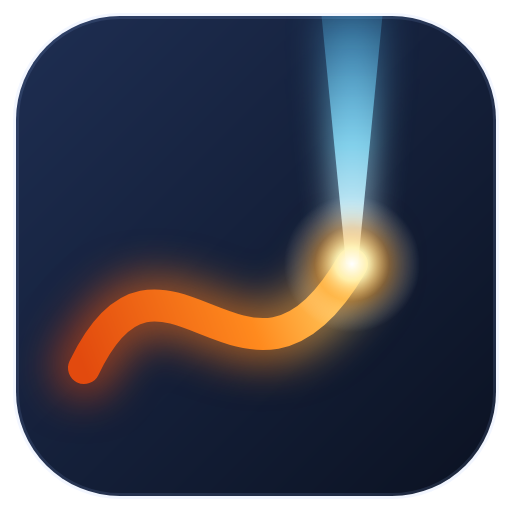

# PhotonCanvas

A free, offline, open replacement for xTool Studio for the **xTool F2 Ultra** laser.
No account, no cloud, no telemetry: designs and jobs stay on your computer and go
straight to the machine over your own network.

> **⚠ Safety and disclaimer: please read**
>
> Lasers can blind you, start fires and release toxic fumes. Never look at the beam or
> its reflections, never leave a job running unattended, ventilate, and only process
> materials you know are safe (no PVC or vinyl).
>
> This is independent hobby software. It is **not made, endorsed or supported by xTool
> or Makeblock**, and using it may affect your machine's warranty. It is provided
> **"as is", without warranty of any kind**. You use it entirely at your own risk; the
> authors are not liable for injury, fire, or damage to your machine, materials or
> property (GPL v3, sections 15–16).
>
> **Lid-open mode** ("Allow starting with the lid open" in Settings → Machine) removes the
> protection the lid gives you. Only turn it on if everyone in the room wears safety
> glasses rated for 455 nm and 1064 nm, and never leave the machine unattended.

## Features

**Design**
- Draw (text, pen, ellipse, rectangle, polygon, star, line), a shape library with your own saved shapes, edit points, group/combine/break apart, weld/subtract/intersect/exclude, offset, grid and circular arrays, nesting onto the bed or a piece, align and distribute, snapping and a configurable grid
- Import SVG, DXF, PDF/AI, xTool `.xs`/`.xcs` and pictures; trace pictures into vectors; remove picture backgrounds (offline)
- Depthmaps for relief engraving with [DepthCharge](#depthcharge), placed straight onto the design
- Serial numbers, dates and spreadsheet (CSV) columns as `{fields}` in any text or code, moving on after each finished run; QR codes, Data Matrix and barcodes (Code 128, Code 39, EAN-13, UPC-A)
- Rounded corners, trim, text on a path, copy along a path, warp (taper, arch, bulge, wave), align by two points, measure, tidy lines from imported drawings (join, close, de-duplicate), select circles by size, lock shapes
- Undo history, a font manager (star and hide fonts), templates, editable keyboard shortcuts

**Layers and materials**
- Layers that cut, score, engrave areas or engrave pictures, with the 40 W diode or the 60 W MOPA; kerf, tabs, overcut, lead-in, step-down per pass, MOPA wobble, focus offset per layer
- Engraving with straight lines or offset (contour) fill; the scan lines can turn on every pass, and from one run to the next, so deep engraving doesn't build up stripes
- Relief from a depth map in slices (dark = deep): the focus can follow the floor down, with cleanup passes of their own settings
- Picture styles: error-diffusion and ordered dithers, halftone, newsprint, line screen and sketch (edges only); dot width correction
- A material and cutting library: settings that worked, with photos and ratings, shared as `.pcmat` files; test grids (power × speed, focus, line spacing, or any two settings) and recording their results
- The MOPA's real limits: the frequency range each pulse width allows, how much power is really available below its full-power frequency, and the frequencies kept out of on highly reflective materials (as the stock software does)

**Colour and light on metal (MOPA)** — see [below](#colour-and-gratings-on-metal)
- Oxide colour tests, measured from close-up camera photos into a palette of the colours your plate really makes; colour pictures in those colours
- Diffraction gratings: grating tests measured from five fixed views, rainbow "shimmer" pictures, hue-as-pitch colour pictures, and an experimental depth-map "almost-hologram"

**Camera**
- The calibrated overview camera under your design at any material height; live view
- The close-up camera in the laser head, on the work area, placed where it really looks once its position is known
- Draw from the camera: fit a design onto a real piece, pick a piece's outline with a magic wand, or trace an edge with a magnetic pen

**The machine and the job**
- Connect, auto-focus, set the focus height, lights, live view, pause/resume/stop
- The job always in view: run order as a timeline sized by time, total time, checks, framing (rectangle or outline), and where the laser is while it runs
- Jobs are generated locally in the same G-code dialect as the stock software, checked line for line against real exports
- Designs bigger than the bed in sections; rotary attachment and conveyor work modes (experimental)
- A G-code console with macros, for advanced use

Jobs are uploaded with `autoStart: 0`: nothing moves or fires until you press the
machine's start button.

## The workspace

- **Ribbon** along the top: Home (clipboard, select, draw, serial & codes, group, shape builder, outline, import),
  Arrange, Picture, Camera, Laser and View. Labels give way to icons when the window is narrow;
  every button has a tooltip. The **File** button holds files, import/export and Settings.
- **Machine**, at the right end of the ribbon: connection status (click it to connect), photo,
  camera picture on/off, live view, close-up, lights, and the focus height (▼ ▲ or type it) with Auto-focus.
- **Layers** on the left, as cards: what each does, how hard and fast, and how long it takes.
- **Right column**: the selection (size, position, angle, text, picture) on top; the active
  layer's settings below.
- **Job bar** under the work area: **Ship It**, Frame, the run order, total time, pass mode,
  checks, and export.
- **Settings** (gear): machine connection and options, camera calibration, libraries, help.

## Colour and gratings on metal

These work with the MOPA on stainless steel (and titanium). Results depend on the plate,
its finish and the focus height, so everything starts from a test on your own plate.

**Oxide colours.** A thin oxide layer's thickness, set by the energy put in, decides the colour.
1. Laser → **Colour test**: a grid sweeping two settings (by default frequency across, power down,
   at 6 ns, 800 mm/s, lines 0.002 mm apart). Focus on the plate first and keep that focus.
2. Laser → **Measure colours**: take a **close-up photo** (the truest colour), set the lights so
   there's no glare stripe, click the four corner squares (named by the labels burned on the plate).
   Big grids can be measured in sections. Save the result as a palette on the material.
3. Picture → **Colour on metal**: the picture in the palette's colours, dithered for the shades
   between, one layer per colour with the settings that made it.

The palette shows how many clearly different colours your plate gives. Colours shift with the
viewing angle; expect tens of usable colours, not a full spectrum.

**Diffraction gratings.** The laser's pulses land a set distance apart (speed ÷ frequency:
300 mm/s at 300 kHz = 1 µm), and a row of them splits light into colours like a grating.
1. Laser → Colour test → **Diffraction gratings** on polished stainless: pitch across, power down.
2. Measure colours in **Gratings** mode: five fixed views (straight, and 45° from each side, the
   lamp kept still). The views play together as an animation (saved as a GIF) and the strongest
   squares are ranked.
3. Picture → **Diffraction**: *Shimmer* (brightness → grating direction), *Colour* (hue → pitch, for
   one viewing angle), or *3D* (a depth map → arcs that seem to float; experimental).

The grating and colour methods follow those published by Ben Krasnow (Applied Science):
[MOPA_Laser_Diffraction_Gratings](https://github.com/benkrasnow/MOPA_Laser_Diffraction_Gratings),
[MOPA_Laser_Stainless_Colors](https://github.com/benkrasnow/MOPA_Laser_Stainless_Colors). PhotonCanvas's
code is its own.

## Getting started

1. Install the [.NET 10 SDK](https://dotnet.microsoft.com/download), then run:
   ```bash
   dotnet run --project src/PhotonCanvas.App -c Release
   ```
2. On first start, read and accept the safety notice.
3. **Connection keys (one-time).** xTool machines expect three fixed codes when a
   program searches for them and pairs with them. They are not included in this
   project. If xTool Studio is installed on your computer, click **Find them in my
   xTool Studio** (Settings → Connection or the welcome screen) and they are read from your own
   copy in a few seconds and saved to `%APPDATA%\PhotonCanvas\keys.json`. You can also point
   it at xTool Studio's `resources\app.asar`, or paste them in; each one is checked
   against a fingerprint. Don't have xTool Studio? Install it, run the setup once, then
   uninstall it.
4. Turn the laser on. PhotonCanvas finds and connects to it (its status shows at the right end of the ribbon); the first time, press
   the machine's button to allow this computer.

The ? menu at the top right → Getting started shows the short tour again.

## DepthCharge

PhotonCanvas can turn a picture into a relief depthmap with **DepthCharge**, a separate
local app that runs depth models (DA3, Depth Pro) on your graphics card. Install DepthCharge
first (its `DepthCharge-Setup.exe`, or a set-up folder in Documents). Then select a picture and
click Picture → **Depthmap** (or right-click it → Depthmap with DepthCharge…). PhotonCanvas starts
DepthCharge in the background if needed, talks to it on 127.0.0.1 only, and stops it again on
exit if it started it. Crops and masks made in DepthCharge's own editor (**Open in DepthCharge**)
are used too. DepthCharge is not part of PhotonCanvas; its models keep their own licences
(Depth Pro is non-commercial research only).

## Where things are kept

Everything lives in `%APPDATA%\PhotonCanvas`: `app.json` (settings, including the close-up
camera's angle and position), `camera.json` (overview camera calibration), `keys.json`
(connection keys), `state.json` (pairing token), `materials\` (the material library: recipes,
colour palettes, grating sets and their photos), `shapes\` (your saved shapes) and `logs\`.

## For developers

```
PhotonCanvas.slnx
src/PhotonCanvas.Core     G-code engine, settings/limits, .xf packaging, camera calibration, picture processing
src/PhotonCanvas.Device   F2 Ultra link: discovery, V2 WebSocket protocol, pairing, upload, camera, connection keys
src/PhotonCanvas.Doc      document model: shapes, layers, undo/redo, imports, tracing, job builder, .pcanvas files
src/PhotonCanvas.App      desktop editor (Avalonia)
tests/PhotonCanvas.Tests  xUnit; sample tests compare against captures/gc when present
src/ytool                 Python protocol prototype (read-only probe; reads the same keys.json)
docs/                     protocol, G-code and file-format notes
```

```bash
dotnet test
```

The tests never need the real connection keys or a machine.

### Ground rules

- `reference/` (gitignored) is for studying xTool Studio's behaviour and formats,
  for interoperability. Never copy its code into `src/` or commit anything from it.
- Never put the connection keys in the source, tests or docs.
- Nothing in the code may move the head or fire the laser without the user asking.

To regenerate `reference/` from your own install:

```bash
R="$LOCALAPPDATA/Programs/xTool Studio/resources"
python -I tools/extract_asar.py "$R/app.asar" reference/app
python -I -c "import zipfile,sys; zipfile.ZipFile(sys.argv[1]).extractall('reference/exts')" "$R/exts.zip"
```

## Licence

GNU General Public License v3 or later: see [LICENSE](LICENSE). You may use, share and
change it; if you distribute a changed version, it must stay under the same licence
with its source available. Third-party components and their licences are listed in
[THIRD-PARTY-NOTICES.md](THIRD-PARTY-NOTICES.md).

xTool is a trademark of its owner, used here only to name the machines this works with.
