# 3D models and stacked slices

**3D to slices** turns a 3D model into flat parts that you cut from sheet material and put back
together into the model: solid layers glued one on another, an open grid of slotted sheets (egg
crate), or fins slotted onto rings (radial). It reads STL, OBJ and STEP files, sizes the model,
slices it to your material's thickness, names and marks every part, and lays the parts out on the
work area a bed at a time.

To carve a 3D model into one board as a relief instead, use **Picture → 3D model**: see
[Pictures](pictures.md).

> **Note:** Edge shaping, egg crate, radial, the cut-test slot fit and slicing onto a material
> outline have not yet been tried on the machine. Cut a small model in scrap first.

## Open the Stacked slices window
<!-- windows: StackSliceWindow -->

Click **3D to slices** on the **Home** tab (in the **Bring in** group). The **Stacked slices**
window opens over the program and stays open until you close it.

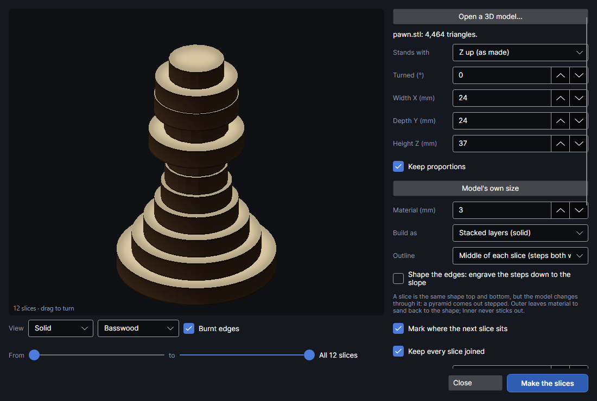

- **Left:** a 3D preview of the parts as they'll be put together, with the view settings under it.
- **Right:** the model, its size, the material, how to build it, and where the parts go. The
  summary at the bottom of this column says what you'll get, and warns about anything that won't
  work.
- **Make the slices** puts the parts on the work area. **Close** (or `Esc`) closes the window.

Every change to the model, its size or how it's built slices it again, in the background, a moment
after you stop changing things.
While it works the summary says "Slicing…" and **Make the slices** is greyed out.

## Open a 3D model

Click **Open a 3D model…**. The model browser opens (below); choose a file there. The line under
the button then says the model's name and how many triangles it has, and the size boxes fill in
with the model's own size.

| File | What's read |
|---|---|
| STL (`.stl`), binary or text | The triangles. One model unit is taken as 1 mm. |
| OBJ (`.obj`) | The corners and faces only (faces with more than three corners are split into triangles). One unit is 1 mm. |
| STEP (`.stp`, `.step`) | The exact shapes from CAD (planes, cylinders, cones, spheres, tori, swept curves, NURBS), turned into triangles within 0.05 mm of the true surface. Assemblies are put together. The file's own units are read and turned into millimetres, so inch files come in at the right size. Nothing else to install. |

- Exported from Fusion, Onshape, SolidWorks or a parts catalogue: use STEP. From a 3D printing
  site or Blender: STL or OBJ.
- If some faces of a STEP file can't be turned into triangles, the line under the button says
  "⚠ N of M faces couldn't be read and are missing", with the reason. Those faces are left out.
- A file that can't be read says "Couldn't read it" and why.
- The model should be closed (watertight), as 3D printing needs: the slicer joins the surface into
  outlines, and a gap in the surface can give a wrong outline. Solids that overlap in the model
  are merged; holes stay holes.

### The model browser
<!-- windows: ModelBrowserWindow -->

**Open a 3D model** shows every STL, OBJ and STEP file in your models folder as a shaded picture,
with its name, type and file size, so you can pick one by sight.

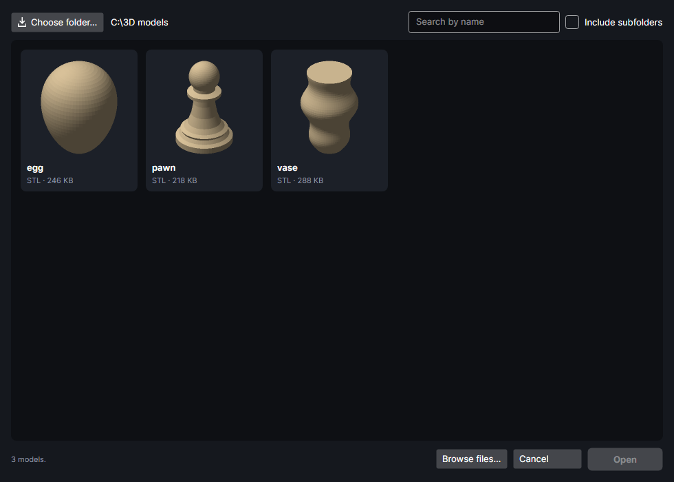

| Control | What it does |
|---|---|
| **Choose folder…** | Pick the folder where you keep your models. It's remembered. The folder's path shows beside the button. |
| **Search by name** | Shows only the models whose file name contains what you type. |
| **Include subfolders** | Also lists the models in folders inside it. |
| A picture | Click to choose it (it's ringed), then **Open**. Double-click opens it straight away. Point at it to see its full path. |
| **Browse files…** | The usual file dialog, for a model somewhere else. |
| **Cancel** | Closes the browser without opening anything. |

- Opening a model also makes its folder the models folder next time.
- The pictures are drawn by the program and kept, so the folder opens instantly the next time.
  A picture is redrawn when its file changes.
- A file it can't draw says "Can't read it". STEP files over 60 MB get no picture, but you can
  still open them.
- Up to 2,000 models are listed, in name order.

## Which way up, and how big

The model is sliced across its **up** direction: each slice is flat, and the stack grows upwards.

| Setting | Range (default) | What it does |
|---|---|---|
| **Stands with** | **Z up (as made)**, **Z down**, **Y up**, **Y down**, **X up**, **X down** (Z up) | Which of the model's axes points up while it's sliced. Most models are made Z up. Choose the way that gives the best slices: a figure standing up, a plaque lying flat. |
| **Turned (°)** | −180 to 180, steps of 15 (0) | Turns the model round the up direction. It changes how the slices lie on the bed (and which way egg crate sheets run), not the model. |
| **Width X (mm)** | 1 to 2000 | Across, left to right, standing the chosen way up. |
| **Depth Y (mm)** | 1 to 2000 | Front to back. |
| **Height Z (mm)** | 1 to 2000 (60 until a model is open) | Up. This sets how many slices there are. |
| **Keep proportions** | on | Change one size and the other two follow. Off, each size stretches or squashes the model on its own. |
| **Model's own size** | | Back to the size the model was made at: one model unit = 1 mm (STL, OBJ), STEP in its own units read as millimetres. |

- Changing **Stands with** or **Turned (°)** changes what X, Y and Z are. With **Keep
  proportions** on, width and depth follow from the height; off, the numbers stay as typed.
- The number of slices is the height divided by the material's thickness, rounded to a whole
  number. The model is fitted to that, so the stack stands slices × thickness tall: up to half a
  slice taller or shorter than **Height Z (mm)**. The summary gives the real height.

## The material

**Material (mm)** (0.3 to 50 mm, default 3) is the thickness of your sheet: one slice per
thickness, and the slot width for egg crate and radial. Use the sheet's real, measured thickness:
every slice is that thick, so an error adds up through the stack.

**Cut with** fills it in from the material library (see
[Using your cut test](#using-your-cut-test-thickness-kerf-and-slot-fit)).

## Build as

**Build as** chooses how the model is made from flat sheets. Only the settings for the chosen way
are shown.

| Choice | What you get | Good for |
|---|---|---|
| **Stacked layers (solid)** (the default) | Flat layers glued one on another: a solid model with stepped sides. | Most models: animals, busts, landscapes, figures. |
| **Egg crate (slotted grid)** | Upright sheets across the model both ways, slotted half-way where they cross so they slide together: an open grid of its shape. | Big models with few parts and little material. |
| **Radial (fins on rings)** | Upright fins round an axis up the middle, slotted onto flat rings at a few heights. | Round things: heads, vases, pumpkins. |

## Stacked layers

Each slice is cut straight through, so it's the same shape top and bottom, but the model changes
shape through the slice's thickness: a pyramid comes out stepped. **Outline** chooses which shape
each slice is cut to.

| **Outline** | How it's worked out | Result |
|---|---|---|
| **Middle of each slice (steps both ways)** (the default) | The model's shape half-way up the slice. | The steps stick out as much as they cut in. |
| **Outer: sand the steps back to the shape** | Everything the model covers anywhere in the slice (five cross-sections through it, combined). | Nothing is missing: sand (or engrave, below) the steps back to the shape. |
| **Inner: nothing sticks out, fill the steps** | Only what the model covers all through the slice (where the five cross-sections overlap). | Nothing sticks out: fill the steps with filler. |

### Shape the edges

**Shape the edges: engrave the steps down to the slope** engraves each slice's top down in steps,
one engrave pass a step, wherever the model slopes away inside the slice. The stack's stair steps
become the model's slopes, with far less sanding. Only for **Stacked layers (solid)**.

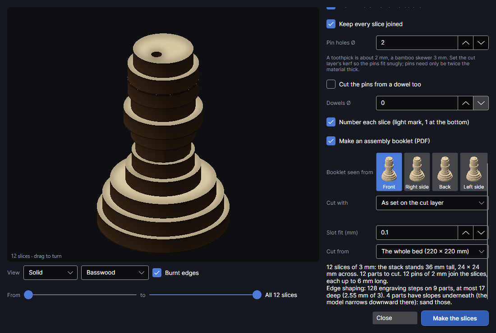

How it works: going down from each slice's top, a step at a time, it takes the model's
cross-section at that depth. Every part of the slice the model doesn't reach at that depth (or
anywhere above it in the slice) is one area to engrave. The areas get smaller as they go deeper,
and each is engraved once, so a spot ends up one step deep for every area it's in. Hairline
slivers are left out, and it never goes deeper than the slice less 0.4 mm, so it can't go
through.

| Setting | Range (default) | What it does |
|---|---|---|
| **Shape the edges: engrave the steps down to the slope** | off | Turns edge shaping on. Turning it on also sets **Outline** to **Outer**, because shaping only takes material away: the slices should start out covering the whole shape. |
| **Engrave with** | Your library's engrave settings that have a measured depth a pass | The settings the steps are engraved with, from the [Etch rate test](materials-and-tests.md) saved to the [material library](material-library.md): shown as "material · settings (0.12 mm a pass)". Choosing one sets **Depth a pass (mm)**. With no results yet it says "No etch-rate results yet". |
| **Depth a pass (mm)** | 0.02 to 2, steps of 0.01 (the first etch result, or 0.15) | How deep one engrave pass goes: the height of one step. |

- Measure the depth a pass first (Laser → **Etch rate**, saved to the library). Until then the
  number is a guess, and the shaping comes out too deep or too shallow; the window says so under
  the settings.
- The summary adds a line: "Edge shaping: N engraving steps on M parts, at most K deep (X mm of
  3)", or that there are no slopes to engrave.
- Engraving only reaches the top. Where the model narrows going down (an overhang, the underside
  of a ball), the steps are underneath: the summary counts those parts, "sand those".
- The steps go on their own layer, **Slices · shaping**, engraved after the marks and before the
  cut (cut parts can shift). Each step is a filled area, one pass. With no etch result chosen,
  that layer gets the default engrave settings: set them yourself.

### Lining the slices up

| Setting | Range (default) | What it does |
|---|---|---|
| **Mark where the next slice sits** | on | Lightly marks the outline of the slice above on each part, where it falls inside the part (at least 0.6 mm in from its edge). Glue the next slice inside the line. |
| **Keep every slice joined** | on | Where the model slopes steeply (a trunk, an ear), two slices can miss each other even though the model is joined. At each place two slices meet, any piece of the model's cross-section they don't already share enough of (6 mm², or most of a small piece) is added to both, so they overlap enough to glue and pin. Sand it back to the shape. The summary counts these "steep spots". |
| **Pin holes Ø** | 0 to 20 mm, steps of 0.5 (2) | Matching holes wherever a part sits on the one below, for short pins (toothpicks, skewers, brads) that line them up. Two pins, well apart, where there's room (that stops the parts turning), else one. Placed where the slices around them hide the holes when they can, clear of the part's edges, of the pin holes already in it and of the dowel holes, with a wall of material between. The pins need only be twice the material's thickness long; the summary says how many. 0 = none. |
| **Cut the pins from a dowel too** | off | Shown when **Pin holes Ø** is above 0. Also makes a page with a cutting job for the pins: lay a long dowel in the machine and cut every pin the slices need in one go. See [Cutting the pins from a dowel](#cutting-the-pins-from-a-dowel). |
| **Dowel Ø (mm)** | 0.5 to 20 mm (follows **Pin holes Ø**) | The dowel's diameter, measured with calipers. It follows the pin holes until you change it; if the two differ, the note under the preview warns that the pins won't fit snugly. Each cut line is 1.2 times this long, so it goes right across a dowel lying a little off the line. |
| **Dowel length (mm)** | 10 to 2000 mm (300) | How long your dowel is. Only as much as fits along the bed's long side (inside 10 mm margins: 200 mm on the F2 Ultra) is cut in one go. |
| **Pins shorter by (%)** | 0 to 40 % (15) | A pin goes through two slices. Cutting it this much shorter means it never stops them closing up, even with a drop of glue in the hole: 3 mm slices and 15 % make 5.1 mm pins. |
| **Spare pins (%)** | 0 to 100 % (10) | Extra pins on top of the ones the holes need, rounded up, for the ones that roll away or break: 21 holes and 10 % make 24 pins. |
| **Cut the dowel with** | As set on the pins' cut layer | Cut settings from your library for the dowel's wood. A dowel is as thick as it is wide, so it needs settings that cut that deep. The recipe's kerf is allowed for in the spacing between cuts (0.2 mm when there's none). |
| **Dowels Ø** | 0 to 20 mm, steps of 0.5 (0) | Two holes through every slice, as far apart as they fit, for long dowels through the whole stack. Only where every slice has room (1.5 mm round each hole); otherwise the summary says "No room for dowel holes in every slice". 0 = none. |
| **Number each slice (light mark, 1 at the bottom)** | on | Marks each part with its label, at the spot furthest from its edges and holes, as large as fits (up to 6 mm). The label is the slice number, 1 at the bottom; where a slice is in several pieces, each gets a letter too (3a, 3b, 3c…), lettered left to right as the model stands, so no two parts share a label. A number that reads as another one upside down gets a dot after it (6., 9., 16.), because the parts are turned round on the bed. Parts too narrow for a label get none. |

A toothpick is about 2 mm, a bamboo skewer 3 mm. Set the cut layer's **Kerf (mm)** (see
[Layer settings](layer-settings.md)) so the holes come out at their size and the pins fit snugly.

### Cutting the pins from a dowel

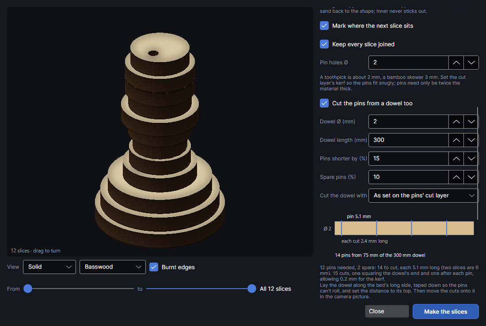

Tick **Cut the pins from a dowel too** and the slicer works out the pins as well as the holes. The
picture under the settings shows the first few pins on the dowel, with the cut lines across it, the
pin length, the dowel's width and each cut line's length written on it, and how much of the dowel
the pins use. The note under it spells it out: how many pins the holes need, how many spares, how
long each is, and how many cuts (one squaring off the dowel's end, then one after each pin).

When you click **Make the slices**, a page of its own called "*model* pins" goes after the slices'
pages. On it, the dowel is drawn on the **Material** layer (grey, never sent) along the bed's long
side, and the cut lines are on a cut layer called **Pins · cut**, all grouped. To cut them:

1. Lay the dowel along the bed's long side and tape it down at both ends, so it can't roll and the
   pins can't jump about once they're free.
2. Set the distance to the dowel's top, not the bed.
3. Move the group onto the dowel in the camera picture (the grey outline over the dowel).
4. Give **Pins · cut** settings that go through the dowel's whole thickness, or choose them in **Cut
   the dowel with** before making.

Warnings in the note:

- **Only N fit along the bed**: the dowel is longer than the bed. Run the job, slide the dowel along,
  move the first cut onto its new end and run it again.
- **The dowel makes only N of the M**: the dowel is too short for every pin and spare. Cut the rest
  from another dowel, or ask for fewer spares.
- **The dowel is X mm but the pin holes are Y mm**: set **Pin holes Ø** to the dowel's size.

The job hasn't been tried on the machine yet. Round stock cuts deepest through its middle, so
check the first cut goes all the way through before leaving it to run.

### What the slicer leaves out and warns about

- **Slivers:** pieces smaller than 1 mm², or narrower than 1 mm, are too small to cut or handle and
  are left out. The summary counts them.
- **Slices in several pieces:** where the model branches (an animal's legs), a slice is several
  parts, each labelled with its slice and a letter: 3a, 3b and so on, left to right.
- **Parts in mid-air** (red in the preview): a part that isn't joined, through the slices, to
  anything on the bottom slice starts with nothing under it. It's a separate piece of the model:
  glue it on by eye, or leave it out. The summary warns about them.

## Egg crate

Upright sheets across the model both ways, slotted half-way where they cross, so they slide
together into an open grid of the model's shape. Few parts, little material. Not yet tried on the
machine.

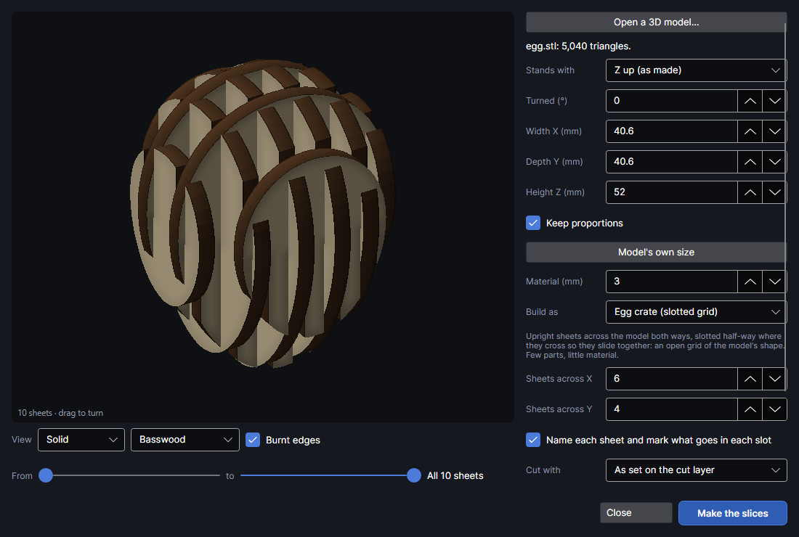

| Setting | Range (default) | What it does |
|---|---|---|
| **Sheets across X** | 1 to 60 (6) | Sheets standing across the model's width, evenly spaced (none on the very ends). Named X1, X2, … |
| **Sheets across Y** | 1 to 60 (4) | Sheets standing across its depth. Named Y1, Y2, … |
| **Name each sheet and mark what goes in each slot** | on | Each sheet's name on it, and beside each slot the name of the sheet that goes in it. |

- Each sheet is the model's cross-section in that upright plane. Where it falls into separate
  pieces, they're named X3a, X3b and so on. Pieces under 4 mm² are left out.
- Where two sheets cross, the X sheet is slotted from its top edge down to half-way and the Y sheet
  from its bottom edge up to half-way. So the Y sheets go on from above, onto the X sheets standing
  on the table, as the summary says.
- Slots are the material's thickness plus **Slot fit (mm)** wide (see
  [Using your cut test](#using-your-cut-test-thickness-kerf-and-slot-fit)).
- Where two sheets overlap by less than twice the slot width plus 2 mm, no slot is cut there.
- **Turned (°)** turns which way the sheets run across the model.

## Radial

Fins standing round an upright axis through the middle, slotted onto flat rings at a few heights.
Best for round things. Not yet tried on the machine.

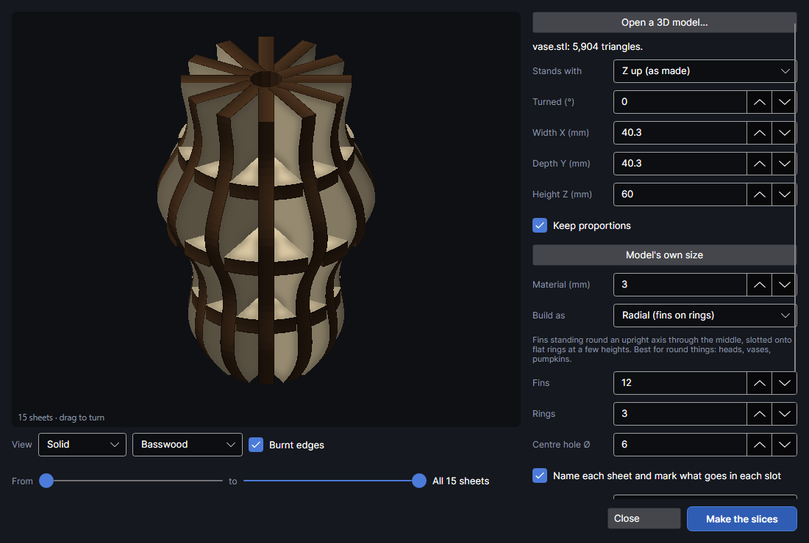

| Setting | Range (default) | What it does |
|---|---|---|
| **Fins** | 3 to 72 (12) | Fins round the axis, evenly spaced. Each is the model's outline on one side of the axis. Named Fin 1, Fin 2, … |
| **Rings** | 1 to 20 (3) | Flat rings at even heights that hold the fins (3 rings sit at a quarter, half and three quarters of the height). Each is the model's cross-section at that height. Named Ring 1, Ring 2, … |
| **Centre hole Ø** | 0 to 50 mm, steps of 0.5 (6) | A hole up the middle of the rings, for a dowel; the fins start at the hole's edge (half the diameter out from the axis). 0 = none. |
| **Name each sheet and mark what goes in each slot** | on | As for egg crate. |

- The axis runs up through the middle of the model's footprint, as it stands.
- At each ring, a fin is notched from its inner edge (by the axis) out to half-way, and the ring is
  slotted from its outer edge in to half-way. So each fin goes on from the side, pushed in towards
  the axis, its notches taking the rings, as the summary says.

## Using your cut test: thickness, kerf and slot fit

The [Cut test](materials-and-tests.md) finds the settings that cut your material, then measures the
kerf (the width the beam burns away) and the slot fit at those settings, and saves them with the
material in the [material library](material-library.md). The slicer can take all of it. Not yet
tried on the machine.

| Setting | Range (default) | What it does |
|---|---|---|
| **Cut with** | **As set on the cut layer**, or any cut settings in your library | The settings the parts are cut with, shown as "material · settings (fit +0.1 mm)". Choosing one sets **Material (mm)** to the material's thickness (when the library has it) and **Slot fit (mm)** to the fit your cut test found; the line under it says what came with it. When you make the slices, its settings, kerf included, go on the **Slices · cut** layer. **As set on the cut layer** leaves that layer's settings as they are (a new **Slices · cut** layer has the default cut settings). |
| **Slot fit (mm)** | −0.5 to 1, steps of 0.05 (0.1) | Egg crate and radial only: slots are the material's thickness plus this. Raise it if the sheets won't go together, lower it if they're loose. |

- The cut layer's kerf counts too: with **Kerf (mm)** set, outlines are moved out by half of it, so
  parts come out at their drawn size and slots and holes stay true.
- A **Slot fit (mm)** below 0 cuts the slots narrower than the material, for when the cut layer
  has no kerf set and the beam's width opens them up. They're never cut narrower than half the
  material's thickness.
- If the parts take more than one bed, each page has its own layers; **Cut with** sets the
  **Slices · cut** layer on every page the slices went on.

## Where the parts go

**Cut from** chooses where the parts are laid out:

- **The whole bed (220 × 220 mm)**: the work area, on as many pages as it takes.
- **Material · name · size**: a material outline on this page: the board actually in the
  machine. Outline it first (draw it, or **Pick piece** on the camera picture), then right-click it
  and choose **Use as material outline**: it moves to the **Material** layer, which is shown but
  never sent. See [Arranging](arrange.md) and [Camera](camera.md).
- **All N material outlines**: every outline on the page together, when there's more than one.

When the page has one material outline, it's chosen to start with; with several, **All N
material outlines** is. On an outline, the parts fill it around anything already on the page, and
holes in it (a knot, a cut-out) are kept clear. Further boards go on new pages with the same
outline: another board the same size, in the same place. Slicing onto a material outline has not yet been tried on the
machine.

Before you make the slices, the biggest part (with 3 mm round it, a quarter turn allowed) is
checked against the bed or the biggest piece of the chosen outline. If it doesn't fit, the summary
says "⚠ The biggest slice (W × H mm) doesn't fit on the bed" (or "the material"; for egg crate
and radial, "The biggest sheet"): make the model smaller.

## The preview

The preview shows the parts in 3D as they'll be put together: slices stacked, or sheets standing
in place. Drag it to turn it round.

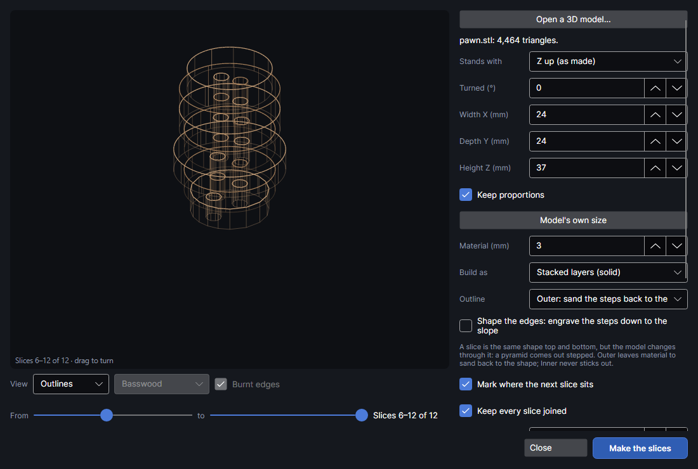

| Control | What it does |
|---|---|
| **View**: **Solid** or **Outlines** | **Solid**: shaded, in the chosen material, nearer parts hiding farther ones. **Outlines**: see-through outlines, alternate slices in two tones. |
| Material: **Basswood**, **Birch plywood**, **Walnut**, **MDF**, **Cardboard**, **White acrylic**, **Black acrylic** | How the solid view looks: the colour of the faces and edges, glue lines between slices, plies in plywood and card. Only the look: it changes nothing that's cut. |
| **Burnt edges** (on) | Shows the cut edges as they come off the laser: charred dark, darkest at the top where the beam comes in, with a little smoke beside them. Acrylic doesn't char, so it's greyed out for acrylic and in **Outlines**. |
| **From** … **to** | Shows only a range of slices (or sheets) to look inside: 1 is the bottom slice. The two sliders never cross. Beside them: "All 20 slices" or "Slices 5–9 of 20". |

Parts in red start in mid-air (see above).

## Make the slices

**Make the slices** is ready once the model is sliced and every part fits. The summary above it
says what it'll make:

- **Stacked:** how many slices of what thickness, how tall the stack stands and how wide, how many
  parts to cut; then slivers left out, steep spots widened, parts in mid-air, pins and dowels, and
  edge shaping.
- **Egg crate and radial:** how many sheets, the overall size, how many crossings and how wide the
  slots are, how they go together, and tiny pieces left out.

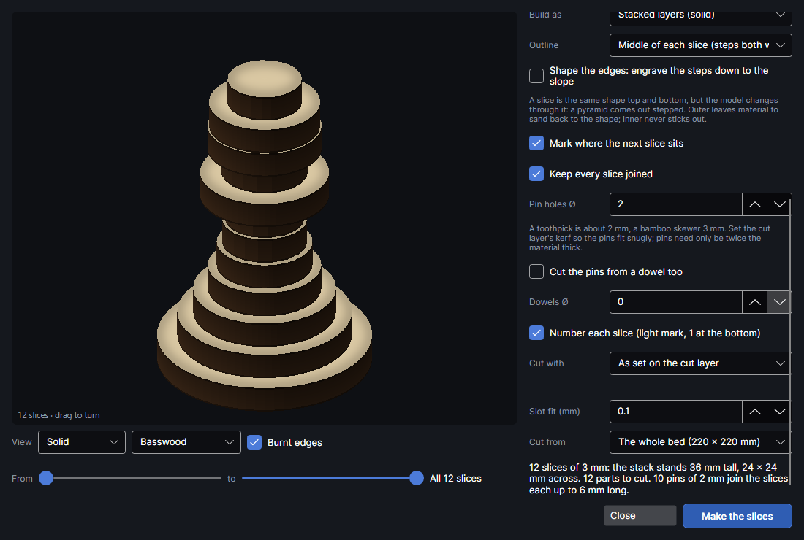

Clicking it lays every part out on the work area. The window stays open and the summary says how
many parts went on how many beds. It's one step: `Ctrl+Z` takes it all back. Clicking it again
makes another set.

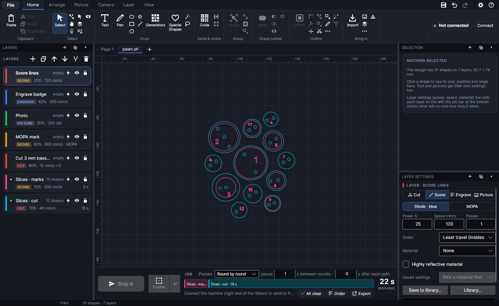

The parts go on three layers of their own (made if they aren't there yet), in the order they run:

| Layer | Mode | What's on it |
|---|---|---|
| **Slices · marks** | Score, at most 15 % power | Numbers, sheet names, slot names and where-the-next-slice-goes lines: light marks, done before anything is cut. |
| **Slices · shaping** | Fill, one pass | The edge-shaping steps (only with **Shape the edges** on). |
| **Slices · cut** | Cut | The parts' outlines, holes and slots. |

- **Groups:** each part is grouped with its marks, so it moves as one. Parts are named after their
  label, "Slice 4" or "Slice 4b" (or X3, Fin 2, Ring 1); shaping steps "Slice 4b · step 2"; marks
  "Where slice 5 goes".
- **Nesting:** the parts are packed by their true shape, biggest first, with quarter turns and
  small parts in the gaps, 3 mm apart and 3 mm from the edge, starting in the middle of the bed
  (or material) and working outward, to fill each bed before starting the next.
- **Pages:** with **The whole bed**, if the current page already has something on it, the parts
  start on a new page named after the model. Parts that don't fit go on further pages ("model 2",
  "model 3"…): the tabs above the work area (see [The workspace](workspace.md)). Each page is a
  job of its own.
- A part bigger than the bed stops it with "… bigger than the bed. Make the model smaller."

Before you send it, check the **Slices · cut** layer's settings and **Kerf (mm)** (see [Layer
settings](layer-settings.md)), and the marks layer's power on your material.

## The assembly booklet

**Make an assembly booklet (PDF)** (on; stacked layers only) also writes step-by-step instructions
for putting the slices together, laid out like a building-set manual, when you click **Make the
slices**. Print it, or keep it open on a tablet beside the glue.

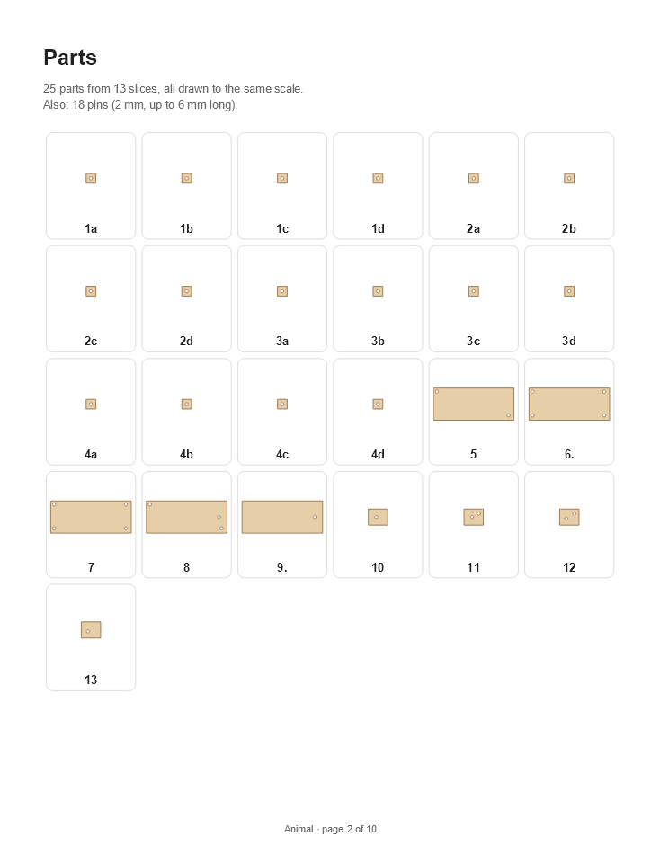

| Page | What's on it |
|---|---|
| Cover | The model's name, the finished stack, how many slices and parts, its size, and what else you need: pins (how many, how thick, how long), dowels, glue. |
| Parts | Every part, flat, all to the same scale, with its label, slice by slice. Parts that start in mid-air are red. |
| Steps | One step per slice, from the bottom up, two to a page. |
| Finished | The whole model, and what to do last: sand the steps back (**Outer**), fill them (**Inner**), or sand or leave them (**Middle**). |

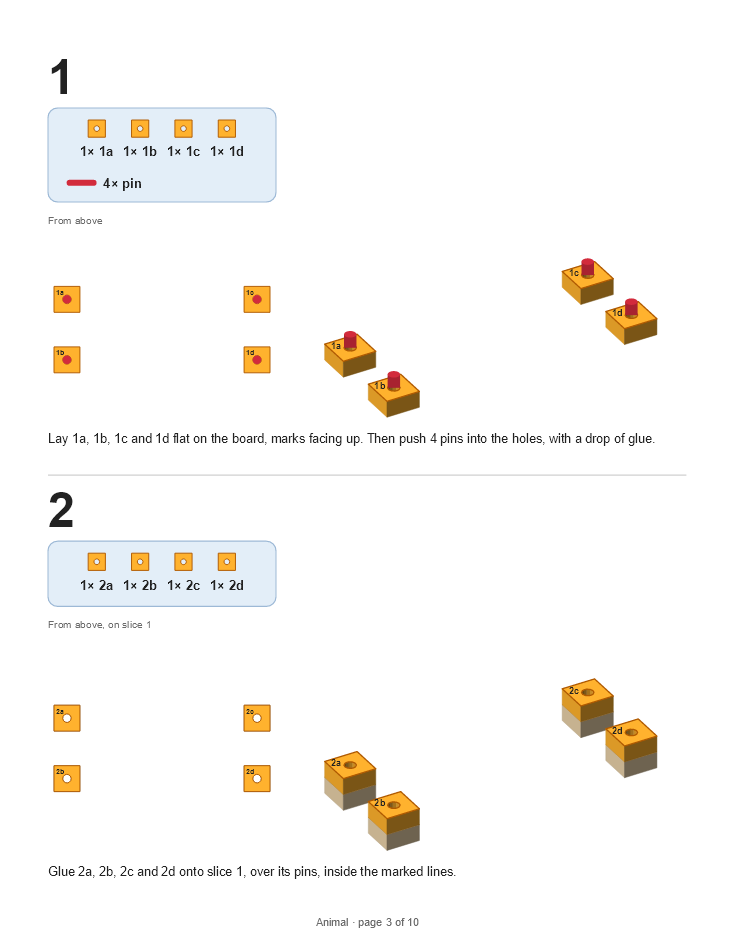

Each step shows:

- **The step number**, the same as the slice number.
- **A blue box** with the parts to add (drawn flat, with their labels: "1× 3a"), and how many pins
  go in at this step.
- **From above:** the slice below in grey, with the new parts on it in colour where they go, their
  labels, and red dots where the pins go in.
- **The stack so far**, always from the same angle and at the same size, the slices already glued
  in wood colour and the new parts in orange with their labels, and the pins standing in their
  holes, ready for the next slice.
- **What to do**, in words: "Glue 3a and 3b onto slice 2, over its pins, inside the marked lines.
  Then push 2 pins into the holes, with a drop of glue."

Where it's saved: next to your design, as "*model* assembly.pdf", once the design has been saved
(**File → Save**); until then, in the **Booklets** folder of the program's data folder
(`%USERPROFILE%\PhotonCanvas\Booklets` on Windows). Making the slices again replaces it. The summary
says where it went and how many pages it has, and **Open the booklet** opens it in your PDF viewer.
If it's open in a viewer that locks it, the summary says it couldn't be saved: close it there and
make the slices again.

- The pages are US Letter, with margins wide enough to print on A4 too.
- With **Cut the pins from a dowel too** ticked, the cover gives the pins' real length.
- Egg crate and radial get no booklet: their slot names say what goes where.

## Putting it together

- **Stacked:** follow the assembly booklet, or start with slice 1 and glue each slice on the one below, numbers in order, inside
  the marked line. Pins or dowels through the holes line them up. Then sand back what sticks out
  (with **Outer**) or fill the steps (with **Inner**), and sand any steep spots and undersides the
  summary mentions.
- **Egg crate:** stand the X sheets up and lower the Y sheets onto them; the names beside each slot
  say which sheet goes there.
- **Radial:** put the rings on a dowel through their centre holes (if you made them) at their
  heights, then push the fins in towards the axis; each notch is marked with the ring it takes.

## Limits

- Every part must fit on the 220 × 220 mm bed with 3 mm round it. Make the model smaller, or
  split it in your 3D program.
- Slices are flat, so a stack is stepped. **Outline** chooses how; **Shape the edges** engraves
  the steps away on slopes that face up, not on undersides.
- STL and OBJ files don't say their units: one unit is taken as 1 mm. A model made in inches or
  metres comes in at the wrong size: type the size you want.
- The material's real thickness matters: an error repeats in every slice.
- Edge shaping, egg crate, radial, the slot fit and material outlines haven't been tried on the
  machine yet.

## Try it

- [Slice a 3D model into stacked layers](tutorial:3d-stacked-slices)
- [Line the slices up: numbers, marks, pins and dowels](tutorial:3d-assembly)
- [Make an assembly booklet for the slices](tutorial:3d-booklet)
- [Shape the edges with engraved steps](tutorial:3d-edge-shaping)
- [Use your cut test on the slices](tutorial:3d-cut-test-results)
- [Build a model as an egg crate](tutorial:3d-egg-crate)
- [Build a round model with radial fins](tutorial:3d-radial)
- [Slice onto the board in the machine](tutorial:3d-material-outline)
