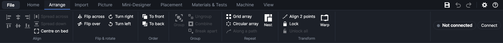
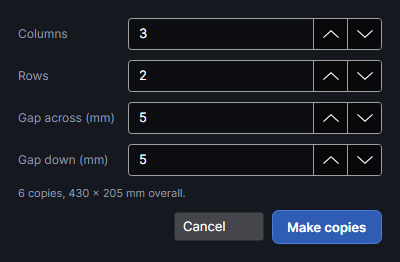
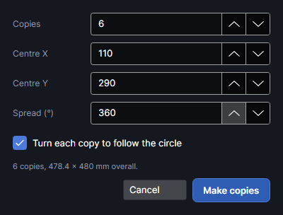
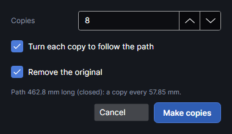
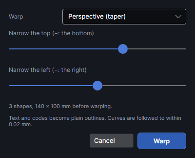
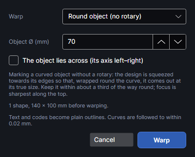
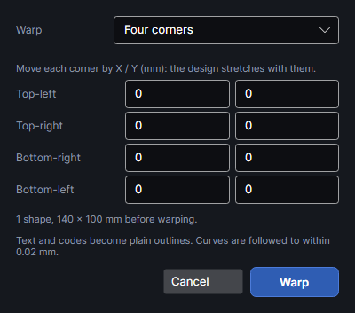

# Arranging

The **Arrange** tab places shapes: it lines them up and spaces them, flips and turns them, sets
which lies on top, packs parts onto the material, repeats them in grids, circles and along paths,
bends them, and locks them in place. Select the shapes first; a button stays grey until the
selection suits it. Every change is one undo step: `Ctrl+Z` takes it back. Most of these are also
on the right-click menu (**Align and distribute**, **Flip and rotate**, **Order**, **Array**).

Positions are in millimetres on the work area: X from its left edge, Y down from its top edge.
The F2 Ultra's work area is 220 × 220 mm.

## Align

### Align edges and centres

Select two or more shapes, then click one of the six align buttons: the icons at the left of the
tab (their names show when you hover over them). Each lines the shapes up against the box round
everything selected, so the outermost shape stays where it is.

| Button | Moves each shape so that |
|---|---|
| **Align left edges** | its left edge is on the selection's left edge |
| **Align centres horizontally** | its centre is level, left to right, with the middle of the selection (one above the other) |
| **Align right edges** | its right edge is on the selection's right edge |
| **Align top edges** | its top edge is on the selection's top edge |
| **Align centres vertically** | its centre is level, top to bottom, with the middle of the selection (side by side) |
| **Align bottom edges** | its bottom edge is on the selection's bottom edge |

- Only one direction changes: aligning left edges moves nothing up or down.
- Each shape moves on its own, even inside a group: the shapes of a group end up lined up with each
  other too. Undo and leave the group out of the selection if that isn't what you want.

### Spread across and spread down

**Spread across** and **Spread down** space three or more shapes evenly. The two outermost stay
where they are, and the ones between move so the gaps between neighbours are equal (the gaps, not
the distances between centres). **Spread across** works left to right, **Spread down** top to
bottom. A group counts as one item.

### Centre on bed

**Centre on bed** moves the selection, as a whole, so the middle of the box round it is the middle
of the work area (110, 110 mm on the F2 Ultra; the chosen machine's work area otherwise). The Selection panel's **Centre in work area** does the same.

## Flip and rotate

| Button | Does |
|---|---|
| **Flip across** | Mirrors the selection left to right. |
| **Flip over** | Mirrors it top to bottom. |
| **Turn right** | Turns it 90° clockwise. |
| **Turn left** | Turns it 90° counter-clockwise. |

- The whole selection flips or turns together, about the middle of the box round it.
- Text stays editable text, mirrored or turned. Pictures flip and turn too.
- For other angles, type one in **Angle °** in the Selection panel, or drag the selection's rotate
  handle ([Working on the canvas](canvas.md)).
- Flip across is how you engrave the back of clear acrylic or glass so it reads the right way from
  the front.

## To front and to back

Shapes are kept in an order: the ones added later come after the earlier ones. **To front** moves
the selected shapes to the end of that order, **To back** to the start. The order decides:

- which shape is "the bottom one": the shape **Subtract** cuts the others from, and whose layer
  the results of **Combine**, **Weld** and the other shape builders go on
  ([Editing shapes](editing-shapes.md));
- the cut order on a layer whose **Order** is **As drawn** ([Layer settings](layer-settings.md)).

## Material outline

To nest onto the board actually in the machine (an offcut, a board with a knot in it), outline it
first: draw round it, or click it with **Pick piece** on the camera picture
([Drawing](drawing.md), [Camera](camera.md)). Then right-click the outline and choose **Use as
material outline**.

The outline moves to a layer called "Material" (made if the page has none: grey, output off, so it
is shown but never sent to the laser). **Sheet** in the Nest window then starts on it, and
**3D to slices** fills it too ([3D models and stacked slices](3d-slices.md)). A hole in the outline
(a knot, a cut-out) is kept clear.

- The outline must be a closed shape; text can't be one. Outlines whose box is 25 mm² or less
  (5 × 5 mm) are ignored.
- Not yet tried on the machine with a real offcut.

## Arrays

<!-- windows: ArrayWindow -->

**Grid array** and **Circular array** make copies of the selection in rows and columns, or round a
centre. The copies show on the work area as you change the numbers. **Make copies** keeps them
(the originals and the copies are then selected); **Cancel** removes them. Copies of a group are
new groups; the copies aren't grouped with each other. The line under the settings says how many
there are (the original included) and how big the whole set is.

To make each copy mark the next serial number or spreadsheet row, select them and click **Number
copies** on the Home tab ([Drawing](drawing.md)).

### Grid array

| Setting | What it does |
|---|---|
| **Columns** | 1–500, default 3. |
| **Rows** | 1–500, default 2. |
| **Gap across (mm)** | The space between copies side by side (not the distance between their starts), −1000 to 1000, default 5. A negative gap overlaps them. |
| **Gap down (mm)** | The same between rows, default 5. |

The original stays as the top-left copy; the others go to the right and downwards.

### Circular array

| Setting | What it does |
|---|---|
| **Copies** | The total, the original included: 2–1000, default 6. |
| **Centre X**, **Centre Y** | The point the copies go round, in mm on the work area. It starts below the selection, as far below its bottom edge as the selection's longer side, so the copies make a ring. |
| **Spread (°)** | −360 to 360, default 360. 360 spreads the copies evenly all the way round; less makes an arc from the original, the last copy at that angle. Positive goes clockwise, negative counter-clockwise. |
| **Turn each copy to follow the circle** | Ticked (default): each copy turns with its place on the circle, like spokes. Unticked: the copies move round without turning. |

## Along a path

<!-- windows: CopyAlongWindow -->

**Along a path** spaces copies of the selection evenly along a line or round a shape's outline:
beads along a curve, holes round a rim, a border of motifs. Select what to copy and the path
together: the longest selected line or outline is taken as the path (never a text or code), and
everything else is copied as one.

| Setting | What it does |
|---|---|
| **Copies** | 1–5000, default 8. Along an open line they go from one end to the other (a single copy goes in the middle); round a closed outline, evenly all the way round. |
| **Turn each copy to follow the path** | Ticked (default): each copy turns with the path's direction. Unticked: they all keep the original's angle. |
| **Remove the original** | Ticked (default): only the copies are left. |

The line under the settings gives the path's length, whether it's open or closed, and the distance
between copies. **Make copies** keeps them (they're then selected); **Cancel** removes them.

- Each copy is centred on its point of the path.
- Only the path's first outline is used.
- The path stays. Delete it, or move it to a layer whose output is off, if it shouldn't be marked.
- If what you copy is longer than the path, it's taken as the path instead: make sure the path is
  the longest thing selected.

## Warp

<!-- windows: WarpWindow -->

**Warp** bends the selected shapes, all together: a taper, an arch, a bulge, a wave, a correction
for marking round objects, or the four corners moved freely. The result shows on the work area as
you change it. **Warp** keeps it; **Cancel** puts the shapes back.

Choose the kind under **Warp**. The sliders run from −100 to 100.

| Warp | Settings | What it does |
|---|---|---|
| **Perspective (taper)** | **Narrow the top (−: the bottom)** (default 30), **Narrow the left (−: the right)** (default 0) | Narrows one side so the design tapers, as if seen at an angle. At the far right of the first slider the top is a tenth of its width. |
| **Arch** | **Arch up (−: down)** | Bends the design into an arch: the middle rises by up to half the design's height, the left and right ends stay put. |
| **Bulge or pinch** | **Bulge (−: pinch)** | Swells the middle up to 1.5 times (or pinches it to half), leaving the edges. |
| **Wave** | **Wave height**, **Waves across** (0.5–20, default 2) | Ripples it up and down, by up to a quarter of its height. |
| **Round object (no rotary)** | **Object Ø (mm)** (5–500, default 70), **The object lies across (its axis left–right)** | For marking a mug, pen or bottle lying on the bed without a rotary: the design is squeezed towards its edges so that, wrapped round the curve, it comes out at its true size. Keep it within about a third of the way round; focus is sharpest along the top. Unticked, the object's axis runs up and down the work area. |
| **Cone (tapered tumbler)** | **Top Ø**, **Bottom Ø** (5–500 mm, defaults 80 and 65) | For tapered tumblers and cups marked from above: each row of the design is corrected for the diameter at its height, so it wraps at its true size. |
| **Four corners** | X and Y for **Top-left**, **Top-right**, **Bottom-right** and **Bottom-left** (−500 to 500 mm) | Moves each corner of the box round the design by the amounts typed; everything in between stretches in proportion. |

- The warp works on the box round all the selected shapes; the line under the settings gives how
  many shapes there are and their size before warping.
- Text, codes and editable shapes become plain outlines. Curves are followed within 0.02 mm.
- Pictures aren't warped.
- Each shape keeps its layer and group; hand-placed tabs and start points are dropped.

## Align 2 points

**Align 2 points** is a tool that moves and turns the selection so that two points on it land on
two other points: line one part's edge up with another's, or put a design onto a piece by two of
its corners in the camera picture.

1. Select what to move, then click **Align 2 points**.
2. Click a first point on the selection, then a second.
3. Click where the first point should go, then where the second should go.

The selection moves so the first point lands exactly on its target, and turns so the line between
its two points lies along the line between the two targets. Its size doesn't change, unless you
hold `Shift` on the last click: then it's also resized (the same across and down) so the second
point lands exactly too. The status bar says how far it turned and how much it was resized.

- Clicks snap to the corners and ends of shapes on visible layers when you're near one; otherwise
  the usual snapping applies.
- The points are marked 1, 2, 1→ and 2→ as you click them.
- The tool stays on for another go; `Esc` goes back to **Select**.

## Lock and unlock

**Lock** (`Ctrl+Alt+L`) fixes the selected shapes where they are: on the work area they can't be
clicked, box-selected or dragged, and **All** (`Ctrl+A`) leaves them out. They're still marked
when the job runs. Use it for a jig outline or a finished part of the design you don't want to
knock by accident.

**Unlock all** (`Ctrl+Alt+Shift+L`) unlocks every locked shape and selects them.

- In the Layers panel a locked shape has a lock button beside it: click it to unlock just that one.
  Right-clicking a locked shape there gives **Unlock** too.
- A locked shape can still be selected by clicking it in the Layers panel; commands and the
  arrow keys then act on it.
- To lock everything on a layer, lock the layer instead ([Layers](layers.md)). More in
  [Working on the canvas](canvas.md).

## Try it

- [Line shapes up](tutorial:arr-align)
- [Space shapes evenly and centre them](tutorial:arr-spread)
- [Flip and turn](tutorial:arr-flip-rotate)
- [To front and to back](tutorial:arr-order)
- [Grid array](tutorial:arr-grid-array)
- [Circular array](tutorial:arr-circular-array)
- [Copies along a path](tutorial:arr-along-path)
- [Warp a design](tutorial:arr-warp)
- [Align by two points](tutorial:arr-align-2-points)
- [Lock shapes in place](tutorial:arr-lock)
