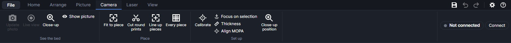
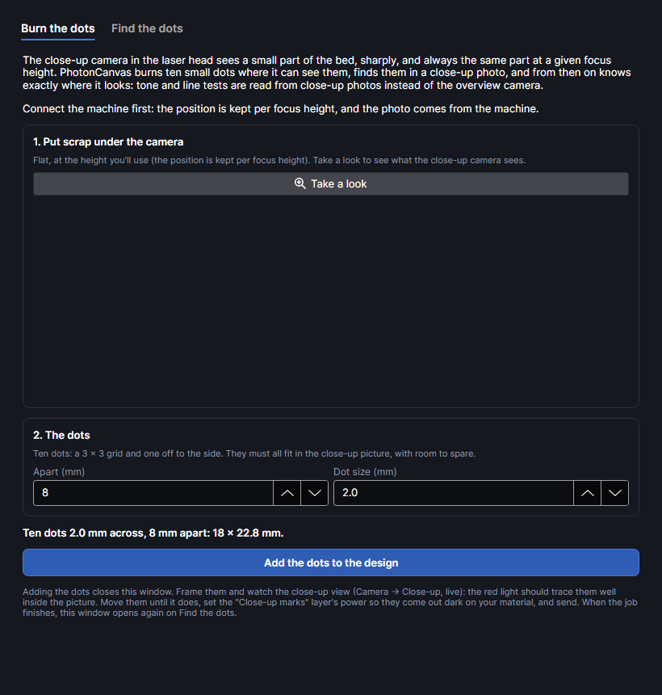
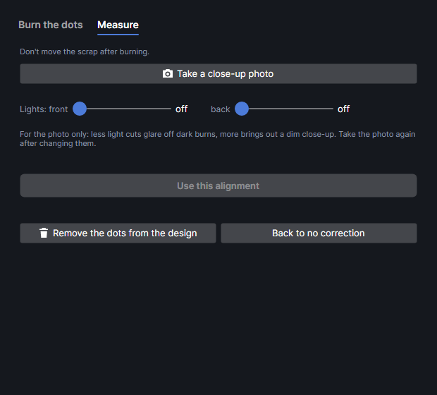
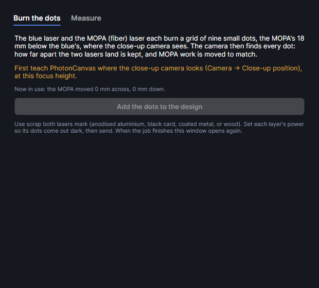

# Camera

The F2 Ultra has two cameras, and PhotonCanvas uses both:

- **The overview camera** looks down on the whole bed from above. Once it's calibrated, its photo is
  straightened and laid under your design at true size: you see where the design will land on the
  material, and PhotonCanvas can fit designs to pieces and find pieces on the bed.
- **The close-up camera** sits in the laser head, beside the red pointer. It sees a smaller part of
  the bed, turned at an angle, but far more sharply (about 27 pixels per mm in the middle of its
  picture). It reads tests, finds burned dots, measures heights with the red pointer and lines the
  MOPA up with the blue laser.

Both take 4000 × 3000 photos. This firmware has no video stream, so "live" means photos taken one
after another, as fast as the machine allows. Both cameras are dark while a job runs: the machine
turns its lights off.

Everything on the **Camera** tab needs the machine connected (see
[The machine and settings](machine.md)). The one exception is the calibration window, which can
work from a photo saved earlier.

The camera picture itself is worked from the machine panel at the right end of the ribbon, on every
tab: **Photo**, **Show**, **Live** and **Close-up** (see [The machine and settings](machine.md)).

| Group | Buttons |
|---|---|
| **Place** | **Fit to piece**; add-ons add **Cut round prints** and **Every piece** (Camera placement) and **Line up pieces** (Split onto pieces) |
| **Set up** | **Calibrate**, **Focus on selection**, **Thickness**, **Align MOPA**, **Close-up position** |

## What each one needs

| Feature | Needs |
|---|---|
| **Show**, **Photo**, **Live** on the work area | Connected; the camera calibrated (**Calibrate**) |
| **Close-up** | Connected. Laying its photo on the work area also needs **Close-up position** at the current focus height |
| **Fit to piece**, **Every piece** | Connected; the camera calibrated near the piece's height; the design selected |
| **Line up pieces** | Connected; the camera calibrated near the pieces' height; a piece's page from **Split onto pieces** (both from the Split onto pieces add-on) |
| **Cut round prints** | Connected; the camera calibrated, or **Close-up position** covering the area |
| **Focus on selection** | Connected; focused once; the red pointer calibrated (Laser tab → **Curved surface**) |
| **Thickness** | Connected |
| **Align MOPA** | Connected; **Close-up position** at the current focus height |

On a new machine, do **Calibrate** first, then **Close-up position**. Each takes a few minutes and
a piece of scrap.

## The camera picture under your design

### How it lines up

The overview camera sees the bed at an angle, through a wide lens. **Calibrate** measures both from
25 marks burned across the bed: a perspective map, plus a lens correction. Every photo is then
straightened onto the 220 × 220 mm work area (0.2 mm per pixel) and drawn under your design. Where
the camera can't see, the picture is see-through.

The picture is only true at the height it was calibrated for: the top of a 10 mm board is 10 mm
nearer the camera, and shows up shifted. So each calibration belongs to a focus distance, and
PhotonCanvas uses the one that fits the machine's current focus (shown as **Focus** at the right
end of the ribbon):

| Calibrations you have | What's used at the current focus |
|---|---|
| One within 0.25 mm of it | That one, as it is. |
| Only one, at another height | That one anyway. Within 1 mm it counts as close enough; further away you're told to calibrate a second height. |
| Two or more | A map worked out for this height: a straight line between two calibrations, a smooth curve through three or more. Trusted up to 5 mm beyond the lowest and highest; further out you're warned. |
| The focus isn't known | The newest calibration. |

Settings → Machine → **Work area camera** lists the heights you've calibrated, each with its average
error, and says which map is in use now. It turns orange when the current height is outside what's
trusted. **Fit to piece** and **Every piece** won't run unless the map is trusted at the height you
give them.

> **Tip:** Auto-focus on the material before you rely on the picture. With the picture on, a new
> photo is taken by itself after auto-focus or after moving the head.

### Show the picture

**Show** (a toggle in the machine panel) lays the latest photo under the design, or hides it. Turning it on takes
a fresh photo. If the camera isn't calibrated yet, it opens the calibration instead. When a
calibration exists, the picture is always on when the program starts (whatever it was last time),
and a photo is taken as soon as the machine connects.

### Take a new photo

**Photo** (in the machine panel) takes a new overview photo and lays it under the design, turning
**Show** on if it was off. Use it after moving or changing the material. Greyed out until the machine is
connected and the camera calibrated.

What happens for each photo:

- Live view pauses: photos, uploads and framing share one connection to the machine.
- The red centre pointer and the auto-focus light are turned off, so they don't show, and back on
  afterwards. This is only done while the machine is idle, waiting with a job, or just finished;
  never during a job, frame or focus.
- The first photo after connecting is thrown away (the exposure is still settling). A photo that
  comes out too bright is taken again, up to three times.

### Live view

**Live** (a toggle in the machine panel) keeps the overview camera taking photos one after another,
about 3 to 4 a second over Wi-Fi. It also turns the picture on when the camera is calibrated. With
**Show** on, each one is straightened and laid under the design, so
you can watch the material as you place it. Greyed out until the machine is connected.

- It pauses while a photo, an upload or a frame uses the connection, then carries on.
- The machine sends one camera at a time: the close-up camera's **Live** stops it.
- After three failed photos in a row it stops by itself, and says why under **Machine events** in
  Settings → Machine.

### The other camera controls

- **In the machine panel**: right-click **Show** for **Camera picture opacity**; **Lights** for the
  fill lights. See [The machine and settings](machine.md).
- **Settings → Machine → Work area camera**: **Camera on work area** (the same switch as
  **Show**), **Opacity** (how strongly the picture shows under the design, 0.15 to 1,
  default 0.85), **Update photo**, **Calibrate camera…**, and the list of calibrated heights.
- **Settings → Machine → Camera lights**: the machine's **Front** and **Back** fill lights, off to
  100 %. Saved on the machine. With the picture on and live view off, changing them retakes the
  work-area photo.
- **Settings → Machine → Camera**: either camera on its own, live (**Live view on**, with
  **Overview** or **Close-up**), and **Save snapshot…**, which saves a full-size JPEG exactly as the
  camera took it. With **Close-up** chosen, **Straighten** turns the picture for display only:
  degrees clockwise, −180 to 180 (about −149° on the F2 Ultra; **Close-up position** and
  **Measure colours** set it exactly).

The work-area photo is also what [Pick piece and Trace edge](drawing.md) draw from. The overview
camera is also used by [Quick on lid close](materials-and-tests.md) to centre a design on the
material, and for a time-lapse of a job (the Time-lapse add-on).

## The close-up camera

### Close-up

**Close-up** (a toggle in the machine panel) opens the close-up camera in the bottom-right corner of the work area, under
the title **CLOSE-UP CAMERA**. The first time it opens it takes a photo; after that it shows the last
photo until you click **Photo** or **Live**. The camera sits turned in the head; its picture is
turned back so the bed looks straight.

| Button | What it does |
|---|---|
| **Live** | Keeps the close-up updating (a little under 3 photos a second). The overview's live view stops meanwhile: turn the machine panel's **Live** on again afterwards. |
| **Photo** | Takes one new close-up photo. |
| **Save** | Saves a full-size close-up photo, exactly as the camera took it: a fresh one when connected, otherwise the last one. |
| **Bigger** / **Smaller** | Switches between two sizes of the viewer. |
| ✕ | Closes it, and stops its live view. Clicking **Close-up** again does the same. |

When the close-up camera's position is known at the current focus height (see
[Close-up position](#close-up-position)), each photo is also laid on the work area exactly where the
camera looks: straightened, far sharper than the overview, inside a dashed outline. It goes away
when the viewer is closed. Live photos only show in the corner.

### Where the close-up camera sees

The close-up camera always sees the same part of the bed at a given focus height. Measured on an
F2 Ultra at 21.1 mm focus, it saw a turned, slightly keystoned area of about 155 × 118 mm near the
middle of the bed; the largest straight rectangle inside it was 83 × 74 mm, from (67, 75) to
(150, 149).

While a tone test or a line test is in the design, and the close-up position is known at the
current height, a green dashed rectangle labelled **close-up camera sees this** marks the part of
the bed that's surely in the close-up picture. Keep the test inside it, and it's read from sharp
close-up photos (see [Materials and tests](materials-and-tests.md)).

## Calibrate the camera

<!-- windows: CalibrationWindow -->

**Calibrate** opens **Camera calibration**: PhotonCanvas burns a grid of marks, photographs them,
finds each mark in the photo and works out how the camera's picture maps onto the bed. It takes
about 5 minutes and a scrap sheet, once for each material height you use. Checked on the
machine.

It also opens from **Calibrate camera…** (the machine status menu at the right end of the ribbon,
and Settings → Machine), and from **Show** in the machine panel while the camera isn't calibrated.

The photo is on the left (scroll to zoom, right- or middle-drag to move it about); the five steps
are on the right.

### Step 1: focus on the material

Lay a flat scrap sheet (wood or card) over the whole 220 × 220 mm area, then focus on it. Out of
focus, the marks come out faint or wide and the camera is calibrated for the wrong height.

- **Auto-focus on the material**: the machine measures the material under the head and moves the
  head to focus on it.
- **Or its height** (0 to 150 mm) and **Move the head to it**: for material auto-focus can't see
  (glass, very dark or shiny). Measure its thickness and type it.

The line underneath says where it focused. A focus at the top of the head's travel (149 mm or more)
means it didn't find the material: check the material is under the head and try again.

### Step 2: burn the marks

The marks are 25 in a 5 × 5 grid, 10 mm in from the edges of the work area (50 mm apart), plus small
orientation dots: one beside the top-left mark and two beside the top-right mark. They're burned as
lines with the blue diode, so they land exactly where cuts land.

| Setting | Choices | Default | What it does |
|---|---|---|---|
| **Marks** | Dots, Crosshairs | Dots | Dots are easiest to spot; crosshairs make the middle easiest to judge by eye. PhotonCanvas finds the exact middle either way. |
| **Mark size** | 1 mm, 2 mm, 4 mm | 2 mm | Dot diameter, or crosshair width. Smaller marks are easier to judge but fainter. **Marks** and **Mark size** are remembered for next time. |
| **Power** | 1 to 100 % | 30 % | Blue diode power. |
| **Speed** | 2 to 15000 mm/s | 150 mm/s | Slower makes darker marks. |

**Send marks to machine** asks first, then uploads the marks. If you haven't focused in this window,
it warns you first. A job that's loaded on the machine but not started is replaced. Press the
machine's start button to burn them. If they're already burned, skip to step 3.

### Step 3: photograph them

- **Take photo**: an overview photo (the lights must be on; they are unless a job is running).
- **Open photo file…**: a JPEG you saved earlier from the overview camera (with **Save snapshot…**).
  Handy when the machine isn't connected.

### Step 4: locate the marks

Click the four corner marks in turn: top left, top right, bottom right, bottom left. The view zooms
in where each is expected. You don't need to hit the middle: the click snaps to the middle of the
nearest mark. After the fourth, PhotonCanvas finds all the others.

| Marker | Means |
|---|---|
| Green | Found. |
| Orange | Not found (shown where it should be), or more than 0.6 mm off the fit (its error is shown). |
| Grey | Ignored. |

- To move a marker: click it, then click its mark in the photo.
- To leave a mark out (smudged, hidden): right-click its marker. Right-click again to use it.
- **Start over** clears every click.

### Step 5: check and save

- **Distance**: the focus distance the marks were burned at, filled in from the machine. The
  calibration is saved for this height.
- The result line: how many marks were used, the average and worst error in mm, and a verdict:
  **Excellent** (worst 0.3 mm or less), **Good** (0.6 mm or less), **Usable** (1.2 mm or less) or
  **Poor** (a marker is probably on the wrong mark).
- With 16 marks or more the lens is fully corrected; with 9 to 15, partly; below 9, only the
  perspective. At least 4 marks are needed to save.
- **Show straightened check**: the photo straightened as it will lie on the work area. Every mark
  should sit inside its green ring.
- **Save calibration**: saves it for that distance, replacing one within 0.25 mm. Calibrations are
  kept in `camera.json` in the PhotonCanvas data folder (`%USERPROFILE%\PhotonCanvas`).

> **Tip:** Calibrate at two or three heights you use (thin card and your usual board, say).
> Heights between them, and a little beyond, are then worked out.

## Fit to piece

<!-- windows: FitToCameraWindow -->

**Fit to piece** snaps the selected design onto the real piece the camera sees: it moves, turns and
(if you allow it) resizes the design so its outline sits on the piece's edges. Use it to engrave or
cut a design that must match a piece already on the bed: a pre-cut blank, a coaster, a tag. The
outline is what's matched, so the design should be (or include) the piece's outline.
When the selection has shapes on a guide layer (**Output** off) as well as others, only the guide
shapes are matched and everything selected moves with them. The wall maker uses this for the backs
of turned-over walls: each piece's outline is on a guide layer round the engraving for its back.

Select the design (shapes, text and codes; pictures don't count), place it roughly over the piece
with the camera picture on, then click **Fit to piece** (or press `Ctrl+Shift+F`). It's also **Fit to
piece in camera…** in the right-click menu and in the Selection panel. **Fit to piece in camera** opens; nothing changes until
**Apply**.

**1 Height.** The camera picture only lines up at the right height.

- **Distance (mm)** (0 to 60): the distance to the top of the piece, as the machine's focus uses
  it. It starts at the machine's current focus.
- **Auto-focus now**: the machine measures the material under the head and moves to it.
- The line underneath says which camera calibration is used. Fitting stays off until the camera is
  calibrated near this height. If the machine's own focus is more than 0.3 mm from the distance you
  typed, it reminds you to focus on the piece before cutting.

**2 Fit.**

| Setting | Choices | Default | What it does |
|---|---|---|---|
| **Turn** | A little (±30°), Any angle | A little (±30°) | How far the design may be turned to match the piece. |
| **Allow resizing (±15 %)** | on, off | off | Lets the design grow or shrink to the piece (keeping its proportions). |
| **Search (mm)** | 2 to 80 | 20 | How far from where it is now the design may move. |

**Take photo and fit** photographs the area round the design (0.15 mm per pixel), finds the edges in
it and looks for the best fit. The preview shows the photo with your design where it is now (dashed
white) and where it would go (green). Underneath:

- **Good match** (75 % or more of the outline sits on the piece's edge), **Partial match** (50 % or
  more: check it before applying) or **Poor match** (the piece may be elsewhere, too faint, or a
  different shape), with how far off it typically is;
- the move across and down in mm, the turn in degrees, and the size change if any.

**Apply** moves the design (one step, `Ctrl+Z` undoes it). It's greyed out when less than 20 % of the
outline sits on an edge. For a poor match: move the design nearer the piece, raise **Search**, check
the distance, or change the lights.

## Focus on selection

**Focus on selection** is aimed focus: the red pointer is aimed at the middle of the selection (or
of the bed, with nothing selected), the close-up camera reads the height there from where the dot
lands, and the head moves to focus on it. Nothing fires and nothing touches the material. Use it to
focus on one spot of an uneven piece, or on a spot auto-focus doesn't reach. Not yet tried on the
machine.

How it reads the height: the pointer comes in at a slant, so its dot moves sideways in the close-up
picture as the surface rises or falls. The pointer calibration records where the dot lands at
each height. It's made once, in Laser tab → **Curved surface** → **Calibrate the pointer…** (see
[Calibrate the pointer](work-area.md#calibrate-the-pointer)).

- It needs the machine connected, the pointer calibrated, and a focus already set (auto-focus, or a
  height typed at the right end of the ribbon): the pointer reads heights within 8 mm of the current
  focus.
- The spot must be where the close-up camera can see the dot.
- The result goes to the status bar: the new focus and how far it moved. If the dot can't be read
  (too far from the current focus, too dark, or shiny), auto-focus nearer first or pick another
  spot.

## Thickness

**Thickness** measures how thick the material is: it auto-focuses on the material and compares the
result with the empty bed's. Auto-focus moves the head; nothing fires.

1. The first time, PhotonCanvas asks for the empty bed: clear the bed under the head and choose
   **Measure the empty bed**. Its height is kept from then on.
2. Put the material under the head and click **Thickness** again. The thickness shows in a
   message; the status bar also gives the two focus readings it came from.

If a result is far off (the bed was moved or changed), choose **Measure the empty bed again** in
the message.

## Close-up position

<!-- windows: CloseUpCalibrationWindow -->

**Close-up position** teaches PhotonCanvas exactly where the close-up camera looks: ten small dots
are burned where it can see them and found in a close-up photo. From then on, at that focus height,
close-up photos land on the bed by themselves: tone and line tests are read from sharp close-up
photos, the close-up viewer's photo lies on the work area, and **Cut round prints** and
**Align MOPA** can use it. Checked on the machine: all ten dots found, lining up within
0.03 mm.

The position is kept per focus height (a saved one is used within 0.5 mm of it). Doing it again at
the same height replaces it. **Close-up camera position** has two tabs.

### Burn the dots

The top line says the current focus height, and whether the position is already known there.

1. **Put scrap under the camera**: flat, at the height you'll use. **Take a look** takes a close-up
   photo and shows it: put the scrap so it fills that picture.
2. **The dots**: ten dots, a 3 × 3 grid and one off to the side (so the pattern can only be read
   one way round). They must all fit in the close-up picture, with room to spare.

| Setting | Range | Default | What it does |
|---|---|---|---|
| **Apart (mm)** | 2 to 10 | 8 | Distance between neighbouring dots. |
| **Dot size (mm)** | 0.5 to 3 | 2 | Diameter of each dot. Bigger dots are easier to find. |

The line underneath gives the pattern's size. **Add the dots to the design** puts them on a new fill
layer called "Close-up marks" (replacing earlier ones): in the middle of where the camera looked at
the nearest height already known, or else in the middle of the bed. The window closes.

Then: **Frame** the dots and watch the close-up camera live (**Close-up**, **Live**): the red light
should trace them well inside the picture. Move them until it does, set the "Close-up marks" layer's
power so they come out dark on your material, and send. When the job finishes, the window opens again
on **Find the dots**.

### Find the dots

Don't move the scrap after burning: the dots are found where they were burned.

- **Take a close-up photo**: photographs the dots and looks for them. Every dark round spot is ringed
  in yellow; the dots it matched are ringed in green and numbered. Fainter and smaller dots are only
  looked for when bold ones don't make the pattern. It needs at least seven dots, including the odd
  one off the side. The photo is kept as `closeup-marks.jpg` in the log folder.
- **Lights: front** and **back** (off to 100 %): the machine's fill lights, for the photo only. Less
  light cuts glare off dark burns, more brings out a dim close-up. Take the photo again after
  changing them.
- The result says how many dots were found, how closely they line up, and which part of the bed the
  camera sees at this focus height, in mm.
- **Save where the close-up camera looks**: only when they line up within 0.2 mm. It also sets the
  angle the close-up picture is turned by, so the viewer comes out straight.
- **Remove the dots from the design**: deletes the "Close-up marks" layer.

## Align MOPA

<!-- windows: LaserAlignWindow -->

**Align MOPA** lines the MOPA (fiber) laser up with the blue one. The two lasers can land a little
apart, which shows when one design uses both. Both lasers burn a grid of dots where the close-up
camera sees, the camera measures where each grid landed, and from then on all MOPA work is moved by
the difference. It needs the close-up camera's position at the
current focus height ([Close-up position](#close-up-position)). **Align MOPA to blue** has two tabs.

### Burn the dots

- The top lines say whether the close-up position is known at this focus height (orange if not),
  and which correction is in use now.
- **Add the dots to the design** (greyed out without the close-up position): two grids of nine dots,
  1.2 mm across and 6 mm apart, in the middle of what the close-up camera sees, the MOPA's 18 mm below
  the blue's. They go on two fill layers, "Align · blue" (blue, 60 % at 100 mm/s) and "Align · MOPA"
  (MOPA, 60 % at 500 mm/s, 200 ns, 60 kHz). The window closes.
- Use scrap both lasers mark (anodised aluminium, black card, coated metal, or wood). Set each
  layer's power so its dots come out dark, then send. When the job finishes, the window opens again
  on **Measure**.

### Measure

Don't move the scrap after burning.

- **Take a close-up photo**: finds each dot within 2 mm of where it was drawn. It needs five dots of
  each grid. The result says how many of each were found, how closely they agree, and how far the
  MOPA lands right or left, and down or up, of the blue laser.
- **Lights: front** and **back**: the fill lights for the photo only, as in Close-up position.
- **Use this alignment**: only when the dots agree within 0.4 mm. The measured difference is added to
  the correction already in use (the dots were burned with it), and from then on every job's MOPA
  work is moved back by it. Burn the dots again to check.
- **Remove the dots from the design**: deletes both alignment layers.
- **Back to no correction**: MOPA work is no longer moved.

## Try it

- [Calibrate the camera](tutorial:cam-calibrate)
- [See the bed under your design](tutorial:cam-see-the-bed)
- [Look through the close-up camera](tutorial:cam-close-up)
- [Teach PhotonCanvas where the close-up camera looks](tutorial:cam-close-up-position)
- [Fit a design to a piece](tutorial:cam-fit-to-piece)
- [Focus on one spot with the pointer](tutorial:cam-focus-on-selection)
- [Measure the material's thickness](tutorial:cam-thickness)
- [Line the MOPA up with the blue laser](tutorial:cam-align-mopa)
