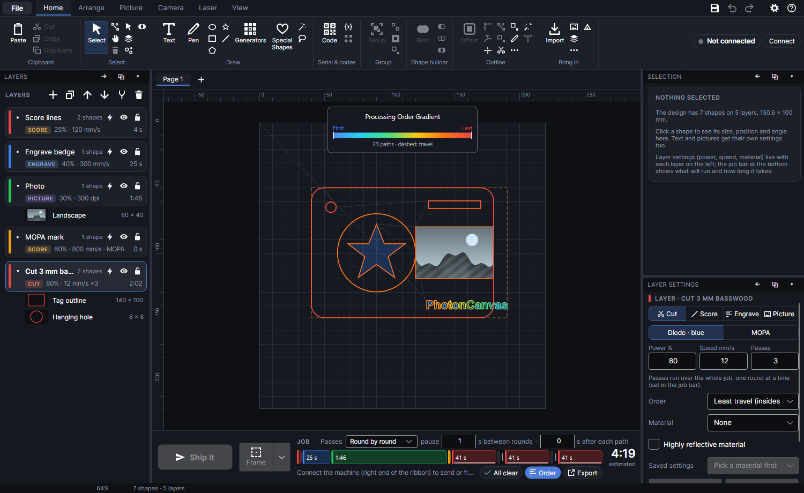
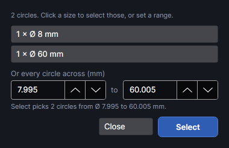
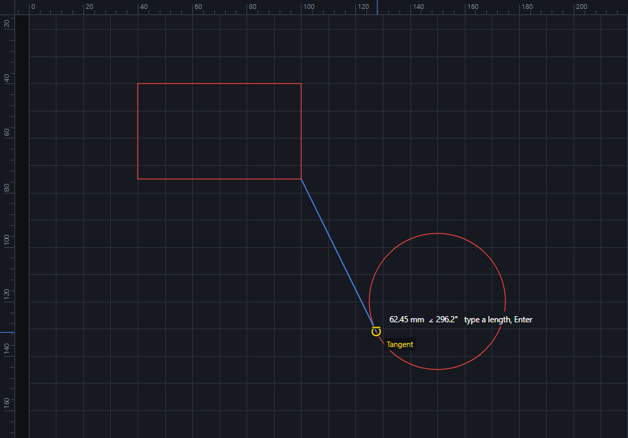
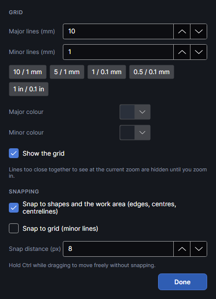
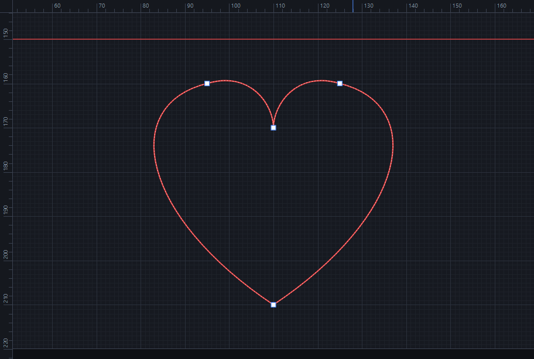
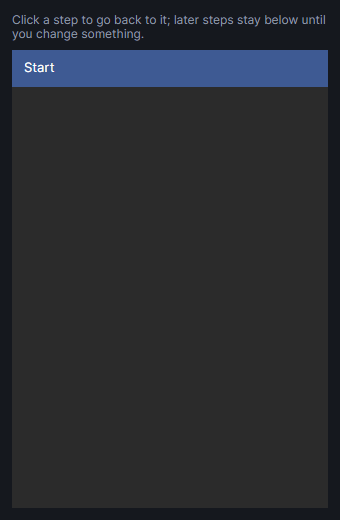

# Working on the canvas

The canvas is the work area in the middle of the window. This page covers what it shows, and how
to select, move, resize, turn, copy, snap, zoom, measure, edit points and undo. Drawing new shapes
is on [Drawing](drawing.md); changing their outlines (weld, offset, trim…) is on
[Editing shapes](editing-shapes.md).

## The work area

- The lighter square is the machine's field: 220 × 220 mm. Its top-left corner is 0, 0; X goes to
  the right and Y goes down, in millimetres (or inches, see
  [Units and colours](workspace.md#units-and-colours)).
- The rulers along the top and left show where you are. A blue mark on each follows the cursor,
  and the status bar shows the cursor's exact position.
- Shapes can sit on the darker surround outside the field, but a job with anything outside the
  field can't be sent: the Selection panel warns "⚠ Partly outside the work area".
- Each shape is drawn in its layer's colour. Shapes on **Engrave** layers are tinted inside.
  Layers that aren't sent to the laser (output off) are drawn faded; hidden layers aren't drawn.
  The shape under the cursor is drawn a little thicker.
- The selection has a dashed blue box with eight square handles, a round handle above it for
  turning, and its size underneath, for example "140 × 100 mm".

Other things can appear on the work area: the camera picture under the design and the close-up
camera's view (see [Camera](camera.md)), the area the close-up camera sees while a tone or line
test is in the design (a dashed green box), the section being marked (see
[Work area](work-area.md)), and a running job: what's done in green, what's being marked in amber
and the laser as a red dot (see [Running a job](running-jobs.md)).

### Processing order

View → **Processing order** colours the job's paths by when they run. It's the same switch as the
**Order** chip in the job bar and Laser → **Show order**.

- Each path is coloured by when it's first marked: blue first, then cyan, green, yellow and
  orange, to red last. Further passes over the same path don't change its colour.
- Dashed grey lines are the travel moves, with the laser off: from the work area's top-left
  corner to the first path, and from each path to the next. When the job has more than 300 cuts
  they're left out, as they'd hide the order.
- A dashed orange rectangle marks the outside edge of the job.
- The key at the top, **Processing Order Gradient**, runs from First to Last and says how many
  paths there are (and how many cuts with the passes), and whether the travel is shown. With
  **Spread the heat** it also says how many pieces the long paths were cut into: "41 paths in 156
  pieces, 624 cuts with the passes".

It follows the design as you change it. Use it to check that holes are cut before the outlines
around them and that the order makes sense. It starts off each time the program starts. How the
order is chosen is explained in [Layer settings](layer-settings.md) and
[Running a job](running-jobs.md).

### Pictures as burned

View → **Pictures as burned** shows pictures as they'll come out on their material, not as the
picture file looks.

- It works for pictures on a layer whose material has been measured with a tone test (Laser →
  **Tone test**). Such a picture is drawn with its own adjustments, then the tone correction, in the
  material's own colours, from the bare material to its darkest burn. See-through parts show as
  bare material.
- Pictures on other layers look as usual.
- It changes only what you see on screen, never the job.
- It stays on or off between runs.

See [Materials and tests](materials-and-tests.md) for the tone test and [Pictures](pictures.md)
for picture layers.

## Selecting

The Select tool (Home → **Select**, `V`) is the one you use most: it selects, moves, resizes and
turns. `Esc` in any other tool brings you back to it.

- **Click** a shape to select it. Click on its outline; on an Engrave layer, and on a picture,
  anywhere inside counts too. Where shapes overlap the top one is picked, but an already selected
  shape wins, so a selection is easy to drag.
- A shape that's in a group brings its whole group. Hold `Alt` while clicking to pick just that
  one shape.
- `Shift`+click adds a shape to the selection, or takes it out.
- Click on empty space, or press `Esc`, to select nothing.
- **Drag a box** from empty space:
  - from left to right (a blue box): selects the shapes entirely inside it;
  - from right to left (a green, dashed box): also selects the shapes it touches.
  - Hold `Shift` to add them to what's already selected. Groups come along whole.
- Shapes on a hidden or locked layer, and locked shapes, can't be picked on the canvas.
- When everything selected is on one layer, that layer becomes the active layer and its settings
  come up in **Layer settings**.

Shapes can also be selected in the Layers panel: see [Layers](layers.md).

### Select everything, a layer, or the rest

| Button | Shortcut | What it selects |
|---|---|---|
| **All** | `Ctrl+A` | Every shape you can pick (not on hidden or locked layers, not locked). |
| **Active layer** | `Ctrl+Shift+A` | Every shape on the active layer you could click: not locked shapes, and nothing when the layer is hidden or locked. |
| **Invert** | | Every shape you can pick that isn't selected now; what was selected is let go. |

### Select by…

Home → **Select by…** opens a menu of ways to select shapes by what they are. Each only picks
shapes you could click (not on hidden or locked layers, not locked).

| Item | What it selects |
|---|---|
| **Circles by size…** | Opens the **Select circles** window (below). |
| **Open lines (not closed)** | Every shape with a line whose ends aren't joined. Useful for checking an imported drawing before cutting it. |
| **The same size as the selection** | Every shape whose width and height are both within 0.05 mm of a selected shape's. |
| **Everything inside the selected shape** | Select a closed shape first. Every shape lying entirely inside it (all four corners of its box inside the outline). The outer shape itself isn't included. |
| **On the same layers as the selection** | Everything on the layers the selected shapes are on. |

### Select circles

<!-- windows: CirclesWindow -->

The **Select circles** window finds every circle in the design, for example to put all the
holes for pins or magnets on a layer of their own. A circle here is a shape made of one closed
outline, round to within 1.5% of its radius (drawn circles, and circles in imported drawings).
Text and codes don't count, nor do shapes you can't pick.

- The list shows each size found, with how many there are: "4 × Ø 5 mm". Click a size to select
  those circles (to within 0.005 mm) and close the window.
- Or type a range under **Or every circle across (mm)**: the two boxes start at the smallest and
  largest diameter found. The line under them says how many circles **Select** will pick ("Select
  picks 6 circles from Ø 3 to 5 mm."); click **Select** to select them and close the window.
  **Select** is greyed out when the range holds none.
- **Close** leaves the selection as it was.
- With no circles it says "There are no circles in the design (on unlocked, visible layers)."

Diameters are always in millimetres.

## Moving, resizing and turning

- **Move**: drag a shape. If it wasn't selected, it's selected as you start. Hold `Shift` to keep
  the move straight across or straight up and down. It snaps as it goes (see
  [Snapping](#snapping-the-grid-and-guides)); hold `Ctrl` to move freely.
- **Nudge**: the arrow keys move the selection 1 mm; with `Shift` 10 mm; with `Ctrl` 0.1 mm.
  Nudges are always in millimetres, and each is an undo step.
- **Resize**: drag one of the eight square handles.
  - A corner handle keeps the proportions; hold `Shift` to stretch freely.
  - A handle in the middle of a side stretches one way only.
  - Hold `Alt` to resize about the centre: the opposite side moves too.
  - Dragging a handle past the opposite side flips the shape.
  - The handle snaps along the direction it changes.
- **Turn**: drag the round handle above the selection. It turns about the middle of the
  selection. Hold `Shift` for steps of 15°.
- `Esc` while dragging puts everything back where it was.
- **Double-click** a text to change its words (in the Selection panel), a code to edit it, or any
  other shape to edit its points (see [Edit points](#edit-points)).

For exact numbers, type them in the Selection panel: see
[The Selection panel](workspace.md#the-selection-panel). Quarter turns, flips, aligning and
spacing out are on the Arrange tab: see [Arranging](arrange.md).

## Cut, copy, paste, duplicate and delete

The **Clipboard** group on the **Home** tab, and **Delete** in its **Select** group:

| Button | Shortcut | What it does |
|---|---|---|
| **Cut** | `Ctrl+X` | Copies the selection and removes it. |
| **Copy** | `Ctrl+C` | Copies the selection. |
| **Paste** | `Ctrl+V` | Adds what you copied, 5 mm right of and below where it was; each further paste lands 5 mm further on. Shapes go back on their own layer, or on the active layer if theirs isn't in this design. Copied groups become new groups. What's pasted is selected. |
| **Duplicate** | `Ctrl+D` | A copy of the selection, 5 mm right and down, selected. It doesn't touch the clipboard. |
| **Delete** | `Delete` or `Backspace` | Removes the selection. |

- What you copy stays ready to paste until you copy something else or close the program, so it
  can go onto another page or into another design.
- `Ctrl+V` also pastes a picture, or SVG text, copied in another program: it comes in as if you'd
  imported a file (see [Files](files.md)). The **Paste** button does the same.
- Copying in PhotonCanvas replaces what's on your computer's clipboard (with a short note saying
  the shapes are PhotonCanvas's), so `Ctrl+V` then pastes your shapes, not something copied earlier
  elsewhere.

## Snapping, the grid and guides

### Snap to shapes

View → **Snap to shapes** (on to start with). While you drag (moving, resizing with a handle,
drawing a rectangle, ellipse, polygon, star or line, placing pen points, or dragging points in
Edit points), the left edge, centre and right edge of what you drag, and its top, middle and
bottom, line up with:

- the edges and centres of other shapes on visible layers,
- guides,
- the work area's edges and centre lines.

It snaps when something is within the **Snap distance**: 8 pixels on screen to start with, so it
feels the same at any zoom. A pink line shows what it lined up with. Hold `Ctrl` while dragging to
move freely. With **Snap to shapes** off, guides don't attract either.

### Object snaps

View → **Object snaps** (on to start with; `F3` turns them off and on). As in AutoCAD, a point you
pick lands exactly on a point of another shape near the pointer, and a yellow marker with its name
shows which, before you click. It works wherever you pick a point: drawing lines, rectangles,
ellipses, polygons and stars, pen points, dragging points in **Edit points**, **Measure** and
**Align 2 points**. Hold `Ctrl` for a point that doesn't snap.

| Snap | Marker | Lands on |
|---|---|---|
| **Endpoint** | square | Corners, and the ends of lines and curves. |
| **Midpoint** | triangle | The middle of a straight line or a curve (halfway along it). |
| **Centre** | circle | The centre of a circle or arc: point at its edge and the centre is found, however far away. Also the centre of an ellipse and the middle of a closed shape (a rectangle's centre). |
| **Quadrant** | diamond | The top, bottom, left and right of a circle or ellipse. |
| **Intersection** | X | Where two lines cross (of two shapes, or of one shape with itself). |
| **Perpendicular** | ⊥ | Square onto a line or circle, from where the line you're drawing starts (when that point is near the pointer). |
| **Tangent** | circle with a bar | Touching a circle, from where the line you're drawing starts. |
| **Nearest** | hourglass | Anywhere on a line. Off to start with: it makes everything sticky. |

- When several are near, the one nearest the pointer wins, with ends and crossings ahead of the
  rest and **Nearest** last.
- **Snap points…** (View tab, next to **Object snaps**) ticks each kind on or off, and **Tracking**.
  The same choices are in the **Grid & snapping** window.
- It finds points on shapes on visible layers (material outlines too), and on pictures: their
  corners, the middles of their sides and their centre. Text and codes are left out (their letters
  would snap everywhere).
- **Tracking**: pause on a snap point for half a second and a small green cross marks it. Moving
  straight across or down from it then lines the pointer up with it (a pink line shows it), as do the
  start of the line you're drawing. Two tracked points give the corner where their lines meet. Pause
  on a marked point again to let it go. Up to four are kept; choosing another tool clears them.
- **Moving a shape by one of its points**: select it, press on one of its own snap points (a corner,
  the middle of an edge, its centre) just inside it, and drag. That point lands on the other shapes'
  points: a box's corner onto the end of a line, a hole's centre onto a crossing. The marker shows
  the point it lands on. (Press on a handle, just outside the selection, to resize as usual.)

### The grid

- View → **Show grid** (on to start with): major lines every 10 mm and minor lines every 1 mm,
  inside the work area. Lines too close together to see at the current zoom are left out until
  you zoom in. Over a camera picture the grid is drawn fainter.
- View → **Snap to grid** (off to start with): when no shape, guide or edge is within reach, the
  dragged edges or centre land on the nearest minor grid line. Lining up with shapes wins over
  the grid.
- The grid only helps you draw: it's never sent to the machine.

### Grid settings

<!-- windows: GridWindow -->

View → **Grid settings…** opens the **Grid & snapping** window (also from the right-click menu
on empty work area, and Settings → Workspace). Changes apply as you make them and are kept
between runs. **Done** closes it.

| Setting | Range | What it does |
|---|---|---|
| **Major lines (mm)** | 0.01 to 200, 10 to start with | Spacing of the stronger lines. |
| **Minor lines (mm)** | 0.01 to 200, 1 to start with | Spacing of the fainter lines. **Snap to grid** uses these. |
| The preset buttons | | Set both at once: **10 / 1 mm**, **5 / 1 mm**, **1 / 0.1 mm**, **0.5 / 0.1 mm**, **1 in / 0.1 in** (25.4 and 2.54 mm). |
| **Major colour**, **Minor colour** | | The lines' colours. |
| **Show the grid** | | The same as View → **Show grid**. |
| **Snap to shapes and the work area (edges, centres, centrelines)** | | The same as View → **Snap to shapes**. |
| **Snap to grid (minor lines)** | | The same as View → **Snap to grid**. |
| **Object snaps (F3): land on other shapes' points, as in AutoCAD** | | The same as View → **Object snaps**. The ticks under it turn each kind on or off (**Endpoint** to **Nearest**, see [Object snaps](#object-snaps)). |
| **Tracking: pause on a snap point to line up with it across or down** | | Tracking, as in [Object snaps](#object-snaps). |
| **Snap distance (px)** | 2 to 40, 8 to start with | How close, on screen, something has to be before it snaps (object snaps too). |

When the major spacing isn't a whole number of minor spacings, a tip under the colours says the
lines won't line up.

### Guides

Guides are lines across the work area to line things up against.

- **Add one**: press on a ruler and drag onto the work area: from the top ruler for a horizontal
  guide, from the left ruler for a vertical one. The status bar shows where it is ("Guide at
  Y = 50 mm"). It lands on whole and half millimetres; hold `Ctrl` to place it anywhere.
- Guides are dashed cyan lines. Dragged shapes snap to them (with **Snap to shapes** on).
- **Move one**: with the Select tool, drag it (press on it where there's no shape).
- **Remove one**: drag it back onto its ruler. **Remove them all**: Home → **More…** (in the
  Outline group) → Clear all guides.
- Each page has its own guides, saved with the design. Adding, moving and removing guides are undo
  steps. Guides are never sent to the machine.

## Zooming and panning

| To | Do this |
|---|---|
| Zoom in or out where the cursor is | Turn the mouse wheel. |
| Zoom in or out about the middle of the view | View → **Zoom in**, View → **Zoom out**, or `Ctrl+=` and `Ctrl+-` (the keypad's + and − work too). |
| See the whole work area | View → **Fit bed**, `Home` or `Ctrl+0`. |
| Fill the view with the selection (or the whole design if nothing is selected) | View → **Fit selection** or `F`. Right-click → Zoom to it does the same. |
| Pan | Hold `Space` and drag, drag with the middle mouse button, or choose Home → **Pan** (`H`) and drag. |
| Scroll sideways | `Shift` + mouse wheel. |
| Scroll up and down | `Ctrl` + mouse wheel. |

- The status bar shows the zoom: 100% is about life size on a typical screen. It goes from about
  5% to about 10 000%.
- The program opens showing the whole work area, or, when it reopens your last design, the view
  you left it at.
- `Esc` leaves the Pan tool for the Select tool.

## Measure

View → **Measure** is a tool for measuring distances and angles on the work area.

1. Drag from one point to another. Each end snaps to the nearest corner or end point of a shape
   within the snap distance; otherwise it lines up like any drag (edges, centres, guides, grid).
   Hold `Shift` for steps of 45°, `Ctrl` for no snapping.
2. The line is labelled with its length, how far it goes across and down (Δx, Δy) and its angle in
   degrees, counted anticlockwise from pointing right (so a line going up is positive). The status
   bar repeats it ("Measured …").
3. Drag again to measure something else. `Esc` goes back to the Select tool.

Measurements aren't kept: the line goes when you leave the tool. Lengths are in the units you
chose.

## Edit points

Home → **Edit points** (`N`, or double-click a shape) shows the points of the selected shape, to
change its outline point by point.

- It works on one shape at a time: an ordinary path (drawn with the pen, imported, traced, or the
  result of a shape tool) on a visible, unlocked layer. Click another shape to switch to it.
- Rectangles, ellipses, polygons and stars drawn with their tools stay editable as shapes (size,
  corner radius, sides) and don't show points. To edit their points, select one and press
  `Ctrl+Shift+C` first: it becomes an ordinary path. Text and codes show no points either until
  they're turned into paths the same way (for text, Home → **Text to paths** does it too).
- Square points are sharp corners; round points are smooth. The selected point is filled in blue,
  and its curve handles show as small circles on lines.

| To | Do this |
|---|---|
| Move a point | Drag it. It snaps like any drag; hold `Ctrl` to move freely. |
| Reshape a curve | Drag one of the selected point's handles. On a smooth point the other handle turns with it, so the point stays smooth. |
| Make a smooth point sharp while dragging | Hold `Alt` as you start dragging a handle: it moves on its own. |
| Add a point | Double-click on an edge. The curve keeps its shape. |
| Delete the selected point | `Delete` or `Backspace`. Its two edges become one. A part with only two points disappears; the shape is deleted when nothing is left. |
| Switch between sharp and smooth | `S`. Sharp pulls both handles into the point; smooth lines them up (straight edges either side become curves). |
| Make the handles symmetric | `Y`: both handles in line and the same length. Only for a point with a curve on both sides. |
| Break the outline at the point | `B`: a closed outline opens there; an open line becomes two. |
| Round the corner | `R`: the selected sharp corner becomes a 2 mm arc. (While Edit points is in use, `R` doesn't pick the Rectangle tool.) |
| Finish | `Esc`, or choose another tool. |

The tool options bar above the work area shows these keys while the tool is in use. Each change
is an undo step.

## Locked shapes

Locking a shape keeps it where it is: it can't be clicked, dragged, box-selected or picked by
**All**, **Active layer**, **Invert** or **Select by…**, so you can work around it without knocking it. It's still
marked when the job runs, and other shapes still snap to it.

- Lock the selection: Arrange → **Lock** (`Ctrl+Alt+L`) or right-click → Lock.
- Unlock: Arrange → **Unlock all** (`Ctrl+Alt+Shift+L`) unlocks every locked shape.

A whole layer can be locked or hidden in the Layers panel: its shapes can't be picked either.
See [Arranging](arrange.md) and [Layers](layers.md).

## The right-click menu

With the Select or Edit points tool, right-click a shape: it's selected (with its group; hold
`Alt` for just that shape) unless it's already part of the selection, and a menu of what you can
do with the selection opens. Items that don't apply are greyed.

- **Cut**, **Copy**, **Paste**, **Duplicate**, **Delete it** (or **Delete these 3**…)
- **Group**, **Ungroup**, **Combine into one shape (compound)**, **Break apart**,
  **Convert text to paths**, **Lock** (or **Unlock**), **Use as material outline**
- **Shape operations**: **Offset…**, **Round corners…**, **Text on path**
  (or **Straighten text**), **Copy along path…**, **Warp…**, **Tidy lines…**, **Weld (union)**,
  **Subtract (bottom minus the rest)**, **Intersect (keep the overlap)**,
  **Exclude (remove the overlap)**
- **Array**: **Nest on material…**, **Grid array…**, **Circular array…**
- **Align and distribute**: **Align left**, **Align centres horizontally**, **Align right**,
  **Align top**, **Align centres vertically**, **Align bottom**, **Distribute horizontally**,
  **Distribute vertically**, **Centre in work area**
- **Flip and rotate**: **Flip horizontally**, **Flip vertically**, **Rotate 90° clockwise**,
  **Rotate 90° counter-clockwise**
- **Order**: **Bring to front**, **Send to back**
- **Move to layer**: every layer of the design
- **Fit to piece in camera…**, **Trace picture…**, **Depthmap with DepthCharge…**,
  **Remove picture background…**
- **Zoom to it**, **Rename…**, **Save to My shapes…**

Right-click on empty space: it selects nothing and offers **Paste**, **Select all**, **Fit work
area** and **Grid & snapping…**.

What each command does is explained with its ribbon button: [Editing shapes](editing-shapes.md),
[Arranging](arrange.md), [Pictures](pictures.md) and [Camera](camera.md).

## Undo, redo and history

<!-- windows: HistoryWindow -->

- **Undo** (`Ctrl+Z`) takes back the last change; **Redo** (`Ctrl+Y` or `Ctrl+Shift+Z`) does it
  again. The buttons are at the top right; their tips name the step ("Undo Move shape").
- Every change to the design is a step: drawing, moving, editing, layer settings, adding or
  switching pages. Selecting on its own isn't a step, but each step remembers what was selected
  and which layer was active, and brings them back.
- Quick repeated changes to the same setting (typing into a box, clicking its arrows) within two
  seconds count as one step.
- Up to 500 steps are kept; older ones are dropped. **New** and **Open** start a fresh history;
  saving doesn't clear it.
- Undo isn't available in the middle of a drag.

View → **History** (`Ctrl+H`) opens the **Undo history** window, which stays open beside your work
and follows every change.

- The list starts with **Start** (the design as opened), then every step, oldest first. The step
  you're at is highlighted.
- Undone steps stay below it in grey italics, until you change something: then they're dropped.
- Click any step to go straight back (or forward) to it, however many steps away.

## Try it

- [Select shapes](tutorial:ws-select)
- [Select circles by size](tutorial:ws-circles)
- [Move, resize and turn shapes](tutorial:ws-move)
- [Copy, paste, duplicate and delete](tutorial:ws-clipboard)
- [Grid and snapping](tutorial:ws-snap)
- [Guides from the rulers](tutorial:ws-guides)
- [Zoom and pan](tutorial:ws-zoom)
- [Measure distances](tutorial:ws-measure)
- [Edit a shape's points](tutorial:ws-edit-points)
- [Undo, redo and the history](tutorial:ws-history)
- [See the run order and pictures as burned](tutorial:ws-view)
