# Drawing

The **Draw** group of the **Home** tab draws shapes and text, makes ready-made projects and
outlines real pieces from the camera picture. The **Serial & codes** group beside it adds QR codes
and barcodes, and fills text and codes with serial numbers, dates and spreadsheet rows that change
on every run.

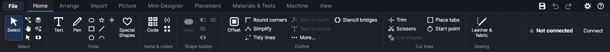

The small buttons show only an icon; hold the mouse over one to see its name. In the Draw group,
after **Text** and **Pen**, the first column of small icons is **Ellipse**, **Rectangle** and
**Polygon**, the second **Star** and **Line**. After **Generators** and **Special Shapes** come
**Pick piece** (the wand) and **Trace edge** (the lasso). In **Serial & codes**, **Variables** is
the `{x}` icon and **Number copies** the four squares.

## Where new shapes go

- Shapes from the drawing tools, text, library shapes and camera outlines go on the active layer if
  it's visible, unlocked and not a picture layer; otherwise on the first layer that is. See
  [Layers](layers.md). Generators and codes choose their own layers (see below).
- The new shape is selected, so its size and position show in the **Selection** panel straight
  away (see [The workspace](workspace.md)).
- Corners and points snap to the grid and to other shapes when snapping is on (see
  [Working on the canvas](canvas.md)).
- **Rectangle**, **Ellipse**, **Polygon**, **Star** and **Text** go back to **Select** after one
  shape. **Line**, **Pen**, **Pick piece** and **Trace edge** stay on until you choose another tool
  or press `Esc`.
- Points land on other shapes' ends, middles, centres and crossings with **Object snaps** on (a
  yellow marker shows which; see [Object snaps](canvas.md#object-snaps)).
- `Ctrl+Z` undoes anything here.

## Drawing tools

| Tool | Key | How to draw | Keys while drawing |
|---|---|---|---|
| **Rectangle** | `R` | Drag from corner to corner. | `Shift` square, `Alt` from the centre |
| **Ellipse** | `E` | Drag the box it fills. | `Shift` circle, `Alt` from the centre |
| **Polygon** | `O` | Drag the box it fills. | `Shift` square box, `Alt` from the centre |
| **Star** | `S` | Drag the box it fills. | `Shift` square box, `Alt` from the centre |
| **Line** | `L` | Drag from one end to the other, or click each end (and carry on from there). | `Shift` 45° steps; type a length |
| **Pen** | `P` | Click for corners, drag for curves. | See [Pen](#pen) |
| **Text** | `T` | Click where the text starts. | |

You can press or let go of `Shift` and `Alt` during the drag; the outline follows. A click without
a drag makes nothing. The keys can be changed in **File → Keyboard shortcuts…** (see
[Keyboard shortcuts](keyboard-shortcuts.md)).

### Rectangle and Ellipse

Drag on the work area. Both corners snap. The result stays an editable rectangle or ellipse (see
[Editable shapes](#editable-shapes)), so you can type an exact size or round a rectangle's corners
afterwards.

### Polygon and Star

Choosing **Polygon** or **Star** shows a bar above the work area with its options. They apply to
the shapes you draw next and are remembered between runs.

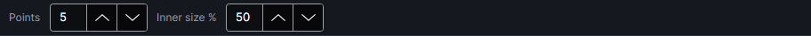

| Setting | Range | Default | What it does |
|---|---|---|---|
| **Sides** (Polygon) | 3–64 | 6 | How many corners. |
| **Points** (Star) | 3–64 | 5 | How many points. |
| **Inner size %** (Star) | 5–95 | 50 | How far out the inner corners are, as a share of the outer size. Smaller makes thinner, spikier points. |

The shape points up and is stretched to fill the box you drag; hold `Shift` to keep the box
square. Both stay editable afterwards (see [Editable shapes](#editable-shapes)).

### Line

A straight line: an open line, not a closed shape. Each end lands on the nearest object snap (an
end, a middle, a centre, a crossing, square onto a line or touching a circle: see
[Object snaps](canvas.md#object-snaps)); `Shift` keeps it to 45° steps. The Line tool stays on after
each line, until you choose another tool or press `Esc`.

- **Drag** from one end to the other for one line.
- **Click** where it starts, then **click** where it ends: the line is drawn, and the next one starts
  from its end, so you can click round a shape line by line. `Enter`, `Esc` or a right-click stops
  (the lines drawn so far stay).
- While a line follows the pointer, its length and angle show beside it ("42.5 mm ∠ 30°": the angle
  counter-clockwise from the right, as on paper).
- **Type a length** and press `Enter` to end the line that far along the pointer's direction (in the
  units shown, millimetres or inches). Type `25<30` for 25 at 30°. `Backspace` takes back a
  character; `Esc` clears what's typed.
- The lines drawn this way aren't selected, so handles don't get in the way of the next one.

### Pen

The pen draws any outline point by point.

- **Click**: a corner point, joined to the last one by a straight line.
- **Click and drag**: a smooth point. The handle you pull out sets the curve; the handle on the
  other side mirrors it.
- **Click the first point** (drawn larger) to close the shape.
- `Enter` or a **double-click**: finish an open line.
- `Backspace` or `Delete`: remove the last point.
- `Esc`: throw away the points so far (`Esc` again goes back to **Select**).

A dashed line from the last point follows the mouse. Points snap like the other tools. Choosing
another tool part-way keeps what you've drawn (two points or more) as an open line. Closed shapes
are named "Shape" in the layer list, open ones "Path". To change the points later, use **Edit
points** (see [Editing shapes](editing-shapes.md)).

### Editable shapes

Rectangles, ellipses, polygons and stars drawn with these tools remember what they are. Select one
and the **Selection** panel shows a **Shape** card under the selection card:

| Setting | Shown for | Range | What it does |
|---|---|---|---|
| **W**, **H** | all four | 0.01–2000 mm | The size as seen on the work area. The shape is rebuilt at this size, so corners stay round and sides even, even after stretching it with the handles. |
| **Corner radius** | rectangles | 0–1000 mm | Rounded corners (0 = square). Never more than half the shorter side. |
| **Sides / points** | polygons, stars | 3–64 | Corners of a polygon, points of a star. |
| **Inner size %** | stars | 5–95 | How far in the inner corners are, as a share of the size: smaller is spikier. |

The shape stays editable until you change its points. To edit its points, first turn it into a
plain path with `Ctrl+Shift+C`.

## Text

Text stays editable: its outline is redrawn from the font whenever the words or settings change,
and it's cut, scored or engraved like any other shape.

### Adding text

1. Click **Text** (or press `T`).
2. Click the work area where the text's top-left corner should be. A text saying "Text" appears,
   in the last font and size you used (Arial, 10 mm the first time).
3. The cursor jumps to the text box in the **Selection** panel with the word selected: type to
   replace it. `Enter` starts a new line.

The tool goes back to **Select**. To change the words later, double-click the text on the work area,
or select it and click in the text box. The text's name in the layer list is its first line.

### Text settings

With one text selected, the **Selection** panel shows a **Text** card. Every change shows on the
work area at once.

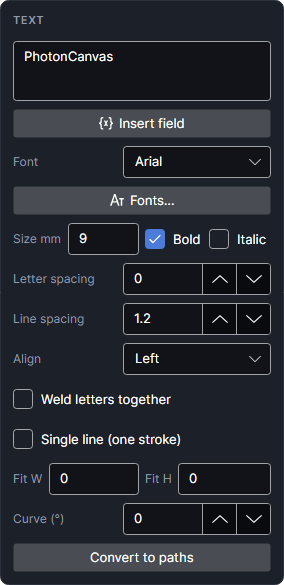

| Setting | Range | What it does |
|---|---|---|
| Text box | | The words, with any fields such as `{serial}` (see [Fields](#fields-serial-numbers-dates-and-spreadsheets)). When there are fields, **Next run marks:** under the box shows them filled in. |
| **Insert field** | | Puts a field at the cursor: a serial number, the date, the time or a spreadsheet column. |
| **Font** | | The fonts installed on the computer: starred ones first, hidden ones left out. |
| **Fonts…** | | Opens the [Fonts](#fonts) window. |
| **Size mm** | 0.5–500 | The font size (its em height) in mm, as in other programs: capital letters come out smaller. For an exact height use **Fit H**. |
| **Bold**, **Italic** | | The font's bold or italic style. |
| **Letter spacing** | −50 to 200 mm | Extra space between letters; negative tightens. Default 0. |
| **Line spacing** | 0.5–5 | Line height as a multiple of the size. Default 1.2. |
| **Align** | Left, Centre, Right | Lines line up within the widest line. On a path: start at its start, centre on it, or end at its end. |
| **Weld letters together** | | Merges letters that touch or overlap into one outline (script fonts, tight spacing), so the laser doesn't cut where they meet. |
| **Single line (one stroke)** | | One line down the middle of each stroke instead of the outline: much faster engraving with a clean, pen-drawn look. Put it on a Score layer. The lines are worked out by thinning the letters, so plain, even-weight fonts work best. Weld has no effect while this is on. |
| **Fit W**, **Fit H** | 0–2000 mm | Scales the text, in proportion, to exactly this width or height whatever it says; with both, it fits inside the box. 0 = off. Use it for changing text (names, fields) that must fill the same space. Not used for text on a path. |
| **Curve (°)** | −360 to 360 | Bends each line along an arc covering this many degrees of a circle: 180 is a half circle. Positive arches up, negative curves down, 0 is straight. |
| **Convert to paths** | | Turns the text into ordinary shapes, no longer editable as text. |

On the **Home** tab's **Outline** group, **Text on path** makes the words follow a line or shape and
**Text to paths** does the same as **Convert to paths** (see [Editing shapes](editing-shapes.md)).

> **Note:** A design opened on a computer that lacks its font keeps the text's saved outlines. Once
> you change that text, it's redrawn in a stand-in font (the **Font** box still shows the missing
> font's name). Install the font, or convert the text to paths before sharing the design.

### Fonts
<!-- windows: FontWindow -->

The **Fonts** window sorts out the font list. Open it with **Fonts…** on the **Text** card, or
**File → Fonts…**.

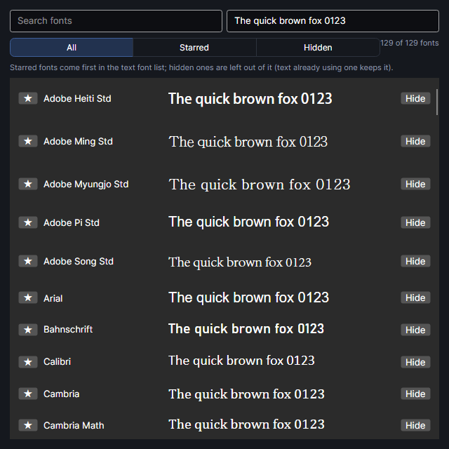

- **Search fonts**: shows only fonts whose name contains what you type.
- The box beside it holds the sample words each font is shown in.
- **All**, **Starred**, **Hidden**: which fonts to list. The count of shown and installed fonts is
  at the right.
- **★**: star a font. Starred fonts come first in the **Font** list (and here).
- **Hide**: leave a font out of the **Font** list. Text already using it keeps it.

Changes are saved at once and kept between runs. The list holds the fonts installed on the
computer; to add one, install it on the computer.

## Generators
<!-- windows: GeneratorsWindow -->

**Generators** opens a window with five tabs that draw ready-to-cut projects. **Box**, **Keychain /
tag**, **Living hinge** and **Earrings** put their parts on the first visible, unlocked Cut layer
(the keychain's words on an Engrave layer), or on a new layer named "Cut" (or "Engrave") if there's
none, and group them. **Sizes** copies the selection instead. What's made is selected and the
window closes. The results are ordinary shapes: edit them like any other.

### Box

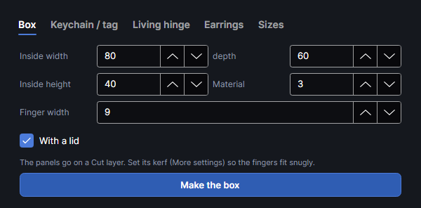

A box with finger joints, drawn as flat panels that slot together.

| Setting | Range | Default | What it does |
|---|---|---|---|
| **Inside width**, **depth** | 10–1000 mm | 80, 60 | The inside of the box. |
| **Inside height** | 5–1000 mm | 40 | From the floor to the underside of the lid (to the top of the walls without a lid). |
| **Material** | 0.5–20 mm | 3 | The thickness of your sheet. Measure it: the joints depend on it. |
| **Finger width** | 1–100 mm | 9 | Roughly how wide each finger is. About three times the thickness is a good start. |
| **With a lid** | | on | Adds a lid panel jointed like the floor. Without it the walls' top edges are plain. |

How it's built:

- Panels: **Bottom**, **Front**, **Back**, **Left**, **Right** and, with a lid, **Lid**, named
  "Box · Front" and so on. The outside of the box is the inside size plus the material's thickness
  on each side (on top only with a lid).
- Each jointed edge gets an odd number of fingers (at least 3) so the corners work out, so the
  real finger width is close to what you set but not exact.
- The panels are laid in a row from 10 mm in from the work area's top-left corner, 3 mm apart. A
  box is usually wider than the 220 mm work area: ungroup (`Ctrl+Shift+G`) and arrange or nest the
  panels (see [Arranging](arrange.md)), and cut what doesn't fit in a second run.
- The panels are drawn at their exact size. Set the Cut layer's kerf (in its **More settings**,
  see [Layer settings](layer-settings.md)) so the fingers fit snugly; the cut test measures it (see
  [Materials and tests](materials-and-tests.md)).

### Keychain and tag

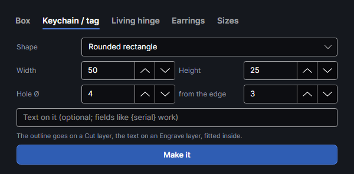

The **Keychain / tag** tab draws a keychain or gift tag with its hole and, if you like, words on it.

| Setting | Range | Default | What it does |
|---|---|---|---|
| **Shape** | | Rounded rectangle | **Rounded rectangle** (corners rounded by a fifth of the shorter side), **Circle** (an ellipse of the width and height) or **Tag** (a luggage tag with its left end cut to a blunt point). |
| **Width**, **Height** | 10–300, 5–300 mm | 50, 25 | The outside size. |
| **Hole Ø** | 0–30 mm | 4 | The ring hole's diameter; 0 = no hole. |
| **from the edge** | 0.5–50 mm | 3 | From the left end (the top of a circle) to the edge of the hole. |
| Words box | | empty | Optional words to engrave. Fields such as `{serial}` work. |

The outline goes on a Cut layer, in the middle of the work area. The words go on an Engrave layer
as an Arial text fitted (with **Fit W** and **Fit H**) into the part beside the hole, so they stay
inside whatever they say. The text stays editable.

### Living hinge

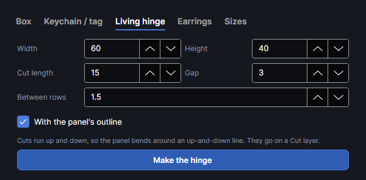

Rows of staggered slits that let a flat sheet bend.

| Setting | Range | Default | What it does |
|---|---|---|---|
| **Width**, **Height** | 5–1000 mm | 60, 40 | The area that bends. |
| **Cut length** | 1–200 mm | 15 | The length of each slit. |
| **Gap** | 0.5–50 mm | 3 | The uncut material between slits in a line. |
| **Between rows** | 0.3–20 mm | 1.5 | The distance between neighbouring lines of slits. Closer lines bend more easily, but the strips get thinner. In 3 mm plywood, 1.5 mm is a good start. |
| **With the panel's outline** | | on | Also draws the rectangle round the area. |

The slits run up and down, so the panel bends around an up-and-down line; turn the result 90° for
the other direction. Neighbouring lines are shifted by half a slit and gap: every other line runs out
through the top and bottom edges, the others stop half a gap short. The slits are open lines on a
Cut layer, in the middle of the work area; the outline is a separate shape in the same group.

### Earrings

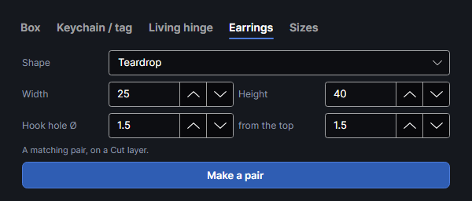

A matching pair of earring blanks with holes for the hooks.

| Setting | Range | Default | What it does |
|---|---|---|---|
| **Shape** | | Teardrop | **Teardrop** (a point at the top, round at the bottom), **Leaf** (pointed at both ends), **Circle**, **Hexagon** (a corner at the top) or **Arch** (a half ring standing on its ends, the band 30% of the smaller size). |
| **Width**, **Height** | 5–100, 5–150 mm | 25, 40 | The size of each earring. |
| **Hook hole Ø** | 0–10 mm | 1.5 | The hole's diameter; 0 = no hole. |
| **from the top** | 0.3–20 mm | 1.5 | From the top of the shape to the edge of the hole. |

The pair goes in the middle of the work area, 5 mm apart, the right one mirrored so a lopsided
shape makes a matching pair. Both are on a Cut layer. A teardrop or leaf is narrow at its tip: keep
the hole far enough down that it doesn't break through the sides.

### Sizes

Copies of the selection in several sizes, side by side. Select the design first: **Make the sizes**
is greyed out when nothing was selected as the window opened.

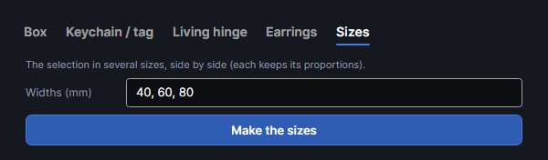

- **Widths (mm)**: the widths you want, separated by commas, semicolons or spaces (use a point for
  decimals: 12.5). Default 40, 60, 80.
- Each width makes a copy of the whole selection scaled to that width, the height in proportion.
  The copies go in a row to the right of the selection, 5 mm apart, their tops level with it.
  They keep their layers and groups.

## Special Shapes
<!-- windows: ShapeLibraryWindow -->

**Special Shapes** (`I`) opens the **Shapes** window, a library of ready-made outlines and your
own saved shapes. It's also in **Settings → Workspace → Shape library…**. The window stays open
beside the work area, so you can add several.

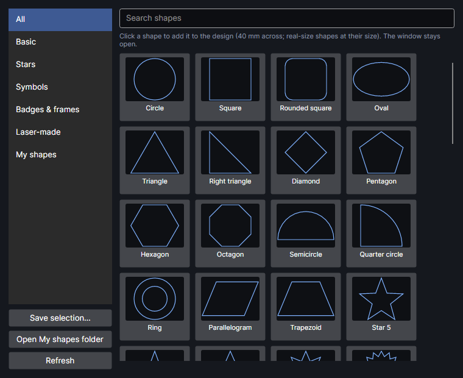

- The categories on the left: **All**, the built-in ones and **My shapes**.
- **Search shapes** shows the shapes whose name or category contains what you type.
- Click a tile to add that shape in the middle of the work area, 40 mm across its longer side,
  on the active layer. Shapes marked "added at its real size" in their tip keep their size.
  Adding again steps each new one 6 mm down and right so they don't stack exactly. The line under
  the tiles says what was added.
- The added shapes are ordinary outlines: resize them, edit their points, combine them.

### Built-in shapes

| Category | Shapes |
|---|---|
| Basic | Circle, Square, Rounded square, Oval, Triangle, Right triangle, Diamond, Pentagon, Hexagon, Octagon, Semicircle, Quarter circle, Ring, Parallelogram, Trapezoid |
| Stars | Star 5, Star 4, Star 6, Star 8, Starburst, Sparkle |
| Symbols | Heart, Arrow, Double arrow, Chevron, Plus, Cross, Check mark, Lightning bolt, Teardrop, Crescent moon, Cloud, Speech bubble, Location pin, Shield, Keyhole, Paw print, Sun, Flower, Leaf, Snowflake, House |
| Badges & frames | Scalloped badge, Gear, Rounded frame, Circle frame, Hexagon frame, Ticket, Banner, Label, Gift tag |
| Laser-made | Keychain tag, Round keychain, Coaster, Ornament, Living hinge 100 × 40 (open lines), Living hinge 60 × 60 (open lines) |

The two living hinges are added at their real size; for one of your own size, use the
[Living hinge](#living-hinge) generator.

### Your own shapes

- **Save selection…**: select shapes in the design, click this and give the shape a name. The
  selected shapes are kept as one combined outline under **My shapes** (pictures are left out).
  They're added like the built-in ones, 40 mm across.
- Each is a design file (`.pcanvas`) in the `shapes` folder of PhotonCanvas's data folder
  (normally `%USERPROFILE%\PhotonCanvas\shapes`). A name that's taken gets a number added.
- **Open My shapes folder** opens it: copy the files to share them, or put other people's
  `.pcanvas` files in it, then click **Refresh** to list them.
- To delete one of your shapes, right-click its tile, **Delete from My shapes** (it asks first).

Your shapes are included when you back up your settings (**Settings → Tools → Back up settings…**).

## Pick piece and Trace edge

These two tools draw from the camera picture of the bed: they outline real pieces lying in the
machine, such as an offcut to fit a design onto. They need the picture showing under the design:
connect to the machine, calibrate the camera and click **Show picture** on the **Camera** tab
(**Update photo** takes a new one after you move things; see [Camera](camera.md)). Without it,
the status line asks you to show the picture first.

The picture is straightened onto the work area at 0.2 mm per pixel, and outlines are only as
accurate as the camera's calibration for the material's height.

> **Note:** Outlining a real offcut on the bed with **Pick piece** is still on the list to try at
> the machine.

### Pick piece

1. Choose **Pick piece** (`W`).
2. Move the mouse over a piece: after a moment its outline shows, filled and dashed.
3. Click inside it. The outline, with any holes in the piece, is added as a shape named
   "Picked piece".

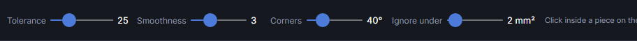

It takes the area joined to where you clicked whose colour is close to the clicked colour (the
photo is smoothed a little first, to calm wood grain and camera noise). The sliders in the bar
above the work area refine the last pick as you move them, as long as you haven't moved or changed
it. A click where the camera can't see picks nothing.

What next: **Offset** (`Ctrl+Shift+O`) for a margin inside or outside the piece, a design fitted
inside it, or right-click → **Use as material outline** so nesting and slicing fill that board.

### Trace edge

A magnetic pen: you click along an edge in the camera picture and the line between your clicks
follows it. Use it when **Pick piece** can't tell a piece from what's around it (similar colours,
shadows), or to trace only part of an edge.

1. Choose **Trace edge** (`M`).
2. Click on the edge. Each click snaps to the strongest edge within a few pixels on screen.
3. Click again further along. The line between follows the strongest edges in the picture.
4. Click the first point (drawn larger) to close the shape, or press `Enter` or double-click to
   finish an open line.

`Backspace` or `Delete` removes the last point; `Esc` throws the line away. The path along the edge
is worked out up to 60 mm from the last click; beyond that the line goes straight. Click every few
centimetres, and more often where the edge is faint or other edges run close by. A closed shape is
fitted with lines and curves ("Traced shape"); an open line is made of straight pieces ("Traced
line"). Set **Smoothness** and **Corners** before you finish: they're used when the shape is made.

### The settings bar

Both tools show these sliders above the work area (**Trace edge** only **Smoothness** and
**Corners**). They're remembered between runs.

| Setting | Range | Default | What it does |
|---|---|---|---|
| **Tolerance** | 1–100 | 25 | How different a colour can be and still count as the piece. Raise it if the outline stops short; lower it if it spills onto the bed. |
| **Smoothness** | 0–10 | 3 | 0 follows every step of the edge; higher values give smoother, simpler outlines. |
| **Corners** | 0–180° | 40° | Bends sharper than this stay as corners; gentler ones become curves. 0 = straight lines only. |
| **Ignore under** | 0–50 mm² | 2 mm² | Specks and holes smaller than this are left out: knots, burn marks, dust. |

## Codes
<!-- windows: CodeWindow -->

**Code** opens **Add a code**: a QR code, Data Matrix or barcode that can hold a web address, a
serial number, the date or a spreadsheet column, new on every run.

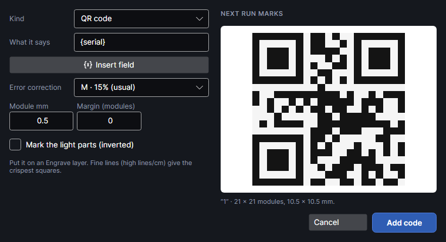

| Setting | Range | Default | What it does |
|---|---|---|---|
| **Kind** | | QR code | The kind of code (see [What each kind can hold](#what-each-kind-can-hold)). |
| **What it says** | | `{serial}` | What the code holds: one line, fields allowed. |
| **Insert field** | | | Puts a field at the cursor (see [Fields](#fields-serial-numbers-dates-and-spreadsheets)). |
| **Error correction** | L, M, Q, H | M · 15% (usual) | QR codes only: how much of the code can be damaged and still read: **L · 7% can be damaged**, **M · 15% (usual)**, **Q · 25%**, **H · 30% (rough surfaces)**. More correction makes a bigger code. |
| **Module mm** | 0.05–10 | 0.5 | The size of one square, or of the narrowest bar. Phones read QR codes down to about 0.3 mm squares on a clean mark; bigger is safer on wood. |
| **Margin (modules)** | 0–20 | 0 | A clear margin around the code, in modules. Scanners want 4 (QR), 1 (Data Matrix) or 10 (barcodes) unless the material around it is plain anyway. Barcodes get it at the two ends only. |
| **Bar height mm** | 1–200 | 12 | Barcodes only: how tall the bars are. |
| **Mark the light parts (inverted)** | | off | For materials that mark light on dark (anodised aluminium, slate, painted metal): the code's light parts are marked, so it reads the right way round. The margin is marked too, at least 1 module. |

**NEXT RUN MARKS** shows the code as the next run marks it, its fields filled in. Under it: what it
says with the fields filled in, its size in modules and in mm. If the content can't be made into
this kind of code, a ⚠ line says why.

**Add code** puts it in the middle of the work area, on the active layer if that's a visible,
unlocked Engrave layer; otherwise on a new Engrave layer named "Codes" set to 200 **Lines / cm**
(fine lines give the crispest squares). That layer becomes the active one. The code is drawn as
filled squares or bars, so the Engrave layer fills them.

### What each kind can hold

| Kind | Holds |
|---|---|
| QR code | Any text: web addresses, words in any language. The usual choice for phones. |
| Data Matrix | Text, in a small square code. |
| Aztec | Any text. |
| PDF417 | Any text, as a wide stacked barcode. |
| Code 128 | Plain (ASCII) letters, digits and punctuation. |
| Code 39 | A–Z, 0–9, space and - . $ / + %. Small letters become capitals. |
| Code 93 | The same as Code 39. |
| EAN-13 | 12 digits; the 13th, the check digit, is worked out. |
| EAN-8 | 7 digits; the 8th, the check digit, is worked out. |
| UPC-A | 11 digits; the 12th, the check digit, is worked out. |
| UPC-E | 7 digits starting with 0 or 1; the check digit is worked out. |
| ITF (Interleaved 2 of 5) | An even number of digits. |
| Codabar | Digits and - $ : / . +, optionally between the start and stop letters A–D. |

### Changing a code

Double-click the code on the work area, or select it and click **Edit code…** on the **Code** card
of the **Selection** panel. That card shows the kind, what it says, what the next run marks, and
any problem; **Variables…** there opens the [Variables](#the-variables-window) window. The code
window opens as **Edit code**; **Save** keeps the changes, in place.

The code is redrawn whenever what it says changes, fields included. `Ctrl+Shift+C` turns it into
plain shapes that no longer change. A code that can't be made stops the job from being sent, with
the reason.

## Fields: serial numbers, dates and spreadsheets

Any text or code can hold fields in braces, such as `Part {serial:0000}`. They're filled in on the
work area and again when the job is sent, so each run can mark something different. Type them, or
use **Insert field** under a text's words or in the code window: it lists the fields below, the
spreadsheet's columns (**Spreadsheet:** and the heading) and **Serial number and spreadsheet…**.

| Field | Gives |
|---|---|
| `{serial}` | The serial number, e.g. 42. |
| `{serial:0000}` | The serial number with leading zeros, as many digits as zeros: 0042. |
| `{date}` | Today's date: 2026-10-16. |
| `{date:dd/MM/yyyy}` | The date laid out your way: `dd` day, `MM` month, `yyyy` year (16/10/2026). |
| `{time}` | The time: 14:05. |
| `{time:HH:mm:ss}` | The time with seconds. |
| `{row}` | The spreadsheet row number (1 = the first row under the headings). |
| `{Name}` | Any column of the spreadsheet: that column's value in the current row. Capitals don't matter. |
| `{{` and `}}` | Plain braces. |

- The text box shows the fields; the work area shows the values the next run marks. Dates and times
  are as of the moment you click **Ship It**.
- Changing text changes width: **Fit W** keeps it the same width (see [Text settings](#text-settings)).
- A field that isn't one (no such heading) stays as typed, and the job won't send until it's fixed.
- When the job is sent, its summary says what the run marks, e.g. "Fields: serial 12 · row 3 of 40".

### The Variables window
<!-- windows: VariablesWindow -->

**Variables** (the `{x}` icon in **Serial & codes**) sets what fills the fields. It also opens from
**Variables…** on a selected code and from **Insert field → Serial number and spreadsheet…**. The
values are saved with the design, so the count carries on next time you open it.

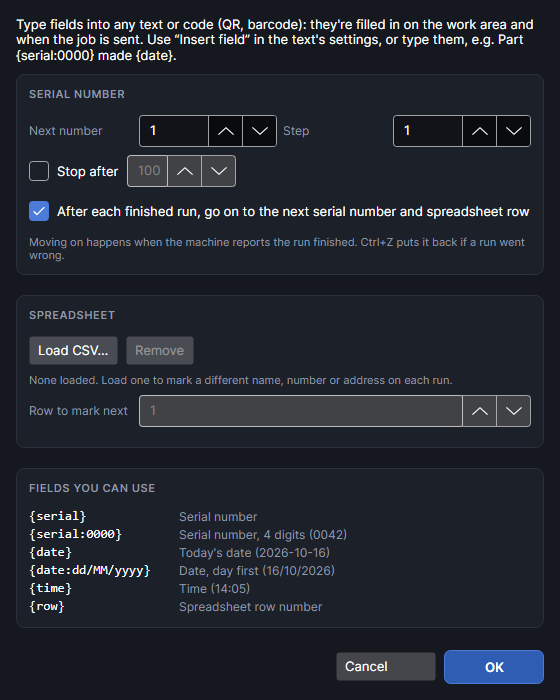

**Serial number**

| Setting | Range | Default | What it does |
|---|---|---|---|
| **Next number** | −999,999,999 to 999,999,999 | 1 | The number the next run marks wherever `{serial}` is used. |
| **Step** | −1,000,000 to 1,000,000 | 1 | Added after each run: 1 counts up, −1 counts down, 10 skips. |
| **Stop after** | | off | The last number to mark. Past it, the job won't send, so nothing gets a duplicate. |
| **After each finished run, go on to the next serial number and spreadsheet row** | | on | Moves on by itself after each run (see [Moving on after each run](#moving-on-after-each-run)). Off: the same values every run until you change them. |

**Spreadsheet**

- **Load CSV…**: a spreadsheet saved as CSV (`.csv`, `.txt` or `.tsv`, up to 5 MB). The first row
  must be the headings: each becomes a field, such as `{Name}`. Commas, semicolons or tabs
  separate the cells (whichever the first line has most of); cells in quotes may hold them.
- The line under it names the file, its number of rows and its headings.
- The spreadsheet is copied into the design, so it travels with the design file. If you change the
  CSV file, load it again.
- **Remove** takes the spreadsheet out of the design.
- **Row to mark next**: 1 is the first row under the headings; that row's values are listed under
  it. One past the last row means all rows are done, and the job won't send until you pick a row.

**Fields you can use** lists the fields and the spreadsheet's headings. **OK** keeps the changes
(`Ctrl+Z` undoes them); **Cancel** drops them.

### Moving on after each run

When the machine reports a job finished (not stopped or cancelled), and **After each finished run…**
is on, and the design that was sent is still open:

- if the design uses `{serial}`, **Next number** moves on by **Step** for each item the run marked;
- if it uses a spreadsheet column or `{row}`, **Row to mark next** moves on one row per item.

A run marks one item, or as many as the copies numbered with [Number copies](#number-copies). The
status line then says what the next run marks; `Ctrl+Z` puts it back if a run went wrong. A job
marked in sections moves on after its last section.

### When the job won't send

**Ship It** stops and says why when:

- the serial number is past **Stop after**, or the numbered copies would go past it;
- all spreadsheet rows have been marked, or the copies need more rows than are left;
- the design uses `{row}` but no spreadsheet is loaded;
- a field isn't one (no such heading in the spreadsheet);
- a code can't be made from what it says.

## Number copies

**Number copies** (the four squares in **Serial & codes**) lets one run mark several different
items: copies of a tag, each with its own serial number or spreadsheet row.

1. Make the design with a field, e.g. a tag with `{serial}` on it, and group it if it's more than
   one shape (`Ctrl+G`): each copy must be one group or one shape.
2. Make the copies, for example with **Grid array** on the **Arrange** tab (see
   [Arranging](arrange.md)).
3. Select all the copies and click **Number copies**.

The copies are counted row by row from the back of the work area (the top of the screen),
left to right in each row; shapes count as one row when their middles are within about half a
copy's height. The first copy marks the design's own values, the next serial number + step and the
next row, and so on. The work area shows each copy's value, and after the run the serial number and
row move on past all of them.

- To give a copy the design's own values again, select just that copy and click **Number copies**.
- Copying a numbered copy (duplicate, paste, array) keeps its number: after adding copies, select
  them all and click **Number copies** again.
- Shapes that aren't grouped count as separate copies.
- **Every piece** on the **Camera** tab numbers the copies it places by itself (see [Camera](camera.md)).
