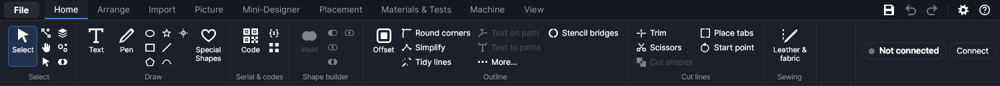
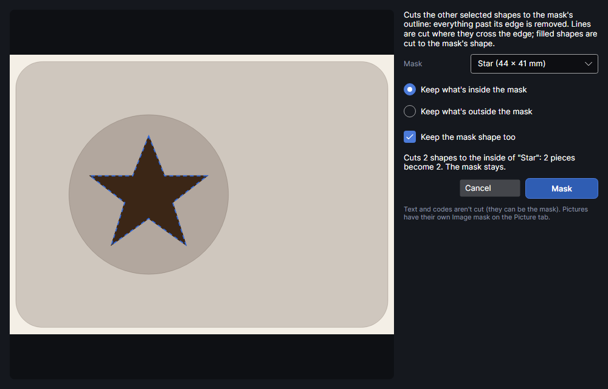
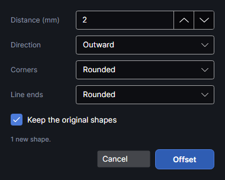
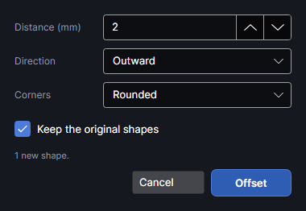

# Editing shapes

The **Home** tab's **Group**, **Shape builder** and **Outline** groups change shapes: they tie them
together, merge and cut them, grow or shrink their outlines, and tidy up imported drawings. Select
what to change first: a button stays grey until the selection suits it. Most of them work on
vector shapes (drawn, imported, text), not on pictures.

Right-click a shape for most of the same commands (**Shape operations** in the menu, see
[Working on the canvas](canvas.md)). Every change is one undo step: `Ctrl+Z` takes it back.

## What shape operations change

Most of these commands replace a shape's outline with a new one, and that has side effects:

- **Text and codes** become plain outlines when their outline is changed. The words, the font
  and any serial number or spreadsheet field are fixed as they show at that moment and can't be
  edited any more. Some commands leave text and codes out altogether (table below); convert them
  first with **Text to paths** if you want them included.
- **Editable shapes** (rectangles, ellipses, polygons and stars that keep their size, corner radius
  or points, see [Drawing](drawing.md)) become plain outlines in the same way.
- **Pictures** are never changed by these commands; selected along with vector shapes, they're
  left as they are. To show only part of a picture, use **Image mask** on the Picture tab
  (the Image mask add-on).
- **Stencil bridges** (the middles of O, A, R kept in a cut-out stencil) is the Stencil bridges
  add-on: **Home → Outline → Stencil bridges**.
- **Hand-placed tabs and start points** are dropped from a shape whose outline is rebuilt. Place
  them last. Moving, turning and resizing keep them.

| Command | Text and codes | The result |
|---|---|---|
| **Combine** | become outlines | one new shape on the bottom shape's layer, in no group |
| **Break apart** | become outlines | one shape per outline, each on its shape's layer, in no group |
| **Weld**, **Subtract**, **Intersect**, **Exclude** | become outlines | one new shape on the bottom shape's layer, in no group; the originals are removed |
| **Offset** | used (the text itself stays if you keep the originals) | new shapes on each original's layer, in no group |
| **Round corners** | become outlines | the same shapes, layer and group |
| **Simplify**, **Tidy lines**, **Extend lines to meet the next shape**, **Remove overlapping lines** | left out | the same shapes, layer and group |
| **Cut shapes** | left out | new pieces on the bottom shape's layer, in no group |
| **Mask with shape** | left out (they can be the mask) | the same shapes, layer and group, cut to the mask; a shape left with nothing is removed |
| **Trim**, **Scissors**, **Place tabs**, **Start point** | can't be clicked | the same shape, layer and group |
| **Drop shadow…**, **3D shadow…** | used (the text stays) | a new shadow shape on the same layer |
| **Warp** (Arrange tab) | become outlines | the same shapes, layer and group |
| **Text to paths** | become outlines | the same shapes, layer and group |

"The bottom shape" is the selected shape furthest back in the drawing order: the one drawn or
imported first, or sent back with **To back** (see [Arranging](arrange.md)).

These commands also change the drawing order. **Combine** puts its shape where the front one of
the selected shapes was. **Weld**, **Subtract**, **Intersect**, **Exclude** and **Cut shapes** put
the result in front of everything else, as if it had just been drawn. On a layer whose **Order** is
**As drawn**, that changes when it's cut.

## Group and ungroup

**Group** (`Ctrl+G`) ties two or more selected shapes together: clicking any of them selects them
all, and they move, turn and resize as one. **Ungroup** (`Ctrl+Shift+G`) takes the selected shapes
out of their group.

- Shapes on different layers can share a group; each keeps its own layer and settings. Pictures
  can be grouped too.
- Groups don't nest: grouping shapes that are already in groups makes one new group of them all.
- `Alt`+click picks a single shape out of a group without ungrouping it. **Ungroup** with only
  that shape selected takes just that one out.
- Copies of a group (paste, **Duplicate**, the arrays, **Nest**, **Along a path**) are new groups of
  their own.
- **Spread across**, **Spread down** and **Nest** treat a group as one item. The align buttons
  don't: they move each shape on its own ([Arranging](arrange.md)).

## Combine and break apart

**Combine** (`Ctrl+K`) makes one shape out of two or more selected shapes. Every outline is kept
as it was, open lines included, but they now belong to one compound shape called "Combined", on
the bottom shape's layer. Outlines inside other outlines count as holes (even-odd: inside one
outline is a hole, inside two is solid again). Use it to make one shape with holes, a washer from
two circles for example.

**Break apart** (`Ctrl+Shift+K`) does the opposite: each outline of the selected shapes becomes a
shape of its own, named after the original with a number ("Combined 1", "Combined 2"…), on the
same layer. Shapes with a single outline are left alone.

- Holes become separate shapes too: the middle of an O is no longer part of the letter.
- A text broken apart becomes plain outlines, one shape per letter outline.
- Use it on a drawing that was imported as one big shape, or after **Scissors** to separate the
  pieces.

## Weld, subtract, intersect, exclude

The **Shape builder** group makes one new outline from two or more overlapping shapes. The
originals are replaced by the result, which is named after the command and goes on the bottom
shape's layer.

| Button | Keeps | Use it for |
|---|---|---|
| **Weld** (`Ctrl+Shift+U`) | Everything any of the shapes covers, as one outline: the lines inside the overlaps are gone | Joining letters to each other or to a base, so the laser doesn't cut through where they meet |
| **Subtract** (`Ctrl+Shift+M`) | The bottom shape, minus everything the others cover | Cutting a notch, a hole or a name out of a shape |
| **Intersect** | Only where all the shapes overlap | Trimming a pattern to an outline |
| **Exclude** | Where an odd number of the shapes lie: with two shapes, everything except the overlap | Alternating, interlaced designs |

- They work on closed outlines only: open lines in the selected shapes are dropped.
- To choose the shape **Subtract** cuts from, select it alone and click **To back** on the Arrange
  tab first.
- With **Weld**, a shape's own holes stay holes unless another shape covers them. Shapes that don't
  touch stay separate outlines, but in one shape.
- When nothing would be left (**Intersect** of shapes that don't overlap, for example), a message
  says so and nothing changes.
- To weld the letters of a text and keep it editable, tick **Weld letters together** for the text
  in the Selection panel instead ([Drawing](drawing.md)).

## Mask with shape
<!-- windows: MaskShapesWindow -->

**Mask with shape** (in the **Shape builder** group, and **Shape operations** on the right-click
menu) cuts the selected shapes to the outline of one of them, the mask: everything past the mask's
edge is removed. Use it to keep depth outlines, a traced pattern or
hatching only inside a frame or some lettering. Unlike **Intersect**, it keeps open lines (they're
cut where they cross the mask's edge), keeps each shape on its own layer, and puts the mask on the
mask layer, where it's kept but never burned.

Select the shapes to cut and the mask together, then click **Mask with shape**. A window shows the
result before anything changes: the shapes as they were in faint brown, what's kept in dark brown,
and the mask's outline dashed in blue.

| Setting | What it does |
|---|---|
| **Mask** | The shape whose outline does the cutting, listed by name and size. Only its closed outlines count. It starts on the simplest closed shape selected (the one with the fewest outlines, so a frame or some lettering rather than a thousand traced lines); pick another if that's wrong. |
| **Keep what's inside the mask** / **Keep what's outside the mask** | Which side survives. Inside is the default. |
| **The mask afterwards** | **Moves to the mask layer (never burned)** (default): the mask is kept on the **Mask (never burned)** layer, to line things up with and mask with again, but it's never cut or marked (see [The mask layer](layers.md#the-mask-layer)). **Stays on its own layer (burned with it)**: for a frame you want cut as well. **Is deleted**: it's gone once it has done the cutting. |

The line under the settings says how many shapes are cut, how many pieces they had and will have,
and which shapes are left with nothing (they're removed). **Mask** applies it as one undo step.

- Lines are cut where they cross the mask's edge. Filled (closed) outlines are cut to the mask's
  shape, so a filled ribbon that crosses the edge ends exactly on it.
- A mask with holes (letters such as "o" and "e") keeps the holes out: what lies in a hole counts
  as outside.
- Text and codes are never cut, but either can be the mask. Pictures have their own
  Image mask.
- The cut shapes keep their name, layer and group, but lose their tabs and start point.

## Offset

<!-- windows: OffsetWindow -->

**Offset** (`Ctrl+Shift+O`) draws a new outline a set distance outside or inside the selected
shapes: a cut line round an engraving, a border round a sticker, an inset frame, or a closed
outline round a single line so it can be cut as a strip. The result shows on the work area as you
change the settings. **Offset** keeps it; **Cancel** (or closing the window) leaves the design as
it was.

| Setting | What it does |
|---|---|
| **Distance (mm)** | How far out or in, 0.01–200 mm. Default 2. |
| **Direction** | **Outward** grows shapes (their holes shrink), **Inward** shrinks them, **Both sides** makes one of each. Default **Outward**. |
| **Corners** | **Sharp** keeps corners pointed (very sharp points are cut off once they would reach 4 × the distance, so they don't spike out), **Rounded** goes round each corner in an arc, **Flat (cut off)** cuts corners straight across. Default **Rounded**. |
| **Line ends** | Shown only when open lines are selected. An open line gets a closed outline the distance either side of it; this sets its ends: **Flat** square at the end of the line, **Rounded** a half circle, **Square** square and reaching past the end by the distance. Default **Rounded**. |
| **Keep the original shapes** | Ticked (default): the new outlines are added. Unticked: they replace the originals. |

- Each selected shape is offset on its own. Offsets of neighbouring shapes can overlap; **Weld**
  them afterwards if they should be one outline.
- Within a shape, the outlines are filled even-odd first, so a hole moves the opposite way to the
  outline round it.
- The new shapes are named "Outset …" or "Inset …", go on each original's layer, and are selected
  when you click **Offset**.
- An inward distance more than half a shape's width makes it vanish; the line under the settings
  says how many vanished ("1 result(s) vanished…").
- **Direction** doesn't apply to open lines: **Both sides** gives two copies of the same outline
  round them.
- Curves come back as curves, within 0.01 mm. Distance, direction, corners and line ends are
  remembered for next time.

## Round corners

**Round corners** turns every sharp corner between two straight edges of the selected shapes into
an arc. A small window asks for the radius: **Corner radius (mm)**, default 2 (the last value you
used is offered again until the program is closed). **OK** applies it.

- Only corners where two straight edges meet are rounded. Curves, and corners between a curve and
  a straight edge, are left as they are.
- Where the edges are too short for the radius, the corner gets the biggest radius that fits:
  each edge lends half its length to the corner at each end (all of it at the open end of a line).
- The status bar says how many corners were rounded, or that there were none to round.
- A rectangle drawn with the Rectangle tool has its own **Corner radius** in the Selection panel,
  which keeps it editable ([Drawing](drawing.md)).

## Text on path

**Text on path** makes a text follow a line or a shape's outline: a name round a badge, words
along a wave. Select the text and the line or shape (`Shift`+click adds to the selection), then
click **Text on path**.

- Each letter sits with its middle on the path, turned to the path's direction. The text's
  **Align** setting (Selection panel) says where it goes: **Left** starts at the path's start,
  **Centre** centres it on the path, **Right** ends at the path's end. Further lines go below the
  first. On a closed outline the words go round.
- The text stays text: its words, font and size can still be changed.
- With several shapes selected besides the text, the biggest is the path (its first outline).
- The text keeps its own copy of the path. Moving or changing the path afterwards doesn't move the
  text; to follow a changed path, select both and click **Text on path** again.
- The path is still there and is marked like any shape on its layer. Delete it, or move it to a
  layer whose output is off, if it shouldn't be marked.
- To straighten the text, select it alone and click **Text on path** again (the right-click menu
  calls it **Straighten text**).
- To bend a text along an arc without a path, use **Curve (°)** in the text's settings
  ([Drawing](drawing.md)).

## Trim

**Trim** is a tool: click a piece of a line between the places where it crosses other lines, and
that piece is cut away. Use it to clean up line drawings: ends that overshoot, crossing
construction lines, the inner arcs of overlapping circles drawn as lines.

- As you move over a line, the piece that would go is highlighted.
- A piece ends where the line crosses another line on a visible layer, another outline of the same
  shape, or itself. A line that crosses nothing can't be trimmed: the status bar says "Nothing to
  trim there".
- The trimmed outline becomes open lines, rebuilt from short straight lines that follow its curves
  within about 0.01 mm. Its other outlines are unchanged. A shape with nothing left is deleted.
- Text and codes can't be trimmed (convert them first with **Text to paths**).
- The tool stays on for the next click. `Esc` goes back to **Select**.
- Open lines can't be filled: when the remaining pieces should make a closed shape, join them with
  **Tidy lines**.

## Scissors

**Scissors** is a tool: click a line or outline to cut it at that point. A closed outline opens
there (one open line that starts and ends at the cut); an open line becomes two. Curves stay
curves.

- A dot shows where the cut will be when the pointer is on a line.
- The pieces stay in one shape: select it and click **Break apart** to make them separate shapes.
- An opened outline is no longer closed: Engrave layers can't fill it, and kerf, tabs and start
  points don't apply to it.
- Text and codes can't be cut (convert them first with **Text to paths**).
- The tool stays on for the next click. `Esc` goes back to **Select**.

## Simplify

**Simplify** redraws the selected shapes with far fewer lines and curves, keeping within a
distance of the original that you type in: **Stay within (mm) of the original outline**, default
0.02. Imported and traced shapes often have thousands of tiny pieces; fewer make the design
lighter to work with.

- Closed outlines are redrawn with straight lines and curves; open lines with straight lines only.
- An outline is never made worse: if the new one wouldn't have fewer pieces, the old one is kept.
- The status bar gives the count before and after ("Simplified: … pieces → …"), or says "Already
  as simple as it gets at that accuracy."
- A larger distance removes more, but rounds off small details.
- Text and codes are left out.

## Cut shapes

**Cut shapes** cuts overlapping shapes into separate pieces where they cross: each overlap becomes
a piece of its own, and what's left of each shape another. Two overlapping circles give three
pieces. Use it for inlays, puzzles and colour work, where each region is cut or engraved on its
own.

- Only closed outlines take part. Open lines in the selected shapes are removed along with the
  originals (`Ctrl+Z` brings them back).
- Text and codes are left out, and left as they are.
- The pieces are called "Piece 1", "Piece 2"… and go on the bottom shape's layer, selected. The
  status bar says how many there are.

## Tabs and start points

Two tools for where cuts stop and start. Both are kept with the shape: they move, turn and resize
with it and are saved with the design. They're shown on the work area as small markers on the
outline. Neither has been tried on the machine yet.

### Place tabs

Tabs are short uncut bridges that keep a part in the sheet so it doesn't drop or shift while the
rest is cut; you snap it out afterwards. A Cut layer's **Tabs** setting spaces them evenly round
every closed outline ([Layer settings](layer-settings.md)). **Place tabs** puts them exactly where
you click instead: on a straight edge that's easy to sand, away from a fragile detail.

- Click an outline: a tab goes on the nearest point of it, shown as a small filled square. Click
  again for more. The status bar says how many the shape has.
- `Shift`+click near a tab removes it.
- When the job is built, a closed outline on a Cut layer with hand-placed tabs gets exactly those,
  whatever the layer's **Tabs** number. Each gap is the layer's **Tab width (mm)** wide; with
  **Tab power %** above 0 the gaps are cut at that power instead of left (thin bridges that snap
  out cleanly). Outlines with tabs get no lead-in, overcut or lead-out.
- Tabs do nothing on Score, Engrave or picture layers, or on open lines.
- Text and codes can't have tabs.
- The tool stays on; `Esc` goes back to **Select**.

### Start point

Where a closed outline's cut starts and ends can leave a small mark (that's what the layer's
**Lead-in (mm)** is for). **Start point** lets you choose that spot, a corner or the back edge,
where it shows least: click an outline and its cut starts exactly there, even mid-edge, and goes
round from it.

- The chosen point shows as a ring with a dot. Clicking the shape again moves it: a shape has one
  start point.
- `Shift`+click the shape to clear it: the layer's cut order chooses again.
- It's used on Cut and Score layers, for closed outlines, and wins over **Start outlines nearest
  the laser** for that outline. Which outline is cut when is still the layer's **Order**.
- Text and codes can't have one.
- The tool stays on; `Esc` goes back to **Select**.

## The More… menu

**More…** opens a menu of less common outline tools. Each acts on the selection straight away
(or asks for one number first) and says in the status bar what it did.

### Extend lines to meet the next shape

Each open end of the selected lines carries on straight, the way it was heading, to the first line
or outline it meets, up to 500 mm away. Ends that would meet nothing stay as they are. With nothing
selected it works on every open line in the design. Use it to close a drawing whose lines stop
just short of each other, then **Trim** any overhang and **Tidy lines** to join the pieces.

- The lines it runs to can be any shape on a visible, unlocked layer, not only the selection.
- Text and codes are left out.

### Remove overlapping lines

Where lines lie on top of each other, such as the shared edge of two parts drawn side by side, the
laser would cut them twice. This removes the doubled stretches so each is cut once. It works on
the selection, or on the whole design when nothing is selected.

- Lines count as doubled when they run side by side within 0.02 mm. The shape first in the drawing
  order keeps its line; the later ones lose that stretch.
- A closed outline that loses a stretch becomes open lines: Engrave layers can't fill it, and kerf
  and tabs no longer apply to it. Shapes left with nothing are deleted.
- The Cut layer setting **Cut shared edges once** does the same when the job is built and leaves
  the drawing as it is ([Layer settings](layer-settings.md)).
- Text and codes are left out. The status bar says how many millimetres were removed.

### Tangent circles

**Tangent circles (select three circles)**: select exactly three circles, and every circle that
touches all three (from inside or outside, up to eight) is drawn. Delete the ones you don't want.
Useful for geometric patterns of touching circles.

- Each of the three must be one closed, round outline (drawn or imported).
- The new circles are editable ellipses named "Tangent circle", on the first circle's layer, and
  are selected.

### Drop shadow and 3D shadow

Both add a shadow beside each selected closed shape, offset by a distance you type: **Offset X, Y
(mm)**, default `1.5, 1.5` (right and down). Type two numbers separated by a comma or a space,
with a point for decimals (`0.8, 1.2`).

- **Drop shadow…**: the shape moved by the offset, minus the shape itself: the sliver that shows
  beside it.
- **3D shadow…**: the shape swept all the way along the offset, minus the shape: a solid, extruded
  look.
- The shadow is a new shape named "Shadow · …" on the same layer, and is selected; the original
  stays. Move the shadow to another layer to engrave it with different settings, lighter for
  example.
- Only closed outlines make shadows; text works.

### Clear all guides

**Clear all guides** removes every guideline dragged out from the rulers at once. `Ctrl+Z` brings
them back. To remove one guide, drag it back onto its ruler ([Working on the canvas](canvas.md)).

## Tidy lines

**Tidy lines** cleans up drawings that came in broken up. A small window asks for **Join ends
closer than (mm)**, default 0.05, and says whether it works on the selection or, with nothing
selected, on the whole design. **OK** runs it. In turn, it:

1. leaves out zero-length pieces;
2. closes lines whose two ends are within that distance of each other (the end moves onto the
   start);
3. joins open lines whose ends are within that distance into one line, either way round and
   across shapes (the joined line stays in the shape its first piece came from; shapes left empty
   are deleted), closing it if its ends then meet;
4. deletes outlines that lie exactly on top of another (the same points within that distance,
   either direction).

The status bar sums it up: "Joined …, closed …, removed … duplicates and … zero-length pieces."

Why it matters: CAD programs save a DXF drawing as separate lines and arcs, so a rectangle comes
in as four lines that only touch. Until they're joined and closed:

- Engrave layers can't fill them (open lines are skipped, with a warning when the job is built);
- kerf compensation, tabs, lead-ins and start points only work on closed outlines;
- each piece is cut as a separate path, so the job has many more starts and stops;
- lines drawn twice are cut twice.

Keep the distance small: it's meant for gaps too small to see, not for lines that are meant to be
apart. Text and codes are left out. Afterwards, **Select by…** → **Open lines (not closed)**
selects anything still open ([Working on the canvas](canvas.md)).

## Text to paths

**Text to paths** (`Ctrl+Shift+C`) turns the selected texts into ordinary outlines: the letters'
shapes, no longer editable as words. Codes (QR, Data Matrix, barcodes) and editable rectangles,
ellipses, polygons and stars in the selection become plain outlines too. The button lights up
when a text is selected.

- Fields such as serial numbers and spreadsheet columns are fixed at the value they show at that
  moment: they no longer change from run to run.
- Each shape keeps its place, layer and group.
- Use it before changing letters with **Edit points** (which doesn't work on text, codes or
  editable shapes) or with **Trim** and **Scissors** (which don't work on text or codes).

## Try it

- [Group and ungroup](tutorial:edit-group)
- [Combine and break apart](tutorial:edit-combine)
- [Weld, subtract, intersect, exclude](tutorial:edit-shape-builder)
- [Offset an outline](tutorial:edit-offset)
- [Round corners](tutorial:edit-round-corners)
- [Text on a path](tutorial:edit-text-on-path)
- [Trim lines](tutorial:edit-trim)
- [Cut a line with scissors](tutorial:edit-scissors)
- [Simplify a shape](tutorial:edit-simplify)
- [Cut overlapping shapes into pieces](tutorial:edit-cut-shapes)
- [Mask shapes with a shape](tutorial:edit-mask)
- [Place tabs by hand](tutorial:edit-tabs)
- [Choose where a cut starts](tutorial:edit-start-point)
- [Extend lines to meet](tutorial:edit-extend-lines)
- [Remove doubled lines](tutorial:edit-remove-overlaps)
- [Tangent circles](tutorial:edit-tangent-circles)
- [Drop shadow and 3D shadow](tutorial:edit-shadows)
- [Clear all guides](tutorial:edit-clear-guides)
- [Tidy an imported drawing](tutorial:edit-tidy-lines)
- [Text to paths](tutorial:edit-text-to-paths)
