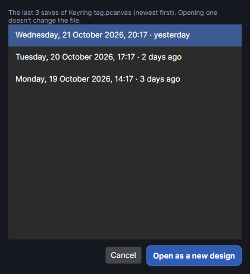
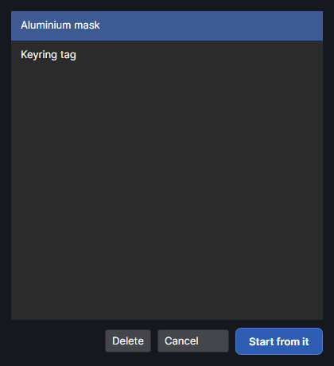
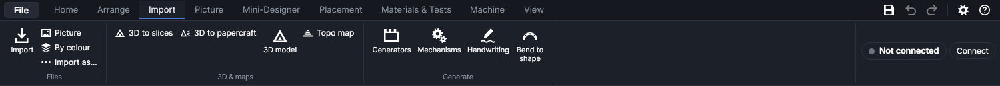

# Files: open, save, import, export

This page covers everything that goes in or out of the program as a file: your designs (saving,
opening, templates, autosave and earlier versions), drawings and pictures brought in from other
programs, and what you can export. It ends with where the program keeps its own files.

## The File menu

The **File** button at the top left, beside the ribbon's tabs, opens this menu.

| Item | Keys | What it does |
|---|---|---|
| **New** | `Ctrl+N` | Starts an empty design. See [New](#new). |
| **New from template…** | | Starts a new design from a saved template. See [Templates](#templates). |
| **Open…** | `Ctrl+O` | Opens a saved design. See [Open and Open recent](#open-and-open-recent). |
| **Open recent** | | The last 10 designs you opened or saved. |
| **Save** | `Ctrl+S` | Saves the design to its file (asks for a name the first time). |
| **Save as…** | `Ctrl+Shift+S` | Saves it under a new name or in another folder. |
| **Save as template…** | | Keeps the design as a template to start new designs from. |
| **Earlier versions…** | | Opens one of the last 20 saved versions of this design. See [Earlier versions](#earlier-versions). |
| **Import…** | `Ctrl+I` | Brings drawings and pictures into the design. See [Importing](#importing). |
| **Import, one layer per colour…** | `Ctrl+Shift+I` | The same, with a layer for each colour in the drawing. |
| **Import picture…** | `Ctrl+J` | Brings in photos and other pictures. |
| **Export job package (.xf)…** | | Saves the job the machine would run. See [The job: .xf and G-code](#the-job-xf-and-g-code). |
| **Export G-code (.gcode)…** | | Saves the job's G-code as text. |
| **Export design as SVG…** | | Saves the design for other programs. See [The design: SVG, DXF and PNG](#the-design-svg-dxf-and-png). |
| **Export design as DXF…** | | The same, as DXF. |
| **Export design as PNG…** | | The same, as a picture. |
| **Settings…** | | Opens the settings. See [Settings, shortcuts, fonts and Exit](#settings-shortcuts-fonts-and-exit). |
| **Keyboard shortcuts…** | | Opens the window where shortcuts are changed. |
| **Fonts…** | | Opens the font manager. |
| **Exit** | | Closes the program (asking first if there are unsaved changes). |

The keys above work everywhere in the main window, even while you're typing in a box. They can
be changed in **Keyboard shortcuts…**.

## Designs: new, open and save

### New

**New** (`Ctrl+N`) starts an empty, untitled design with one layer, called *Cut*. If the design
you have open has unsaved changes, you're asked first (see [Unsaved changes](#unsaved-changes)).

### Open and Open recent

**Open…** (`Ctrl+O`) shows the **Open project** window. It lists PhotonCanvas designs (`.pcanvas`)
and older `.ytool` files from before the program was renamed. To bring in an xTool Studio or
LightBurn project, SVG, DXF or PDF, use [Import](#importing) instead: those add to the design you
have open.

**Open recent** lists, by their full path, the last 10 designs you opened or saved, newest first.
Files that have been moved or deleted are left out; with none, it shows **(none)**.

Opening a design replaces the one on screen and clears the undo history. Messages you may see:

- *This is not a PhotonCanvas project file.* The file is something else.
- *The project file is damaged (…).* It can't be read as a design.
- *This project was saved by a newer version of PhotonCanvas.* Update the program to open it.

You can also drag a design file onto the window (see [Drag and drop, and paste](#drag-and-drop-and-paste)).
Starting the program with a design file (for example from Windows' **Open with**) opens that design.

### Save and Save as

**Save** (`Ctrl+S`, or the disk icon at the top right) writes the design to its file. The first
time, the **Save project** window asks where and under what name; the file gets the `.pcanvas`
ending. **Save as…** (`Ctrl+Shift+S`) always asks, and from then on the design is that new file.

- The window's title shows the design's name, or **Untitled** before it's first saved. A **•**
  after the name means there are changes that aren't saved.
- Each save is written to a temporary file first and then put in place, so a crash or power cut
  during saving never leaves a half-written design.
- Before a file is saved over, the version already there is kept (see [Earlier versions](#earlier-versions)).
- A `.ytool` file is saved in the current format, under the same name.

### Unsaved changes

Before anything replaces or closes a design with unsaved changes (**New**, **New from template…**,
**Open…**, **Open recent**, opening a version from **Earlier versions…**, dropping a design file,
**Exit** or closing the window), the **Unsaved changes** window asks *Save changes to "name"?*

- **Save** saves first. If the design has never been saved, the save window opens; cancelling it
  cancels the whole thing.
- **Don't save** throws the changes away.
- **Cancel** goes back to the design.

### The design file (.pcanvas)

A `.pcanvas` file is plain, readable text (JSON). It holds everything in the design:

- *Every page*, with its name, and which page was showing.
- *Layers*, in order, with all their settings: mode, laser, power, speed, passes, pulse width
  and frequency, line spacing, and every other layer setting, plus the material chosen from your
  library (as a reference to it, with its name).
- *Shapes*, each with its layer, group, lock, name and placement. Drawn shapes are stored as
  outlines; rectangles, ellipses, polygons and stars stay editable (size, corners, sides,
  points); codes keep their content and settings; hand-placed tabs and chosen start points are kept.
- *Text*, with its font and style, and also its outline, so the design looks the same on a
  computer that doesn't have the font.
- *Pictures*, as the original picture file inside the design, with their tone settings and
  clipping. A design with photos in it is therefore about as big as the photos.
- *Guides*, the *curved surface* set up for the design, and the *variables* (serial number,
  and the spreadsheet's contents, so the CSV file itself isn't needed later).

It doesn't hold the work mode, the machine connection or your material library: those belong to
the program's settings.

### Reopening the last design

When you close the program, it notes which design was open and which part of the work area was on
screen. The next time it starts, it opens that design again at the same view, and the status bar
says *Reopened …, as it was when PhotonCanvas was closed.*

It opens the file as it is on disk, so if you closed with **Don't save**, you get the last saved
version. Nothing is reopened when the design had never been saved, the file has been moved or
deleted, unsaved work was just brought back (see below), or the program was started with a file.

## Autosave and unsaved work

Every two minutes, if the design has unsaved changes, a copy is written to the `autosave` folder in
the program's data folder (see [Where files are kept](#where-files-are-kept)). There is one copy:
each autosave replaces the last. Saving the design, or closing the program normally (including with
**Don't save**), deletes it.

So the copy only survives when the program stopped without closing normally: a crash, a power cut,
the computer shutting down. At the next start, **Bring back unsaved work?** says which design it was
and when the copy was made:

- **Open the copy** opens it, marked as unsaved. If the design had a file, it's still that file, so
  **Save** writes the brought-back work over it (and the version there is kept, as always).
  The status bar says *Unsaved work brought back: save it to keep it.*
- **Discard it** deletes the copy.

If PhotonCanvas was started by opening a file (double-clicking a `.pcanvas`, say) and you open the
copy, it then asks whether to save the brought-back work before that file opens: **Cancel** keeps
the copy open instead.

> **Note:** Autosave is a safety net, not a save. Up to two minutes of work can be lost; save often.

## Earlier versions
<!-- windows: VersionsWindow -->

Each time you save over a design's file, the file as it was is copied aside first. The last 20 are
kept for each design, so you can go back to how it was a few saves ago.

**File → Earlier versions…** opens the **Earlier versions** window for the design that's open. It
lists the kept versions newest first, each by the date and time it was saved and how long ago
(*Wednesday, October 21, 2026, 12:23 AM · yesterday*). Pick one and click **Open as a new design**:

- It opens as a new, untitled design. The design's file isn't changed.
- To go back to that version for good, save it over the original file (**Save as…**, choose the
  same file). To keep both, save it under a new name.

If the design has never been saved, a message says *Save the design first: a copy is kept each time
you save over it.* With no versions yet, the window says so.

Versions are kept in the `versions` folder of the data folder, in a folder per design. They follow
the file's full name and place: if you rename or move a design, its earlier versions stay with the
old name, and a fresh list starts.

## Templates
<!-- windows: TemplatesWindow -->

A template is a design you start new ones from: a jig outline with its layers set up, a sign blank,
a test layout. Starting from a template never changes the template.

**Save as template…** asks for a **Template name** (it suggests the design's own name, or *My
template*) and saves the whole design, every page, layer and setting, as that template. Characters
that can't be in a file name become `_`. If a template has that name already, you're asked whether
to replace it.

**New from template…** first asks about unsaved changes, then opens **New from template**:

- The list shows your templates in alphabetical order, the first one picked.
- **Start from it** (or a double-click on a template) starts a new, untitled design from it.
  **Save** then asks for a name, so the template stays as it was.
- **Delete** removes the picked template, after asking. Designs made from it aren't affected. A
  deleted template can't be brought back.
- **Cancel** closes the window.

Templates are `.pcanvas` files in the `templates` folder of the data folder. A design file copied
into that folder shows up as a template too.

## Importing

Importing brings drawings and pictures from other programs into the design you have open, as
ordinary shapes you can edit. The buttons are in the **Files** group at the left of the **Import**
tab, which also holds the add-ons that bring in 3D models and maps and the generators. **Import**,
**Picture** and **By colour** are also in the **File** menu.

| Button | Keys | What it does |
|---|---|---|
| **Import** | `Ctrl+I` | Drawings and pictures. A drawing comes in shape by shape on the active layer. |
| **Picture** | `Ctrl+J` | Pictures only (PNG, JPG, BMP, GIF, WebP, TIFF), onto a picture layer. |
| **By colour** | `Ctrl+Shift+I` | A drawing with one layer per colour. |
| **Import as…** | | A menu: **Import, each file grouped…**, **Import with every piece separate…**, **Import as one picture…** |
| **3D to slices** | | Slices a 3D model into layers to cut and stack: see 3D models and stacked slices. |

On a narrow window the small buttons show only their icons; hover over one to see its name.

Each opens the system's file window. You can pick several files at once: each is brought in, and the
whole import is one step to undo. Pictures picked with **Import** or **By colour** come in exactly as
with **Picture**; picked together with drawings, the pictures are one undo step and the drawings
another.

### Where imported shapes go

- **Layer.** A plain import lands on the active layer (the one picked in the Layers panel). If that
  layer is hidden or locked, it goes on the first layer that's visible and unlocked; if there is
  none, a message asks you to show or unlock one. Pictures in the file go on a picture layer (see
  [Pictures](#pictures)).
- **Files that name their layers** (xTool projects, LightBurn projects, nearly every DXF file) always come
  in with one layer per colour, named after the file's own layers, as with **By colour**.
- **Position.** If the drawing lies inside the work area where the file puts it, it stays there.
  Otherwise it's moved to the middle of the work area.
- **Size.** Drawings come in at their real size, from the units the file gives (see
  [What each file type brings in](#what-each-file-type-brings-in)). If one is bigger than the work
  area, a note says so: scale it down before sending.
- **Afterwards** the new shapes are selected and the view zooms to them. Groups in the file aren't
  kept, except with **Import, each file grouped…**.
- **Import notes.** Anything that couldn't be brought in (text, hatches, hidden objects…) is
  listed in an **Import notes** window afterwards, with what to do about it. Each note is listed
  once, and at most 12 are shown.

### One layer per colour

**By colour** (and **File → Import, one layer per colour…**, or holding `Shift` while dropping
drawings on the window) puts each colour in the drawing on its own layer. The colour is a shape's outline (stroke) colour, or its fill colour if it has no outline.

- Each new layer is a **Cut** layer with the default settings, named *Colour #RRGGBB* (the colour's
  code, for example *Colour #FF0000*), or after the file's own layer where it names them.
- The layer shows in the file's colour, unless that colour is too dark to see on the work area (black,
  for example): then it gets one of the program's layer colours, keeping its name.
- If a layer of that name is already there, the shapes go onto it instead of a new one. Import a
  second drawing with the same colours and its shapes join the same layers.

Use it for drawings made with a colour per operation (red to cut, blue to score, black to engrave):
then set each layer's mode and settings once (see [Layers](layers.md) and [Layer settings](layer-settings.md)).

### Import as: grouped, every piece separate, one picture

The **Import as…** button opens a menu of three other ways to bring a drawing in:

- **Import, each file grouped…**: everything from one file (shapes and pictures) becomes a single
  group, so it moves and sizes as one. With several files, each is its own group.
- **Import with every piece separate…**: every closed or open outline becomes its own shape, holes
  too. A letter O, for example, comes in as two shapes, the outside and the hole. Normally a shape
  with holes stays one shape.
- **Import as one picture…**: the drawing is drawn into one black picture, 0.1 mm a pixel (254 dpi):
  closed shapes filled, open lines drawn 0.2 mm wide. The picture is named after the file and goes
  on the first visible, unlocked picture layer, or on a new one called **Pictures**. Use it to engrave a drawing as a picture (with dithering and the picture settings) rather than
  as vector fills. Pictures inside the file still come in on their own, on top of it.

### Pictures

**Picture** (`Ctrl+J`, **File → Import picture…**) brings in PNG, JPG, BMP, GIF, WebP and TIFF files.

- A picture goes on the first visible, unlocked layer in **Picture** mode. If there is none, a new
  picture layer called **Pictures** is added.
- Its size is 0.1 mm a pixel (254 dpi), reduced if needed so its longer side is at most 100 mm. The
  file's own dpi is ignored. Set the real size in the Selection panel.
- It's placed in the middle of the work area; with several, each sits 5 mm further down and to the
  right of the one before.
- Phone photos stored on their side are turned the right way up. Pictures bigger than 6000 pixels on
  their longer side are reduced to 6000 pixels.
- The design keeps the original picture file, so nothing is lost by saving.

If a picture can't be read, a message names it and says why; save it as PNG or JPG and import
that. To trace, crop, filter or prepare a picture, see [Pictures](pictures.md).

### Drag and drop, and paste

You can drag files from Explorer onto the window:

- Drawings of every kind **Import** reads (SVG, DXF, PDF, AI, EPS and PostScript, xTool, LightBurn,
  HPGL) are imported as with **Import**. Hold `Shift` while dropping for one layer per colour.
- PNG, JPG, BMP, GIF, WebP and TIFF pictures are imported as with **Picture**.
- A design file (`.pcanvas` or `.ytool`) is opened, after asking about unsaved changes, when no
  drawings are dropped with it.

**Paste** (`Ctrl+V`) also brings in what another program copied: SVG code copied as text is imported
like an SVG file, and a copied picture goes onto a picture layer as with **Picture**.

### What each file type brings in

| Type | Endings | Comes in | Left out |
|---|---|---|---|
| SVG | `.svg` | Paths and basic shapes, at their real size, with their colours | Text, embedded pictures |
| DXF | `.dxf` | Lines, arcs, circles, polylines, splines, blocks, with layer names and colours | Text, hatches, dimensions, pictures, 3-D objects |
| PDF | `.pdf` | The first page: paths with their colours, and pictures | Text, other pages |
| Illustrator | `.ai` | As PDF (needs a PDF-compatible file) | As PDF |
| EPS, PostScript | `.eps`, `.ps` | As PDF (needs Ghostscript) | As PDF |
| xTool Studio | `.xs`, `.xcs` | The open canvas: shapes, text, pictures, layer names and colours | Laser settings, 3D models, hidden objects |
| LightBurn | `.lbrn2`, `.lbrn` | Shapes, text, pictures, layer names | Laser settings |
| HPGL / plotter | `.plt`, `.hpgl`, `.hpg` | Lines and circles, a colour per pen | |

Details, for when a drawing doesn't come in as expected:

**SVG**

- Paths, rectangles (with rounded corners), circles, ellipses, lines, polylines, polygons, nested
  groups and SVGs, `use` copies and transforms are read.
- Size comes from the file's width and height (mm, cm, in, pt, pc or px) and its viewBox. Pixels
  count as 96 to the inch, as in Inkscape and browsers, unless you change `SvgPxPerInch` in
  `app.json` (there's no setting for it in the program). An old Illustrator SVG made at 72 to the
  inch comes in at three quarters of its size: scale it to 133.3 %.
- Hidden parts (display none, visibility hidden, opacity 0) are left out. Clipping paths and masks are
  ignored: the full shapes come in, with a note. Shapes with neither outline nor fill come in anyway,
  with a note.
- Text and embedded pictures are left out, with a note: turn text into paths (outlines) in the program
  that made it, and import pictures on their own.
- A gradient or pattern has no single colour, so it counts as black for **By colour**.

**DXF**

- Text (ASCII) DXF files from R12 to R2018. A binary DXF is refused: save it again as ASCII.
- Read: LINE, LWPOLYLINE and POLYLINE (with arcs), CIRCLE, ARC, ELLIPSE, SPLINE, SOLID, TRACE and
  blocks (INSERT, nested and arrayed).
- Units come from the file. A file that doesn't say is read as millimetres, with a note if the result
  looks too small or too big ("if it was drawn in inches, scale it by 25.4"). A file that says it's in
  a unit bigger than millimetres (inches, metres…) and comes out bigger than 2 m gets a note too.
- The drawing is turned right side up (DXF counts up, the work area down) and placed with its
  top-left corner at the work area's top-left corner (or in the middle, if it doesn't fit).
- Each shape is named after its DXF layer and coloured with its DXF colour. Where a colour belongs to
  exactly one DXF layer, the layer made for it gets that layer's name.
- Left out, with a note each: text (explode it to curves first), hatch fills, dimensions, linked
  pictures, 3-D solids and meshes, construction lines (XLINE, RAY), leaders, objects on hidden or
  frozen layers, and anything only in a paper-space layout.

**PDF, Illustrator and EPS**

- Only the first page of a PDF is read, at its real size, with the page's top-left corner at the
  work area's top-left corner (or in the middle, if the drawing doesn't fit).
- Each path takes its outline colour, or its fill colour if it's only filled. Clipping is ignored.
- Text is left out (a PDF holds letters, not outlines), with a note: turn text into outlines first.
- Pictures come in when stored as JPEG or convertible to PNG; others are left out, with a note.
- An `.ai` file is read through the PDF copy Illustrator keeps inside it. Without it, a message says
  to save from Illustrator with **Create PDF Compatible File** ticked, or export SVG or PDF.
- An `.eps` file needs Ghostscript, a free program not included with PhotonCanvas. When it's installed,
  the file is turned into a PDF (Ghostscript runs in its safe mode, for at most a minute) and read like
  one. Without it, a message says to install it, or to save the file as PDF or SVG.

**xTool Studio projects (.xs, .xcs)**

- Both versions of xTool Studio's project file are read.
- Only the canvas that was open in xTool Studio comes in; a note says so when there are more.
- Paths, rectangles, circles, ellipses, lines, text (from the letter outlines xTool keeps with it) and
  pictures come in where they were. Each layer's colour and name come too.
- Laser settings (power, speed…) aren't brought in: set them on the layers here. xTool Studio's
  material settings come in through the [Material library](material-library.md) instead.
- Left out, with a note: hidden objects, 3D models, text without stored letter outlines (turn it into
  a path in xTool Studio), and masks or crops on pictures (the whole picture comes in).

**LightBurn projects (.lbrn2, .lbrn)**

- Rectangles, ellipses, paths, the contents of groups, pictures and text. Text uses the outline
  LightBurn keeps with it, or is rebuilt from its font.
- Each LightBurn layer (cut setting) becomes a layer here, with its name. Its settings aren't converted.
- Shapes of other kinds are left out, with a note.

**HPGL plotter files (.plt, .hpgl, .hpg)**

- Pen moves and circles, in plotter units of 0.025 mm, turned right side up.
- Each pen number has its own colour, so **By colour** gives a layer per pen, with two
  exceptions: pens 0 and 1 are both black, and pens 8 and up share one colour (orange).

## Exporting

### The design: SVG, DXF and PNG

**Export design as SVG…**, **Export design as DXF…** and **Export design as PNG…** in the **File**
menu save the design (not the job) for other programs. The suggested name is the design's own. All three take the page on screen, leave out hidden
layers, and cover everything on the visible ones.

- **SVG**: sized in millimetres. Each layer is a group with the layer's name; every shape is outlined
  0.1 mm wide in its layer's colour, and filled on **Engrave** layers. Text and codes are outlines.
  Pictures are embedded as PNG.
- **DXF**: version R12, in millimetres. Every outline is a polyline on a DXF layer named after its
  layer (characters other than letters, digits, `-` and `_` become `_`). Curves become short straight
  lines, within 0.01 mm. Pictures are left out, and the layer colours aren't carried over.
- **PNG**: a picture of the design at 300 dpi on white, at most 20000 pixels a side: shapes as thin
  lines in their layer colours (filled on **Engrave** layers), and pictures drawn in.

Pictures in SVG and PNG exports are their pixels as imported (after any crop or filter), without the
tone settings or clipping shape set on them in the program.

### The job: .xf and G-code

These save the job instead of sending it: the job is built just as **Ship It** would send it, from
the design and the job bar's settings. If it can't be built, a **Can't export** message says why.

- **Export job package (.xf)…** saves exactly the package **Ship It** uploads to the machine. It is
  an archive of four files: `preview.jpg` (a small drawing of the paths), `border.gcode` (the framing
  outline), `motion.gcode` (the marking itself) and `description.json` (the mode, which laser, and each
  layer's power, speed and passes).
- **Export G-code (.gcode)…** saves only the marking G-code (`motion.gcode` above), as plain text, to
  read or compare.

The same exports are **Export .xf** and **Export G-code** on the **Machine** tab, and the job bar's
export menu: see [Running a job](running-jobs.md).

Both are written in the G-code of the xTool machines. For a GRBL machine added in
**Settings → Machines**, its G-code is saved with **Save G-code…** in the window that opens when you
send the job (see [The machine and settings](machine.md)).

## Settings, shortcuts, fonts and Exit

- **Settings…** opens the **Settings** window at its **Machine** page, as the gear at the top right
  does. See [The machine and settings](machine.md).
- **Keyboard shortcuts…** opens the window where every shortcut can be changed. See
  [Keyboard shortcuts](keyboard-shortcuts.md).
- **Fonts…** opens the font manager, where fonts are starred or hidden. See [Drawing](drawing.md).
- **Exit** closes the program, asking first if there are unsaved changes. The open design is noted to
  reopen next time (see [Reopening the last design](#reopening-the-last-design)).

## Where files are kept

Your designs go wherever you save them. The program keeps its own files in a **PhotonCanvas** folder in
your user folder (`%USERPROFILE%\PhotonCanvas`, for example `C:\Users\you\PhotonCanvas`):

| In it | What |
|---|---|
| `app.json` | Your settings, recent designs, the last design and view, changed shortcuts. |
| `autosave` | The copy of unsaved work (see [Autosave](#autosave-and-unsaved-work)). |
| `versions` | Earlier versions, a folder per design. |
| `templates` | Your templates. |
| `materials` | The material library. |
| `shapes` | Shapes you saved to the shape library. |
| `camera.json`, `keys.json` | The camera calibration and the machine's connection keys. |
| `job-history.jsonl` | The job history. |
| `logs` | The program's logs, for tracking down problems. |
| `depth` | Where each **Exact depth** run has got to, so it can carry on. |
| `graphene-readings.json` | The resistances you typed for a graphene test. |
| `model-thumbs` | Small pictures of 3D models, kept so the model browser opens faster. |
| `remote` | The phone remote's settings and records (see the Phone remote add-on). |
| `data-merged.json` | A note of which files from earlier data folders have been brought over (below). |

Earlier versions of the program kept these under AppData (in a **PhotonCanvas** or **YTool** folder).
At start, anything there is brought over once, without losing what's here; the old folders are left
as they are. A file that's in both places is replaced only when the old folder's copy is newer. The
material libraries are combined recipe by recipe (a recipe in both keeps the copy changed last), and
the job histories line by line.

> **Tip:** To keep your settings, material library, shapes and templates safe or move them to another computer,
> use **Back up settings…** in the settings (see [The machine and settings](machine.md)).

## Try it

- [Import a drawing](tutorial:file-import)
- [Import with a layer per colour](tutorial:file-import-by-colour)
- [Import grouped, in pieces or as a picture](tutorial:file-import-as)
- [Import a picture](tutorial:file-import-picture)
- [Save and open designs](tutorial:file-save-open)
- [Start designs from a template](tutorial:file-templates)
- [Go back to an earlier version](tutorial:file-earlier-versions)
- [Export the design or the job](tutorial:file-export)
