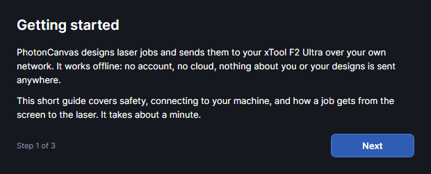

# Getting started

This page covers what PhotonCanvas is, how to run it, what happens the first time it starts, how
it connects to your machine, and a first job from drawing to laser.

## What PhotonCanvas is

PhotonCanvas designs laser jobs and sends them to an xTool F2 Ultra: a galvo laser with a 40 W
455 nm blue diode, a 60 W 1064 nm MOPA fiber laser and a 220 × 220 mm work area.

- **Offline.** No account and no cloud. The program talks to the machine over your own network
  (Wi-Fi, Ethernet or USB). Nothing about you or your designs is sent anywhere. The one request
  that leaves your network is the check for a new version at start, which you can turn off
  (Settings → Updates).
- **Jobs made on your computer.** Each job is turned into G-code here, in the same dialect the
  stock software uses, and uploaded as a job package.
- **The machine waits for you.** Uploading never starts the laser. A job sits on the machine
  until you press its start button.
- **Free to use**, all rights reserved (the terms are in the LICENSE file). It is independent: not made,
  endorsed or supported by xTool or Makeblock. Help → **About PhotonCanvas** shows the version.

## Running it

There is no installer. A ready-to-run build is a folder that carries everything it needs,
including its own .NET runtime, so nothing else has to be installed.

| Computer | What you get | To run it |
|---|---|---|
| Windows (x64 or ARM) | `PhotonCanvas-win-x64.zip` (or `win-arm64`) holding a `PhotonCanvas` folder | Unzip it anywhere and run `PhotonCanvas.exe` in the folder. |
| macOS (Apple silicon or Intel) | `PhotonCanvas-osx-arm64.tar.gz` (or `osx-x64`) holding `PhotonCanvas.app` | Unpack it. The app isn't signed: the first time, right-click it and choose Open. |
| Linux (x64 or ARM) | `PhotonCanvas-linux-x64.tar.gz` (or `linux-arm64`) holding a `PhotonCanvas` folder | Unpack it and run `PhotonCanvas` in the folder. A `photoncanvas.desktop` file is included. |

- The guide you are reading ships with the program, in the `help` folder beside it.
- Your settings, material library, saved shapes, templates, camera calibration and connection
  keys are kept in a `PhotonCanvas` folder in your home folder (on Windows
  `C:\Users\<you>\PhotonCanvas`), not with the program. To update, unpack the new version in place
  of the old one: nothing of yours is lost. Your designs are saved wherever you choose.
- Finding the machine on the network needs your firewall to allow the program.
- When a newer version is out, a window says so at start, with **Download**, **Skip this version**
  and **Later**. See [The machine and settings](machine.md) for the Updates page.

> **Note:** The Mac and Linux builds are made and packaged but haven't yet been run on a Mac or a
> Linux computer.

## The first start

<!-- windows: WelcomeWindow -->

The first time PhotonCanvas starts, the **Welcome to PhotonCanvas** window walks you through six
short steps. **Next** moves on, **Back** goes back; "Step 1 of 6" at the bottom says where you are.

1. **Welcome.** What the program is.
2. **Safety and terms.** The safety notice and the disclaimer (below). Tick
   **I have read this, I understand the risks, and I accept these terms.**
   to enable **Accept and continue**. If you close the window without accepting, the program
   closes.
3. **Connect your laser.** **Set up connection keys…** opens the one-time setup (see
   [Connecting to the machine](#connecting-to-the-machine)). It says "✓ Connection keys are set
   up." when they are. You can skip this and do it later in Settings.
4. **Your equipment.** Pick your machine (the F2 Ultra to begin with, or another xTool model such
   as the F2 Ultra UV: tools that need a laser it doesn't have are hidden) and tick the attachments you have (RA2 Pro rotary, RA3 rotary, a rotary of
   your own, Conveyor feeder) and the specialist features to show (Colour on metal, Diffraction gratings, G-code
   console). Features you don't tick stay out of the ribbon. You can change this any time in
   Settings → Equipment; see [The machine and settings](machine.md).
5. **Calibrate the camera.** Lines the camera picture up with where the laser marks, for the
   machine you picked in step 4, so you can place designs on a photo of your material. A box says
   what that machine needs: on the F2 Ultra the marks are burned with the blue diode over
   220 × 220 mm (one calibration does for both lasers); on the F2 Ultra UV with the UV laser over
   200 × 200 mm (do xTool's own lens and camera setup in xTool Studio first). **Connect** connects
   to the machine, then lay a scrap sheet over the whole area and click **Calibrate camera…**: the
   calibration window takes you through focusing, burning the marks, the photo and saving (see
   [Calibrate the camera](camera.md#calibrate-the-camera)). The step then says "✓ The camera is
   calibrated for this machine." You can skip it and calibrate later with Machine →
   **Calibrate camera**.
6. **How a job works.** Draw or import, choose what each layer does, find the right settings,
   then send it. **Start designing** closes the window.

Help → **Getting started** opens the same window again at any time, without the safety and
equipment steps (four steps: Welcome, Connect your laser, Calibrate the camera, How a job works).

### The safety notice

The notice you accept says, in short:

- A laser can blind you, start fires and release toxic fumes.
- Never look at the beam or its reflections. Keep the lid closed while it runs, or wear safety
  glasses rated for this laser's wavelengths (455 nm and 1064 nm).
- Never leave the machine running unattended. Keep a fire extinguisher nearby.
- Only cut materials you know are safe. PVC, vinyl and many other plastics release poisonous gas.
  Always ventilate.
- Check every job before pressing start: the preview is a guide, not a guarantee.

The disclaimer says the program is free, independent hobby software, provided as is with no
warranty, used at your own risk, and that using it may not be covered by your machine's
warranty. Help → **Safety and disclaimer** shows both again.

### Every start after that

1. If the program stopped without saving your changes, it asks **Bring back unsaved work?**:
   **Open the copy** brings back the copy it kept (save it to keep it), **Discard it** throws it
   away. See [Files](files.md).
2. It looks for the machine and connects by itself.
3. Unless you brought back unsaved work, it reopens the design that was open when you last
   closed it, at the same view.
4. If **Check for a new version at start** is on, it asks whether a newer version is out, and
   downloads it in the background (see [Updates](machine.md#updates)).

## Connecting to the machine

xTool machines expect three connection codes when a program looks for them and pairs with them.
They don't ship with PhotonCanvas. The one-time setup finds them in your own copy of xTool Studio:

1. Turn the machine on. It must be on the same Wi-Fi or network as this computer, or plugged in
   by USB.
2. Open the setup: **Set up connection keys…** in the welcome window, or Settings → Connection →
   **Connection keys…**.
3. Click **Find them in my xTool Studio**. If xTool Studio is installed, the keys are read from it
   in a few seconds. You can also choose xTool Studio's program file, or paste the keys in.
4. From then on PhotonCanvas finds and connects to the laser by itself. The first time, the
   machine may ask you to press its button to allow this computer.

The connection status shows at the right end of the ribbon: **Not connected** with a **Connect**
button, or the machine's name and state. Everything about the connection, the keys and the
machine's own settings is in [The machine and settings](machine.md).

## Your first job

A small square cut from 3 mm wood or card, start to finish. The tutorial
[Your first job, start to finish](tutorial:first-job) walks you through the same steps on screen.

1. **Connect.** The status at the right end of the ribbon must show the machine (click
   **Connect** if it says **Not connected**).
2. **Draw.** On the **Home** tab, click **Rectangle**, then drag on the work area (hold `Shift`
   for a square). The square with the grid is the machine's 220 × 220 mm work area; anything
   outside it can't be sent. The **Selection** panel on the right shows the shape's size: type 20
   into **W** for a 20 mm square (with **Keep proportions** ticked, **H** follows).
3. **Choose what the laser does.** Every shape is on a layer (the **Layers** panel on the left). A
   new design has one layer, called Cut, set to **Cut**: it cuts along the outline. Its settings
   are in the **Layer settings** panel on the right. See [Layers](layers.md) and
   [Layer settings](layer-settings.md).
4. **Set power and speed.** In **Layer settings**, set **Power %**, **Speed mm/s** and **Passes**
   for your material. A new layer starts at 70% and 40 mm/s with the blue diode. Don't know the
   right numbers? Materials & Tests → **Library** has settings that worked, and Materials & Tests → Tests → **Test grid** or
   Materials & Tests → Tests → **Cut test** finds them on a scrap: see [Materials and tests](materials-and-tests.md).
5. **Place the material and focus.** Put the material under the head and click **Auto-focus**
   at the right end of the ribbon: the machine measures it and moves to the right height.
6. **Frame.** Click **Frame** (in the job bar under the work area, or Machine → **Frame**). The first
   time, confirm with **Start framing**. The head traces around the job with a faint laser dot,
   over and over. Move the material (or the design) until it's where you want it, then click
   **Stop framing**.
7. **Ship It.** Click **Ship It** (job bar, or Machine → **Ship It**). A summary lists each layer's
   settings, the size, the time and anything worth checking. Click **Ship It** in it to upload.
8. **Start.** The job bar says "Uploaded. Press the start button on the machine to begin". Close
   the lid and press the machine's start button. The job bar follows the job; **Pause** and
   **Stop** are there while it runs. On the machine, a short press of its button pauses, and a
   long press while paused cancels. See [Running a job](running-jobs.md).

> **Safety:** Stay with the machine while it runs, keep the lid closed, and never cut a material
> you aren't sure is safe.

## What next

- Find your way around the window: [The workspace](workspace.md).
- Select, move, zoom and snap: [Working on the canvas](canvas.md).
- Every shortcut: [Keyboard shortcuts](keyboard-shortcuts.md).
- Words you don't know: [Glossary](glossary.md).

## Try it

- [Your first job, start to finish](tutorial:first-job)
- [Find help in the program](tutorial:ws-help)
- [Find your way around the window](tutorial:ws-tour)
