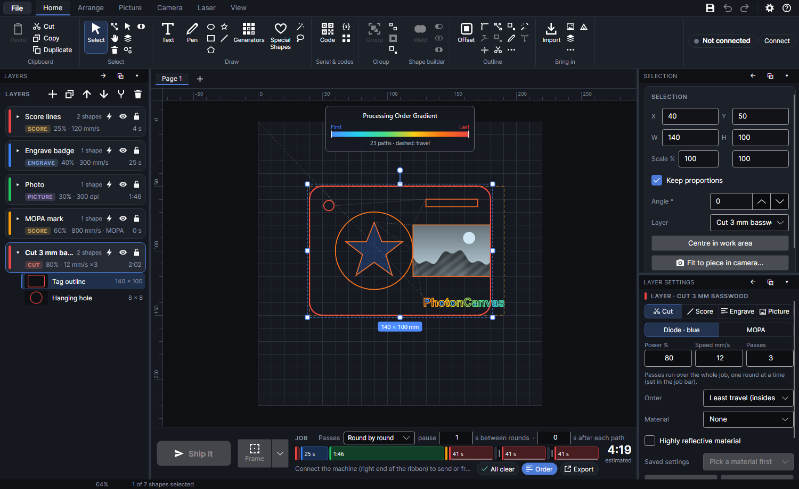

# Spread the heat

**Spread the heat** is an **Order** for Cut and Score layers, for thin sheet metal that warps.
The program works out how the sheet warms up as the job runs, and cuts every pass of every path
where the sheet is coolest, long paths in short pieces, waiting only when the whole area is too
warm.

> **Note:** Not yet tried on the machine. The temperatures it works with are estimates: tune it by
> how flat your parts come out.

## The problem it solves

A cut puts heat into the metal around it. On thin sheet (a few tenths of a millimetre) there is so
little metal that a patch near a cut gets hot quickly, expands, and the sheet buckles. Cutting the
paths in the usual order (nearest next) puts cut after cut into the same warm area, and repeating
passes straight away puts more heat into the same line. A plain pause after every path (in the job
bar) helps, but it waits even where it doesn't need to, and the waits add up.

Spread the heat keeps track of where the sheet is warm, picks the next cut somewhere cool, and only
waits when there's nowhere cool enough to go.

## Turning it on

1. Select the Cut or Score layer with the metal parts.
2. In **Layer settings**, set **Order** to **Spread the heat**.
3. Set **Sheet** and **Thickness mm** to your metal, and leave the rest as they are for a first try.

Its settings appear under **Order**:

| Setting | Range | Start | What it does |
|---|---|---|---|
| **Sheet** | Aluminium, Stainless steel, Steel, Brass, Copper, Titanium | Aluminium | The metal: how fast heat spreads through it and how much it takes to warm it. |
| **Thickness mm** | 0.01–10 | 0.2 | Thinner sheet warms more from the same cut. |
| **Keep under +°C** | 1–500 | 30 | How much warmer than at the start any patch of the sheet (a few mm across) may get. Lower is flatter, with more waiting. An estimate: tune it by how flat your parts come out. |
| **Pieces of mm** | 0–500 | 15 | Paths longer than this are cut in pieces of about this length, at different times, so a long line never takes all its heat at once. 0 = whole paths. |
| **Finer heat model (much slower to plan)** | on or off | off | Works the heat out on cells half the size: small holes and the thin metal between them are followed more closely, so waits round dense hole patterns come out truer. Planning takes about 16 times as long: a minute or two on a big job with thousands of holes, after every change. |

A line under them says: "Holes and insides are finished before the last pass of the outline
around them. The job's checks say how warm the sheet gets and how much waiting it adds (estimates:
the share of the laser's power that stays in the sheet isn't measured)."

With several passes, the line under **Passes** reads "Each pass of each path is placed on its own,
where the sheet is coolest (spread the heat), not round by round."

It doesn't work together with **Dot mode every** or perforation: such a layer keeps the usual
order, and the checks say "dot mode and perforation keep the usual order; spreading the heat is for
whole cuts."

### The metals

| Sheet | Heat spreads (mm²/s) | Heat to warm 1 mm³ by 1 °C |
|---|---|---|
| **Aluminium** | 84 | 2.4 mJ |
| **Stainless steel** | 4 | 4.0 mJ |
| **Steel** | 13 | 3.8 mJ |
| **Brass** | 34 | 3.2 mJ |
| **Copper** | 113 | 3.4 mJ |
| **Titanium** | 9 | 2.3 mJ |

These come from handbook values at room temperature. Heat spreads twenty times faster in aluminium
than in stainless steel, so a stainless sheet stays hot where it was cut for much longer: expect
more spreading out and more waiting on stainless and titanium.

## How the order is worked out

### The simulated sheet

The program models the sheet as a thin plate, the same temperature through its thickness, on a
grid of square cells covering the work plus 15 mm all round:

- Each cut puts 30% of the laser's power into the sheet, spread along the cells it crosses. The
  laser's power is its full power (40 W blue, 60 W MOPA) × **Power %**; the time is the path's
  length ÷ **Speed mm/s**.
- The heat spreads to neighbouring cells as fast as the metal allows, and leaves slowly into the
  air from both faces (still air, about 15 W per m² per °C). None leaves at the edges of the
  modelled area.
- How warm the sheet is "here" is read as the average over a patch about 4.5 mm across (3 × 3 cells
  on 1.5 mm cells, 7 × 7 on 0.75 mm), whatever the cell size: warping comes from a patch expanding,
  not from the kerf's own spot.
- The cell size is chosen to keep planning quick: at least 0.5 mm (1 mm in aluminium, 1.2 mm in
  copper, where heat spreads fast), at most 6 mm, larger for big or long jobs.
  **Finer heat model (much slower to plan)** halves it (down to 0.25 mm). The checks say which
  size was used.

### From the middle outwards

The work is cut from the middle outwards, while the metal round each cut is still whole and can
carry the heat away. The cuts are sorted by how far they are from the middle of the work. The next
cut is taken from a band 10 mm wide (4 cells on cells over 2.5 mm) starting at the innermost cut
that may go now: the innermost one in that band that is cool enough goes next.

"Cool enough" means: the warmest patch along it now, plus what the cut itself will add, stays
under **Keep under +°C**.

### Waiting only when needed

When no cut in the band is cool enough, the coolest of them is taken and the job waits, laser off,
just long enough: until it is cool enough, or the patch round it has cooled to a tenth of the
limit. No single wait is longer than 30 seconds. The wait goes into the job as a pause after the
cut before it.

### Every pass on its own

Each pass of each path is a separate cut, placed on its own. A path's second pass waits for its
own heat like any other cut, instead of following the first straight away. A layer with 3 passes
and 200 paths is 600 cuts, in an order of their own.

### Long paths in pieces

A path longer than 1.5 × **Pieces of mm** is cut in equal pieces of about that length, each a
separate cut placed where the sheet is coolest. Neighbouring pieces overlap by 0.05 mm, so the cut
is continuous where they meet. 0 cuts every path whole.

### Holes and insides first

The last pass of an outline waits until everything inside it (its holes, and parts inside parts) is
finished, all passes and pieces. Its earlier passes can go any time. So a part stays held in the
sheet until its holes are done.

### Cut-out holes and cuts that block heat

As the job goes on, the model follows what's been cut:

- Once a cut has had its last pass, it goes right through: no heat crosses its kerf any more.
- Once a closed outline is cut right round, what's inside is gone from the sheet (a hole, or a part
  now loose), and the heat it held goes with it.
- Cells that are partly holes hold less heat, so a cut there warms them more, and they pass heat on
  less well than their share of metal suggests: m ÷ (2 − m) of solid sheet, where m is the share of
  metal left (Rayleigh's result for a sheet with round holes). Heat round a cluster of cut-out holes
  has to squeeze through the metal between them, so dense hole patterns get waits of their own.

## What else changes

- Kerf, tabs, lead-in, overcut, lead-out, start points and **Wobble** work as usual: the paths are
  made first, then split and ordered. Tabs cut at **Tab power %** run after all the heat-ordered
  cuts.
- **Step down/pass** isn't used (each pass is cut on its own); the checks say so.
- The job bar's pauses, **s after each path** and **s between rounds**, don't apply to this layer:
  it works out its own waits. The checks say so, and the job bar adds an asterisk to "s after each
  path" (point at it: "Not on layers that spread the heat: they work out their own waits."). When
  every cut and score layer in the job spreads the heat, the job bar hides the path pause; when
  every layer does, it hides the passes choice too.
- With **Round by round** passes, the whole layer, every pass of it, runs in the first round (its
  passes are already spread out in its own order).
- The job's time includes the waits. The job summary counts paths, and the cuts with all their
  passes and pieces: "… paths (… cuts with the passes)".

## The checks

The job's checks (in the job bar) say what the plan came to:

- "Layer "…" spreads the heat: 120 paths in 310 pieces, 2 passes each, cut where the sheet is
  coolest. The aluminium stays under about +28 °C (estimated, on a 1.2 mm grid), with 1 min of
  waits to let it cool." Or "…, with no waits needed."
- "Layer "…": one cut alone warms the sheet about +45 °C, more than the +30 °C allowed, so the job
  waits until each spot is nearly cold. Lower the power, go faster, cut shorter pieces or allow more
  warming." A single cut that's already over the limit can't be helped by any order: change one of
  those.
- "Layer "…" works out its own waits from the heat, so the job bar's pauses (after each path,
  between rounds) don't apply to it."
- "Layer "…": step-down isn't used when spreading the heat (each pass is cut on its own)."

## Planning progress

Working out the order takes a moment on big jobs (a minute or two with the finer model and
thousands of holes). When it takes more than a moment, the job bar shows "Working out the heat
order… 40%" with a progress bar under the timeline. It starts again whenever the design or a
setting changes; the plan for the older design is dropped.

## Seeing the order

Turn on **Order** in the job bar to see it on the work area: every piece is coloured by when it is
first cut, from blue (first) to red (last). Above 300 cuts the travel moves aren't drawn. See
[Running a job](running-jobs.md).

## Tuning it

- Start with **Keep under +°C** at 30 and look at the parts. If they come out flat with a lot of
  waiting, raise it; if they still warp, lower it, or lower the power and go faster.
- Shorter **Pieces of mm** spread the heat of long outlines further, at the cost of more starts and
  stops.
- If the check says one cut alone is over the limit, the job will be slow whatever the order:
  lower the power, raise the speed, shorten the pieces, or allow more warming.
- Keep notes of what worked with **Save to library…** (the order and its settings are saved with
  the layer's settings).

## What it can't know

- The 30% of the laser's power that stays in the sheet is an estimate: cutting blows much of it
  away with the melt, and metal reflects some. It hasn't been measured on this machine, so every
  temperature here is an estimate too. Read the numbers as "more" or "less", and tune by results.
- The model doesn't know how the sheet is held down, how warm the room is, or whether air is
  blowing on it.
- Not yet tried on the machine.

Tutorial: [Spread the heat on thin metal](tutorial:layer-spread-heat).
