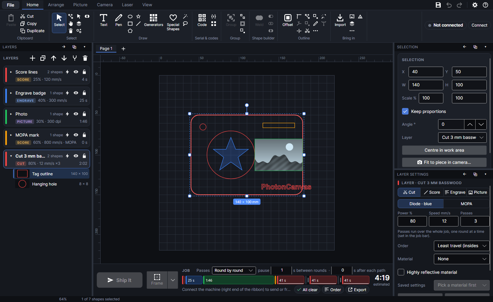

# Welcome to the PhotonCanvas guide

PhotonCanvas designs laser jobs and sends them to your xTool F2 Ultra over your own network. This
guide explains every part of it: what each button, setting and window is for, how it works, and
when to use it.

## How to use this guide

- **The contents** on the left lists every page. The arrow beside a page opens its sections.
- **Search** (the box above the contents, or `Ctrl+F`) finds every section that mentions all the
  words you type. Matching tutorials are listed first.
- **Back** and **Forward** (or `Alt+←` and `Alt+→`) step through the pages you've visited.
- **Links** go to other pages and sections. A link with ▶ starts a tutorial.
- **Pictures** can be clicked to see them full size.
- **F1** in any window of the program opens this guide at the page explaining that window.
  In the main window it opens this page.

<!-- windows: HelpWindow -->

## Tutorials

The tutorials teach one feature at a time by doing it. Open them with the **▶ Tutorials** button at
the top of this guide, or **Help → Tutorials** (the **?** at the top right of the program).

- They're listed by topic, each with a line saying what it teaches and how many steps it has.
  Type in the box at the top to find one.
- **Start** begins it; **Read** opens this guide's page on the same feature.
- A small card stays on top of the program. Each step says what to do in a sentence or two, and
  rings the button or setting it's about in blue. A ribbon tab opens, a folded panel unfolds and a
  closed section expands by themselves so you can see it.
- Some steps wait for you: when you've done what they ask (opened a window, drawn a shape, chosen a
  tool), the card says **✓ Done!** and moves on by itself. You can always press **Next** instead.
- **Back** goes to the step before. Drag the card by its title bar to move it out of the way.
  **✕** or `Esc` stops the tutorial. Nothing is changed that you don't do yourself.
- The page that explains a feature fully lists its tutorials at the end, under **Try it**.

<!-- windows: TutorialsWindow -->

## Where to start

- New to the program: [Getting started](getting-started.md), then the tutorial
  [Your first job, start to finish](tutorial:first-job).
- Finding your way around the window: [The workspace](workspace.md).
- Dialling in a new material: [Materials and tests](materials-and-tests.md).
- Something isn't working: [Troubleshooting](troubleshooting.md).

## A word on safety

> **Safety:** Lasers can blind, start fires and release toxic fumes. Never look at the beam or its
> reflections, never leave a job running unattended, keep a fire extinguisher near, ventilate,
> and only cut materials you know are safe (never PVC or vinyl). Check every job before pressing
> the machine's start button: the preview is a guide, not a guarantee.

PhotonCanvas never starts the laser by itself. A job you send waits on the machine until you press
its start button.
