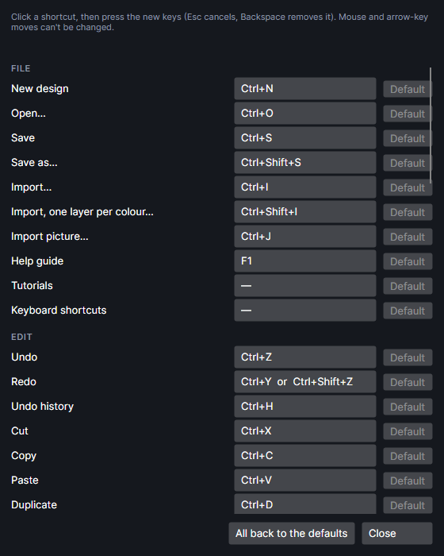

# Keyboard shortcuts

Every keyboard shortcut, as it comes. Most can be changed: see
[Changing shortcuts](#changing-shortcuts). Help → **Keyboard shortcuts** shows the ones in use on
one page, with only the first key of a command that has more than one.

- Shortcuts work in the main window. While you're typing in a box, only the **File** group's
  shortcuts work; the box keeps `Ctrl+Z`, `Ctrl+A`, `Delete`, the arrows and letters for itself.
- While the **Pen** or **Edit points** tool is in use, `Delete`, `Backspace`, `Enter`, `Esc` and `S`
  (without `Ctrl`) go to the tool. **Edit points** also keeps `R`, `Y` and `B`. **Trace edge**, and
  the **Line** tool while a line is being drawn click by click, keep `Delete`, `Backspace`, `Enter`
  and `Esc`. See [Keys inside tools](#keys-inside-tools).
- "—" below means no key to start with: you can give it one.
- Add-ons add commands of their own while they're on (for example **Nest…** with `Ctrl+Alt+N`,
  **Warp…**, **3D to slices…**). They're listed with the rest in Settings → Shortcuts and can be
  given keys the same way; each add-on's page names its shortcuts.

## File

| Command | Keys |
|---|---|
| New design | `Ctrl+N` |
| Open… | `Ctrl+O` |
| Save | `Ctrl+S` |
| Save as… | `Ctrl+Shift+S` |
| Import… | `Ctrl+I` |
| Import, one layer per colour… | `Ctrl+Shift+I` |
| Import picture… | `Ctrl+J` |
| Help guide | `F1` |
| Tutorials | — |
| Keyboard shortcuts | — |

`F1` in any other window of the program opens the guide at the page about that window.

## Edit

| Command | Keys |
|---|---|
| Undo | `Ctrl+Z` |
| Redo | `Ctrl+Y` or `Ctrl+Shift+Z` |
| Undo history | `Ctrl+H` |
| Cut | `Ctrl+X` |
| Copy | `Ctrl+C` |
| Paste | `Ctrl+V` |
| Duplicate | `Ctrl+D` |
| Delete | `Delete` or `Backspace` (also with `Shift`) |

## Select

| Command | Keys |
|---|---|
| Select all | `Ctrl+A` |
| Select the active layer | `Ctrl+Shift+A` |
| Select circles… | — |

## Shapes

| Command | Keys |
|---|---|
| Group | `Ctrl+G` |
| Ungroup | `Ctrl+Shift+G` |
| Combine | `Ctrl+K` |
| Break apart | `Ctrl+Shift+K` |
| Text to paths | `Ctrl+Shift+C` (also turns codes, and rectangles, ellipses, polygons and stars drawn with their tools, into ordinary paths) |
| Weld | `Ctrl+Shift+U` |
| Subtract | `Ctrl+Shift+M` |
| Offset… | `Ctrl+Shift+O` |
| Round corners… | — |
| Text on path | — |
| Tidy lines… | — |
| Copy along a path… | — |
| Use as material outline | — |
| Put on the mask layer (never burned) | — |
| Lock | `Ctrl+Alt+L` |
| Unlock all | `Ctrl+Alt+Shift+L` |
| Fit to piece in camera… | `Ctrl+Shift+F` |
| Trace picture… | `Ctrl+T` |

## Layers

| Command | Keys |
|---|---|
| New layer | `Ctrl+L` |
| Move selection to the active layer | `Ctrl+M` |
| Move the selection to layer 1 to 9 | `Ctrl+1` to `Ctrl+9` (the layer in that place in the Layers list, 1 = the top one; can't be changed) |

## View

| Command | Keys |
|---|---|
| Zoom in | `Ctrl+=` (the +/= key) or `Ctrl` and the keypad's `+` |
| Zoom out | `Ctrl+-` or `Ctrl` and the keypad's `-` |
| Fit work area | `Home`, `Ctrl+0` or `Ctrl` and the keypad's `0` |
| Fit selection | `F` |
| Fit design | `Shift+F` |
| Grid settings… | `Ctrl+'` |
| Object snaps on or off | `F3` |

## Tools

| Command | Keys |
|---|---|
| Select | `V` |
| Rectangle | `R` |
| Ellipse | `E` |
| Line | `L` |
| Polygon | `O` |
| Star | `S` |
| Pen | `P` |
| Text | `T` |
| Edit points | `N` (with one shape selected) |
| Pan | `H` |
| Pick piece (camera) | `W` |
| Trace edge (camera) | `M` |
| Special shapes | `I` |
| Measure | — |
| Trim | — |
| Align by two points | — |

## Job

| Command | Keys |
|---|---|
| Frame | — |
| Ship It | — |
| G-code console | — |

**Ship It** with a key still shows its summary to confirm, and the machine still waits for its
start button.

## Mouse and keys on the work area

These can't be changed.

| To | Do this |
|---|---|
| Pan | Hold `Space` and drag, or drag with the middle mouse button |
| Zoom where the cursor is | Mouse wheel |
| Scroll sideways | `Shift` + mouse wheel |
| Scroll up and down | `Ctrl` + mouse wheel |
| Nudge the selection | Arrow keys: 1 mm; with `Shift` 10 mm; with `Ctrl` 0.1 mm |
| Select what's inside a box | Drag from left to right |
| Select what a box touches | Drag from right to left |
| Add a shape to the selection, or take it out | `Shift`+click |
| Add what a box picks to the selection | `Shift` while dragging a box (it only adds) |
| Pick one shape out of a group | `Alt`+click |
| Move only straight across or up and down | Hold `Shift` while dragging |
| Resize freely with a corner handle | Hold `Shift` (corners keep proportions otherwise) |
| Resize about the centre | Hold `Alt` while dragging a handle |
| Turn in 15° steps | Hold `Shift` while dragging the round handle |
| Drag without snapping | Hold `Ctrl` while dragging |
| Cancel a drag, leave a tool, select nothing | `Esc` |

See [Working on the canvas](canvas.md) for all of them.

## Keys inside tools

| Tool | Keys |
|---|---|
| **Edit points** | `Delete` or `Backspace` removes the selected point; `S` switches it between smooth and sharp; `Y` makes its handles symmetric; `R` rounds the corner there by 2 mm; `B` breaks the outline there; `Alt` while starting to drag a handle breaks a smooth point; `Esc` finishes. See [Edit points](canvas.md#edit-points). |
| **Pen** | `Enter` finishes an open line; `Backspace` or `Delete` removes the last point; `Esc` throws away the line being drawn. See [Drawing](drawing.md). |
| **Trace edge** | `Enter` finishes; `Backspace` or `Delete` takes back the last point; `Esc` throws away the line being traced. See [Drawing](drawing.md). |
| **Rectangle**, **Ellipse**, **Polygon**, **Star** | Hold `Shift` for a square, a circle or an even shape; `Alt` to draw from the centre. See [Drawing](drawing.md). |
| **Line** | `Shift` for 45° steps. Drawing click by click: type a length (or `25<30` for an angle) and `Enter` to place it; `Backspace` takes back a character; `Esc` clears what's typed, then stops; `Enter` or a right-click stops. See [Line](drawing.md#line). |
| Any tool that picks points | Hold `Ctrl` for a point that doesn't snap. `F3` turns object snaps off and on. |
| **Measure** | Hold `Shift` for 45° steps, `Ctrl` for no snapping. See [Measure](canvas.md#measure). |

## In the guide and the tutorials

- In the help guide: `Ctrl+F` goes to the search box; `Alt+←` (or `Alt+Backspace`) and `Alt+→` go
  back and forward.
- On a tutorial's card (click it first): `→` or `Enter` for the next step, `←` for the one
  before, `Esc` to stop.

## Changing shortcuts

<!-- windows: HotkeysWindow -->

File → **Keyboard shortcuts…** opens the **Keyboard shortcuts** window. (Help → **Keyboard
shortcuts** shows them on one page; its **Change shortcuts…** button opens the same window.)

Commands are listed in groups (File, Edit, Select, Shapes, Layers, View, Tools, Job), each with its
keys on a button, "—" when it has none.

1. Click the keys of the command you want to change. The button says "Press the keys…".
2. Press the new keys, for example `F5` or `Ctrl+Shift+P`. Holding `Ctrl`, `Shift` or `Alt` on
   their own does nothing; the keys are taken when you press another key with them.
   - `Esc` cancels and keeps the old keys.
   - `Backspace` on its own removes the command's shortcut.
3. If another command had those keys, it loses them, and a note at the top says which, for
   example "R was “Rectangle”: that one has no shortcut now."

- A command you set yourself gets just the one key combination, in place of all the ones it had.
- **Default** on a command's row puts back its own keys. It's greyed while the command still
  has them.
- **All back to the defaults** puts back every command's keys.
- **Close** closes the window. Every change is saved and works at once.
- Some keys show by the names the computer gives them: `OemPlus` and `OemMinus` are the +/= and
  -/_ keys, `OemQuotes` the '/" key, `Add` and `Subtract` the keypad's + and −, `D0` the 0 key,
  `NumPad0` the keypad's 0, `Back` is `Backspace`.
- The mouse, the arrow keys, `Space`, `Esc`, `Ctrl+1` to `Ctrl+9` and the keys inside tools can't
  be changed.

## Try it

- [Change a keyboard shortcut](tutorial:ws-shortcuts)
