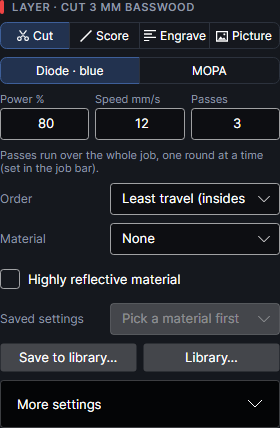
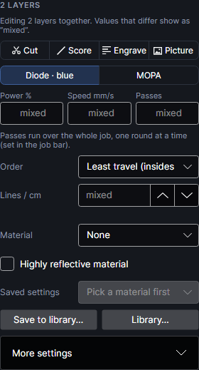
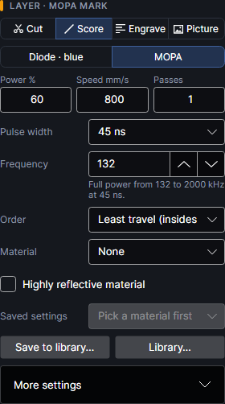
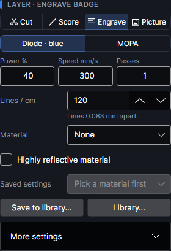
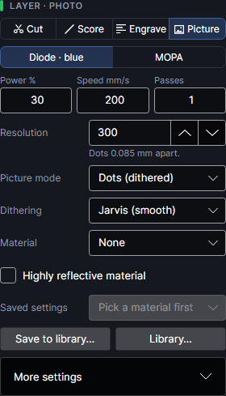
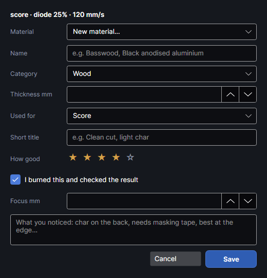
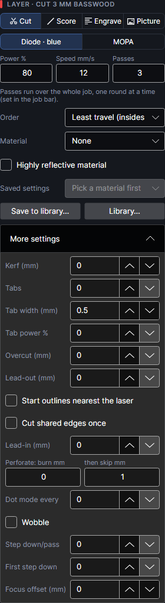
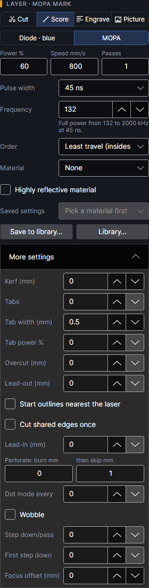
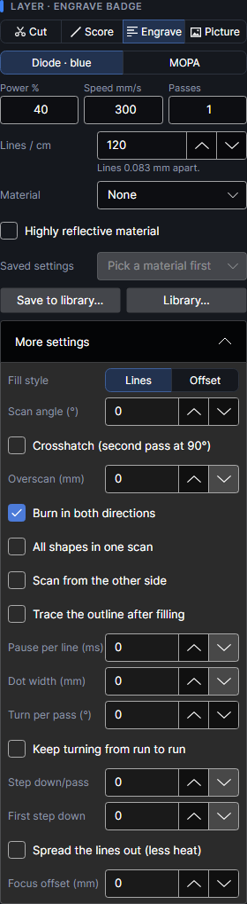
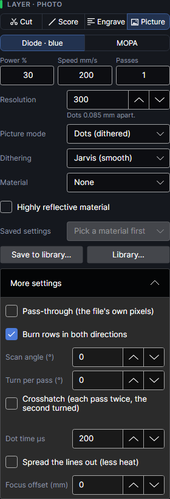

# Layer settings

The **Layer settings** panel (right side, at first) shows the settings of the active layer: what
the laser does with its shapes, with which laser, how hard and how fast, and the material it is
for. The rarely changed settings fold away under **More settings**. Every change applies at once,
shows in the job's time and checks straight away, and can be undone with `Ctrl+Z`.

The title says which layer it is: "LAYER · NAME", with its colour beside it. Only the settings
that matter for the layer's kind are shown.

Power and speed go to the machine as they are: power as **S** = percent × 10 (80% is S800), speed
as **F** = mm/s × 60 (12 mm/s is F720).

## Editing several layers

Select several layers (`Ctrl+click` or `Shift+click` in the **Layers** panel, see
[Layers](layers.md)) and the panel edits them all. The title reads "N LAYERS" and a line says
"Editing N layers together. Values that differ show as “mixed”." A box showing **mixed** keeps
each layer's own value until you type a new one. Settings of every kind of layer in the selection
are shown.

## Mode: Cut, Score, Engrave, Picture

The four buttons at the top say what the laser does with the layer's shapes.

| Button | What it does | Card chip | New layer of this kind starts at |
|---|---|---|---|
| **Cut** | Follows each outline, to cut through. Tabs, lead-ins and overcut apply. | **CUT** | 70% · 40 mm/s |
| **Score** | Follows each outline, the same motion as Cut, for lines that mark rather than cut (fold lines, outlines, drawings). Tabs, lead-ins and overcut don't apply. | **SCORE** | 20% · 200 mm/s |
| **Engrave** | Scans back and forth to burn the inside of closed shapes (holes stay clear). Open lines are skipped, with a check saying how many. | **ENGRAVE** | 30% · 400 mm/s |
| **Picture** | Engraves pictures as fine dots, one laser pulse per dot, or carves them as a relief. | **PICTURE** | 90% · 80 mm/s |

Cut, Score and Engrave layers only do outlines; Picture layers only do pictures (see
[Layers](layers.md#shapes-on-the-wrong-kind-of-layer)).

Switching the mode keeps every other setting as it was, power and speed included: set them for the
new mode. The starting values in the table are what the program gives a layer it makes for you
(a sub-layer, a picture layer for an imported picture). **Add layer** always makes a Cut layer.

Score doesn't run first by itself: layers run in list order, so keep score layers above cut layers.

## Laser: diode or MOPA

| Button | Laser | For |
|---|---|---|
| **Diode · blue** | The 40 W, 455 nm blue diode. | Wood, leather, acrylic, paper. |
| **MOPA** | The 60 W, 1064 nm MOPA fiber laser. | Metals (including colour on stainless steel and titanium) and some plastics. |

Choosing **MOPA** shows **Pulse width** and **Frequency**. The card adds " · MOPA". MOPA work is
moved by the offset measured with **Align MOPA** on the Camera tab, so both lasers land in the
same place (see [Camera](camera.md)).

## Power, speed and passes

| Setting | Range | What it does |
|---|---|---|
| **Power %** | 0–100 | Percent of the chosen laser's full power (40 W blue, 60 W MOPA). |
| **Speed mm/s** | 2–15000 | How fast the beam moves while firing. Slower is deeper and darker. On a Picture layer it's how fast the beam moves from dot to dot (each dot fires for the **Dot time µs**). |
| **Passes** | 1–10000 | How many times the layer is done. |

With more than one pass, a line under the three boxes says how the passes run:

- "Passes run over the whole job, one round at a time (set in the job bar)." Every layer's first
  pass, then every layer's second pass, and so on.
- "Each path repeats all its passes before the next one." Set by **Path by path** in the job bar.
- "Each pass of each path is placed on its own, where the sheet is coolest (spread the heat), not
  round by round." On a layer whose **Order** is **Spread the heat** (see
  [Spread the heat](heat-order.md)).

The job bar's choice is explained in [Running a job](running-jobs.md).

## MOPA: pulse width and frequency

Only on layers that use the MOPA.

- **Pulse width**: how long each laser pulse lasts, one of 2, 4, 6, 9, 13, 20, 30, 45, 60, 80, 100,
  150, 200, 250, 350 or 500 ns (200 ns to start). Short pulses mark crisply; long pulses put in more
  heat.
- **Frequency**: pulses per second, in kHz (65 kHz to start). Higher means the pulses overlap more:
  smoother lines, less energy in each pulse. The highest you can type depends on the pulse width.

Each pulse can only carry so much energy, and the longer the pulse the more it may carry. Below a
certain frequency the source caps each pulse, so it gives less than its 60 W. The line under
**Frequency** says where full power is at this pulse width, for example "Full power from 132 to
2000 kHz at 45 ns." Below that it turns orange and says how much is left, for example: "At 30 kHz
each pulse is already as big as the source allows, so it gives only about 46% of its 60 W (100%
power here ≈ 46% at full power). Fine for colour and gentle marks." The share is roughly the
frequency divided by the full-power frequency.

| Pulse width | Full power from | Highest | Kept out of on reflective material |
|---|---|---|---|
| 2 ns | 1950 kHz | 4000 kHz | – |
| 4 ns | 1350 kHz | 4000 kHz | – |
| 6 ns | 850 kHz | 4000 kHz | – |
| 9 ns | 600 kHz | 4000 kHz | – |
| 13 ns | 360 kHz | 3000 kHz | – |
| 20 ns | 252 kHz | 3000 kHz | – |
| 30 ns | 187 kHz | 3000 kHz | – |
| 45 ns | 132 kHz | 2000 kHz | – |
| 60 ns | 115 kHz | 2000 kHz | – |
| 80 ns | 90 kHz | 2000 kHz | – |
| 100 ns | 80 kHz | 1000 kHz | – |
| 150 ns | 70 kHz | 1000 kHz | 57–69 kHz |
| 200 ns | 65 kHz | 1000 kHz | 48–64 kHz |
| 250 ns | 65 kHz | 900 kHz | 46–64 kHz |
| 350 ns | 60 kHz | 600 kHz | 35–59 kHz |
| 500 ns | 60 kHz | 500 kHz | 30–59 kHz |

These limits come from xTool's own table for the F2 Ultra. Changing the pulse width keeps the
frequency where it can (colour work tunes it): above the new width's highest it comes down to the
highest, and on reflective material one in the protected range goes up to the full-power
frequency.

## Highly reflective material

**Highly reflective material**: tick it for bare copper, brass, aluminium, silver, gold, chrome or
mirror finishes. It's ticked or cleared by itself when you pick a material, from the material's
tag in the library; you can change it by hand.

- On long pulses (150 ns and longer) the MOPA keeps out of the range in the last column of the
  table above: the largest pulses at nearly full power, which a shiny surface can bounce back into
  the fiber and damage it. A frequency in that range is moved up to the full-power frequency, and
  the line under **Frequency** says "On this reflective material … kHz is skipped to protect the
  source."
- The job's checks remind you: "… is on highly reflective material and may throw reflections. Put
  it near the exhaust fan, or coat it with anti-reflective black marking spray."

> **Safety:** Reflections from shiny metal can damage the laser and your eyes. Keep the lid closed,
> and use marking spray on mirror finishes.

## Order (Cut and Score)

**Order** is the order a Cut or Score layer's paths run in.

| Choice | What it does |
|---|---|
| **Least travel (insides first)** | Holes and anything inside a closed outline first (the deepest first), then the outlines round them, so a part is still held while its holes are cut. Within each depth, the nearest path next. Open lines may be run backwards if their far end is nearer. The usual choice. |
| **As drawn** | In the order the shapes were drawn or imported (**Bring to front** and **Send to back** change it). Holes are *not* moved first: draw them before the outline, or a part can drop before its holes are cut. |
| **Back to front (away from smoke)** | Insides first as above, then in bands 10 mm deep from the top (back) of the work area to the front, nearest next within each band, so smoke drifts over what's finished, not what's still to cut. |
| **Spread the heat** | For thin sheet metal that warps: the sheet's warming is worked out as the job runs, and every pass of every path is cut where the sheet is coolest; long paths in short pieces; the job waits only when it must. Its own settings appear under it: see [Spread the heat](heat-order.md). |

Order doesn't apply to Engrave or Picture layers. To see the order, turn on **Order** in the job
bar: the paths are coloured from first to last (see [Running a job](running-jobs.md)). The cut
orders haven't been tried on the machine yet (they're on the list to check on scrap).

## Line density

**Lines / cm** (Engrave layers, and Picture layers in Depth slices mode): how densely an area is
scanned, 1–10000 lines per centimetre (100 to start). More lines are darker, smoother and slower.
The line under it gives the spacing: "Lines 0.1 mm apart." Above 1000 it adds "Very fine: much
longer jobs and more heat (thin sheet can warp)."

## Picture settings

On Picture layers. The picture's own brightness, contrast and the rest are set on the Picture tab
(see [Pictures](pictures.md)); these say how it's burned.

### Resolution

**Resolution**: dots per inch, 50–1000 (180 to start). Higher is finer detail and slower;
150–300 suits most wood. The line under it gives the dot spacing: "Dots 0.085 mm apart." at 300
dpi. In Depth slices mode it sets the size of the depth cells instead. A picture may have at most
40 million dots: make it smaller or lower the resolution if the job says it needs more.

> **Tip:** On basswood, finer dots at proportionally lower power (the same energy) came out lighter
> with a smoother gradient in the first Line tests. Laser → **Line test** compares settings side
> by side (see [Materials and tests](materials-and-tests.md)).

### Picture mode

**Picture mode**:

- **Dots (dithered)**: every dot fires at the layer's power for the **Dot time µs**; tone comes
  from how close together the dots are. The proven mode.
- **Greyscale (experimental)**: each dot's power follows the picture: the palest tone that still
  burns gets **Lightest power %**, black gets **Power %**, pure white isn't visited. Marked
  experimental in the program. **Dithering** is hidden in this mode, since it isn't used.
- **Depth slices (relief)**: the picture is a depth map (dark = deep), carved in thin slices one
  after another: relief on metal with the MOPA, or on wood. Its settings are under
  **More settings** (see [Depth slices](#depth-slices)). Switching to it sets
  **Turn per pass (°)** to 37° if it was 0. Not yet tried on the machine.

### Dithering

**Dithering** (Dots mode): how grey tones become dots.

| Choice | Gives |
|---|---|
| **Jarvis (smooth)** | Smooth, fine detail. Suits photos. The usual choice. |
| **Floyd–Steinberg** | Error diffusion like Jarvis, spread over 4 neighbouring dots instead of 12. |
| **Stucki** | Error diffusion like Jarvis, over 12 neighbouring dots with different weights. |
| **Atkinson (contrasty)** | Higher contrast; keeps highlights clean. |
| **Bayer (pattern)** | A regular 8 × 8 pattern, no "worms". |
| **Threshold (line art)** | Plain cut-off at 50% grey: logos and line art. **Ramp (mm)** can slope its edges. |
| **Halftone (dots)** | Round dots on a screen that grow in dark areas, like print. |
| **Newsprint (coarse dots)** | Coarse newspaper dots on a fixed 45° screen. Decorative. |
| **Line screen (engraved lines)** | Parallel lines that thicken in dark areas, like a banknote engraving. |
| **Sketch (edges only)** | Only the hard edges between light and dark: line drawings, handwriting, a pencil-sketch look. |

### Screen: cells and angle

With **Halftone (dots)** or **Line screen (engraved lines)**:

- **Cells / inch**: how many screen cells per inch, 2–500 (30 to start). Fewer cells are bigger,
  bolder dots or lines. Must be at most half the **Resolution**, or the job says so.
- **Screen angle °**: the screen's direction, −180 to 180 (45° to start). 45° hides the pattern best
  for dots; any angle for lines.

## Material and saved settings

- **Material**: what the layer is for, from your material library, or **None**. Picking one shows
  its saved settings below, ticks or clears **Highly reflective material** by its tag, and on a
  Picture layer takes the material's tone correction from its tone test (from the tested settings
  nearest the layer's own). It doesn't change power, speed or the other settings (only a MOPA
  frequency in the protected range moves, see above). A material that isn't in your library any
  more shows as "… (not in your library)".
- **Saved settings**: the settings saved for that material, as "Purpose · title ★★★★☆ ✓" (✓ =
  tested), sorted by purpose, best first. Picking one puts all of them on the layer, the mode
  included. It says "Pick a material first" or "None saved yet" when there's nothing to pick.

Under them a line says which saved settings the layer uses and who tested them ("Using “Clean cut”,
tested by you."), or "Changed since applying “…”." once you've changed something, with the focus
height and notes saved with them, and the photo of the result if there is one. With an empty
library it says "Your library is empty: set up a layer that works, then Save to library."

With several layers selected, saved settings go only on the layers they suit: picture settings on
layers with pictures, cut, score and engrave settings on layers with outlines (empty layers take
anything). So picking a photo's settings doesn't turn the cut layer next to it into a picture
layer.

- **Library…** opens the material library: see [Material library](material-library.md).

### Save to library

<!-- windows: SaveRecipeWindow -->

**Save to library…** keeps the active layer's settings in the material library, with how well they
worked, so you can put them back on any layer later. It opens **Save to material library**:

| Field | What it's for |
|---|---|
| (top line) | The settings being saved, in short: "cut · diode 80% · 12 mm/s ×3". |
| **Material** | Which material they're for: one from your library (the layer's own is picked), or **New material…**. |
| **Name**, **Category**, **Thickness mm** | Only for a new material. The name is required. **Category** is one of Wood, Plywood & MDF, Acrylic, Leather, Paper & card, Fabric, Cork & rubber, Stone & tile, Glass, Metal, Coated metal, Plastic, Food, Other. Leave **Thickness mm** at 0 for coatings, surfaces and anything where thickness doesn't matter. A new material whose name contains copper, brass, bronze, alumin…, silver, gold, chrome, mirror, polished, rhodium or platinum is tagged highly reflective. |
| **Used for** | Cut, Score, Engrave, Picture, Relief or Mark (picked from the layer's mode). |
| **Short title** | For example "Clean cut, light char". Left empty, the top line is used. |
| **How good** | 0–5 stars (Poor, Usable, Good, Very good, Perfect); 4 to start. Click the top star again to take one off. |
| **I burned this and checked the result** | Marks them as tested (✓), with today's date. On to start. |
| **Focus mm** | The laser-to-material distance used, from the machine when it has measured one. Leave empty if it doesn't matter. |
| Notes | What you noticed: char on the back, needs masking tape, best at the edge… |
| **Attach a camera photo of the result** | Only when a camera photo on the work area covers the layer's shapes: that part of it (2 mm round them) is kept with the settings. |

**Save** adds them to the library and the layer then uses that material and those saved settings.
**Cancel** closes without saving.

The library, sharing it and importing xTool's settings are explained in
[Material library](material-library.md); finding good settings in
[Materials and tests](materials-and-tests.md).

## More settings

**More settings** folds open the rest; it stays open or closed as you left it. What's in it depends
on the kind of layer; the defaults work for most jobs.

| Settings | Cut | Score | Engrave (Lines) | Engrave (Offset) | Picture (Dots, Greyscale) | Depth slices |
|---|---|---|---|---|---|---|
| **Kerf (mm)**, **Start outlines nearest the laser**, **Cut shared edges once**, perforation, **Dot mode every**, **Wobble** | yes | yes | – | – | – | – |
| **Tabs**, **Tab width (mm)**, **Tab power %**, **Overcut (mm)**, **Lead-in (mm)**, **Lead-out (mm)** | yes | – | – | – | – | – |
| **Fill style** | – | – | yes | yes | – | – |
| **Scan angle (°)**, **Overscan (mm)**, **Dot width (mm)**, **Turn per pass (°)**, **Keep turning from run to run** | – | – | yes | – | – | yes |
| **Pause per line (ms)** | – | – | yes | – | – | shown, not used |
| Crosshatch, **Burn in both directions**, **All shapes in one scan**, **Scan from the other side**, **Trace the outline after filling** | – | – | yes | – | – | – |
| **Step down/pass**, **First step down** | yes | yes | yes | shown, not used | – | – |
| **Lightest power %** | – | – | – | – | Greyscale, or Dots with Threshold and **Ramp (mm)** above 0 | – |
| **Ramp (mm)** | – | – | – | – | Dots with Threshold | – |
| **Pass-through (the file's own pixels)**, **Burn rows in both directions**, scan angle, turning and crosshatch for pictures | – | – | – | – | yes | – |
| **Dot time µs** | when **Dot mode every** is above 0 | when **Dot mode every** is above 0 | – | – | yes | – |
| **Slices** and the rest of the relief settings | – | – | – | – | – | yes |
| **Spread the lines out (less heat)** | – | – | yes | – | yes | – |
| **Focus offset (mm)** | yes | yes | yes | yes | yes | yes |

### Kerf

**Kerf (mm)** (Cut and Score): the width of the cut line, −1 to 1 mm (0 = off). Every closed
outline moves out by half of it so parts come out at their drawn size, and holes move in by half
so they stay true too. Which outline is a part and which is a hole is worked out from how they lie
inside each other, not from the direction they were drawn. A negative kerf moves them the other
way.

- Open paths are cut as drawn; the checks say how many.
- An outline narrower than the kerf disappears; the checks say how many were left out.
- Laser → **Cut test** measures the kerf of your material and saves it with it (see
  [Materials and tests](materials-and-tests.md)).

### Tabs

Small uncut bridges that keep parts in the sheet until you snap them out. Cut layers only.

- **Tabs**: how many tabs in each closed outline, 0–100 (0 = none). They're spaced evenly round the
  outline, the first half a spacing from its start, and nudged off sharp corners (more than 30°)
  where there's room. An outline shorter than 3 × tabs × tab width gets none; the checks say how
  many.
- **Tab width (mm)**: the width of each bridge, 0.1–10 mm (0.5 to start).
- **Tab power %**: 0–100. Above 0, the tabs are cut too, at this power (never more than the
  layer's) and the layer's speed, along with their outline: thin bridges that snap out cleanly.
  0 = tabs left uncut.

Tabs placed by hand with **Place tabs** (Home → Outline) are used instead of the count on the
outlines they sit on (see [Editing shapes](editing-shapes.md)). An outline with tabs gets no
lead-in, overcut or lead-out. Not yet tried on the machine.

### Overcut, lead-in and lead-out

For closed outlines on Cut layers.

- **Overcut (mm)**: keep cutting this far past the start, 0–10 mm, so the outline closes cleanly.
  Ignored when tabs are on.
- **Lead-in (mm)**: start each outline with a short entry line in the waste, 0–10 mm, so the start
  mark isn't on the part. It's outside a part's outline and inside a hole.
- **Lead-out (mm)**: end each outline with a short exit line into the waste, 0–10 mm, on the same
  side, so the end mark isn't on the part either. Not yet tried on the machine.

### Start points and shared edges

- **Start outlines nearest the laser** (Cut and Score): each closed outline starts at its point
  nearest where the laser already is: less travel. Off: outlines start where they were drawn.
  Outlines given a start point with **Start point** (Home → Outline) always start there. Not yet
  tried on the machine.
- **Cut shared edges once** (Cut and Score): where two shapes share an edge (parts side by side),
  it's cut only once: cleaner edges, less time, less scorching. The checks say how much was left
  out: "… mm of lines lying on top of each other will be cut only once." An outline that loses a
  shared stretch becomes an open line, so it gets no tabs, lead-in or overcut. The kerf is applied
  first: with **Kerf (mm)** set, the outlines move apart and their edges no longer lie exactly on
  top of each other, so both are cut.

### Perforation and dot mode

- **Perforate: burn mm** and **then skip mm** (Cut and Score): burn this far, then skip the gap,
  along every line: fold lines, tear-off lines. Burn 0–100 mm (0 = a continuous line), skip
  0.05–100 mm (1 to start).
- **Dot mode every** (Cut and Score): a single pulse every this many mm along the line instead of a
  line, 0–50 mm (0 = off): stippled marks, dotted lines. Each dot fires for the layer's
  **Dot time µs** (200 µs unless changed), and the beam moves between dots at the layer's speed.

Dot mode wins over perforation, and both win over wobble. Neither works with **Spread the heat**
(the layer keeps the usual order, and the checks say so).

On a Cut or Score layer, **Dot time µs** shows in **More settings** once **Dot mode every** is
above 0.

Not yet tried on the machine.

### Wobble

**Wobble** (Cut and Score): the beam traces small overlapping circles as it moves along the path:
wider, smoother lines, and a wider kerf that lets thick cuts clear their smoke and melt. Works with
either laser. Ticking it shows:

- **Wobble size (mm)**: the diameter of the circles, 0.01–5 mm (0.05 to start): about how much wider
  the line or kerf gets.
- **Wobble spacing**: how far the circles move forward per loop, 0.005–5 mm (0.015 to start).
  Smaller is denser and slower.

Each loop is drawn as 36 points, the way xTool Studio does it. The beam goes round every circle at
the layer's speed, so a wobbled path takes about π × size ÷ spacing times as long as a plain one
(about 10 times with the starting values).

### Engrave: fill style and lines

**Fill style** (Engrave layers):

- **Lines**: straight lines back and forth.
- **Offset**: the outline stepped inward, like contour lines, half a line spacing in to start,
  then one line spacing (from **Lines / cm**) each step, until nothing is left. It follows the
  shape, so edges come out cleaner: good for text and logos. Offset uses only **Lines / cm**,
  power, speed, passes and **Focus offset (mm)**; the line settings below are hidden. Not yet
  tried on the machine.

With **Lines**:

- **Scan angle (°)**: the direction of the lines, −180 to 180 (0 = left to right).
- **Crosshatch (second pass at 90°)**: a second set of lines over the first, turned by
  **Second pass at (°)** (−180 to 180, 90° to start; shown when crosshatch is on). 90° is the
  classic crosshatch; other angles give finer patterns.
- **Overscan (mm)**: each line starts and ends this far outside the shape with the laser off, 0–20
  mm, so the beam is up to speed and the edges burn evenly.
- **Burn in both directions**: on to start. Off: every line burns in the same direction and the beam
  returns unlit; more even on some materials, a little slower.
- **All shapes in one scan**: all of the layer's shapes scanned in one go instead of one shape at a
  time: fewer jumps for lots of small shapes. Where shapes overlap they cancel out.
- **Scan from the other side**: fill from the far side back (bottom to top): keeps the smoke away
  from what's still to engrave, depending on how your air flows.
- **Trace the outline after filling**: after filling each shape, its outline is traced at the same
  settings: hides ragged edges.
- **Pause per line (ms)**: wait this long before each line, 0–60000 ms, so heat can leave
  (acrylic, thin or heat-sensitive material). 0 = none. Adds to the time.
- **Dot width (mm)**: each burned line is made shorter by this much (half at each end), 0–1 mm, so
  the beam's width doesn't make fills wider than drawn. About the beam width: 0.03–0.08 mm. 0 =
  off. It must be less than the line spacing, or the job says so.

### Turning the lines

On Engrave layers with **Lines**, and in Depth slices:

- **Turn per pass (°)**: turn the lines this much more on every pass (and every depth slice),
  −180 to 180, so the line pattern doesn't build up into stripes or ridges. Something odd like 37°
  or 23° spreads the angles best. 0 = every pass the same.
- **Keep turning from run to run**: each run of the job starts where the last one's turning left
  off, so repeating the job doesn't repeat the pattern. Under it the count of runs so far ("Not run
  yet", "Run 3 times so far") and **Start again**, which counts from 0 again so the next run starts
  at the scan angle as set. A run counts when a job of the saved design finishes on the machine.

Turning per pass on fills hasn't been burned yet. On the conveyor, engraving lines always run
across the belt, so scan angles and turning are left out (see [Work area](work-area.md)).

### Step down

**Step down/pass** (Cut, Score and Engrave): lower the head this many mm before each pass after
the first, 0–2 mm, so the focus follows the cut or engraving down into thick material or a deep
engraving. **First step down**: also lower it this much before the first pass, 0–2 mm. The head
goes back up afterwards. All the steps together may not lower the head more than 10 mm.

- With **Path by path** passes each path is cut with all its passes, the head lowered a little more
  each time, then raised. With **Round by round** the head is lowered to that round's depth for the
  layer, and raised again straight after, so other layers keep their focus.
- The checks warn: "… lowers the head by up to … mm while cutting (step-down). Make sure the
  material is at least that thick."
- Not used with **Spread the heat**, on a curved surface, or with the **Offset** fill style.

### Picture: more settings

- **Lightest power %** (Greyscale mode): the power for the palest tones that still burn, 0–100 (10
  to start); the darkest tones get the layer's **Power %**. It can't be more than the layer's
  power.
- **Ramp (mm)** (Dots mode with **Threshold (line art)**): power climbs from the lightest power at
  each edge to full power this far in, 0–10 mm, so the sides slope: rubber stamps, cleaner edges.
  0 = off. The lightest power is the layer's **Lightest power %** (10% unless changed), which
  shows here once **Ramp (mm)** is above 0.
- **Pass-through (the file's own pixels)**: engrave the picture's own pixels, one dot each, with no
  resampling, for pictures already prepared at the right size. Never closer together than the
  **Resolution**: a picture with more pixels than that is engraved at the resolution instead, and
  the checks say so, so it can't put in more heat than you set.
- **Burn rows in both directions**: on to start. Off: every row burns left to right and the head
  goes back unlit. Slower, but rows can't be shifted against each other by the direction (a woven
  look). Laser → **Line test** compares both.
- **Scan angle (°)**: the direction the rows run, −180 to 180 (0 = left to right).
- **Turn per pass (°)**: with several passes, each one runs its rows this much further round, so no
  row lies on top of another and the row pattern averages out. Pull the power back so all the
  passes together make the darkness you want. Up to 36 different angles, then they repeat.
- **Crosshatch (each pass twice, the second turned)**: every pass is burned twice, the second time
  turned by **Second pass at (°)** (90° to start).
- A line under them spells the passes out, for example "6 burns, rows at 0°, 90°, 37°, 127°, 74°,
  164°; each at 30%, so the darkest spots get 6× that."
- **Dot time µs**: how long each dot fires, 10–10000 µs in steps of 10 (200 to start). Longer is
  darker. It goes to the machine in tens of microseconds.

Scan angle, turning and crosshatch for pictures work on the flat bed only: on the rotary, the
conveyor or a curved surface the rows run straight, and the checks say so. The machine has been
seen to burn picture rows at 20–30°; whether the edges line up between turned passes is still to
be checked.

### Depth slices

On Picture layers in **Depth slices (relief)** mode. The picture is read as a depth map: dark is
deep. It is cut into slices from the surface down; each slice engraves everything at least that
deep, so the material is carved away in steps. Each slice is an engraved fill at the layer's power,
speed, **Lines / cm** and passes, inside the area of that depth (cells of 25.4 ÷ **Resolution**
mm).

- **Slices**: how many steps from the surface to the deepest point, 2–255 (32 to start). More
  slices give a smoother relief and a longer job. The line under it says "32 slices, depth cells
  0.141 mm. How deep each slice cuts depends on power, speed, lines and passes: try a few on scrap
  and measure."
- **Light = deep (negative)**: for depth maps where light means deep (most are dark = deep).
- **Lower focus mm** and **every … slices**: follow the floor down by lowering the focus this much
  (0–2 mm, 0 = off) every so many slices (1–255, 8 to start): about the depth those slices remove.
  With **Focus offset (mm)**, the focus may go down at most 10 mm in all. With several passes, each
  pass starts again at the surface focus (the checks say so).
- **Deepest slice first**: engrave the deepest (smallest) slices first and the widest last: often a
  smoother floor (noise reduction).
- **Cleanup every**: a cleanup pass after every this many slices, 0–255 (0 = none). It clears
  debris and recast so the next slices cut cleanly. It runs across the slice's lines (turned 90°),
  at the slice's focus, with:
  - **Cleanup %** (20 to start), **Speed mm/s** (2000 to start) and **Lines / cm** (300 to start):
    gentle, to clear and smooth rather than cut deeper.
  - **Cleanup kHz** (MOPA only, 300 to start): the cleanup pass's frequency. Setting it gives the
    cleanup pass the layer's pulse width.
  - **Clean the whole picture (else only the slice just done)**: on to start.

The fill line settings also apply to each slice: **Scan angle (°)**, **Overscan (mm)**, **Dot width
(mm)**, **Turn per pass (°)** (each slice turned further; 37° when you switch to this mode) and
**Keep turning from run to run**. Depth slices haven't been burned on the machine yet: start with a
small test on scrap. Laser → **Etch rate** measures how deep one pass goes (see
[Materials and tests](materials-and-tests.md)); [3D models and stacked slices](3d-slices.md) makes
depth maps from 3D models.

### Spread the lines out

**Spread the lines out (less heat)** (Engrave with **Lines**, Picture in Dots or Greyscale): burn
every few lines first, then the ones between, so no line is burned straight after the one beside
it and the heat has time to leave: less scorching, less warping of thin plastic, more even colours
on metal. Hardly any slower on a galvo. Lines about 0.4 mm apart are burned in each sweep (every
4th line at 100 lines/cm: 1, 5, 9 … then 2, 6, 10 …), between every 2nd and every 32nd line.

- **…in no set pattern (no rows)** (shown when spreading is on): the lines in no set order, each
  still well away from the last, so there's no repeating pattern of early and late lines to show
  as rows. The same order every time for the same picture.

On the machine: confirmed that it takes picture rows out of order. On basswood pictures, spreading
left visible rows (lines burned beside already-charred ones come out darker); with it off there
were no rows but the picture was darker and blotchier. Try it with Laser → **Line test** before
using it on wood pictures. Its effect on thin acrylic and on colours on steel is still to be
compared.

### Focus offset

**Focus offset (mm)** (every kind of layer): move the focus for this layer, −10 to 10 mm. + is
deeper into the material (the head goes lower), − is above it (a softer, wider beam). 0 = at the
surface. The head moves when a layer with a different offset starts, and goes back to where it
started at the end of the job. Not yet burned on the machine.

## What has been tried on the machine

From the machine tests so far:

- Confirmed (Line tests, October 2026): the machine burns picture rows out of order (spread) and
  at an angle (20–30°).
- Not yet tried: the cut orders, start points, tabs, lead-out, perforation and dot mode; focus
  offset, turning per pass on fills, depth slices and the **Offset** fill style;
  **Spread the heat**. Try them on scrap first.
- The program marks **Greyscale (experimental)** as experimental.

Tutorials: [Choose what a layer does](tutorial:layer-mode),
[Power, speed and passes](tutorial:layer-power-speed),
[MOPA pulse width and frequency](tutorial:layer-mopa), [Kerf](tutorial:layer-kerf),
[Tabs](tutorial:layer-tabs), [Lead-in, lead-out and start points](tutorial:layer-lead-in),
[Perforation and dot mode](tutorial:layer-perforate), [Wobble](tutorial:layer-wobble),
[Step down for thick cuts](tutorial:layer-step-down), [Engrave fills](tutorial:layer-fill),
[Turn the lines each pass](tutorial:layer-turn), [Spread the lines out](tutorial:layer-spread-lines),
[Path order](tutorial:layer-path-order), [Picture layer settings](tutorial:layer-picture),
[Picture rows and passes](tutorial:layer-picture-rows), [Depth slices](tutorial:layer-depth-slices),
[Material and saved settings](tutorial:layer-material), [Focus offset](tutorial:layer-focus-offset).
