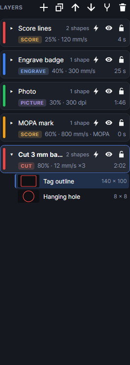
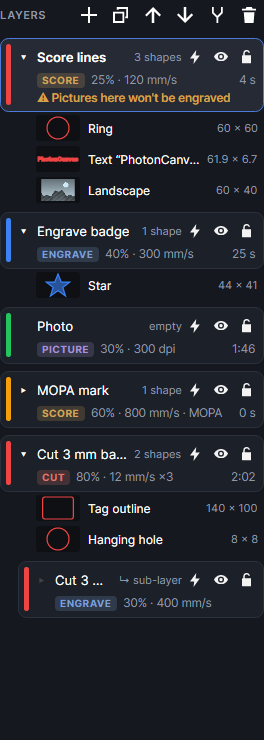

# Layers

A layer is a group of shapes with one set of laser settings: what the laser does (cut, score,
engrave, picture), with which laser, how hard, how fast and how often. Every shape is on exactly
one layer. The order of the layers in the list is the order they run in: **the top layer runs
first**.

Layers are listed in the **Layers** panel (left side, at first). The settings of the layer you
click show in the **Layer settings** panel: see [Layer settings](layer-settings.md).

A new design starts with one layer, called **Cut**. Layers, their settings and their order are
saved with the design.

## The buttons along the top

The icons at the top of the panel (point at one to see its name):

| Button | What it does |
|---|---|
| **Add layer** (+) | A new layer just below the active one, which becomes the active layer. It's called "Layer N", gets the first colour of the palette not used yet, and starts as a Cut layer at 70% and 40 mm/s on the blue diode. Same as `Ctrl+L`. |
| **Duplicate layer with its shapes** | A copy of the active layer, settings and all, with a copy of every shape on it, placed right below it and called "… copy". The copied shapes sit exactly on top of the originals: move them, or the job's checks will say both get processed. |
| **Move up (runs earlier)** | Moves the selected layers one place up. Nothing happens if one of them is already at the top. |
| **Move down (runs later)** | Moves the selected layers one place down. |
| **Merge selected layers into the top one** | With two or more layers selected: all their shapes go onto the topmost of them, which keeps its own settings. The other layers are deleted. |
| **Delete selected layers (shapes move to the layer above)** | Deletes the selected layers. Their shapes move to the nearest layer above that isn't being deleted (or, if there is none, the first one left below). Their sub-layers go with them. |

> **Note:** Deleting every layer at once leaves one new layer with all the shapes on it (their
> settings go with the deleted layers). `Ctrl+Z` brings everything back.

The bar above the panel (with **LAYERS** and the arrows) moves the panel to the other side, floats
it in its own window or folds it: see [The workspace](workspace.md).

## A layer's card

Each layer is a card. From left to right and top to bottom:

| Part | What it shows |
|---|---|
| Colour bar | The layer's colour, used to draw its shapes. Click it to pick another (see below). Faded when the layer won't be sent. |
| ▸ / ▾ | Shows or hides the list of the layer's shapes. Greyed out for an empty layer or a sub-layer. |
| Name | The layer's name, in bold for the active layer. Faded when the layer won't be sent. |
| Count | "empty", "1 shape" or "N shapes". A sub-layer shows "↳ sub-layer" instead (point at it for its parent layer). |
| Lightning | Output on or off (see below). |
| Eye | Shown or hidden. |
| Padlock | Locked or not. |
| Material line | Only when the layer has a material: the material, and the name of the saved settings it uses. |
| Mode chip | **CUT**, **SCORE**, **ENGRAVE** or **PICTURE**. |
| Summary | Power, speed and passes: "80% · 12 mm/s ×3". A picture layer shows its resolution instead of the speed: "30% · 300 dpi". " · MOPA" is added when it uses the MOPA. |
| Time | About how long the layer takes, all passes included, from the job's estimate. Blank for layers that won't be sent and for empty ones. |
| Warning | A line in orange when some of its shapes would be left out (see [Shapes on the wrong kind of layer](#shapes-on-the-wrong-kind-of-layer)). |

The active layer's card is lighter, with a blue border. Other selected layers have a blue border.

## Run order: the top layer runs first

The job runs the layers from the top of the list down. Within a layer, its **Order** setting
decides which shape goes first (see [Layer settings](layer-settings.md)).

To change the order:

- **Drag** a card up or down. Press on the card (not on its buttons), move the mouse: a thicker
  blue line shows where it will land. Let go to drop it there.
- **Move up (runs earlier)** and **Move down (runs later)** move the selected layers one place.

What to put first:

- Score, engrave and picture layers above cut layers. Once a part is cut out it can shift or drop,
  and whatever runs on it afterwards lands in the wrong place. The job's checks warn about any
  layer that runs after a cut layer: "… runs after the cut layer …. Parts may move or drop before it
  is processed; consider moving it above."
- Holes before outlines happens inside a cut layer by itself, with the default order
  (**Least travel (insides first)**).

With several passes, the job bar decides whether a layer's passes all run before the next layer
starts (**Path by path**) or whether every layer's first pass runs, then every layer's second
(**Round by round**): see [Running a job](running-jobs.md).

## Output, show and lock

Three switches on each card. Clicking one on a layer that is part of a selection of several sets
all of them the same way.

| Switch | On | Off |
|---|---|---|
| Lightning: **Output on: this layer is sent to the laser** | The layer is part of the job. | **Output off: shown as a guide, never sent**. The shapes stay on the work area, drawn faded (a sketch to trace over, a jig outline, the outline of the board), but nothing on this layer is marked. |
| Eye: **Hide (hidden layers are never sent)** / **Show** | The shapes are drawn on the work area. | The shapes aren't drawn and can't be picked, and the layer isn't sent. If its output is on, the job's checks say "Layer … is hidden, so it will not be processed." |
| Padlock: **Lock (can't select or move its shapes)** / **Unlock** | Its shapes can't be picked or moved on the work area. They are still sent. | Shapes can be picked and edited. |

A layer is sent only when it is both shown and its output is on. A hidden or output-off layer
has a faded colour bar and name, and no time on its card.

The layer's right-click menu also has **Show only this layer** (hides all the others) and **Show
all layers**.

> **Tip:** Use Output off rather than Hide for a reference you want to see but never burn. Hide is
> for getting things out of the way while you work.

## The active layer, and editing several layers together

- **Click** a card: it becomes the active layer, and the only selected one. Its settings show in
  **Layer settings**.
- **Ctrl+click** adds a layer to the selection, or takes it out.
- **Shift+click** selects every layer from the one clicked before to this one.

With several layers selected, the **Layer settings** panel is titled "N LAYERS" and says "Editing N
layers together. Values that differ show as “mixed”." A change made there goes to all of them;
anything left alone keeps each layer's own value. Settings that only some of the selected layers
use (kerf when a cut and an engrave layer are selected) are shown too; they are set on all of them
but only do something on the layers that use them.

The active layer also changes by itself:

- Select shapes on the work area that are all on one layer: that layer becomes active.
- Click a layer's block on the job bar's timeline.

New shapes you draw go onto the active layer, as long as it's shown, unlocked and not a Picture
layer. Otherwise they go onto the first shown, unlocked layer that isn't a Picture layer.

## Name and colour

- **Rename:** double-click the card (or right-click → **Rename**), type, then `Enter`. `Esc` keeps
  the old name; clicking elsewhere keeps the new one.
- **Colour:** click the colour bar at the card's left edge
  (**Layer colour (display only): click to change**) and pick one of 12 colours. The colour only
  changes how the shapes are drawn on the work area; it has nothing to do with the laser.

## Moving shapes between layers

**Drag them.** Open a layer's shape list (the ▸ on its card), and drag a shape from it onto another
layer's card (or onto that layer's own list). The card you're over lights up and says "Let go to move
1 shape here"; let go and the shape is on that layer. If the shape is one of several selected, all of
them go. Drag a group's **Group of N** line to move the whole group. Letting go anywhere else, or on
the layer they're already on, changes nothing. A sub-layer can't take shapes (it has none of its
own), so it doesn't light up. It's one step: `Ctrl+Z` puts them back.

Or select the shapes on the work area (or in a layer's shape list), then:

- `Ctrl+M`: moves them to the active layer.
- `Ctrl+1` … `Ctrl+9`: moves them to the 1st … 9th layer in the list.
- Right-click a layer → **Move selected shapes here (N)**.
- Right-click a shape → **Move to layer** → the layer.
- The **Layer** list in the **Selection** panel.

Shapes moved to a sub-layer go onto its parent layer (a sub-layer has no shapes of its own).

## The shapes under a layer

The arrow (▸) on a card lists the layer's shapes under it. Selecting shapes on the work area opens
their layers' lists and scrolls to them.

Each row shows a small picture of the shape in the layer's colour (filled on an Engrave layer), its
name and its size. Text shows as Text “its words”, a code as its kind and contents, a picture by its
file name. Point at a row to see its size and position, and to highlight the shape on the work area.

| On a row | Does |
|---|---|
| Click | Selects that shape. |
| `Ctrl`+click | Adds it to the selection, or takes it out. |
| `Shift`+click | Selects every shape on the layer from the one clicked before to this one. |
| Double-click | Renames the shape (`Enter` to keep, `Esc` to cancel). |
| Padlock on the row | The shape is locked (it can't be picked on the work area): click to unlock it. |
| **Group of N** row | Click to select the whole group; its shapes are listed under it. |

At most 60 rows are shown; the rest are counted ("… and N more (use Select all shapes on this
layer)").

### Right-click on a shape

Right-clicking a shape that isn't selected selects it alone. Right-clicking a selected shape acts on
the whole selection. The menu has:

**Rename** (one shape only) and **Select its whole group** (grouped shapes only), then the same menu
as right-clicking shapes on the work area: **Cut**, **Copy**, **Paste**, **Duplicate**, **Delete**,
**Group**, **Ungroup**, **Combine into one shape (compound)**, **Break apart**, **Convert text to
paths**, **Lock** / **Unlock**, **Use as material outline**, **Shape operations**, **Array**,
**Align and distribute**, **Flip and rotate**, **Order**, **Move to layer**, **Fit to piece in
camera…**, **Trace picture…**, **Depthmap with DepthCharge…**, **Remove picture background…**,
**Zoom to …**, **Rename…** and **Save to My shapes…**. They're explained in
[Editing shapes](editing-shapes.md) and [Arranging](arrange.md).

## The layer's right-click menu

Right-click a card. If the layer isn't among the selected ones, it becomes the active layer first.

| Item | Does |
|---|---|
| **Its shapes (N)** | The shape menu above, for every shape on this layer at once (group them, array them, align them…). |
| **Select all shapes on this layer** | Selects them all (same as `Ctrl+Shift+A` for the active layer). |
| **Show all layers' shapes** | Opens the shape list of every layer. |
| **Hide all layers' shapes** | Closes them all. |
| **Move selected shapes here (N)** | Moves the selected shapes onto this layer. |
| **Add sub-layer (another operation on these shapes)** | See [Sub-layers](#sub-layers). On a sub-layer this item reads **Make it a normal layer (with no shapes)**. |
| **Copy settings** | Remembers this layer's settings. |
| **Paste settings** | Puts the copied settings on this layer, or on all the selected layers when this one is among them. |
| **Rename** | Renames the layer. |
| **Duplicate with shapes** | The same as the **Duplicate layer with its shapes** button. |
| **Show only this layer** | Hides every other layer. |
| **Show all layers** | Shows every layer. |
| **Delete layer and its shapes** | Deletes this layer, its sub-layers and every shape on it. `Ctrl+Z` undoes it. |

**Copy settings** and **Paste settings** carry everything that says how a layer is processed: the
mode, the laser, power, speed and passes, the MOPA's pulse width and frequency, and every setting
under **More settings**. They don't carry the name, colour, the three switches, the material or the
**Highly reflective material** tick. Pasting can change the layer's mode (a cut layer's settings
pasted onto an engrave layer make it a cut layer).

## Sub-layers

A sub-layer is a second operation on the shapes of the layer above it, with its own settings: an
outline traced round a fill, a fill inside a cut, a second picture pass. It has no shapes of its
own: it always does whatever is on its parent layer, so moving or changing those shapes changes
both.

Right-click a layer → **Add sub-layer (another operation on these shapes)**. The sub-layer is placed
right after the layer (and its other sub-layers) and becomes the active layer. It takes the parent's
colour, laser (diode or MOPA), material and **Highly reflective material** tick, and starts with
the power and speed a new layer of its mode gets (see [Layer settings](layer-settings.md)):

| Parent layer | Sub-layer | Its name |
|---|---|---|
| Engrave | Score | "*parent* · outline" |
| Picture | Picture | "*parent* · second pass" |
| Cut or Score | Engrave | "*parent* · fill" |

Change its mode and settings like any layer. Its card is indented under its parent and says
"↳ sub-layer".

- It runs where it is in the list, like any layer; it can be dragged above its parent.
- It has its own output, show and lock switches. The parent's switches don't turn it off.
- Shapes moved or drawn onto a sub-layer go onto its parent.
- Deleting the parent deletes its sub-layers.
- Right-click → **Make it a normal layer (with no shapes)** turns it into an ordinary, empty layer.

## Shapes on the wrong kind of layer

A Picture layer only engraves pictures; Cut, Score and Engrave layers only do outlines. Shapes of
the other kind on a layer are left out of the job, and the card says so in orange:

- **⚠ Pictures here won't be engraved** (a Cut, Score or Engrave layer with pictures on it).
- **⚠ Outlines here won't be cut (picture layer)** (a Picture layer with outlines on it).

The picture under [Sub-layers](#sub-layers) shows one: a picture moved onto the **Score lines** layer.

Point at the warning for the details, for example: "Layer "Cut" is a Cut layer, so its picture
won't be engraved. Move it to a Picture layer, or trace it into outlines." The same line appears in
the job's checks. If nothing else is left to do, the job can't be made and says "Nothing would be
done." followed by that line.

To fix it, move the shapes to a layer of the right kind (`Ctrl+1` … `Ctrl+9` or **Move to layer**),
change the layer's mode, or turn a picture into outlines with **Trace** (see
[Pictures](pictures.md)). Only layers whose output is on are checked.

## Keys

| Key | Does |
|---|---|
| `Ctrl+L` | New layer (the same as **Add layer**). |
| `Ctrl+M` | Move the selected shapes to the active layer. |
| `Ctrl+1` … `Ctrl+9` | Move the selected shapes to layer 1 … 9 of the list. |
| `Ctrl+Shift+A` | Select every shape on the active layer. |
| `Enter` / `Esc` | While renaming: keep / cancel. |

`Ctrl+L`, `Ctrl+M` and `Ctrl+Shift+A` can be changed in the keyboard shortcuts (see
[Keyboard shortcuts](keyboard-shortcuts.md)).

Tutorials: [Add, name and order layers](tutorial:layer-basics),
[Output, show and lock](tutorial:layer-switches),
[Move shapes between layers](tutorial:layer-move-shapes),
[Edit several layers at once](tutorial:layer-several),
[Sub-layers](tutorial:layer-sublayer).
