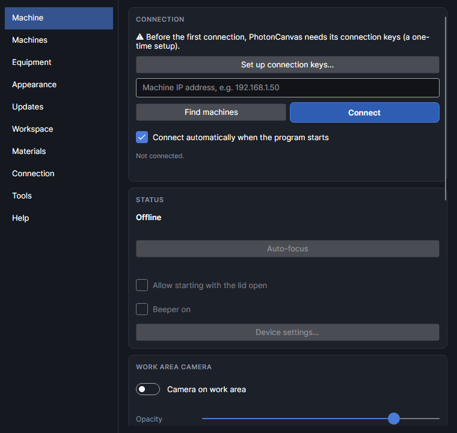
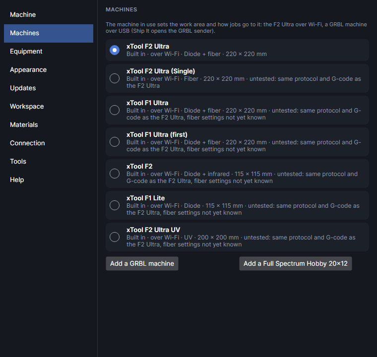
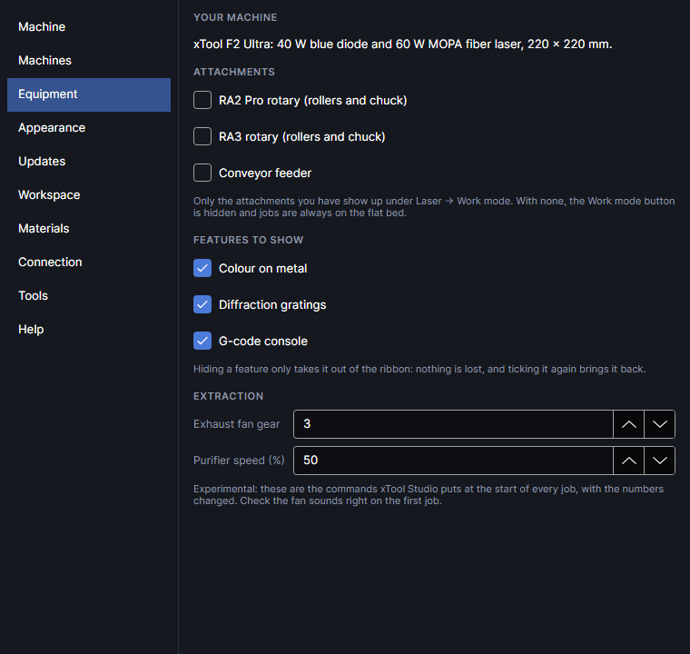
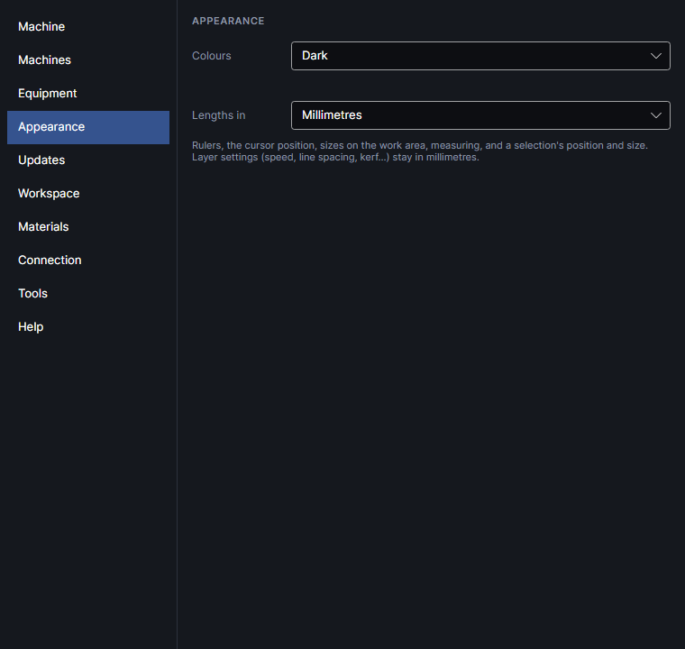
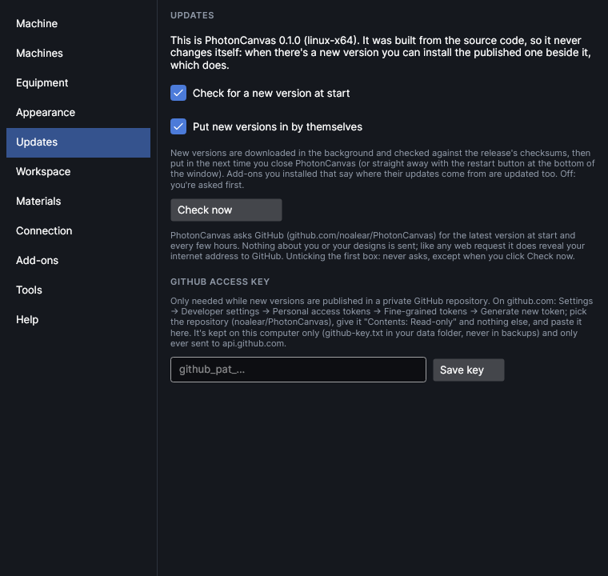
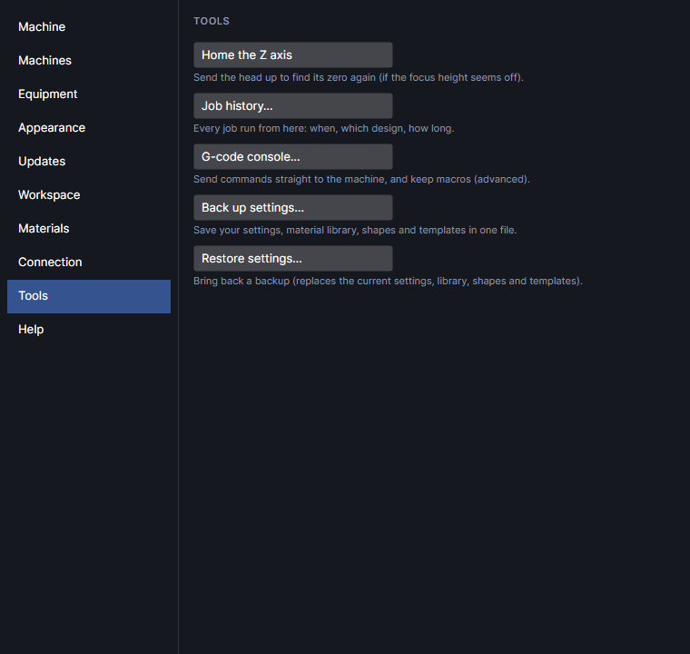
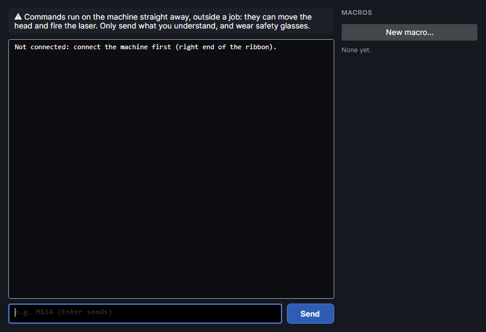

# The machine and settings

PhotonCanvas talks to the F2 Ultra over your own network (Wi-Fi, a network cable or USB): no
account, no cloud. This page covers connecting, the machine panel at the right end of the ribbon,
the **Settings** window page by page, the machine's own stored settings, the G-code console and
where PhotonCanvas keeps its files.

Nothing on this page starts a job. Jobs only start from the machine's button (see
[Running a job](running-jobs.md)). A few things here do move the head or fire the laser, and say
so: auto-focus, moving the focus height, homing the Z axis and the console.

## Connecting

Connecting takes three things: the connection keys (once), the machine on the same network as the
computer, and **Connect**.

### Connection keys
<!-- windows: KeysWindow -->

xTool machines only answer programs that know three short codes. They don't come with
PhotonCanvas: it reads them from your own copy of xTool Studio, once, and keeps them on this
computer. Nothing else is read from xTool Studio, and nothing is sent anywhere.

| Key | Used for |
|---|---|
| **Search key** | Encrypting the "find machines" message sent over the network (32 characters). |
| **Answer key** | Reading the machines' answers (32 characters). |
| **Pairing key** | Pairing this computer with the machine (20 characters). |

The **Connection keys** window opens by itself the first time you connect or search, and from the
first-start welcome window, from **Set up connection keys…** on the Settings window's **Machine**
page (shown while the keys are missing) and from **Settings → Connection → Connection keys…**.

- **Find them in my xTool Studio** looks in the usual places (your Programs folder and Program
  Files, as *xTool Studio*, *xToolStudio* or *xTool Creative Space*) and reads the keys from its
  program file. It takes a few seconds.
- **Choose xTool Studio's program file…** is for xTool Studio installed somewhere else: pick its
  `app.asar`, in its `resources` folder (usually
  `C:\Users\<you>\AppData\Local\Programs\xTool Studio\resources\app.asar`).
- **Or type / paste them in** opens three boxes for the keys. Each is checked as you type against
  a fingerprint built into PhotonCanvas: ✓ means it's right, ✗ that it isn't.
- **Save** is ready once all three are right. They're saved in `keys.json` in the
  [data folder](#the-data-folder).

Without xTool Studio on this computer, PhotonCanvas can't find the keys for you; type them in
if you have them.

### Finding and connecting

The quickest way is **Connect** on the machine panel at the right end of the ribbon: it tries the
last machine first, then searches the network and connects to the first one that answers (an
F2 Ultra first). With **Connect automatically when the program starts** ticked (it is to begin
with), the same happens every time PhotonCanvas opens.

On the Settings window's **Machine** page you can do it by hand:

1. **Find machines** searches the network for 4 seconds and lists what answered (name, model code
   and address). If nothing answers on the network, it tries a USB cable and a direct network cable
   (*Nothing on the network; trying a USB or Ethernet cable…*). Your firewall must let PhotonCanvas
   through.
2. Pick one from the list, or type its address in the box (*Machine IP address, e.g.
   192.168.1.50*). Your router lists the machine's address.
3. **Connect** (or `Enter` in the box). The first time, the machine may ask for its button to be
   pressed: *Press the button on the machine to allow this computer.* Press it within 90 seconds.

Once connected:

- The line under the buttons says *Connected to …*, with the machine's serial number and firmware.
  It warns when the machine is a different model from the one chosen in
  [Machines](#machines-page), when PhotonCanvas doesn't know the model, or when its firmware doesn't
  list text G-code.
- The machine's status and head height are read every 3 seconds.
- If a job was cut short by a power cut, PhotonCanvas offers to carry on (see
  [Alarms and power cuts](#alarms-and-power-cuts)).
- **Connect** becomes **Disconnect**.

If the machine goes quiet for 11 seconds, the connection is dropped: *Connection lost: …*. Click
**Connect** again once it's back. Connecting over a USB cable hasn't been tried on the machine yet.

## The machine panel

The machine panel sits at the right end of the ribbon, whichever tab is open. It has the things
you reach for at the machine. While disconnected it shows only the status and **Connect**.

### Status

The status pill says *Not connected*, or the model (*F2 Ultra ·*, as the machine reports itself) and
what the machine is doing, with a
coloured dot:

| Dot | Status |
|---|---|
| grey | *Not connected* |
| green | *Ready*, *Job finished* |
| blue | *Running* |
| amber | *Paused*, *Job loaded – waiting for the start button*, *Framing* |
| red | *Asleep*, or *Error: check the machine* |

Other states: *Auto-focusing*, *Measuring*, *Unknown*. While the head moves the pill says so
(*Moving to 21.6 mm…*), and an error stays up for 8 seconds.

Click the pill for **Connect** or **Disconnect**, **Calibrate camera…** and
**Machine settings…** (the Settings window).

**Connect**, beside it while disconnected, connects to the last machine or the one found on the
network (setting up the keys first if they're missing).

### Camera and lights

The middle row, once connected. The camera itself is explained in [Camera](camera.md).

| Button | Does |
|---|---|
| **Photo** | Takes a new photo of the bed and lays it under your design. Needs the camera calibrated. |
| **Show** | Shows the camera picture under the design, straightened and to scale. Not calibrated yet: it opens the calibration. Right-click for **CAMERA PICTURE OPACITY**. |
| **Live** | Keeps the camera picture updating (live view). |
| **Close-up** | The close-up camera in the laser head, on the work area. |
| **Lights** | **CAMERA LIGHTS**: **Front** and **Back**, 0–100 each, the machine's fill lights for the cameras. Saved on the machine. |

### Focus height and auto-focus

The bottom row: **Focus**, the focus distance (the gap between the laser head and the material),
and **Auto-focus**.

- **Auto-focus**: the machine measures the material under the head and moves to the right focus
  height. Put the material in first. The head moves; the machine's button stops it.
- **▼** and **▲** lower and raise the head 1 mm (`Shift`: 0.1 mm). Click as often as you like:
  the head moves when you stop clicking.
- Or type a distance in the box (*21.6*, *21.6 mm* or *21,6*, from 0 to 150 mm) and press
  `Enter`. `Esc` puts it back.

They work only when the machine is *Ready* or *Job finished*: not while a job is loaded, running or
paused, while framing, or while it's already focusing. When the camera picture is on the work
area it's retaken after the height changes, since where the camera looks depends on it.

## The Settings window
<!-- windows: SettingsWindow -->

The **Settings** window holds what you set up once. Open it with the gear at the top right,
**File → Settings…**, **Laser → Machine settings** or the status pill's **Machine settings…**. It
always opens on the **Machine** page. Pick a page from the list on the left; changes save at once.

The machine stays connected when you close it.

### Machine page

The full machine panel: connection, status and options, the camera, its lights and the machine's
event log.

**CONNECTION**: the keys warning and **Set up connection keys…** (while the keys are missing), the
address box, the list of machines found, **Find machines**, **Connect**/**Disconnect**,
**Connect automatically when the program starts** (tries the last machine first, then searches),
and what's happening. See [Finding and connecting](#finding-and-connecting).

**STATUS**:

- What the machine is doing, and *Focus distance … mm (head Z …)*. A loaded job says whose it is.
- **Auto-focus**, as on the [machine panel](#focus-height-and-auto-focus), with its progress:
  *Focusing… the head will move. Press the machine's button to stop.*, then *Focused: material
  distance … mm.*
- **Allow starting with the lid open**: stored on the machine (xTool calls it "Enclosure-opened
  processing"). When on, the start button works with the lid up. Turning it on asks first,
  **Allow starting with the lid open?**, with what's at stake; **I understand, allow it** turns it
  on, **Keep it off** doesn't. It stays on until you turn it off.
- **Beeper on**: the machine's beeps for button presses and jobs. Stored on the machine; the
  firmware has on and off, no volume.
- **Device settings…**: the machine's own stored settings (see [Device settings](#device-settings)).

> **Safety:** With the lid open, laser light, smoke and sparks escape. Everyone in the room needs
> safety glasses rated for 455 nm and 1064 nm. Never leave the machine running unattended.

**WORK AREA CAMERA**: **Camera on work area** (the overview camera under your design),
**Opacity** (how strongly it shows, 15–100%, 85% to begin with), **Update photo**,
**Calibrate camera…** and which material heights it's calibrated for. See [Camera](camera.md).

**CAMERA LIGHTS**: **Front** and **Back**, 0–100 (*off* at 0). Saved on the machine.

**CAMERA**:

- **Live view on**/**Live view off** and which camera: **Overview** or **Close-up**. The machine
  sends one camera at a time, as fast as it can (about 3–4 pictures a second); the line under the
  picture says how fast. Live view stops after three failed pictures in a row.
- **Straighten** (close-up only): degrees clockwise to turn the close-up picture, which sits turned
  in the head (about −149° on the F2 Ultra; Measure colours learns the exact angle). For display
  only.
- **Save snapshot…**: saves the current camera's photo as a JPEG, as the camera took it.

The red pointer and the auto-focus light are turned off for photos and live view (only while the
machine is idle or waiting with a job), so they don't show in the picture.

**MACHINE EVENTS**: the last 200 things the machine reported, with times: connecting, status
changes, *Job loaded*, *Job started*, *Job paused*, *Job stopped*, *Job finished*, *Job cancelled*, *Lid opened*,
*Lid closed*, focusing, and any errors. They're also written to the day's log file.

### Machines page

The machine in use sets the work area, the limits jobs are checked against, and how jobs go to
it: the F2 Ultra over the network, a GRBL machine over USB.

- **xTool F2 Ultra** is built in and chosen to begin with.
- **xTool F2 Ultra (Single)**, **xTool F1 Ultra**, **xTool F1 Ultra (first)**, **xTool F2**,
  **xTool F1 Lite** and **xTool F2 Ultra UV** are built in from xTool Studio's model list, with
  their work areas. They use the same protocol and G-code as the F2 Ultra but are untested: none
  has been tried on a real machine. MOPA settings are allowed only where the limits are known
  (the F2 Ultra and F2 Ultra (Single)).
- Your GRBL machines, each with **Edit**.

Click the round button beside one to use it. The work area and the job change at once.

### GRBL machines

GRBL is the controller in most hobby lasers (and in others after a controller swap).
PhotonCanvas writes GRBL 1.1 laser-mode G-code for them and sends it over USB. Not yet tried on a
real GRBL machine.

**Add a GRBL machine** adds one to describe; **Add a Full Spectrum Hobby 20×12** adds a starting
point for that 45 W CO2 laser after a GRBL controller swap (its bed and a CO2's speeds; check the
origin and power scale against your controller). **EDIT** shows these:

| Setting | Range | Default | What it is |
|---|---|---|---|
| **Name** | | *My laser (GRBL)* | Shown in the list. |
| **Laser** | CO2, Diode, Fiber | Diode | The kind of laser. |
| **Laser power (W)** | 1–500 | 10 | Its power, for the heat order and the list. |
| **Bed width (mm)** | 10–3,000 | 400 | Left to right: the area the head can reach. |
| **Bed depth (mm)** | 10–3,000 | 300 | Front to back. |
| **Fastest (mm/s)** | 1–3,000 | 300 | The fastest it moves while marking (GRBL's `$110`/`$111`, in mm/s rather than mm/min). Faster layer settings are refused. |
| **Full power is S** | 1–100,000 | 1,000 | GRBL's `$30`: the S value for 100% (usually 1000; 255 on some boards). |
| **Where 0, 0 is** | | Front left | **Front left, Y going back (the usual)**, **Back left, Y going forward as negative numbers** or **Back left, Y going forward as positive numbers**. Frame a small design: if it's mirrored front to back, pick another. |
| **Port** | | | The USB serial port it shows up as (COM3 on Windows, `/dev/ttyUSB0` or `/dev/tty.usbserial` on Linux and Mac). Plug it in first. |
| **Speed (baud)** | 9,600–2,000,000 | 115,200 | The port's speed. |
| **Picture overscan (mm)** | 0–50 | 3 | Each picture row runs this far past both ends with the laser off, so the head is at speed where it burns. More for heavy CO2 gantries. |
| **Air assist on while marking (M8)** | | on | Turns air assist on for the job (`M8`) and off at the end (`M9`). |

GRBL must be in laser mode (`$32=1`): moves without S then don't fire, and power follows speed
(`M4`) so corners don't scorch. GRBL machines take flat-bed jobs only: no rotary, conveyor or
curved surface. **Delete this machine** removes it.

### Sending to a GRBL machine
<!-- windows: GrblWindow -->

With a GRBL machine in use, **Ship It** opens **Send to** *(the machine's name)*: the job as GRBL
G-code, how many lines, and its size.

1. Pick the **Port** and click **Connect**. The status shows GRBL's state and the head's position
   (*Idle · X 0.0 Y 0.0*).
2. **Home ($H)** sends the head to its home switches; **Unlock ($X)** clears an alarm without
   homing.
3. **Frame** traces the box round the job with the laser off, so you can see where it goes.
4. **Start** sends the job, keeping GRBL's buffer full so the head never stalls mid-row. Progress
   shows as *Running: line … of … · about … left*.
5. **Pause** holds it at once (laser off) and **Resume** carries on. **Stop** resets GRBL: the
   laser goes off at once; home again before the next job if the position may be lost.

**Save G-code…** saves the GRBL G-code to a file. GRBL's errors and alarms are explained in words
(for example *error:9 — GRBL is locked (an alarm, or it hasn't been homed): Unlock or Home first.*).
Stay with the machine while it runs.

### Equipment
<!-- windows: EquipmentWindow -->

What you have, so features that need something you don't have stay out of the ribbon. It's asked
once: in the welcome window at the first start, or in **Your equipment** at the first start after
updating from a version that didn't ask. Change it here any time.

**ATTACHMENTS**: **RA2 Pro rotary (rollers and chuck)**, **RA3 rotary (rollers and chuck)**,
**Conveyor feeder**. Only the ones ticked show up under **Laser → Work mode**; with none ticked,
**Work mode** is hidden and jobs are always on the flat bed (see [Work area](work-area.md)).

**FEATURES TO SHOW**: untick what you don't use. It only comes out of the ribbon; nothing is lost.

| Tick | Shows |
|---|---|
| **Colour on metal** (on) | **Picture → Colour on metal**, and the **Colour on metal** group on the **Laser** tab (**Colour test**, **Measure colours**), while the Colour on metal add-on is on. |
| **Diffraction gratings** (on) | **Picture → Diffraction** (while the Diffraction pictures add-on is on). |
| **G-code console** (on) | **Laser → Console** (see [The G-code console](#the-g-code-console)). |

**EXTRACTION**: sent at the start of every job, as xTool Studio does it. Experimental: these are
xTool Studio's commands with the numbers changed, not yet heard on the machine. Check the fan sounds
right on the first job.

| Setting | Range | Default | Effect |
|---|---|---|---|
| **Exhaust fan gear** | 1–4 | 3 | The exhaust fan's speed (and an xTool duct fan's): 1 lowest, 4 highest. xTool Studio sends 3. |
| **Purifier speed (%)** | 10–100, steps of 10 | 50 | An xTool purifier's speed. xTool Studio sends 50%. |

### Appearance

| Setting | Choices | Effect |
|---|---|---|
| **Colours** | **Dark** (the default), **Light** | The program's colours. Takes effect the next time the program starts. |
| **Lengths in** | **Millimetres** (the default), **Inches** | Rulers, the cursor position, sizes on the work area, measuring, and a selection's position and size. Layer settings (speed, line spacing, kerf…) stay in millimetres. |

### Updates

PhotonCanvas keeps itself up to date: new versions are published on GitHub, and it downloads them
in the background and puts them in when you close it. The page says which version this is (e.g.
*This is PhotonCanvas 0.1.42 (win-x64).*) and has:

- **Check for a new version at start** (on to begin with): at start, and every few hours while
  it's open, PhotonCanvas asks GitHub for the latest version. Nothing about you or your designs is
  sent (like any web request, it shows GitHub your internet address). Quiet when offline. Off: it
  never asks, except when you click **Check now**.
- **Put new versions in by themselves** (on to begin with): a newer version is downloaded in the
  background and checked against the release's checksums (a damaged or tampered download is thrown
  away). While it downloads, the bottom left of the window says so; once it's ready, a button there
  says **PhotonCanvas 0.1.43 is ready: restart**. Click it to close and start again with the new
  version straight away (you're asked to save first, as usual), or carry on: it goes in the next
  time you close PhotonCanvas. After it has gone in, the same place says **Updated to 0.1.43:
  what's new** for a minute (click it for the release notes). Off: you're asked first, with
  **A new version is out** (below).
- **Check now** asks straight away and says what it found.
- **GitHub access key**: only needed while new versions are published in a *private* GitHub
  repository. On github.com go to **Settings → Developer settings → Personal access tokens →
  Fine-grained tokens → Generate new token**, choose the repository, give it
  **Contents: Read-only** and nothing else, then paste it here and click **Save key**. It's kept on
  this computer only (`github-key.txt` in the [data folder](#the-data-folder), never in backups)
  and only ever sent to GitHub. **Forget key** deletes it.

When there's a newer version and it isn't put in by itself, **A new version is out** shows what's
new, with **Update** (download it and put it in when you close, or straight away with
**Restart now**), **Skip this version** (not offered at start again) and **Later**.

Your designs, settings, material library and add-ons are in the
[data folder](#the-data-folder), not with the program, so an update never touches them. Add-ons
you installed yourself are kept up to date too when they say where their updates come from: see
[Add-ons](addons.md).

A copy that was **built from the source code** (rather than downloaded) never changes itself. When
there's a new version, it offers **Install it** instead (Windows): that puts the published version
in `AppData\Local\Programs\PhotonCanvas` with shortcuts on the desktop and in the Start menu, and
offers to open it. From then on, open PhotonCanvas from those shortcuts: that copy keeps itself up
to date. A copy in a folder it can't write to (for example *Program Files*) can't update itself
either; move it to a folder of your own.

### Workspace, Materials and Connection

Shortcuts to windows explained elsewhere:

- **Workspace**: **Grid & snapping…** (see [Working on the canvas](canvas.md)) and
  **Shape library…** (see [Drawing](drawing.md)).
- **Materials**: **Material library…** (see [Material library](material-library.md)) and
  **Material test grid…** (see [Materials and tests](materials-and-tests.md)).
- **Connection**: **Connection keys…** (see [Connection keys](#connection-keys)) and
  **Calibrate camera…** (see [Camera](camera.md)).

### Tools

- **Home the Z axis**: the head goes all the way up to find its zero again. Use it when the focus
  height seems off. **Home the Z axis?** asks first; **Home it** starts it. Keep your hands clear
  of the head. Afterwards the status line says *Z axis homed. Set the focus height again before
  marking.*: set it again, or auto-focus. Only when the machine is *Ready* or *Job finished*.
- **Job history…**: every job run from this computer (see
  [Job history](running-jobs.md#job-history)).
- **G-code console…**: see [The G-code console](#the-g-code-console). It opens the console even
  while its ribbon button is hidden (unticked in [Equipment](#equipment)).
- **Back up settings…**: saves your settings, material library, saved shapes and templates in one
  `.pcbackup` file (*PhotonCanvas backup* and the date). Keep it somewhere safe, or take it to
  another computer.
- **Restore settings…**: brings a backup back. **Restore settings?** warns that it replaces the
  current ones; then close and open the program again to use them.

> **Note:** The connection keys, the pairing with your machine and the camera calibrations aren't in
> the backup: set those up again on another computer. After **Restore settings…**, nothing more is
> saved until the program is closed and opened again, so the restored settings aren't overwritten.

### Help

**Help guide** (this guide; `F1` in any window opens its page), **Tutorials**,
**Getting started** (a short tour, and the connection setup), **Keyboard shortcuts**,
**Safety and disclaimer** and **About PhotonCanvas** (version, licence, credits).

## Device settings
<!-- windows: DeviceSettingsWindow -->

**Device settings…** on the Settings window's **Machine** page (once connected) opens the
settings stored on the machine itself. They apply whichever program sends the job. The line at the
bottom says what happened: *Read from the machine.*, what was changed, or why it failed.

None of this has been checked against the machine yet: whether every switch reads back what the
machine shows, renaming, the exhaust run-on, the galvo timing, Wi-Fi, the interlocks and keeping a
job are all on the list for the next machine test.

### Machine tab

- The machine's name (up to 15 characters, shown on the machine and when searching) and
  **Rename**.
- Its serial number, firmware, model, its addresses on Wi-Fi, USB and Ethernet, and how many jobs
  it has run (from a computer, and from its own screen).

### Safety tab

Switches stored on the machine. Turning off one of the first four shows a full warning first: what
can go wrong without it (blinding laser light, fire, a damaged laser), that it stays off on the
machine whichever program sends the job, and that it's at your own risk. Choose **I understand, turn
it off** or **Keep it on**.

| Switch | When on |
|---|---|
| **Flame alarm: stop and warn when the camera sees fire** | The machine stops if the material catches fire. Only turn it off for false alarms, and never leave a job unwatched. |
| **Stop when the machine is moved or tilted** | A knock or tilt during a job stops it. |
| **Stop when the lid is opened** | Opening the lid stops the job. |
| **MOPA laser overheat alarm** | The job stops if the MOPA laser gets too hot. Off, it could be damaged. |
| **Beeper** | The machine beeps (the same as **Beeper on** on the Machine page). |

**Allow starting with the lid open** is on the Machine page, not here.

### Exhaust & sleep tab

| Setting | Range | Effect |
|---|---|---|
| **Exhaust run-on (s)** | 1–600, steps of 5 | How long the exhaust or purifier keeps running after a job, to clear the smoke. |
| **Purifier beeps (when one is connected)** | | The purifier's beeps. |
| **Go to sleep when left idle** | | The machine sleeps when left alone. Press its button to wake it. |

### Galvo timing tab

Delays that line the laser up with the mirrors' movement, for each laser: **Diode (blue)** and
**MOPA (red)**. The rows are **Laser on delay**, **Laser off delay**, **End-of-line delay**,
**Corner delay**, **Jump delay**, **Jump distance delay** and **Dot settle delay**.

- Raise the **Laser on delay** if lines start with a dot or a gap, the **Laser off delay** if they
  end with a blob, the **Corner delay** if corners round off.
- Values are shown as xTool Studio shows them (−10,000 to 10,000, in steps of 10). Saving rounds
  each up to a step of 10.
- Change them a little at a time and burn a test between changes.
- **Save timing** asks first (**Save galvo timing?**), then stores the changed values on the
  machine: every job uses them from then on.
- **Factory timing: diode** and **Factory timing: MOPA** put one laser's delays back as they came.

### Wi-Fi tab

Which network the machine is on, **Scan for networks** (strongest first), **Network**,
**Password** and **Join**. **Join this network?** asks first. The machine changes over straight
away: this connection drops, and you find it again on the new network with **Find machines**.

### Interlocks tab

What the machine's own safety sensors report now: the **Lid** (closed or open), the **Safety
key** (in or out), the **Exhaust fan** (connected or not) and the **Emergency stop** (released or
PRESSED). **Check again** reads them again.

### Keep a job tab

Keeps the last finished job on the machine, to run again from its own screen without the
computer. Needs the touchscreen controller. Type a name (1 to 15 letters and digits, no spaces) and
click **Keep the last job on the machine**. The machine refuses if a job already has that name,
there's no finished job, or it's out of room.

## Alarms and power cuts

The machine's alarms are shown straight away, whatever window is open, as **Machine alarm**:

| Alarm | Message |
|---|---|
| Emergency stop | *The emergency stop was pressed. Release it (turn it) once it's safe, then check the job.* |
| Flame | *The machine's flame alarm went off and it stopped. Check the material for flames or embers before doing anything else.* |
| Moved or tilted | *The machine was moved or tilted and stopped. Put it back level and check the material hasn't shifted.* |
| MOPA too hot | *The MOPA laser is too hot and the job stopped. Let it cool down before carrying on.* |

When you connect after a power cut stopped a job, **Carry on after the power cut?** offers
**Carry on** (the machine gets the job ready to go on from where it stopped; press its button to
start) or **Forget the job**. Check the material hasn't moved first.

Neither the alarm messages nor carrying on after a power cut have been tried on the machine yet.

## The G-code console
<!-- windows: ConsoleWindow -->

The console sends G-code and M-code lines straight to the machine, and keeps snippets as macros.
It's for advanced use and testing: commands run at once, outside any job, and can move the head and
fire the laser. Not yet tried on the machine.

Open it with **Console** on the **Laser** tab (in the **Machine** group), or
**Settings → Tools → G-code console…**. The console is there while **G-code console** is ticked in
[Settings → Equipment](#equipment), as it is to begin with; unticked, the ribbon button is hidden,
but **G-code console…** under Settings → Tools still opens it. It can also be given a keyboard
shortcut.

- Type a command in the box at the bottom (*e.g. M114 (Enter sends)*) and press `Enter` or
  **Send**. `↑` and `↓` go back through what you sent.
- The first command asks **Send commands to the machine?**; **I understand, send** goes ahead for
  as long as the window is open.
- Each line shows with `>` and the machine's answer under it (*ok* when it says nothing, ✗ and the
  error when it fails). `;` starts a comment.
- Not connected: *Not connected.* Connect first.

**MACROS** on the right: **New macro…** keeps one or more lines under a name (one command per line).
Click a macro to run its lines in turn; it stops at the first error. **Edit** beside it opens it
to change, with **Delete** to remove it. Macros are kept in your settings.

> **Safety:** Console commands don't wait for the machine's start button. Send only what you
> understand, with the lid closed and safety glasses on.

## Machine settings button

**Machine settings**, at the right of the **Laser** tab, opens the Settings window on the
**Machine** page: connection, camera calibration, lights, options and the machine's event log. It's
the same as the gear at the top right.

## The data folder

PhotonCanvas keeps everything in a folder called **PhotonCanvas** in your user folder
(`C:\Users\<you>\PhotonCanvas` on Windows), not with the program, so updating keeps it. What's in
it:

| In it | What it is |
|---|---|
| `app.json` | Your settings: the machine's address, the job bar and frame settings, macros, panels, the ribbon tab you last used… |
| `keys.json` | The connection keys. |
| `state.json` | The pairing with each machine. |
| `camera.json`, `pointer-calibration.json` | The camera calibrations and the red pointer's calibration. |
| `materials`, `shapes`, `templates` | Your material library, saved shapes and templates. |
| `job-history.jsonl` | The job history. |
| `versions`, `autosave` | Earlier versions of your designs, and the crash-recovery copies. |
| `logs` | A diary per day (the last 14 days): machine events, warnings and errors. Useful when something goes wrong. |

Time-lapses (an add-on) go in your Pictures folder instead.
Data saved by older versions in other places is brought over when the program starts.

## Try it

- [Set up the connection keys](tutorial:mach-connection-keys)
- [Connect to the machine](tutorial:mach-connect)
- [Focus the laser](tutorial:mach-focus)
- [Find your way round Settings](tutorial:mach-settings)
- [The machine's own settings](tutorial:mach-device-settings)
- [Add a GRBL machine](tutorial:mach-grbl)
- [Tell PhotonCanvas what you have](tutorial:mach-equipment)
- [Colours and units](tutorial:mach-appearance)
- [Keep PhotonCanvas up to date](tutorial:mach-updates)
- [Back up your settings](tutorial:mach-backup)
- [Send G-code from the console](tutorial:mach-console)
