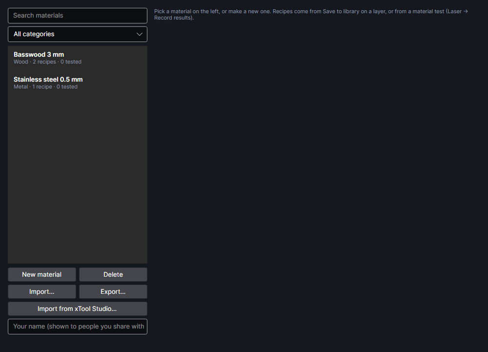

# Material library
<!-- windows: MaterialLibraryWindow -->

The material library keeps the settings that worked, material by material: each material has
*recipes*, layer settings with what they're for, how well they worked, whether they were really
burned, notes and a photo of the result. Tests save their results here, layers take their settings
from here, and you can share it or bring in xTool Studio's settings.

Open it with **Library** on the Laser tab, or **Settings → Materials → Material library…**.

The materials in the pictures are made-up examples.

## Materials

The list on the left shows every material with its category, how many recipes it has and how many
of those are tested. Above it, **Search materials** finds names, notes and recipe titles, and the
category box shows one category (**All categories** shows all). Pick a material to see and edit it
on the right. Changes are saved as you make them.

- **New material** adds one called *New material* in *Wood*, ready to rename.
- **Delete** removes the materials picked in the list (`Ctrl`-click or `Shift`-click for several),
  with all their recipes and photos. It asks first; it can't be undone.

| Field | What it is |
|---|---|
| **Name** | The material's name. With the thickness it makes the label used everywhere, for example *Basswood 3 mm*. |
| **Category** | Wood, Plywood & MDF, Acrylic, Leather, Paper & card, Fabric, Cork & rubber, Stone & tile, Glass, Metal, Coated metal, Plastic, Food, Other. |
| **Thickness mm** | 0–100. 0 means it doesn't apply (coatings, surfaces). |
| **Highly reflective** | Bare copper, brass, aluminium, silver, gold, chrome or mirror finishes. Layers using this material keep the MOPA out of the frequencies that bounce the most back into the fiber, and the job reminds you how to cut reflections. A new name with copper, brass, bronze, aluminium, silver, gold, chrome, mirror, polished, rhodium or platinum in it ticks it, until you set it yourself. |
| Notes | Anything worth remembering about the material. |

## Recipes

Under **RECIPES**, each recipe is a card, sorted by what it's for and then by stars:

- its purpose and title, for example *Cut · Clean cut, light char*;
- its settings in one line (mode, laser, power, speed, passes; for the MOPA, pulse width and
  frequency) and the focus distance if one was saved;
- its stars and who tested it: **Untested**, *Tested by you* with the date, or *Tested by* a name for
  recipes from someone else (or *xTool*);
- its notes, and a photo of the result if it has one.

A recipe holds all of a layer's processing settings: everything except the layer's name, colour and
visibility. Some also carry a test's result: the depth a pass (etch rate), the kerf and slot fit (cut
test), or a tone correction (tone test).

A recipe's purpose is one of Cut, Score, Engrave, Picture, Relief and Mark. You choose it when you
save from a layer; the tests set it from what they burned (etch-rate and graphene results are
Engrave, tone tests Picture).

The buttons on each card:

| Button | What it does |
|---|---|
| **Apply to layer** | Puts these settings on the layers selected in the Layers panel (see below). |
| Stars | Click a star to rate it 1 to 5 (Poor, Usable, Good, Very good, Perfect); click the top star again to lower it. 0 means not rated. |
| **Tested** | Ticked: it was really burned and looked at (dated today if it had no date). Unticked: a guess; the date and tester are cleared. |
| **Rename…** | Changes the title. |
| **Notes…** | Changes the notes. |
| **Delete** | Removes the recipe and its photo, after asking. |

Where recipes come from:

| From | Gives |
|---|---|
| **Save to library…** in a layer's settings | That layer's settings, with what you say about them (see below). |
| **Record results** | One tested recipe per square you pick from a test grid, with its photo. |
| **Etch rate** | *Etch 0.15 mm a pass*: the setting at one pass, with its depth a pass. |
| **Cut test** | *Cuts 3 mm: 8 mm/s × 2*, with the kerf and slot fit when measured. |
| **Tone test** | *Pictures, matched (…)*, with the tone correction. |
| **Graphene test** | *Graphene (… per square)*. |
| **Import…** | Recipes someone shared. |
| **Import from xTool Studio…** | xTool's tested settings and your own from xTool Studio. |

The tests are explained in [Materials and tests](materials-and-tests.md).

## Applying settings to a layer

Two ways:

- In the library, select the layers first (in the Layers panel), then **Apply to layer** on a recipe.
  The status line under the buttons says what was applied.
- In [Layer settings](layer-settings.md), pick the **Material**, then a recipe under **Saved
  settings** (★ is its rating, ✓ means tested).

Either way the layer takes all the recipe's settings, remembers which material and recipe they came
from, and takes the material's **Highly reflective** setting. With several layers selected, only the
layers the recipe suits take it: a picture recipe goes on layers with pictures, a cut, score or
engrave recipe on layers with outlines (empty layers take anything). So picking a photo's settings
doesn't turn the cut layer beside it into a picture layer.

Picking a material for a picture layer also brings in that material's tone correction, from its
tested picture recipe nearest the layer's power, speed and resolution. A layer whose material has
been deleted from the library shows it as *not in your library*.

Other tools read the library too: **Inlay** offers your etch-rate and cut recipes, **Exact depth**
starts from the nearest etch rate, the **Bevel test** offers your cut recipes, and stacked slices
take their cut settings, kerf, slot fit and etch depth from it ([3D models and stacked
slices](3d-slices.md)). **Picture → Colour on metal** uses the palettes (see [Pictures](pictures.md)).

## Saving from a layer

**Save to library…** in a layer's settings saves that layer's settings as a recipe: which material
(or a new one), what it's used for, a short title (its settings if left empty), stars, whether you
burned it and checked, the focus distance, notes, and a camera photo of the layer's shapes when the
camera picture covers them. The layer is then linked to that material and recipe. See [Layer
settings](layer-settings.md).

## Colour and grating tests

When a material has colour palettes or grating sets from **Measure colours**, they're listed under
**COLOUR AND GRATING TESTS**: the palettes first, then the grating sets, each newest first:

- A palette shows its name, date, how many squares and how many clearly different colours, how it was
  measured, the focus, and a chip of each clearly different colour (hover for the settings that made
  it).
- A grating set plays its views one after another, lists its strongest squares and where they light
  up, and **Save GIF…** saves the animation.

The bin icon on each deletes it, after asking. See [Colour on metal](materials-and-tests.md).

## Sharing materials

Materials travel as `.pcmat` files, which hold the materials, their recipes, palettes and grating
sets, and their photos.

- Type your name in **Your name (shown to people you share with)**: it goes in the files you export,
  and people who import them see their recipes as tested by you.
- **Export…** saves the materials picked in the list, or all of them if none is picked.
- **Import…** reads one or more `.pcmat` files.

On import:

- Materials you don't have are added, with all their recipes.
- For a material you already have (the same one, imported before or shared back), only the recipes,
  palettes and grating sets you don't have yet are added. Nothing of yours is changed.
- Recipes keep who tested them; tested ones without a name get the file's author (or its file name).
- Settings are brought inside the F2 Ultra's limits; anything unreadable is skipped.
- A report says, per file, how many new materials and recipes came in and how many were already
  there or unreadable.

Other people's machines and materials may differ from yours: try their recipes on scrap first.

▶ [Share materials](tutorial:mat-share-library)

## Importing from xTool Studio

**Import from xTool Studio…** reads xTool Studio's material settings from its folder on this
computer (`%APPDATA%\xTool Studio`), read only:

- xTool's own tested settings for the F2 Ultra, as xTool Studio last downloaded them;
- the settings you made yourself in xTool Studio.

Only materials and their settings are read. Your account, devices and projects are left alone,
nothing in xTool Studio is changed and nothing is sent anywhere. If xTool Studio isn't installed, or
hasn't opened its material library yet, it says so. If it can't read the folder, close xTool Studio
and try again.

What comes in:

- Flat-bed settings for cutting, scoring, filling and pictures, for both lasers: power, speed, passes,
  line density, picture resolution and dithering, MOPA pulse width and frequency, fill angle and
  cross-hatch, kerf, and xTool's defocus as a focus offset above the surface.
- Left out: settings for xTool's other work modes (batch, conveyor, rotary, relief) and tools
  PhotonCanvas doesn't have (knife, intaglio). Most repeat the flat-bed ones. The report counts them.
- Each material is matched by name and thickness: one you already have gets the settings added, a
  new one is added with its category.
- xTool's settings get *(xTool)* after their title and are marked tested by xTool. Yours from xTool
  Studio come in untested.
- Importing again updates settings with the same title, and adds new ones.

xTool's settings are for their own materials: try any of them on scrap first.

▶ [Bring in xTool Studio's settings](tutorial:mat-xtool-presets)

## The library folder

The library is kept in `%USERPROFILE%\PhotonCanvas\materials`: the list in `library.json`, the
photos in `photos`. If `library.json` is ever damaged, it's set aside with `.damaged-` and the date
added to its name and the library starts empty. **Settings → Tools → Back up settings…** includes the
library, and **Restore settings…** brings it back.

▶ [Use the material library](tutorial:mat-library)
