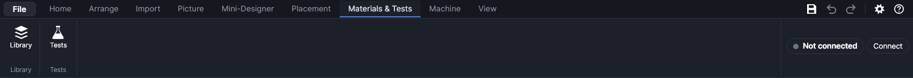
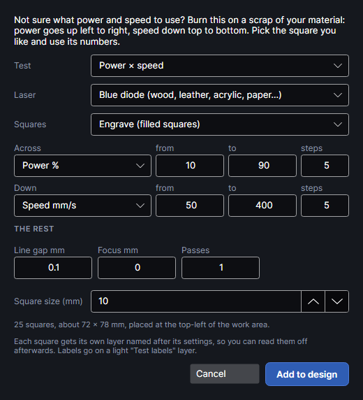
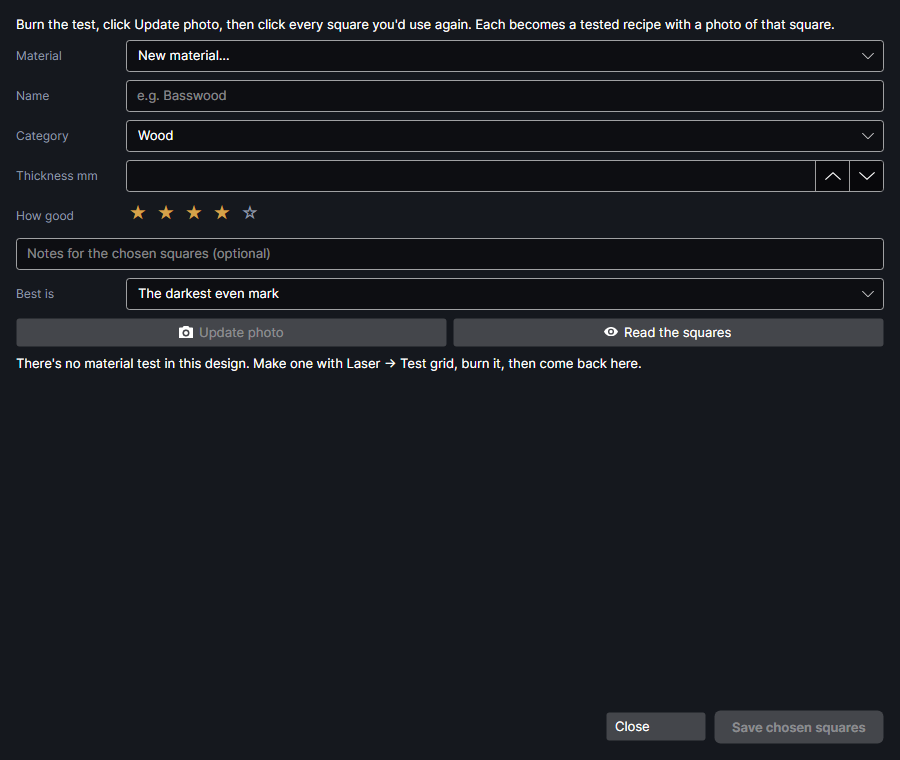

# Materials and tests

Every material takes the laser differently, and the numbers that work on one board may scorch the
next. The tests burn small, labelled samples on a scrap of your material and help you read them, so
you can pick settings from what really happened. What you find goes into the
[Material library](material-library.md), ready to put on a layer.

All of them are on the **Materials & Tests** tab: **Library** opens the material library, and
**Tests** opens the Tests window, where every test is picked from one list (see
[The Tests window](#the-tests-window)).

The **Test grid** and **Record results** are part of the program. The other tests come with add-ons
that are on unless you turn them off in Settings → Add-ons: the **Material tests** add-on (Etch
rate, Cut test, Exact depth, Tone test, Line test, Bevel test, Graphene test), the **Recipe
tuner** add-on, the **Colour on metal** add-on (Colour test, Measure colours) and the **Inlay and
marquetry** add-on. Each has its own
page under **Add-ons** in the contents, with the details and tutorials.

Calibration done once for the machine rather than per material is on **Machine → Calibrate**: the
camera, the close-up position, lining the two lasers up, and the **Kerf gauge** add-on.

## The Tests window

<!-- windows: TestsWindow -->

**Tests** (Materials & Tests tab) opens the **Tests** window. Pick a test from the **Test** list:
under it, the window says what the test finds out. Click **Open** to start it; its own window opens
as before. The window opens on the test you used last.

The list is in groups:

| Group | Tests |
|---|---|
| Find the settings | **Test grid**, **Record results** (rate a burned test grid), **Cut test**, **Etch rate**, **Recipe tuner** |
| Pictures | **Tone test**, **Line test** |
| Colour on metal | **Colour test**, **Measure colours** (read a burned colour test) |
| Use your results | **Exact depth**, **Inlay and marquetry** |
| Machine checks | **Bevel test** |
| Experimental | **Graphene test** |

A test that needs something first (a selection, a burned test, a connected machine) shows a note
and **Open** stays grey until it's there. Tests from add-ons are only listed while their add-on is
on.

▶ [Find the right test](tutorial:mat-tests-window)

## Which test answers which question

| Question | Use | What you get | Where it's kept |
|---|---|---|---|
| At what height is the beam sharpest? | **Test grid**, *Focus* | The focus offset with the thinnest lines | You read it off the grid |
| What power and speed mark it the way I want? | **Test grid**, *Power × speed*, then **Record results** | A grid of squares to compare | Recipes with a photo of each square |
| How close should fill lines be? | **Test grid**, *Line spacing* | Where lines merge into an even tone | You read it off the grid |
| Does this one setting work? | **Test grid**, *One square* | One labelled square | Record results, or Save to library |
| What cuts right through, quickest? | **Cut test** | The quickest setting that went through | A cut recipe |
| How wide is the cut, how tight should slots be? | **Cut test**, kerf and fit | The kerf and the slot fit | In that cut recipe |
| How deep does one pass go? | **Etch rate** | Millimetres per pass, with its range | An engrave recipe |
| How do I engrave exactly 1 mm deep? | **Exact depth** | The depth, reached a round at a time | On its layer |
| Why do my photos come out too dark or flat? | **Tone test** | The material's tone curve | On the picture layer, and a picture recipe |
| Why do rows show in my pictures? | **Line test** | The picture settings that hide them | On the picture layer |
| Which colours does my steel or titanium give? | **Colour test**, then **Measure colours** (Colour on metal add-on) | A measured palette | On the material |
| How much does the galvo's beam slant? | **Bevel test** | The beam's pivot heights | In the program's settings |
| Does the diode make conductive graphene here? | **Graphene test** | The setting with the lowest resistance | An engrave recipe |

**Inlay and marquetry** isn't a test: it cuts pieces of different woods that fit together, and a
pocket or holes for them, from the etch-rate and kerf results (it has a fit test of its own). **Quick on lid close** isn't a test either: it focuses, places and loads a job when you
close the lid.

## In what order

For a new material, roughly:

1. Look in the [Material library](material-library.md) first: **Import from xTool Studio…** may
   already have xTool's settings for it, to start from.
2. If you're unsure where the focus is sharpest, a **Test grid** *Focus* test.
3. For marking and engraving: a **Test grid** *Power × speed*, then **Record results**.
4. For cutting: the **Cut test**, then its kerf and fit test if you'll make slotted builds or inlays.
5. For depth (inlays, exact depths, stacked slices shaped to their slopes): the **Etch rate** test.
6. For photos: the **Line test** first (it changes resolution, power and line order), then the
   **Tone test** with the settings you settled on. A tone correction only holds for the settings it
   was measured with.
7. For colour on metal with the MOPA: **Colour test**, then **Measure colours** (both from the Colour
   on metal add-on, which has its own page under **Add-ons**).

The **Bevel test** is done once for the machine, not per material.

## How the tests work

- A test is added to your design as ordinary shapes, each setting tried on its own layer, named after
  what it tries (for example `Test 50% · 200 mm/s`, `Cut test · 100% · 8 mm/s · 2 passes`,
  `Etch test · 3 passes`). You move, frame and **Ship It** as with any job; nothing is burned until
  you press the machine's start button. See [Running a job](running-jobs.md).
- **Ship It** sends every layer whose output is on. If the design has your own work in it too, turn
  that layer's output off in the [Layers](layers.md) panel, or put the test on a page or design of
  its own.
- Labels are lightly marked on a layer of their own. Where a test cuts, the labels run before the
  cuts, so nothing has dropped or shifted by the time it's marked.
- Most test windows have two tabs: one to make the test, one to read it. Adding the test closes the
  window so you can place and send it. When the job finishes, **Etch rate**, **Cut test**, **Tone
  test**, **Line test** and **Bevel test** open again by themselves on their second tab. Opening a
  test from the ribbon while one is in the design also starts on that tab.
- The windows find a test by its layer names: don't rename those layers. Move a test where you like
  before burning it, but not after: photos are cut out where the shapes are in the design.
- Saving a result needs a material: pick one, or choose **New material…** and type its name.
- When you're done with a test, delete its layers.

## How the camera reads results

**Update photo** in a test window takes a fresh photo with the overview camera, the same as
**Photo** in the machine panel: it needs the machine connected and the camera calibrated
(**Machine → Calibrate camera**, see [Camera](camera.md)). The photo is straightened onto the bed, and
each square, circle or patch is cut out of it where its shape is. A camera calibrated at another
height than the material's shows the wrong spot; **Etch rate** warns when that may be so.

The close-up camera in the head gives sharper photos. Once **Machine → Close-up position** has
taught PhotonCanvas where it looks at the current focus height (within 0.5 mm), the **Tone test**
and **Line test** offer to place the test where it sees, the work area outlines that spot while
such a test is in the design, and **Close-up photo** reads the results from a straightened close-up
photo. Measured on one machine in October 2026, the close-up camera sees about 155 × 118 mm at about
27 pixels per millimetre: it shows 0.4 mm patterns, but not single picture rows.

What each test does with the photo:

| Test | The photo is used for |
|---|---|
| Record results | Measuring each square: how much darker than the bare material, how even |
| Tone test | Measuring how light each grey patch came out |
| Measure colours | Measuring each square's colour (close-up camera, overview camera, or a scan) |
| Etch rate, Cut test, Line test | Thumbnails only, so you know which is which: you judge the burn itself |
| Exact depth | The red pointer, seen by the close-up camera, measures heights |

### Lights

The **Tone test** and **Line test** results tabs have **Lights: front** and **back** sliders, from
0 (off) to 100 %. They set the machine's fill lights at once and change only the next photo, never
the burn: less light cuts glare off dark burns, more brings out a dim close-up. Take the photo again
after changing them. **Measure colours** (Colour on metal add-on) has its own **Front** and
**Back** sliders.

## Test grid
<!-- windows: MaterialTestWindow -->

**Test grid** adds a grid of squares to the design: one setting changes across, another down, the
rest stay as you set them. Each square has its own layer named after its settings, so you can read
the numbers of any square off the Layers panel. Labels go on a light **Test labels** layer. The same
window opens from **Settings → Materials → Material test grid…**.

### Kinds of test grid

**Test** fills in a starting point; every value can be changed after.

| Test | Across | Down | Notes |
|---|---|---|---|
| **Power × speed** | Power 10–90 % (MOPA 20–100 %), 5 steps | Speed 50–400 mm/s (MOPA 200–2000), 5 steps | MOPA: 65 kHz, 200 ns. Pick the square you like and use its numbers. |
| **Focus: find the sharpest height** | Focus −3 to +3 mm, 13 steps | Power 20 and 50 % (MOPA 30 and 60 %) | Lines 1 mm apart, so each line's width shows; 6 mm squares. |
| **Line spacing: how close the fill lines go** | Line gap 0.01–0.1 mm, 10 steps | Power 20–60 % (MOPA 20–80 %), 4 steps | 6 mm squares. |
| **Any two settings** | Your choice | Your choice | The rest stay as set. |
| **One square at chosen settings** | 1 step | 1 step | One square at the **from** values, its settings written beside it. |

Focus and line spacing tests start as filled squares, at 200 mm/s (MOPA 1000 mm/s). **Squares**
can still be switched to outlines afterwards.

- *Focus*: the thinnest, sharpest lines are in focus. Use that offset as the layer's **Focus offset
  (mm)** (see [Layer settings](layer-settings.md)), or move the head by it. + means deeper into the
  material (the head lower).
- *Line spacing*: look for where the lines just merge into an even tone. Closer than that only adds
  heat and time.

### Test grid settings

| Setting | Choices or range | What it does |
|---|---|---|
| **Laser** | **Blue diode (wood, leather, acrylic, paper…)**, **MOPA (metals, some plastics)** | Changing it reloads the test's starting values for that laser. |
| **Squares** | **Engrave (filled squares)**, **Score (outlines)**, **Cut (outlines)** | The mode of every square's layer. |
| **Across**, **Down** | Power %, Speed mm/s, Line gap mm, Focus mm, Frequency kHz (MOPA), Pulse width ns (MOPA), Passes | The two settings that change, each with **from**, **to** and **steps** (1–20): evenly spaced values, rounded. |
| **THE REST** | | The settings that stay the same; a box hides while its setting is swept. **Power %** 1–100, **Speed mm/s** 2–15000, **Line gap mm** 0.001–10 (filled squares only; 0.1 mm = 100 lines per cm), **Focus mm** −10 to +10, **Pulse width** and **kHz** (MOPA only), **Passes** 1–100. |
| **Square size (mm)** | 3–30, default 10 | Under 8 mm the gaps are 2 mm and the labels 2.5 mm high, otherwise 3 mm. |

Picking a setting for an axis fills in a range for it: power 10–90 % (MOPA 20–100 %), speed 50–400
mm/s (MOPA 200–2000), line gap 0.01–0.1 mm, focus −3 to +3 mm, frequency 50–500 kHz, pulse width
2–500 ns, passes 1–5.

Values are kept to what the machine does: power 0–100 %, speed 2–15000 mm/s, focus ±10 mm,
frequency 1–4000 kHz and no more than the pulse width allows, pulse widths moved to the nearest of
the 16 the MOPA has (2 to 500 ns). Values that come out the same are tried once.

The line under the settings says how many squares and how big the grid is, and warns (⚠) when it's
bigger than the work area, when across and down are the same setting, when frequency or pulse width
is swept on the diode (it ignores them), and when line gap is swept on outlines.

**Add to design** places the grid 10 mm in from the top-left corner of the work area. Labels are
scored at 60 % of the **Power %** box and at least 200 mm/s (MOPA: 30 % at 1000 mm/s).

▶ [Burn a test grid](tutorial:mat-test-grid)

## Record results
<!-- windows: RecordTestWindow -->

After burning a test grid, **Record results** photographs it, lets you pick the squares worth
keeping, and saves each one as a tested recipe with a photo of that square.

It finds the grid by its layers: every layer whose name starts with `Test ` (except **Test labels**)
and has a shape on it. The squares are shown by power across and speed down.

| Control | What it does |
|---|---|
| **Material** | An existing material, or **New material…** with its **Name**, **Category** and **Thickness mm**. |
| **How good** | 1 to 5 stars for the squares you save (starts at 4). |
| Notes box | Notes saved with each chosen square. |
| **Best is** | What **Read the squares** looks for: **The darkest even mark**, or **The lightest clear mark (least heat)**. |
| **Update photo** | A fresh camera photo of the burned grid; the squares show it. |
| **Read the squares** | Measures every square on the photo and picks the best for the goal. |
| The squares | Click a square to choose it (blue border); click again to drop it. |
| **Save chosen squares** | Saves each chosen square as a recipe. |

**Read the squares** compares the middle of each square with a ring of bare material 1 to 2.5 mm
around it. Under each square it writes how much darker it is (▲, in brightness steps out of 255;
marks lighter than the material, as on some metals, count too) and how uneven (~, the spread of
brightness inside: blotches, stripes, scorching). A square counts as visible from ▲ 18; one whose ~ is
more than a third of its ▲ plus 4 is too blotchy to pick. Unevenness counts against a square twice
as much as darkness counts for it. The best is marked ★ and chosen for you; add or remove others. If
nothing is clearly visible and even, check the photo was taken after the burn and the camera is
calibrated at this height. **Read the squares** hasn't been tried on a real burned grid yet.

Each saved recipe gets: its purpose from the square's mode (engrave, score or cut), the title
`60% · 200 mm/s (material test)`, all of that square's layer settings, the stars, **Tested** with
today's date, the machine's focus distance, the notes, and a photo of the square.

> **Note:** On a power × speed grid the squares are laid out by power across and speed down. A grid
> over other settings (focus, line spacing…) is shown as it was burned, each square's settings in its
> name (hover it).

▶ [Record a test grid's results](tutorial:mat-record-results)

## Quick on lid close

**Quick on lid close** is an on/off button. When it's on and you close the machine's lid:

1. The machine must be connected, idle (or finished), an xTool machine, and the design must have
   something on a layer with output on. Otherwise nothing happens.
2. It auto-focuses on the material (the status bar says **Lid closed: focusing…**). If the focus
   can't be measured, it stops.
3. It photographs the whole bed and looks for pieces of material at least 400 mm² in area.
4. It moves everything that will be marked so its middle sits on the middle of the biggest piece
   (one step you can undo). With no piece found, the design stays where it is.
5. It ships the job without the usual confirmation, unless the job has warnings.

The machine then waits for its button, as always: check the placement before you press it. It stays
on until you click it again, also after restarting. Not yet tried on the machine.

▶ [Load jobs by closing the lid](tutorial:mat-quick-lid)

