# Materials and tests

Every material takes the laser differently, and the numbers that work on one board may scorch the
next. The tests on the **Laser** tab burn small, labelled samples on a scrap of your material and
help you read them, so you can pick settings from what really happened. What you find goes into the
[Material library](material-library.md), ready to put on a layer.

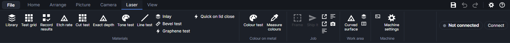

## Which test answers which question

| Question | Use | What you get | Where it's kept |
|---|---|---|---|
| At what height is the beam sharpest? | **Test grid**, *Focus* | The focus offset with the thinnest lines | You read it off the grid |
| What power and speed mark it the way I want? | **Test grid**, *Power × speed*, then **Record results** | A grid of squares to compare | Recipes with a photo of each square |
| How close should fill lines be? | **Test grid**, *Line spacing* | Where lines merge into an even tone | You read it off the grid |
| Does this one setting work? | **Test grid**, *One square* | One labelled square | Record results, or Save to library |
| What cuts right through, quickest? | **Cut test** | The quickest setting that went through | A cut recipe |
| How wide is the cut, how tight should slots be? | **Cut test**, kerf and fit | The kerf and the slot fit | In that cut recipe |
| How deep does one pass go? | **Etch rate** | Millimetres per pass, with its range | An engrave recipe |
| How do I engrave exactly 1 mm deep? | **Exact depth** | The depth, reached a round at a time | On its layer |
| Why do my photos come out too dark or flat? | **Tone test** | The material's tone curve | On the picture layer, and a picture recipe |
| Why do rows show in my pictures? | **Line test** | The picture settings that hide them | On the picture layer |
| Which colours does my steel or titanium give? | **Colour test**, then **Measure colours** | A measured palette | On the material |
| How much does the galvo's beam slant? | **Bevel test** | The beam's pivot heights | In the program's settings |
| Does the diode make conductive graphene here? | **Graphene test** | The setting with the lowest resistance | An engrave recipe |

**Inlay** isn't a test: it makes a pocket and a matching piece from the etch-rate and cut-test
results. **Quick on lid close** isn't a test either: it focuses, places and loads a job when you
close the lid.

## In what order

For a new material, roughly:

1. Look in the [Material library](material-library.md) first: **Import from xTool Studio…** may
   already have xTool's settings for it, to start from.
2. If you're unsure where the focus is sharpest, a **Test grid** *Focus* test.
3. For marking and engraving: a **Test grid** *Power × speed*, then **Record results**.
4. For cutting: the **Cut test**, then its kerf and fit test if you'll make slotted builds or inlays.
5. For depth (inlays, exact depths, stacked slices shaped to their slopes): the **Etch rate** test.
6. For photos: the **Line test** first (it changes resolution, power and line order), then the
   **Tone test** with the settings you settled on. A tone correction only holds for the settings it
   was measured with.
7. For colour on metal with the MOPA: **Colour test**, then **Measure colours**.

The **Bevel test** is done once for the machine, not per material.

## How the tests work

- A test is added to your design as ordinary shapes, each setting tried on its own layer, named after
  what it tries (for example `Test 50% · 200 mm/s`, `Cut test · 100% · 8 mm/s · 2 passes`,
  `Etch test · 3 passes`). You move, frame and **Ship It** as with any job; nothing is burned until
  you press the machine's start button. See [Running a job](running-jobs.md).
- **Ship It** sends every layer whose output is on. If the design has your own work in it too, turn
  that layer's output off in the [Layers](layers.md) panel, or put the test on a page or design of
  its own.
- Labels are lightly marked on a layer of their own. Where a test cuts, the labels run before the
  cuts, so nothing has dropped or shifted by the time it's marked.
- Most test windows have two tabs: one to make the test, one to read it. Adding the test closes the
  window so you can place and send it. When the job finishes, **Etch rate**, **Cut test**, **Tone
  test**, **Line test** and **Bevel test** open again by themselves on their second tab. Opening a
  test from the ribbon while one is in the design also starts on that tab.
- The windows find a test by its layer names: don't rename those layers. Move a test where you like
  before burning it, but not after: photos are cut out where the shapes are in the design.
- Saving a result needs a material: pick one, or choose **New material…** and type its name.
- When you're done with a test, delete its layers.

## How the camera reads results

**Update photo** in a test window takes a fresh photo with the overview camera, the same as
**Update photo** on the Camera tab: it needs the machine connected and the camera calibrated
(**Camera → Calibrate**, see [Camera](camera.md)). The photo is straightened onto the bed, and
each square, circle or patch is cut out of it where its shape is. A camera calibrated at another
height than the material's shows the wrong spot; **Etch rate** warns when that may be so.

The close-up camera in the head gives sharper photos. Once **Camera → Close-up position** has
taught PhotonCanvas where it looks at the current focus height (within 0.5 mm), the **Tone test**
and **Line test** offer to place the test where it sees, the work area outlines that spot while
such a test is in the design, and **Close-up photo** reads the results from a straightened close-up
photo. Measured on one machine in October 2026, the close-up camera sees about 155 × 118 mm at about
27 pixels per millimetre: it shows 0.4 mm patterns, but not single picture rows.

What each test does with the photo:

| Test | The photo is used for |
|---|---|
| Record results | Measuring each square: how much darker than the bare material, how even |
| Tone test | Measuring how light each grey patch came out |
| Measure colours | Measuring each square's colour (close-up camera, overview camera, or a scan) |
| Etch rate, Cut test, Line test | Thumbnails only, so you know which is which: you judge the burn itself |
| Exact depth | The red pointer, seen by the close-up camera, measures heights |

### Lights

The **Tone test** and **Line test** results tabs have **Lights: front** and **back** sliders, from
0 (off) to 100 %. They set the machine's fill lights at once and change only the next photo, never
the burn: less light cuts glare off dark burns, more brings out a dim close-up. Take the photo again
after changing them. **Measure colours** has its own **Front** and **Back** sliders (see
[Measure colours](#measure-colours)).

## Test grid
<!-- windows: MaterialTestWindow -->

**Test grid** adds a grid of squares to the design: one setting changes across, another down, the
rest stay as you set them. Each square has its own layer named after its settings, so you can read
the numbers of any square off the Layers panel. Labels go on a light **Test labels** layer. The same
window opens from **Settings → Materials → Material test grid…**.

### Kinds of test grid

**Test** fills in a starting point; every value can be changed after.

| Test | Across | Down | Notes |
|---|---|---|---|
| **Power × speed** | Power 10–90 % (MOPA 20–100 %), 5 steps | Speed 50–400 mm/s (MOPA 200–2000), 5 steps | MOPA: 65 kHz, 200 ns. Pick the square you like and use its numbers. |
| **Focus: find the sharpest height** | Focus −3 to +3 mm, 13 steps | Power 20 and 50 % (MOPA 30 and 60 %) | Lines 1 mm apart, so each line's width shows; 6 mm squares. |
| **Line spacing: how close the fill lines go** | Line gap 0.01–0.1 mm, 10 steps | Power 20–60 % (MOPA 20–80 %), 4 steps | 6 mm squares. |
| **Any two settings** | Your choice | Your choice | The rest stay as set. |
| **One square at chosen settings** | 1 step | 1 step | One square at the **from** values, its settings written beside it. |

Focus and line spacing tests start as filled squares, at 200 mm/s (MOPA 1000 mm/s). **Squares**
can still be switched to outlines afterwards.

- *Focus*: the thinnest, sharpest lines are in focus. Use that offset as the layer's **Focus offset
  (mm)** (see [Layer settings](layer-settings.md)), or move the head by it. + means deeper into the
  material (the head lower).
- *Line spacing*: look for where the lines just merge into an even tone. Closer than that only adds
  heat and time.

### Test grid settings

| Setting | Choices or range | What it does |
|---|---|---|
| **Laser** | **Blue diode (wood, leather, acrylic, paper…)**, **MOPA (metals, some plastics)** | Changing it reloads the test's starting values for that laser. |
| **Squares** | **Engrave (filled squares)**, **Score (outlines)**, **Cut (outlines)** | The mode of every square's layer. |
| **Across**, **Down** | Power %, Speed mm/s, Line gap mm, Focus mm, Frequency kHz (MOPA), Pulse width ns (MOPA), Passes | The two settings that change, each with **from**, **to** and **steps** (1–20): evenly spaced values, rounded. |
| **THE REST** | | The settings that stay the same; a box hides while its setting is swept. **Power %** 1–100, **Speed mm/s** 2–15000, **Line gap mm** 0.001–10 (filled squares only; 0.1 mm = 100 lines per cm), **Focus mm** −10 to +10, **Pulse width** and **kHz** (MOPA only), **Passes** 1–100. |
| **Square size (mm)** | 3–30, default 10 | Under 8 mm the gaps are 2 mm and the labels 2.5 mm high, otherwise 3 mm. |

Picking a setting for an axis fills in a range for it: power 10–90 % (MOPA 20–100 %), speed 50–400
mm/s (MOPA 200–2000), line gap 0.01–0.1 mm, focus −3 to +3 mm, frequency 50–500 kHz, pulse width
2–500 ns, passes 1–5.

Values are kept to what the machine does: power 0–100 %, speed 2–15000 mm/s, focus ±10 mm,
frequency 1–4000 kHz and no more than the pulse width allows, pulse widths moved to the nearest of
the 16 the MOPA has (2 to 500 ns). Values that come out the same are tried once.

The line under the settings says how many squares and how big the grid is, and warns (⚠) when it's
bigger than the work area, when across and down are the same setting, when frequency or pulse width
is swept on the diode (it ignores them), and when line gap is swept on outlines.

**Add to design** places the grid 10 mm in from the top-left corner of the work area. Labels are
scored at 60 % of the **Power %** box and at least 200 mm/s (MOPA: 30 % at 1000 mm/s).

▶ [Burn a test grid](tutorial:mat-test-grid)

## Record results
<!-- windows: RecordTestWindow -->

After burning a test grid, **Record results** photographs it, lets you pick the squares worth
keeping, and saves each one as a tested recipe with a photo of that square.

It finds the grid by its layers: every layer whose name starts with `Test ` (except **Test labels**)
and has a shape on it. The squares are shown by power across and speed down.

| Control | What it does |
|---|---|
| **Material** | An existing material, or **New material…** with its **Name**, **Category** and **Thickness mm**. |
| **How good** | 1 to 5 stars for the squares you save (starts at 4). |
| Notes box | Notes saved with each chosen square. |
| **Best is** | What **Read the squares** looks for: **The darkest even mark**, or **The lightest clear mark (least heat)**. |
| **Update photo** | A fresh camera photo of the burned grid; the squares show it. |
| **Read the squares** | Measures every square on the photo and picks the best for the goal. |
| The squares | Click a square to choose it (blue border); click again to drop it. |
| **Save chosen squares** | Saves each chosen square as a recipe. |

**Read the squares** compares the middle of each square with a ring of bare material 1 to 2.5 mm
around it. Under each square it writes how much darker it is (▲, in brightness steps out of 255;
marks lighter than the material, as on some metals, count too) and how uneven (~, the spread of
brightness inside: blotches, stripes, scorching). A square counts as visible from ▲ 18; one whose ~ is
more than a third of its ▲ plus 4 is too blotchy to pick. Unevenness counts against a square twice
as much as darkness counts for it. The best is marked ★ and chosen for you; add or remove others. If
nothing is clearly visible and even, check the photo was taken after the burn and the camera is
calibrated at this height. **Read the squares** hasn't been tried on a real burned grid yet.

Each saved recipe gets: its purpose from the square's mode (engrave, score or cut), the title
`60% · 200 mm/s (material test)`, all of that square's layer settings, the stars, **Tested** with
today's date, the machine's focus distance, the notes, and a photo of the square.

> **Note:** On a power × speed grid the squares are laid out by power across and speed down. A grid
> over other settings (focus, line spacing…) is shown as it was burned, each square's settings in its
> name (hover it).

▶ [Record a test grid's results](tutorial:mat-record-results)

## Etch rate
<!-- windows: EtchTestWindow -->

How deep one pass of a setting goes. **Etch rate** burns a ladder of small filled circles with the
same setting, the first 1 pass, the next 2, then 3, and so on. The first circle that goes right
through gives the material's thickness ÷ passes. Depths you measure on the shallower ones show how
much it slows down deeper (it usually does: the floor drops out of focus, and smoke and char build
up). The result goes into the library, where **Inlay**, **Exact depth** and stacked slices shaped to
their slopes ([3D models and stacked slices](3d-slices.md)) use it.

### Making the etch test

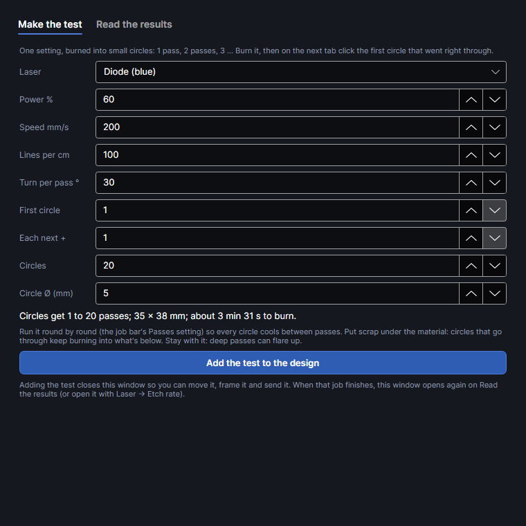

| Setting | Range | Default | What it does |
|---|---|---|---|
| **Laser** | **Diode (blue)**, **MOPA (red)** | Diode | |
| **Power %** | 1–100 | 60 | The setting being measured. |
| **Speed mm/s** | 1–15000 | 200 | |
| **Lines per cm** | 10–1000 | 100 | Fill line density. |
| **Turn per pass °** | 0–90 | 30 | Turns the fill lines each pass, which keeps a deep floor even. Use what you'll use for real. |
| **First circle** | 1–5000 | 1 | Passes on the first circle. |
| **Each next +** | 1–1000 | 1 | Passes added on each next circle. |
| **Circles** | 2–60 | 20 | Five to a row, the pass count marked under each. |
| **Circle Ø (mm)** | 2–20 | 5 | |

The line under them gives the passes from first to last circle, the size, and the time to burn.
**Add the test to the design** puts it in the middle of the bed: each circle on its own layer
(`Etch test · 3 passes`), the numbers on **Etch test labels** (40 % of the power, between 3 and
30 %, at least 300 mm/s).

Run it with the job bar's **Passes** set to **Round by round**: every circle gets its first pass,
then every circle its second, and so on, so each cools between passes, and a circle stops once it
has had all its passes. Put scrap under the material: circles that go through keep burning into what's below.
Stay with it: deep passes can flare up.

### Reading the etch test

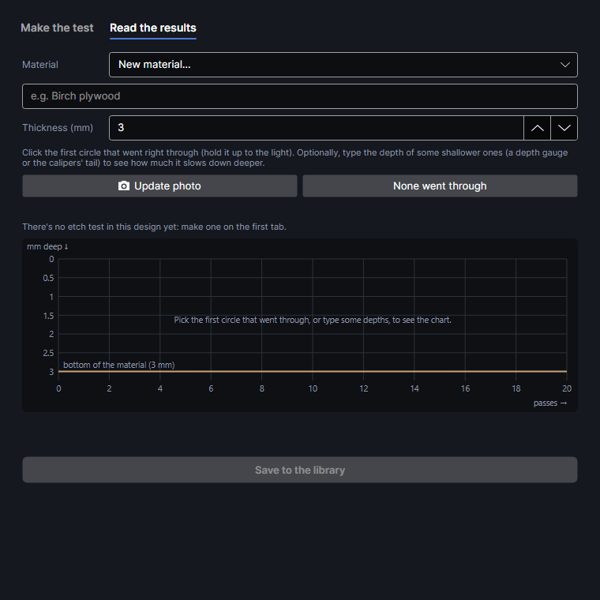

1. **Material**: pick one, or **New material…** and its name. **Thickness (mm)** (0.1–100) is filled
   from the material; measure it with calipers, since the result is only as good as this number.
2. **Update photo** for thumbnails of the circles.
3. Click the first circle that went right through (hold the board up to the light). It gets a blue
   border, and it and the ones after it a ✓. If none did, click **None went through**.
4. Optionally, type the depth of some shallower circles (depth gauge or the calipers' tail) in the
   box under each.

The result:

- **Through at n passes, not at m**: about *thickness ÷ ((n + m) ÷ 2)* mm per pass, somewhere
  between *thickness ÷ n* and *thickness ÷ m*. If the first circle went through, the rate is at
  least *thickness ÷ n*. This is the average all the way through.
- **None went through**: less than *thickness ÷ most passes*. Try more passes or more power.
- **Depths typed**: the depth after the first pass and the average per pass. With three or more, a
  curve (depth = a·n − b·n²) says how much it slows by the deepest reading; with four or more, how
  closely the readings fit. Getting faster deeper is unusual: often the shallow holes read low
  (char in the bottom, or the gauge not reaching the floor).

The chart draws the hole in cross-section: the surface at the top, depth going down, the bottom of
the material as a line. The burn-through is a straight line from the surface to where it went
through; typed depths are dots with the curve through them.

**Save to the library** adds an engrave recipe `Etch 0.15 mm a pass` with the circles' settings at
one pass, the depth per pass, and what the test found (thickness, where it went through, the
depths) in its notes. The window reads the library back to check the save stuck.

Not yet tried on the machine: whether the through-hole shows clearly enough to pick.

▶ [Measure the etch rate](tutorial:mat-etch-rate)

## Cut test
<!-- windows: CutTestWindow -->

Finds the cut: a grid of small squares at different speeds across and more passes (or power) down.
The squares that drop out, or push out with a finger without tearing, were cut right through, and
the quickest of them is your cut setting. At that setting a second test then measures the kerf and
the slot fit. Both go into the library, where **Inlay**, the **Bevel test** and the stacked-slice
tools ([3D models and stacked slices](3d-slices.md)) use them.

### Making the cut test

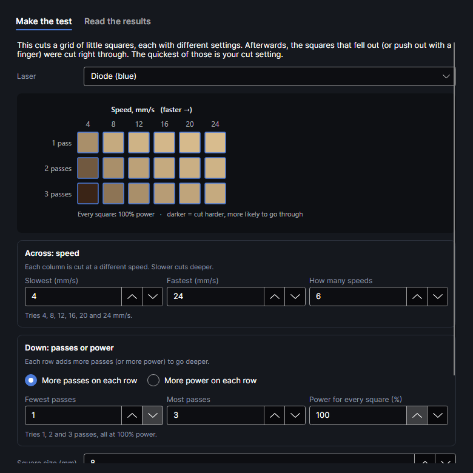

The preview shows the grid with every speed over its column and every pass count (or power) beside
its row; darker squares are cut harder, so more likely to go through.

| Setting | Range | Default | What it does |
|---|---|---|---|
| **Laser** | **Diode (blue)**, **MOPA (red)** | Diode | |
| **Slowest (mm/s)**, **Fastest (mm/s)** | 1–15000 | 4, 24 | The speeds across. Slower cuts deeper. |
| **How many speeds** | 1–12 | 6 | |
| **More passes on each row** / **More power on each row** | | Passes | What changes down the side. |
| **Fewest passes**, **Most passes** | 1–100 | 1, 3 | Every whole number between, up to 10 rows. |
| **Power for every square (%)** | 1–100 | 100 | With rows of passes. |
| **Lowest power (%)**, **Highest power (%)** | 1–100 | 60, 100 | With rows of power. |
| **How many** | 1–10 | 5 | Rows of power. |
| **Passes for every square** | 1–50 | 1 | With rows of power. |
| **Square size (mm)** | 4–20 | 8 | Big enough to see whether it dropped, small enough not to tip up into the head once loose. |

The line under them gives the number of squares, the material needed and the cutting time. If the
grid is bigger than the bed, it says so and **Add the test to the design** stays off.

The test goes in the middle of the bed. Each square is its own cut layer
(`Cut test · 100% · 8 mm/s · 2 passes`) with no kerf allowance. Labels go on **Cut test labels**
before every cut layer, marked lightly (12 % of the cut power, between 3 and 15 %, at 200 mm/s;
MOPA 20 % at 1000 mm/s).

> **Safety:** Cut on the honeycomb or pins (with air assist on, if you have it), and stay with it: slow cuts can flare up.

### Reading the cut test

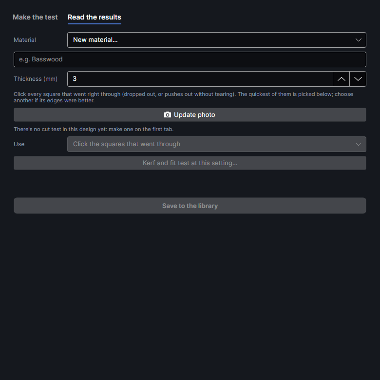

1. **Material** and **Thickness (mm)**, measured with calipers; it's kept with the setting.
2. **Update photo** for thumbnails, laid out as on the bed.
3. Click every square that went through: it gets a green border and a ✓. The squares you click,
   and the setting chosen under **Use**, stay marked when the window opens again (until the program
   closes), as it does after the kerf test.
4. **Use** lists them quickest first (passes ÷ speed, so 2 passes at 12 mm/s beats 3 at 16), and
   picks the quickest. Choose another if its edges were better.
5. **Save to the library** adds a cut recipe `Cuts 3 mm: 8 mm/s × 2`. Its notes list the other
   squares that went through. The material takes the thickness if it had none.

### Kerf and slot-fit comb

**Kerf and fit test at this setting…** adds, at the chosen setting, a 20 mm square and a comb: a
strip with six slots, each the material's thickness plus −0.2, −0.1, 0, +0.1, +0.2 or +0.3 mm,
marked under it. It goes just below the cut grid (above it if there's no room, else the middle of
the bed) on a **Kerf test** layer, labels on **Kerf test labels**. Only one kerf test at a time: an
older one is replaced. The window closes; cut it and open **Cut test** again.

| Field | What to do |
|---|---|
| **Square is (mm)** | Measure across the square with calipers in a couple of places (not corner to corner), and type the average. |
| **Snuggest slot** | Slide the square (it's the same material) into each slot: pick the one it goes into with a firm push and stays. **Not tried yet** leaves it out. |

The kerf is how much smaller than 20 mm the square came out. Set it on the cut layer and parts come
out the size they're drawn. More than 1 mm short gets a warning to measure again. The slot fit is
what the slots of slotted builds (egg crate, radial, boxes) need on top of the thickness: the comb's
fit plus the kerf when the cut layer's kerf is set, the comb's fit alone when it's 0. The window
shows both.

Once the square is measured, **Save to the library** saves the kerf test's setting with the kerf in
its settings and the slot fit beside it.

Not yet tried on the machine: whether a cut square drops cleanly or needs a push, whether the kerf
comes out about 0.1–0.2 mm on 3 mm basswood, and whether the comb's snug slot matches the fit egg
crates need.

▶ [Find the cut](tutorial:mat-cut-test) · ▶ [Measure kerf and slot fit](tutorial:mat-kerf-fit)

## Exact depth
<!-- windows: ExactDepthWindow -->

Engraves the selected shapes to a depth you choose, measuring as it goes. The red pointer, read by
the close-up camera, measures the surface before anything is burned. You burn a round of passes
(shipped as usual), it measures how deep that got, and works out the next round from what each pass
really took off. It closes in on the depth from the shallow side instead of guessing all the passes
up front.
The laser itself never fires while measuring: only the pointer and the head move.

You need: the machine connected, the focus set on the material, and the pointer calibrated once
(**Laser → Curved surface → Calibrate the pointer…**, see
[Work area](work-area.md)). Select closed shapes (not text) and click **Exact depth**.

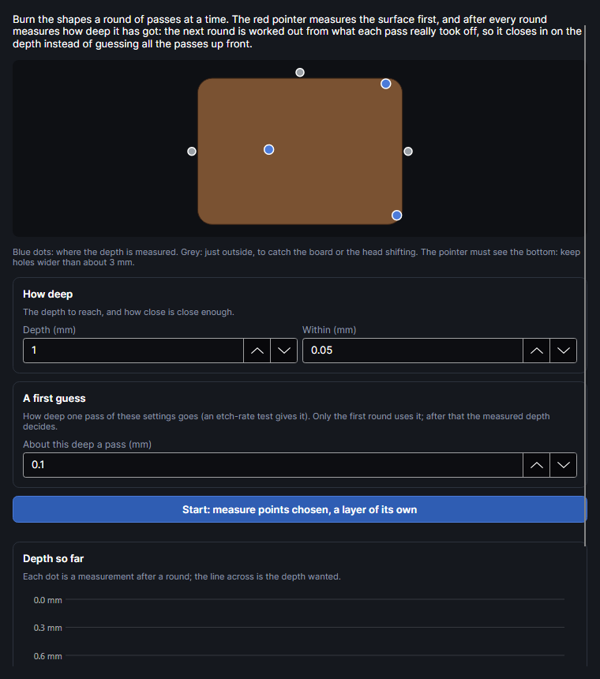

The picture shows the shapes with the points it measures: blue dots inside (up to three, each at
least 2.5 mm from an edge and as far apart as they can be), grey dots 4 mm outside to the left,
right and top. If the outside points move between readings (the board or the head shifted), that is
taken off. The pointer must see the floor 2.5 mm in from every edge: keep holes at least about
5 mm across.

| Setting | Range | Default | What it does |
|---|---|---|---|
| **Depth (mm)** | 0.05–20 | 1 | The depth to reach. |
| **Within (mm)** | 0.01–0.5 | 0.05 | How close is close enough. |
| **About this deep a pass (mm)** | 0.005–2 | 0.1 | The first guess. Filled in from the library's etch-rate result nearest the shapes' power and speed, if there is one. Only the first round uses it. |

**Start: measure points chosen, a layer of its own** moves the shapes onto a new filled layer
`Exact depth · 1 mm`, copied from their layer, then lists the steps:

1. **Measure the surface**: the pointer reads the height at every dot.
2. **Round 1**: a round aimed at 30 % of the depth with the guess, just to find out how deep a pass
   really goes. **Set up 3 passes and close** (the number varies) sets the layer's passes and closes
   the window. Frame and Ship It.
3. When the job finishes, the window opens again. Brush the dust and char out of the hole, then
   **Measure the depth**.
4. Each next round uses the depth per pass of the last round: 85 % of what's left while that's more
   than four passes, then exactly what's left (1 to 500 passes). A round that took almost nothing
   off (char, a bad reading) can't make the next one huge.
5. When the depth is within the tolerance: **Done**, with how much the points differ. A spread of
   more than twice the tolerance means the floor isn't flat (focus, char or air flow).
   **Finish (keep the shapes on their layer)** ends the run.

The chart **Depth so far** plots the depth after each round against passes, with the depth wanted
as a line. A run in progress is kept with its layer (in the `depth` folder of the program's data
folder), so you can close the program between rounds.

Not yet tried on the machine: how precisely the pointer reads a hole's floor, and whether its dot
shows on charred wood.

▶ [Engrave to an exact depth](tutorial:mat-exact-depth)

## Tone test
<!-- windows: ToneTestWindow -->

Photos that come out as they look. Wood, leather and slate don't darken in step with the grey asked
for: most go dark long before black, and the palest greys barely show, so pictures come out too dark
or flat. The tone test burns a row of grey patches, black to white, with a picture layer's own
settings; the camera reads how light each came out; and that layer's pictures are corrected so their
greys come out as they look on screen.

### Making the tone test

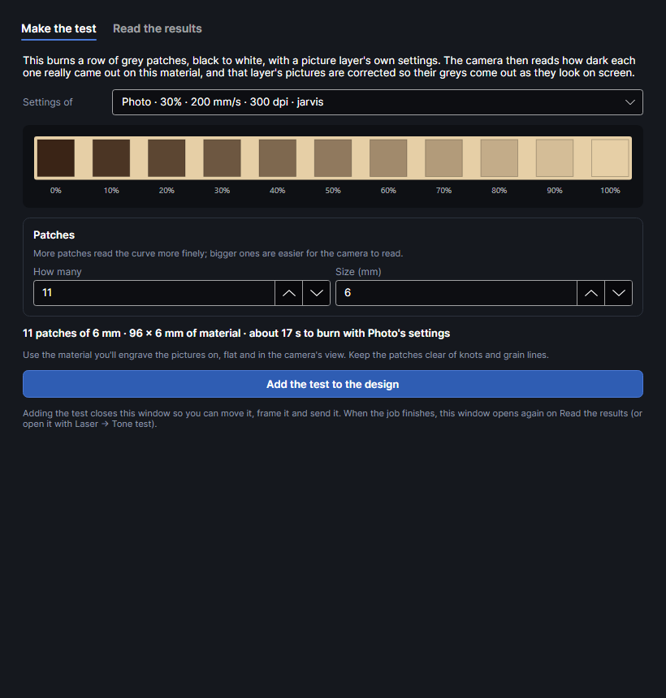

| Setting | Range | Default | What it does |
|---|---|---|---|
| **Settings of** | Your picture layers, or **Picture settings for a new layer** | The first | The test burns with exactly that layer's settings (power, speed, resolution, dithering), without any tone correction. |
| **How many** | 5–41 | 11 | Patches from black to white. More read the curve more finely. |
| **Size (mm)** | 3–15 | 6 | Bigger is easier for the camera to read. Half a patch of bare material between patches. |
| **Where the close-up camera sees it (results read from close-up photos)** | | On | Only shown when the close-up camera's position is known at this focus height. Places the patches where it sees, smaller (down to 3 mm) and in rows if needed. |

The line under them gives the size and time to burn, and warns when the layer has more than one
pass: on wood, later passes burn the char of the earlier ones back off, so greys come out lighter and
uneven, not darker. One pass at the power you need reads (and burns) far more evenly.

**Add the test to the design** puts one strip in the middle of the bed (or where the close-up camera
sees) on a copy of the layer named `Tone test · <layer>`. The white patch is never burned: white
isn't visited. Use the material you'll engrave the pictures on, flat and in the camera's view, with
the patches clear of knots and grain lines.

### Reading the tone test

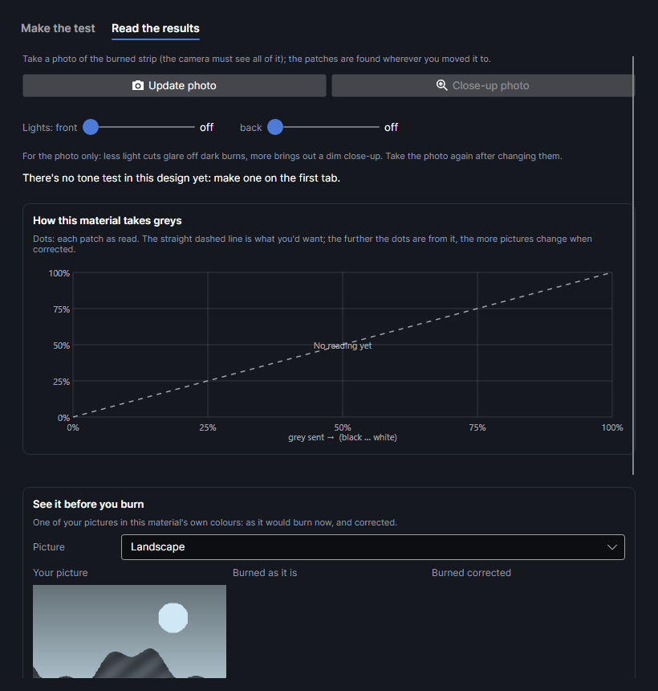

1. **Update photo** (the camera must see the whole strip), or **Close-up photo**. The patches are
   found wherever you moved the strip to before burning. Use the **Lights** if glare or a dim photo
   spoils it.
2. Each patch shows its grey and how light it read. The bare material is read from a band 1 to
   2.5 mm above the strip.
3. **How this material takes greys**: grey sent along the bottom, how light it came out up the side.
   The dashed diagonal is what you'd want; the further the dots are from it, the more pictures
   change when corrected.
4. The summary under it says whether mid-grey comes out too dark (under 42 % light), too pale (over
   58 %) or about right, from which grey down the material is as dark as it goes (darker greys only
   add heat), which pale greys barely show, and whether there's a jump from bare wood to the first
   burn (then lower **Lightest power %** or speed up, and test again).
5. **See it before you burn**: pick a **Picture** from the design, or **A grey gradient**, and see
   **Your picture**, **Burned as it is** and **Burned corrected**, in the material's own colours
   (the bare colour and the darkest burn, read off the photo).
6. **Use it**: pick the **Layer** and click **Correct this layer's pictures**. The correction holds
   only while that layer's settings stay as tested.
7. **Save to the library**: a picture recipe `Pictures, matched (…)` on the chosen **Material**,
   with the settings and the correction.

A reading that can't be right is shown but not used: when the white patch, which isn't burned, reads
under 80 % as light as the bare material, or a lighter grey reads clearly darker than a darker one.
Then the camera was reading the wrong spots: check the photo lines up with the strip (calibrate the
camera if not), nothing shades it, and it's on clean material.

### How pictures get corrected

The test gives the material's response: for each grey sent (black to white), how light it came out,
from as dark as these settings go to the bare material. Readings are smoothed so a lighter grey never
comes out darker. Turned round, it says which grey to send for each tone wanted. When a job is made,
every pixel of a picture on that layer (after the picture's own tone adjustments) is sent as the
grey that gives its tone, before dithering or greyscale power. In greyscale, power still runs from
**Lightest power %** for the palest burned tone to the layer's power for black.

The correction travels with the settings: it's saved with the layer in the design, kept in picture
recipes, and comes back when you apply one. Picking a material for a picture layer in
[Layer settings](layer-settings.md) also brings in that material's tested correction nearest the
layer's power, speed and resolution. If a line test changes the layer's resolution, spreading or
direction, it reminds you to run the tone test again.

### Pictures as burned

**View → Pictures as burned** draws pictures on layers that have a correction as they'll come out:
corrected, in the material's own colours. Other pictures show as they are.

On basswood in October 2026, a strip burned at 30 % × 3 passes, turned 25° each pass, came out
lighter and uneven: the later passes burned the char of the earlier ones back off. Still to check:
how cleanly the camera reads a burned strip (light, glare, grain), and a portrait burned with and
without the correction.

▶ [Match pictures to the material](tutorial:mat-tone-test)

## Line test
<!-- windows: LineTestWindow -->

Pictures are burned in rows, and sometimes the rows show. The line test burns the same patch with a
picture layer's settings, then again with one thing changed each time, side by side, so you can see
which change hides them. Rows often show only where the picture changes from dot to dot (burning back
and forth, a late power change lands on opposite sides in neighbouring rows), which flat grey can't
show, so the patch can be a piece of your own picture.

### Making the line test

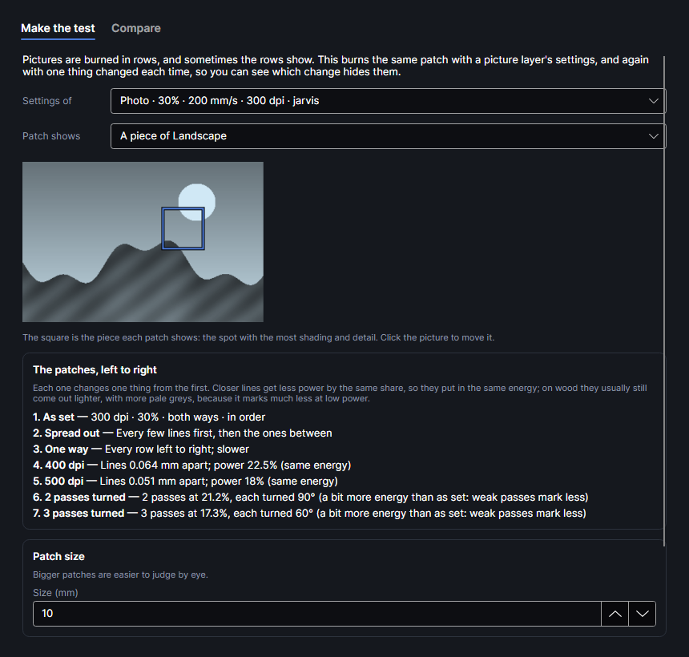

- **Settings of**: the picture layer to try (relief layers aren't offered). Every patch starts from
  exactly its settings.
- **Patch shows**: **A piece of** each picture on that layer, or **Grey bands and edges**: 25, 50 and
  75 % grey side by side on top; below, 0.5 mm bars, a ring on mid grey and a ramp from black to
  white.
- The piece picker shows the picture with a square: the piece every patch shows, first put on the
  spot with the widest spread of light to dark, with both smooth shading and fine detail. Click the
  picture to move it. The piece is the patch size at the size the picture is placed.
- **Patch size**: **Size (mm)** 6–25, default 10. Bigger is easier to judge by eye.
- **Where the close-up camera sees it (results from close-up photos)**: as in the tone test.

**The patches, left to right**, each changing one thing from the first:

| Patch | What changes |
|---|---|
| **As set** | Nothing. |
| **Spread out** / **Not spread** | The fill lines burned every few lines first, then the ones between, or in order. |
| **Scattered** | Only when the layer spreads in a set pattern: spread in no set order, so no row pattern repeats. |
| **One way** / **Both ways** | Every row left to right (slower), or back and forth (faster). |
| Two finer resolutions | 4/3 and 5/3 of the layer's dpi (rounded to 10, at most 2540), with the power and **Lightest power %** lowered by the same share, so they put in the same energy. |
| **2 passes turned**, **3 passes turned** | Two and three times the passes, each turned 180° ÷ passes from the last (90°, or 60°), the power divided by √2 and √3: a little more energy in all, because weak passes mark less. |

**Add the test to the design** replaces any earlier line test and puts the patches in the middle of
the bed (or where the close-up camera sees), each on its own layer (`Line test · One way`).

### Comparing the patches

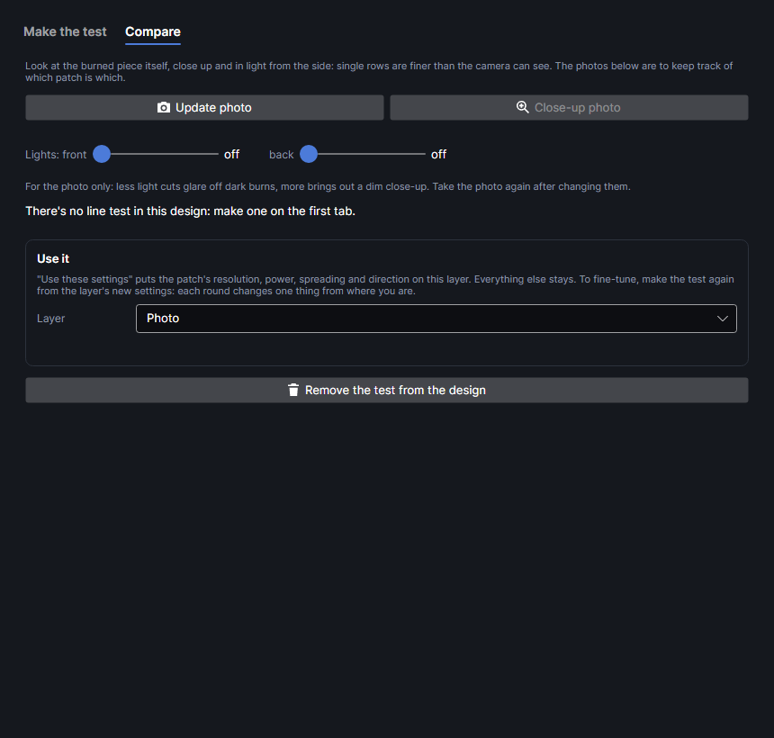

Look at the burned piece itself, close up, in light from the side: single rows are finer than the
camera can see. **Update photo** or **Close-up photo** put a photo on each card so you know which is
which; the **Lights** are there for glare. A card says **Not in the photo** when its patch isn't in
it.

Pick the **Layer** under **Use it** and click **Use these settings** on the best card: the layer
takes that patch's resolution, power, passes, **Lightest power %**, spreading, direction and line
angles. Everything else stays. To fine-tune, make the test again from the new settings: each round
changes one thing from where you are. **Remove the test from the design** deletes the patches and
their layers.

### Line test findings on basswood

From line tests on 2.75 mm basswood in October 2026 (greyscale, 400 dpi at 60 %, then 400 dpi at
40 % × 3):

- Spreading the lines left woven or brick-like rows, both one way and both ways. Not spread left no
  rows, but came out too dark and blotchy. Scan direction made no difference.
- Finer lines at proportionally lower power (530 dpi at 45.3 %, 670 dpi at 35.8 %) came out lighter,
  with a much better gradient: wood marks far less at low power. 530 dpi looked best; at 670 dpi rows
  came back in the deep areas.
- Weak passes didn't add up: the same energy split into 6 passes at 20 % barely marked, and 9 at
  13.3 % not at all. That's why the turned patches lower the power only by √2 and √3.

▶ [Hide the rows in pictures](tutorial:mat-line-test)

## Inlay
<!-- windows: InlayWindow -->

Makes an inlay from the selected closed shapes: a pocket engraved into the board as deep as the
veneer, and the piece cut from the veneer to fit, so it sits flush. Select the shapes, then
**Inlay** (it's off until a shape is selected).

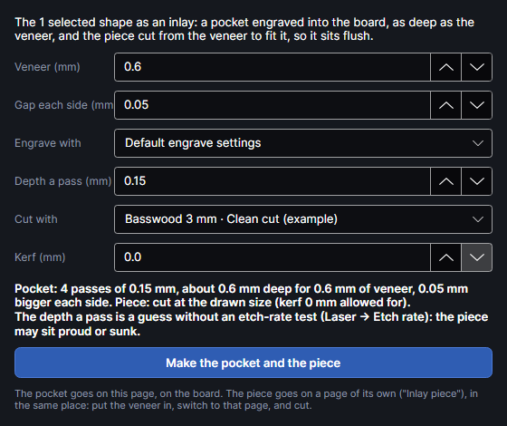

| Setting | Range | Default | What it does |
|---|---|---|---|
| **Veneer (mm)** | 0.1–10 | 0.6 | The thickness of what goes in: the pocket goes this deep. |
| **Gap each side (mm)** | 0–1 | 0.05 | Room round the piece for glue and the wood moving. 0.03–0.08 mm is snug. |
| **Engrave with** | **Default engrave settings**, or a recipe with an etch rate | The first etch recipe | The pocket's settings. |
| **Depth a pass (mm)** | 0.01–2 | 0.15 | Filled in from the etch recipe. Without one it's a guess, and the piece may sit proud or sunk. |
| **Cut with** | **Default cut settings**, or a cut recipe | The first cut recipe | The veneer's settings. |
| **Kerf (mm)** | 0–1 | 0.1 | Filled in from the cut recipe, so the piece comes out the drawn size. |

The line under them says how many passes the pocket takes and how deep that comes out.

**Make the pocket and the piece** adds:

- On this page, on the board: an **Inlay · pocket** layer (filled) with the shapes joined and grown by
  the gap. Its passes are the veneer's thickness ÷ depth a pass, rounded up, each turned by the
  recipe's turn per pass, or 37° if it has none, so the floor comes out flat.
- On a new page **Inlay piece**, in the same place: an **Inlay · piece** cut layer with the shapes at
  their drawn size and the kerf set.

Your original shapes stay as they were. Burn the pocket, put the veneer in, switch to the **Inlay
piece** page and cut. Not yet tried on the machine.

▶ [Make an inlay](tutorial:mat-inlay)

## Bevel test
<!-- windows: BevelTestWindow -->

Away from the middle of the field, the galvo's beam comes down at a slant, so cut edges there slope
instead of standing upright. Edge by edge, that slope could make bevels (pyramids, chamfered boxes,
sloped stacked slices), once it's known how much the beam slants. This test measures it: four bars
are cut through a board, and their lengths at the bottom and the holes' lengths at the top give the
height of the mirrors' pivot above the material. Bevel cutting itself isn't built yet; this is the
first step.

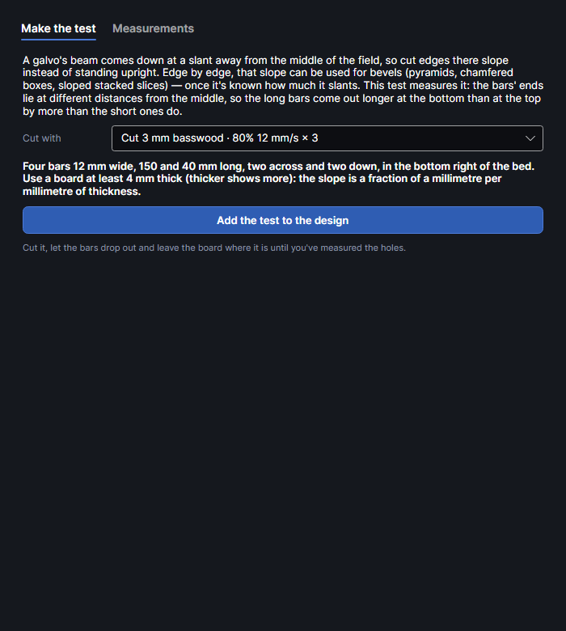

**Cut with** lists the cut layers in the design and the cut recipes in the library: use settings that
cut right through your board cleanly, so the bars drop out. **Add the test to the design** adds a
**Bevel test** layer with four bars 12 mm wide, 150 and 40 mm long, two across and two down, in an L
along the bottom and right of the bed. Use a board at least 4 mm thick: the slope is a fraction of a
millimetre per millimetre of thickness. Let the bars drop out and leave the board where it is until
you've measured the holes.

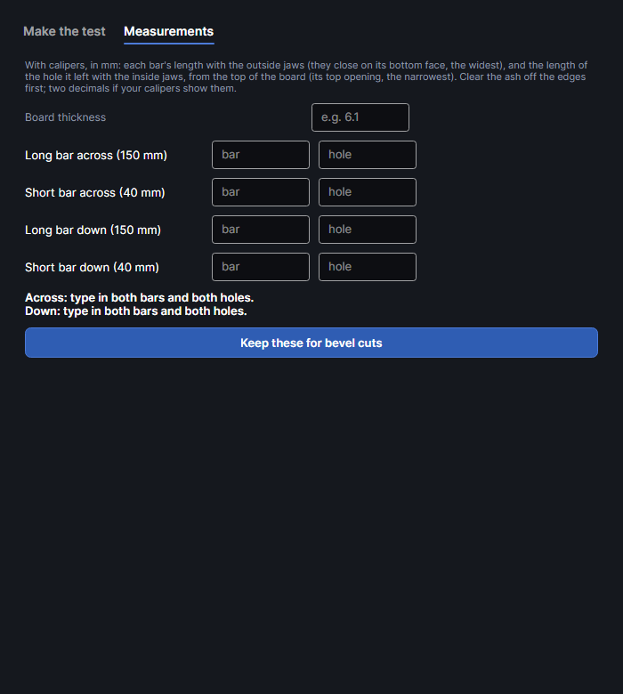

On **Measurements**, in millimetres: **Board thickness** (filled from a recipe's material if empty),
then for each bar its length with the calipers' outside jaws (they close on its bottom face, the
widest) and the length of its hole with the inside jaws from the top of the board (the top opening,
the narrowest). Clear the ash off first; two decimals if your calipers show them. Commas work as
decimal points.

From the long and short bar of one direction: pivot height = thickness × (150 − 40) ÷ ((long bar −
long hole) − (short bar − short hole)). The kerf is the same for both bars, so it cancels out; a
difference under 0.02 mm is too small to use. For each direction the window gives the pivot height,
the slope an edge at the side of the field gets, and how far from the middle 5° and 10° are. It warns
when the two heights are more than a quarter apart or under 80 mm: measure again, jaws square on the
edges. **Keep these for bevel cuts** saves them (one direction measured is used for both).

Not yet tried on the machine. If the pivot is about 300 mm up, the steepest bevel is about 19°; at
600 mm only about 10°.

▶ [Measure the beam's slant](tutorial:mat-bevel-test)

## Graphene test (experimental)
<!-- windows: GrapheneTestWindow -->

Burning cork, wood or polyimide (Kapton) can turn its surface into conductive carbon, laser-induced
graphene, for touch pads and simple sensors. Whether the blue diode does it on your material is what
this finds out: dumbbell-shaped burns (two 5 mm contact pads and a strip between) at a grid of
powers and speeds, which you measure pad to pad with a multimeter. Not yet tried on the machine.

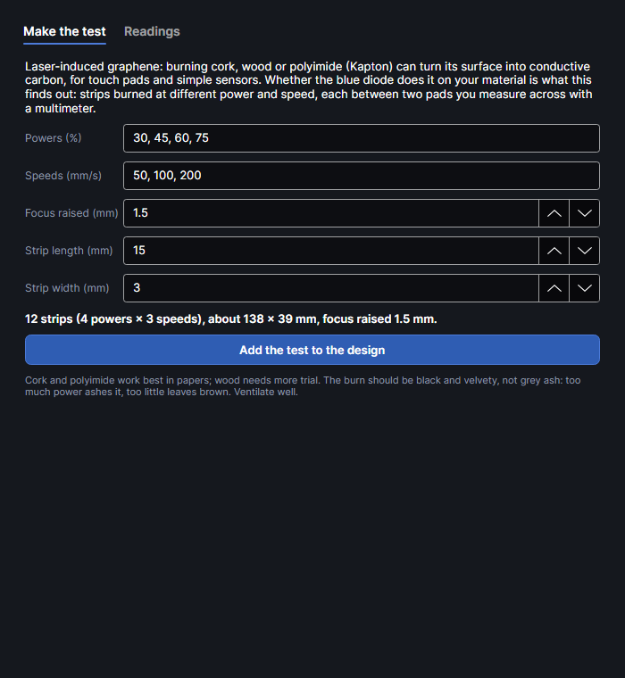

| Setting | Default | What it does |
|---|---|---|
| **Powers (%)** | 30, 45, 60, 75 | Across the grid, separated by commas. |
| **Speeds (mm/s)** | 50, 100, 200 | Down the grid. |
| **Focus raised (mm)** | 1.5 (0–10) | Graphene usually wants a wider, softer spot: the head goes this much higher for the strips. |
| **Strip length (mm)** | 15 (5–50) | |
| **Strip width (mm)** | 3 (1–10) | |

**Add the test to the design** puts the grid near the top-left of the bed: each strip its own
filled layer (`Graphene · 45% 100 mm/s`, blue diode, 150 lines per cm), numbered, with the powers
along the top and speeds down the side on **Graphene · labels**. The burn should be black and
velvety, not grey ash: too much power ashes it, too little leaves brown. Cork and polyimide work best
in published papers; wood needs more trial. Ventilate well.

The window doesn't open by itself after the job: open **Graphene test** again and it starts on
**Readings**. Set the multimeter to resistance (Ω), press one probe on each pad of a strip and type
what it reads (`1500`, `1.5k` and `2M` all work). Leave it empty if it reads nothing. Readings are
kept between sessions. The lowest is the best, with its resistance per square (resistance × width ÷
length): under about 100 Ω per square is good laser graphene; thousands is barely conductive.
**Save the best to the library** adds an engrave recipe `Graphene (… per square)`; a new material
goes under *Cork & rubber*.

▶ [Try laser-induced graphene](tutorial:mat-graphene-test)

## Quick on lid close

**Quick on lid close** is an on/off button. When it's on and you close the machine's lid:

1. The machine must be connected, idle (or finished), an xTool machine, and the design must have
   something on a layer with output on. Otherwise nothing happens.
2. It auto-focuses on the material (the status bar says **Lid closed: focusing…**). If the focus
   can't be measured, it stops.
3. It photographs the whole bed and looks for pieces of material at least 400 mm² in area.
4. It moves everything that will be marked so its middle sits on the middle of the biggest piece
   (one step you can undo). With no piece found, the design stays where it is.
5. It ships the job without the usual confirmation, unless the job has warnings.

The machine then waits for its button, as always: check the placement before you press it. It stays
on until you click it again, also after restarting. Not yet tried on the machine.

▶ [Load jobs by closing the lid](tutorial:mat-quick-lid)

## Colour on metal

The MOPA laser colours stainless steel and titanium by growing a thin oxide layer: its thickness,
set by how much energy goes in, decides the colour. Which colours a plate really gives depends on the
plate, so you burn a colour test and measure it. The measured palette is what
**Picture → Colour on metal** uses (see [Pictures](pictures.md)).

The **Colour on metal** group is on unless you turn it off: **Settings → Equipment → FEATURES TO SHOW
→ Colour on metal** (the same question is asked at the first start). Hiding it only takes the buttons
out of the ribbon; nothing is lost.

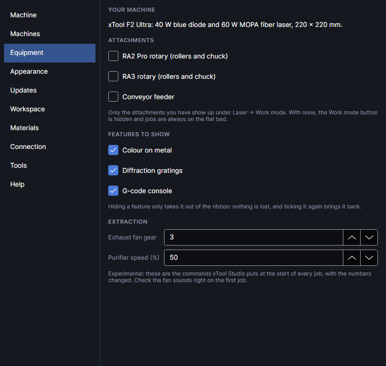

### Colour test
<!-- windows: ColourTestWindow -->

Adds a colour test grid for the MOPA: one setting across, another down, the rest fixed.

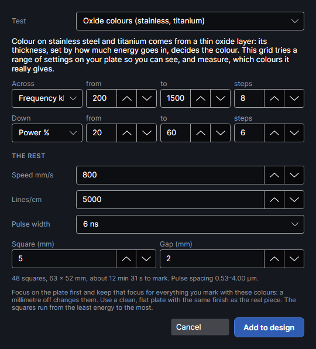

**Test** chooses the kind:

- **Oxide colours (stainless, titanium)**: frequency 200–1500 kHz across (8 steps), power 20–60 %
  down (6 steps), at 800 mm/s, 5000 lines/cm (0.002 mm apart), 6 ns pulses, 5 mm squares. Frequency
  does most of the work, power fine-tunes it.
- **Diffraction gratings (polished stainless)**: each pulse leaves a mark a set distance from the
  last (speed ÷ frequency: 300 mm/s at 300 kHz is 1 µm), and a row of them diffracts light like a
  grating. Frequency 200–500 kHz across (7 steps, labelled as the pitch in µm), power 20–45 % down
  (6 steps), at 300 mm/s, lines 0.06 mm apart, 60 ns pulses, 6 mm squares, 0.2 mm run-up past each
  square at steady speed. Tilt the burned test under a lamp: the best squares show bright rainbows.

| Setting | Range | What it does |
|---|---|---|
| **Across**, **Down** | **Speed mm/s**, **Lines/cm**, **Power %**, **Frequency kHz**, **Pulse ns** | With **from**, **to** and **steps** (1–20). A new choice fills in a range: speed 200–1600, lines 300–1000, power 20–60, frequency 200–1500, pulse 4–200. |
| **Power %** | 1–100 | Hidden while swept, as are the others. |
| **Speed mm/s** | 2–15000 | |
| **Lines/cm** | 10–10000 | Fill line density. Finer is longer and hotter. |
| **Frequency kHz** | 1–4000 | Brought down to the most the pulse width allows. |
| **Pulse width** | 2–500 ns | The MOPA's 16 pulse widths; swept values move to the nearest. |
| **Square (mm)**, **Gap (mm)** | 2–20, 0.5–10 | |
| **Spread the heat: run each square where the plate is coolest** | on or off | On (the start). Turns on [Spread the heat across the whole job](heat-order.md#across-the-whole-job) for the design when the test is added. |
| **Sheet metal**, **Thickness (mm)**, **How it's held** | as under **Heat** in the job bar | Stainless steel, 0.5 mm, in air on the honeycomb to start. Greyed while spreading is off. The rest (how warm it may get, a fixed cool-down) is under **Heat** in the job bar. |

Below a pulse width's full-power frequency the MOPA can't deliver all its power, roughly in
proportion, so low-frequency squares get less than the power says. The line under the settings gives
the number of squares, the size, the time and, when frequency is swept, the pulse spacing.

**Add to design** puts it 10 mm in from the top-left corner. Each square is its own filled layer
(`Colour test R3 C5`), lines straight across. The layers are in order from the least energy per
area to the most. With spreading on, each square runs where the plate is coolest, far from the one
just done, with waits only where the plate needs them: heat from one square doesn't shift its
neighbour's colour or bow the plate out of focus. With it off, they run in layer order, so the
plate warms gradually, but the hottest squares come last on a plate that's already warm. The time
on the line under the settings leaves out the waits (the job bar's estimate has them). The axis labels go on **Colour test labels** (MOPA 30 % at
1000 mm/s). Focus on the plate first and keep that focus for everything you mark with these colours:
a millimetre off changes them. Use a clean, flat plate with the same finish as the real piece.

▶ [Burn a colour test](tutorial:mat-colour-test)

### Measure colours
<!-- windows: MeasureColourWindow -->

Reads the colour of every square of a burned colour test and saves them as a palette on the
material.

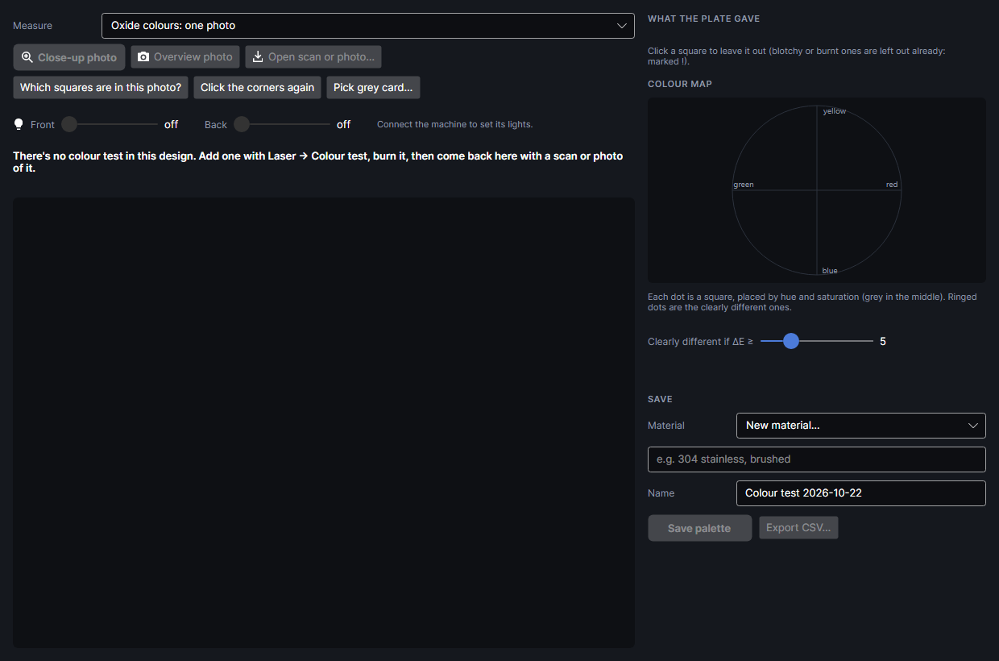

**Measure**: **Oxide colours: one photo**, or **Gratings: five views** (chosen for you when the test
is a grating test). Then a picture of the plate:

| Button | What it does |
|---|---|
| **Close-up photo** | The close-up camera: the truest colours. It sees only part of the bed, so put a block of squares under it and measure the rest the same way. Needs the machine connected. |
| **Overview photo** | The overview camera's picture, already lined up with the bed: quick, but its colour isn't calibrated and its lights shine at an angle. A first look. |
| **Open scan or photo…** | A file (PNG, JPEG, TIFF, BMP, WebP). A flatbed scan is best; a phone photo works taken straight on in soft, even light, ideally with a grey card in view. |
| **Which squares are in this photo?** | For a photo of part of the grid: click the first and the last square of the block on the chart on the right. Results from each photo add up. |
| **Click the corners again** | Clears the corner clicks. |
| **Pick grey card…** | Click two opposite corners of a grey or white card in the picture: its colour is taken as neutral, which corrects the light's tint. |
| **Save as the close-up camera's position** | After a close-up photo, if the plate hasn't moved since it was burned: the corners you clicked teach where the close-up camera looks at this focus height. Later close-up photos then place themselves. |
| **Front**, **Back** | The machine's fill lights (when connected). Keep them the same for every photo you compare; they're saved with the palette. |

Except for the overview photo (and a close-up whose position is known), you then click the middle of
the four corner squares in the photo, in the order the step line asks, each named by its settings and
outlined on the chart. Outlines show the area read in each square: check they sit inside. The
corners also teach the close-up camera's angle, so the next close-up photos come out straight.

**WHAT THE PLATE GAVE** shows every square's measured colour. Blotchy squares are left out already
(marked !); click a square to leave it out or bring it back. The **COLOUR MAP** places each square by
hue and saturation (grey in the middle); ringed dots are the clearly different colours, set by
**Clearly different if ΔE ≥** (2–15, default 5). The summary gives how many clearly different
colours, the lightness range, the strongest colour and the hues reached.

**Material** (a new one goes under *Metal*), **Name**, then **Save palette**. **Export CSV…** writes
every square's settings and colour (L, a, b and sRGB) to a spreadsheet file.

In **Gratings: five views**, photograph the plate from five fixed views with the lamp kept still:
**Straight**, then tilted 45° from the top, right, bottom and left edges' sides (pick each under
**View**; the close-up camera works for the straight one). Each view is measured on its own. **THE
VIEWS TOGETHER** plays them as an animation, **Save GIF…** saves it, the summary lists the strongest
squares and the views they light up at, and a notes box records where the lamp and camera were.
**Save grating set** keeps it all on the material.

▶ [Measure a colour test](tutorial:mat-measure-colours)
