# Pictures

Photos, scans and artwork are pictures: grids of pixels, not outlines. A picture on a Picture layer
is engraved dot by dot. The **Picture** tab also turns pictures into other things: outlines to cut
or score, banknote-style engraving lines, colours or rainbow gratings on metal, and depth maps
carved as a relief.

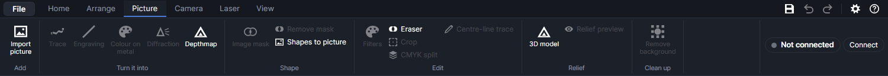

## The Picture tab

The tab's name turns blue when exactly one picture is selected (click it on the work area or in the
Layers panel). Buttons that work on a picture stay grey until then. A picture selected together with
other shapes doesn't count, except for **Image mask**.

| Group | Buttons |
|---|---|
| Add | [Import picture](#import-a-picture) |
| Turn it into | [Trace](#trace), [Engraving](#engraving-lines), [Colour on metal](#colour-on-metal), [Diffraction](#diffraction), [Depthmap](#depthmap-with-depthcharge) |
| Shape | [Image mask](#image-mask), [Remove mask](#image-mask), [Shapes to picture](#shapes-to-picture) |
| Edit | [Filters](#filters), [Eraser](#eraser), [Crop](#crop), [CMYK split](#cmyk-split), [Centre-line trace](#centre-line-trace) |
| Relief | [3D model](#3d-model-relief), [Depth outlines](#depth-outlines), [Relief preview](#relief-preview) |
| Clean up | [Remove background](#remove-background) |

**Colour on metal** and **Diffraction** are MOPA-only features. They show by default; to hide or
show them, open **Settings** (the gear at the top right) → **Equipment** and tick or untick
**Colour on metal** and **Diffraction gratings** under **Features to show**. Unticking **Colour on
metal** also hides the **Colour test** and **Measure colours** buttons on the Laser tab. Hiding a
feature only takes it out of the ribbon: nothing is lost. See [The machine and settings](machine.md).

Right-clicking a picture also offers **Trace picture…**, **Depthmap with DepthCharge…** and
**Remove picture background…**.

## Import a picture

**Import picture** (`Ctrl+J`) opens a file chooser; pick one picture or several. Formats: PNG, JPG,
BMP, GIF, WebP and TIFF. **Home → Picture**, **File → Import picture…** and dragging picture files
onto the window do the same. A picture copied in another program can be pasted with `Ctrl+V`: it
lands the same way. To
turn a drawing (SVG, PDF…) into a picture, see **Import as one picture…** in [Files](files.md).

- **Layer:** pictures go on the first Picture layer that is visible and unlocked. If there is none, a
  new Picture layer called **Pictures** is made.
- **Size:** each pixel is 0.1 mm (254 dpi), shrunk if needed so the longer side is at most 100 mm.
- **Place:** centred in the work area; each further picture is 5 mm further right and down. The
  view zooms to the new pictures.
- A file that can't be read is listed in a message; the others are still imported.

The file's pixels are kept in the design as they are. Changing the size, the tone settings or the
layer never alters them; **Filters**, **Crop**, **Eraser** and **Remove background** make a new
picture in its place (`Ctrl+Z` brings the old one back).

## How pictures are engraved

Only Picture layers engrave pictures. A Picture layer is a layer whose mode is **Picture** in its
layer settings (tooltips call it an Image layer). When the job is built, each picture is resampled
onto the machine's dot grid at the layer's **Resolution**, with its tone settings (below) and the
layer's tone correction (if it has one) applied, and **Dithering** turns the greys into dots to burn
or skip: dark areas get many dots, light areas few, white none. The picture's own pixel count doesn't
matter (except with **Pass-through**): the layer's resolution decides how many dots are burned.

- White and see-through parts aren't burned, and nothing outside an image mask is. With **Invert
  (for dark materials)** ticked, white parts count as black and do burn; see-through parts (more
  than half see-through) are never burned, inverted or not.
- A picture on a Cut, Score or Engrave layer isn't engraved, and shapes on a Picture layer aren't
  done. The Layers panel shows a warning under such a layer.
- One picture may make at most 40 million dots. Lower the resolution or make the picture smaller
  if the job says it needs more.
- The layer's **Picture mode** chooses **Dots (dithered)** (every dot at full power, tone from dot
  spacing: proven on the machine), **Greyscale (experimental)** (each dot's power follows the
  picture) or **Depth slices (relief)** (the picture is a depth map, carved down in slices).

Every Picture layer setting (power, speed, resolution, dithering styles, halftone cells, passes,
scan angle, tone correction…) is explained in [Layer settings](layer-settings.md).

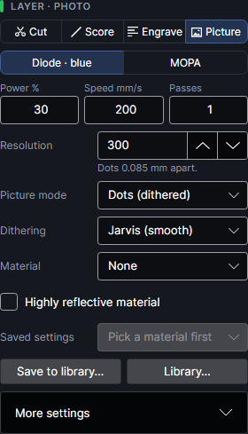

## Size, place and tone

With a picture selected, the **Selection** panel shows its **X**, **Y** (top-left corner), **W**,
**H**, **Scale %** and **Angle °**, and its **Layer**. Type new values to move, resize or turn it
exactly; **Keep proportions** keeps the picture from stretching. **Layer** moves it to another layer
(it must be a Picture layer to be engraved). The panel itself is described in
[The workspace](workspace.md).

Below it, the **Picture** card holds the picture's tone settings. They change how the picture
engraves, not the file, and each picture has its own. Each slider's value shows at its right
("+20%", "1.40 (lighter mid-tones)", "off").

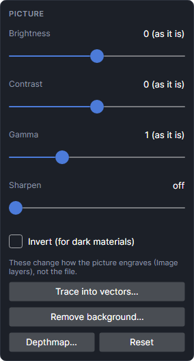

| Setting | Range (default) | What it does |
|---|---|---|
| **Brightness** | −1 to +1 (0) | Lighter (+) or darker (−) all over. |
| **Contrast** | −1 to +1 (0) | More (+) or less (−) difference between light and dark. |
| **Gamma** | 0.2 to 3 (1) | Above 1 lightens the mid-tones, below 1 darkens them; black and white stay. |
| **Sharpen** | 0 to 3 (0) | Brings out edges and fine detail before dithering (an unsharp mask about 0.3 mm wide). About 1 is a good start. |
| **Invert (for dark materials)** | off | Swaps light and dark: what was white burns, what was black doesn't. |

They're applied in this order: invert, gamma, contrast, brightness. **Reset** puts all of them back.
**Trace into vectors…**, **Depthmap…** and **Remove background…** do the same as the ribbon buttons.

- The work area shows the picture's own pixels, not these settings, unless
  [Pictures as burned](#pictures-as-burned) is on.
- **Engraving**, **Centre-line trace** and **Pictures as burned** use them too, all but
  **Sharpen**. **CMYK split** uses them and copies **Sharpen** onto each plate (see
  [CMYK split](#cmyk-split)). **Trace**, **Colour on metal**, **Diffraction** and the filters work
  from the picture's own pixels and ignore them.

## Pictures as burned

**View → Pictures as burned** draws pictures on the work area as they'll come out on their layer's
material: with their tone settings, corrected for the material, in the material's own colours (bare
wood to its darkest burn, for example). See-through parts show as bare material.

It needs a tone test: a picture layer gets its correction from **Laser → Tone test**, or when you
choose a material whose library settings have one. Pictures on layers without one are drawn as
usual. The setting is remembered. See [Materials and tests](materials-and-tests.md).

## Trace
<!-- windows: TraceWindow -->

**Trace** (`Ctrl+T`) turns a picture into vector outlines you can cut, score or fill: logos, signs,
silhouettes, scanned drawings. The window shows the outlines in red over the picture and updates a
moment after each change. The mouse wheel zooms the preview; dragging moves it.

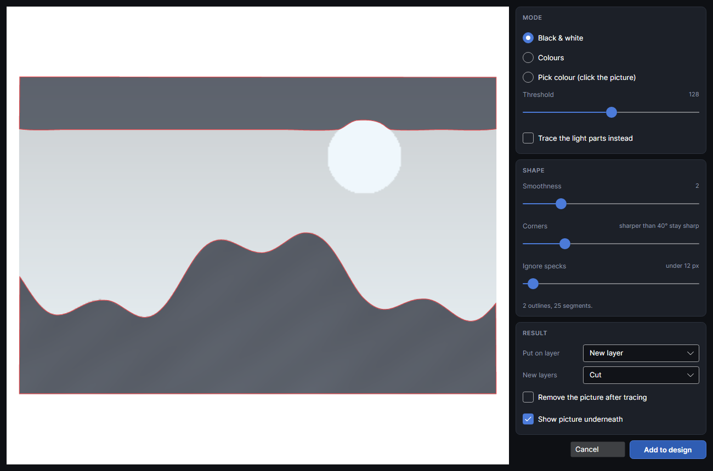

**Mode**

- **Black & white:** traces everything darker than **Threshold** (1 to 254, default 128; 0 is black,
  255 white). **Trace the light parts instead** traces the light areas.
- **Colours:** groups the picture's colours and traces each group onto its own layer. **Colour
  tolerance** (1 to 100, default 25) sets how different two colours can be and still count as one;
  **Most colours** (2 to 16, default 8) caps how many groups are kept. Colours covering under 0.5 %
  of the picture join the nearest group. Each group is listed with a tick box, its share of the
  picture and how many outlines it gives; ticked ones are traced. The background (the most common
  colour along the edge) starts unticked.
- **Pick colour (click the picture):** click the preview to pick a colour (clicking switches to
  this mode). **Tolerance** (0 to 100, default 15): low takes only colours very close to the one
  clicked, high spreads to similar ones. **Only the area connected to where I clicked** (on by
  default) keeps just the patch joined to the click; off takes that colour everywhere.

**Shape**

| Setting | Range (default) | What it does |
|---|---|---|
| **Smoothness** | 0 to 10 (2) | 0 follows every pixel step ("exact"); higher gives smoother, simpler outlines with fewer points. |
| **Corners** | 0 to 180° (40°) | Bends sharper than this stay sharp corners; gentler ones become curves. 0 = straight lines only, 180 = all rounded. |
| **Ignore specks** | 0 to 400 px (12) | Blobs and holes smaller than this many pixels are left out. 0 keeps everything. |

The line under the sliders counts the outlines and segments.

**Result**

- **Put on layer** (Black & white and Pick colour): an existing layer that isn't a Picture layer, or
  **New layer** (called "Traced" and the picture's name). It starts on the active layer if that
  can take outlines.
- In **Colours** mode each colour goes on a layer named after it (**Colour #RRGGBB**), shown in that
  colour; a layer of that name is reused if there is one. A colour too dark to see on the work area
  (black, for example) is shown in one of the program's layer colours instead, keeping its name.
- **New layers:** what any new layer does: **Cut**, **Score** or **Engrave (fill)**. You can change
  it later.
- **Remove the picture after tracing** deletes the picture; otherwise it stays under the outlines.
- **Show picture underneath** only affects the preview.

**Add to design** places the outlines exactly over the picture, one shape per colour (holes stay
holes). Pictures larger than 2000 pixels along their longer side are traced from a copy averaged
down to 2000; the outlines are still placed at full size.

## Centre-line trace

**Centre-line trace** draws one line down the middle of each dark stroke, instead of an outline round
both sides: handwriting, signatures, line art, single-stroke text. It has no window.

- Dark means darker than mid-grey after the picture's tone settings; see-through parts are ignored.
- The strokes are thinned to one pixel and followed end to end; lines shorter than 3 pixels are
  dropped.
- The lines go on the first visible, unlocked Score layer, or a new Score layer called
  **Centre lines**, as one shape ("Centre lines" and the picture's name). The status bar says how
  many lines it found, or "No dark strokes found to trace."
- The picture stays; turn its layer's output off if it shouldn't be engraved as well.

## Engraving lines
<!-- windows: EngravingWindow -->

**Engraving** redraws the picture as engraving lines, like a banknote portrait: each line swells
where the picture is dark and thins away to nothing where it's light. The result is filled
shapes, so it engraves crisply with ordinary fill settings instead of dots.

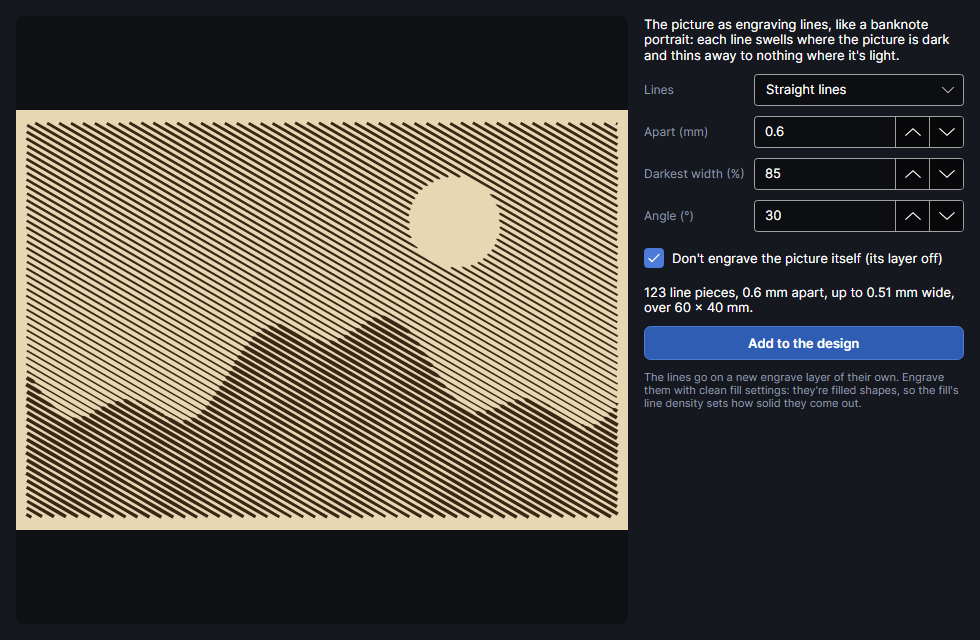

| Setting | Range (default) | What it does |
|---|---|---|
| **Lines** | | **Straight lines** (parallel, the classic banknote shading), **Lines following the forms** (parallel lines bent by the picture's light and dark, for a relief look), **Rings** (circles round a centre) or **Spiral** (one spiral from the centre out). |
| **Apart (mm)** | 0.2 to 5 (0.6) | Line spacing, centre to centre. Closer lines show more detail; keep it at least twice the beam's width so lines stay apart. |
| **Darkest width (%)** | 10 to 100 (85) | How wide a line gets at black, as a share of the spacing. Below 100 % the lines never quite touch. |
| **Angle (°)** | −180 to 180 (30) | Straight and following lines: their direction; 0 = left to right. |
| **Bend** | 0 to 5 (1) | Following lines: how far they bend with the picture's light and dark, in line spacings. More gives a stronger relief. |
| **Centre** | two sliders | Rings and spiral: where they start, across then down the picture (default the middle, a little above centre). |

- Lines narrower than 0.06 mm are broken off, so highlights stay clean.
- The picture's tone settings (all but **Sharpen**) and image mask are followed.
- The summary under the settings gives the number of line pieces, the spacing, the widest line and
  the area covered.
- **Don't engrave the picture itself (its layer off)** (on by default) turns the picture's layer's
  output off, when the picture is the only thing on it.

**Add to the design** puts the lines on a new Engrave layer, **Engraving ·** and the picture's name.
Set it up as a clean fill: the fill's **Lines / cm** decides how solid each line comes out
([Layer settings](layer-settings.md)). Close the window to leave without adding anything.

## Colour on metal
<!-- windows: ColourPictureWindow -->

**Colour on metal** makes a colour picture on stainless steel or titanium with the MOPA laser, using
the colours your plate really made. Each pixel becomes the nearest measured colour, with dots of
neighbouring colours mixed in for the shades between, and each colour becomes one Engrave layer
with the settings that made it.

It needs a measured palette first: burn a **Colour test** (Laser tab), read it with **Measure
colours** and save the palette. See [Materials and tests](materials-and-tests.md). Until then the
window says there are no palettes and **Add colour layers** stays grey.

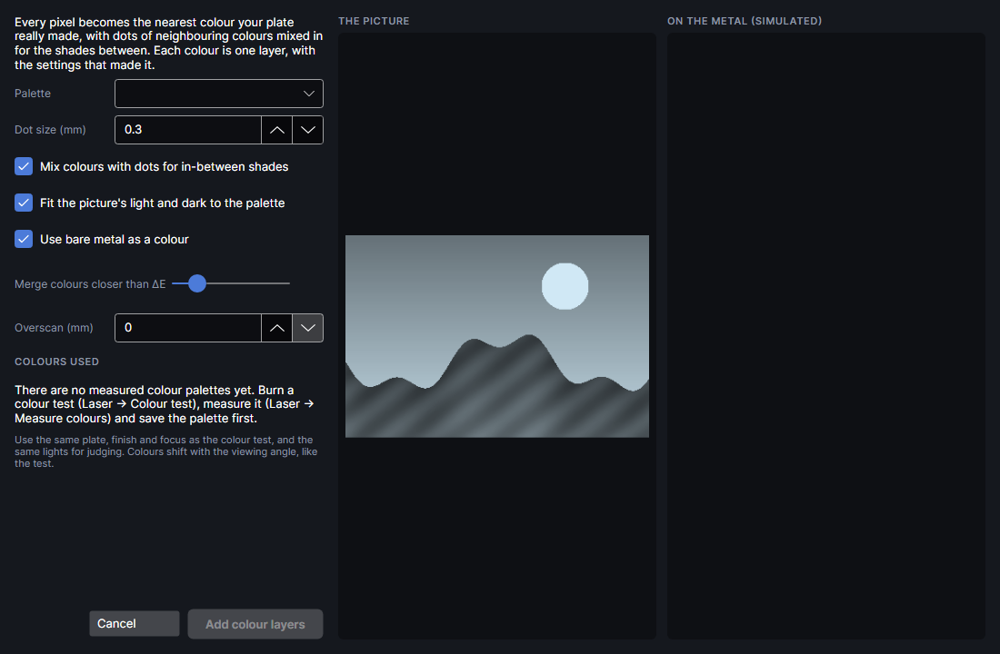

| Setting | Range (default) | What it does |
|---|---|---|
| **Palette** | | A measured palette from the material library: material, palette name and date. |
| **Dot size (mm)** | 0.05 to 3 (0.3) | Size of one colour dot. Smaller = finer, but heat makes neighbouring colours bleed: 0.2–0.5 mm is a good start. |
| **Mix colours with dots for in-between shades** | on | Dithering between palette colours. Off: each dot takes the nearest colour only (posterised). |
| **Fit the picture's light and dark to the palette** | on | Squeezes the picture's lightness into the range the palette really has, so shadows and highlights both land on a colour. |
| **Use bare metal as a colour** | on | Unmarked metal counts as a colour (usually the lightest). If the palette has no bare-metal reading, a light grey stands in. |
| **Merge colours closer than ΔE** | 2 to 20 (5) | Palette colours closer than this count as one: fewer layers, fewer near-duplicates. |
| **Overscan (mm)** | 0 to 2 (0) | Run-up past each line with the laser off: steadier colour right to the edges, a little slower. |

The right half shows the picture and the result simulated in the measured colours. **Colours used**
shows a chip per colour; hover one for the settings that made it and its share of the picture. The
summary gives the dots, colours, layers and the marking time.

**Add colour layers** adds one Engrave layer per colour (named **Colour ·**, the colour and its test
square, e.g. **R2 C5**), least energy first, over the picture at the same place, size and angle.
Bare metal needs no layer. If the picture is alone on its layer, that layer stops being sent; if it
shares it, turn its output off yourself. See-through parts stay bare.

> **Tip:** Use the same plate, finish and focus as the colour test, and the same lights for judging.
> Colours shift with the viewing angle, as on the test.

## Diffraction
<!-- windows: DiffractionWindow -->

**Diffraction** turns the picture into tiny diffraction gratings on polished (mirror) stainless with
the MOPA laser. The laser's pulses land a set distance apart along each line (the pitch: speed ÷
frequency, e.g. 300 mm/s at 300 kHz is 1 µm), and a row of them splits light into rainbow colours.
Each pixel of the picture becomes a small patch of grating.

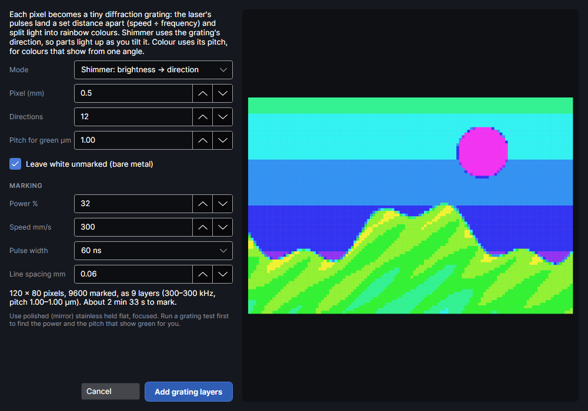

**Mode**

- **Shimmer: brightness → direction:** the scan direction of each pixel follows its brightness
  (dark 0°, light towards 180°, in **Directions** steps), all at the green pitch. Parts of the
  picture light up in turn as you tilt it.
- **Colour: hue → pitch:** each pixel's hue sets its pitch (red to violet), so the colours show from
  one lighting and viewing angle. All pixels scan in one **Direction °**.
- **3D: depth map → floating points (experimental):** for a depth map (light = in front, mid-grey =
  on the surface, dark = behind, white = nothing; **Depthmap** makes one). Each point becomes an arc
  of grating pixels whose glint slides as you tilt the plate, so the point seems to float in front
  of or behind the metal.

| Setting | Range (default) | What it does |
|---|---|---|
| **Pixel (mm)** | 0.1 to 5 (0.5) | Size of one grating pixel. Smaller = more detail, more stop-starts. |
| **Directions** | 2 to 36 (12) | Shimmer and 3D: how many grating directions (0–180°) brightness is shared out over. More = smoother shimmer, more layers. |
| **Colours** | 2 to 24 (10) | Colour: how many pitches the hues are shared out over. |
| **Direction °** | 0 to 179 (0) | Colour: the scan direction for every pixel; colours show when the light and your eye line up along it. |
| **3D strength (mm)** | 0.5 to 30 (6) | 3D: how wide the arcs grow for the nearest and farthest points. More = deeper 3D, but busier. |
| **Point spacing (mm)** | 0.2 to 10 (2) | 3D: distance between the points that get arcs. |
| **Outlines and depth steps only (line art, stepped shapes)** | off | 3D: arcs only on outlines and sudden depth changes; off puts points all over (smooth reliefs). |
| **Swap in front and behind** | off | 3D: if it looks inside out under your light. |
| **Pitch for green µm** | 0.3 to 5 (1.00) | The pulse spacing that shows green where you'll look from. Smaller shows bluer, larger redder. Shimmer and 3D use it for every pixel. |
| **Leave white unmarked (bare metal)** | on | Near-white pixels stay bare. |
| **Leave greys and black unmarked** | on | Colour: greys and near-black stay bare (a grating can't show them). |
| **Power %** | 1 to 100 (32) | Keep it low: too much heat blurs the grating and warps thin sheet. |
| **Speed mm/s** | 2 to 15000 (300) | With the frequency, sets the pitch. Each layer's frequency is worked out from it. |
| **Pulse width** | MOPA pulse widths (60 ns) | The pulse width for every grating layer. |
| **Line spacing mm** | 0.01 to 0.5 (0.06) | Gap between fill lines. 0.05–0.06 mm covers the area with little heat. |

The preview shows the pixel map on grey steel: shimmer and 3D pixels coloured by direction, colour
pixels by their colour. The summary gives the pixels, how many are marked, the number of layers,
their frequency and pitch range, and the marking time.

**Add grating layers** adds one MOPA Engrave layer per direction or pitch (named like **Grating 45° ·
1.00 µm**), pixels merged into strips, over the picture. Each layer's frequency is speed ÷ pitch,
kept within what the pulse width allows, and its scan angle turns with the picture. Its
**Overscan (mm)** is set to 0.2, so the beam is at a steady speed where it marks. As with colour
on metal, the picture's own layer stops being sent if the picture is alone on it.

> **Tip:** Run a grating test first (Laser → Colour test, Diffraction gratings) to find the power and
> the pitch that show green for you. Hold the plate flat and focused.

## Depthmap with DepthCharge
<!-- windows: DepthChargeWindow -->

**Depthmap** estimates the depth of the scene in a photo or artwork and makes a depth map: a grey
picture where white is the surface (left alone) and black the deepest part. On a Picture layer in
**Depth slices** mode it's carved as a relief. Select a picture first, or click **Depthmap** with
nothing selected to pick a picture file.

**What it needs.** The depth is worked out by **DepthCharge**, a separate program that is not part of
PhotonCanvas. It must be installed and set up (its own Setup, once). It runs on your own computer,
on the graphics card if it can (DirectML) or the processor (slower); PhotonCanvas talks to it at
127.0.0.1 only and nothing leaves the computer.

- PhotonCanvas looks for it in the folder you chose before, then in
  `%LOCALAPPDATA%\Programs\DepthCharge`, `Documents\DepthCharge` and `OneDrive\Documents\DepthCharge`.
  **Choose DepthCharge folder…** points to another folder (the one with its `app.py` and
  `runtime\python`).
- If DepthCharge is already running it's used. Otherwise it's started in the background when you
  click **Generate depthmap**, and stopped again when PhotonCanvas closes. A DepthCharge you started
  yourself is left running.

**Estimate depth**

| Model | Detail | Notes |
|---|---|---|
| **DA3 Large (best all-round)** | 518, 728 or 1036 px (1036) | Whole-image depth; best for photos and most artwork. |
| **DA3 + fine detail (research)** | 518, 728 or 1036 px (1036) | DA3 for the shape plus Depth Pro's fine detail. Needs DepthCharge's Depth Pro download. |
| **Local close-ups (experimental)** | 518, 728 or 1036 px (518) | Overlapping close-ups for coins and ornament. Slower; can disturb the overall shape. |
| **Depth Pro (research only)** | 1536 px | Apple's model, sharp boundaries. Non-commercial research licence; needs the Depth Pro download. |
| **V2 Small (fast)** | 518 px | A quick baseline. |

Once DepthCharge is running without the Depth Pro download, a chosen **DA3 + fine detail** or
**Depth Pro** goes back to **DA3 Large**. If you generate with one before that, it stops and says
Depth Pro isn't downloaded (DepthCharge's README says how to get it).

**Large pictures.** The model looks at most at **Detail** pixels at once (1036 for DA3), with the
whole picture fitted inside that square. A 3762 × 1254 px picture would then get only 1036 × 345
depth, and every export of it is that blown up. Tiles fix this: the model looks at overlapping
squares of the full-size picture, each filling its whole input, and each is fitted to the whole
picture's depth where it lies. The overall shape stays the whole picture's (tiles can't bend it);
the tiles bring the fine detail.

| Large pictures | What it does | The 3762 × 1254 example |
|---|---|---|
| **Automatic tiles · when needed** (default) | Tiles when the picture is more than 1.25 × **Detail** or further from square than 5:4. Each tile up to twice **Detail**. | 4 tiles, 3108 × 1036 depth, about 1.2 s |
| **Fine tiles · a depth sample per pixel** | Tiles the size of **Detail**: one depth sample per picture pixel. Slower. | 10 tiles, 3762 × 1254 depth, about 2.7 s |
| **Whole picture only** | As before tiles. | 1036 × 345 depth |

The times are with the model already loaded, on the graphics card. The depth is at most 4096 px
on its longest side. Tiles don't apply to **Local close-ups**, which are their own kind of tiling.
They add resolution, not accuracy: the depth is still the model's guess, relative and not in
millimetres. While it runs, the window counts the tiles; when done it says how big the depth is.

**Generate depthmap** runs the model (the first run takes longer while it loads). The window shows
the picture and the depth map side by side.

**Shape the relief.** These sliders reshape the finished depth map without running the model again:

| Setting | Range (default) | What it does |
|---|---|---|
| **Midtone lift** | 0.2 to 3 (1) | Raises or lowers the middle heights (gamma). |
| **Smoothing** | 0 to 5 (0) | Smooths while keeping edges; also smooths the exported map. |
| **Black point** | 0 to 99 (0) | Percent of the range treated as deepest. |
| **White point** | 1 to 100 (100) | Percent of the range treated as shallowest. |
| **Ignore tails %** | 0 to 10 (0) | Ignores this share of extreme depths at each end before scaling; 0.5–2 tames edge spikes. |
| **Tile detail** | 0 to 2 (1) | Tiled pictures only: the fine detail the tiles found. 1 as found, 0 the whole picture's shape alone (as without tiles), 2 doubled. |
| **Direction** | **Emboss · raised relief** | Emboss raises the subject; **Deboss · recessed relief** sinks it. White is always shallow. |
| **Artwork detail** | 0 to 1 (0.25) | Local close-ups only: adds detail from the picture's brightness. Keeps lettering, but shadows and paint can become false depth. |
| **Model detail** | 0 to 2 (0.5) | DA3 + fine detail only: how much of Depth Pro's detail is added. |
| **Detail scale** | 2 to 64 (12) | DA3 + fine detail only: size of the detail added, in pixels at 1024 px. |
| **Image texture** | 0 to 1 (0) | DA3 + fine detail only: adds picture brightness as detail (can turn pigment into false depth). |
| **Remove plain background** | off | DA3 + fine detail only. |

**Open in DepthCharge (crop, mask, 3D)** opens DepthCharge's own editor in your browser: crop
rectangle or circle, masks and a 3D view. Crops and masks saved there are used here after
**Refresh preview**.

**Output.** **Longest edge (px)** (64 to 8192, default 2048) is the size of the map added or saved.
Up to the depth's own size keeps all its detail; bigger only interpolates. After a tiled depth
bigger than the box says, the box is raised to the depth's size (and the window says so). **Save as** (8-bit or 16-bit) applies only to **Save PNG…**; the design
always uses 8 bits.

**Add depthmap to design** puts the map over the original, in the same place and size. A map cropped
in DepthCharge to another shape is fitted inside the original's box, centred. A picture file picked
instead goes in the middle of the work area, up to 100 mm across. It goes on a new
Picture layer, **Relief ·** and the name, set to **Depth slices (relief)** with **Resolution** 254
dpi, **Lines / cm** 200 and **Turn per pass (°)** 37. Set the slices, power and passes there
([Layer settings](layer-settings.md)). The original picture stays on its own layer: turn its output
off if only the relief should run.

Carving depth slices hasn't been tried on the machine yet.

## 3D model relief
<!-- windows: StlWindow -->

**3D model** turns a 3D model into a depth map, to carve it as a relief: the highest point is the
surface, the lowest the deepest.

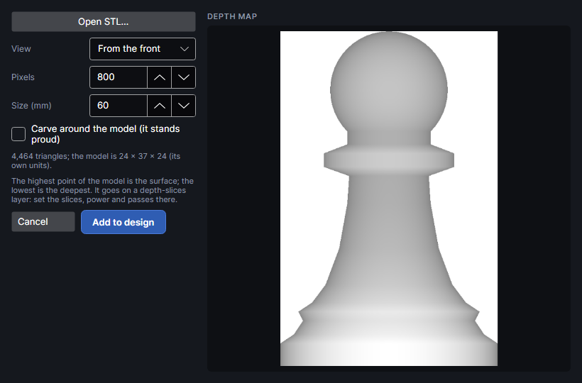

1. **Open STL…** picks the model: STL (binary or text), OBJ or STEP.
2. **View:** **From the top**, **From the front** or **From the side**.
3. **Pixels** (100 to 4000, default 800): pixels along the map's longer side. 10 per mm is plenty
   for most reliefs.
4. **Size (mm)** (2 to 220, default 60): how big the relief is on the work area, along its longer
   side.
5. **Carve around the model (it stands proud)**: off, the area round the model is left as the
   surface; on, it's carved to the bottom.

The preview shows the depth map, and a line gives the number of triangles and the model's size in
its own units. **Add to design** puts it in the middle of the work area on a new Picture layer,
**Relief ·** and the model's name, with the same depth-slice settings as a depthmap, and makes that
layer active.
Set the slices, power and passes there ([Layer settings](layer-settings.md)). For cutting a model
into stacked sheets instead, see [3D models and stacked slices](3d-slices.md).

Carving depth slices hasn't been tried on the machine yet.

## Depth outlines
<!-- windows: DepthOutlinesWindow -->

**Depth outlines** finds the edges in a depthmap, the places where the surface steps or bends
sharply (a face against the leaves behind it, one leaf over another), and turns them into lines to
mark over the relief. A relief from a soft depthmap can look washed out; the lines put the drawing
back, like an ink outline over a watercolour. Select the depthmap picture first.

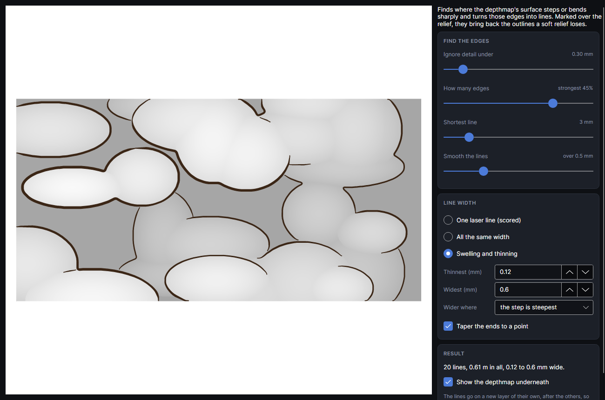

The preview shows the lines dark over the depthmap (wheel zooms, drag pans). **Show the depthmap
underneath** only affects the preview.

**Find the edges**

| Setting | Range (start) | What it does |
|---|---|---|
| **Ignore detail under** | 0.10 to 2.00 mm (0.30) | The depthmap is smoothed this much before edges are looked for. Small: fine detail and texture get lines too. Large: only the big forms. It also stops the small steps of an 8-bit depthmap showing as contour rings. |
| **How many edges** | strongest 1 to 60% (18) | How many of the possible edge points become lines, strongest first. A line that starts on a strong edge carries on along it while it's at least half as strong. |
| **Shortest line** | 0 to 20 mm (3) | Lines shorter than this are dropped: fewer specks and flecks. |
| **Smooth the lines** | 0 to 2 mm (0.5) | Evens out the pixel steps along each line, so it reads as a drawn stroke. |

**Line width**

- **One laser line (scored)**: open lines, one pass of the beam each, on a new Score layer. The
  thinnest and quickest.
- **All the same width**: filled lines **Width (mm)** wide (0.05 to 3, start 0.3), on a new
  engrave (fill) layer.
- **Swelling and thinning**: filled lines from **Thinnest (mm)** (start 0.12) to **Widest (mm)**
  (start 0.6). **Wider where** picks what makes a line wide: **the step is steepest** (tall edges
  bold, gentle ones fine), **the surface is highest** (the outlines of raised parts bold) or **the
  surface is deepest** (lines down in the crevices bold, like shadows).
- **Taper the ends to a point** (filled lines only, on at the start): each line narrows to a point
  over its last few widths instead of stopping square, so it looks drawn with a brush.

The **Result** box says how many lines there are, their length in all and their width. **Add to
design** puts them on a new layer called **Outlines** and the picture's name, placed exactly over the
picture. The layer goes after the others, so the lines are marked over the finished relief. Filled
lines are merged into one shape where they cross; their fill's line density sets how solid they
come out.

Pictures larger than 2000 pixels along their longer side are searched from a copy averaged down to
2000, which is about 0.2 mm a pixel on a 370 mm picture. The lines haven't been marked over a
relief on the machine yet: try the width and power on a scrap of the same material first.

## Relief preview
<!-- windows: ReliefPreviewWindow -->

**Relief preview** shows the selected depth map as the relief it will carve: a surface lit from the
top left, light parts high and dark parts deep. **Depth (mm): how deep the deepest part is carved** (0.2
to 5, default 1) only changes how steep the light makes it look; the real depth comes from the
layer's settings. The window can stay open while you work.

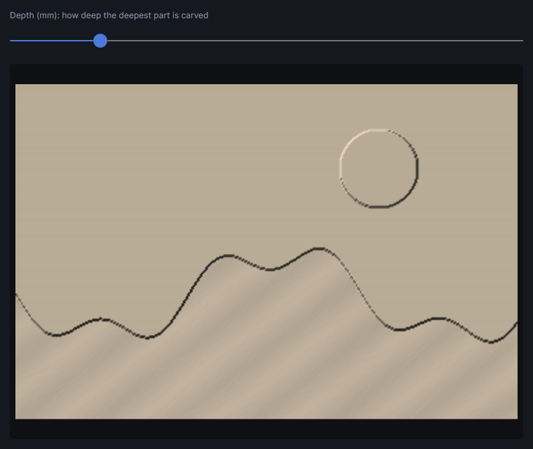

## Image mask

**Image mask** shows and engraves only the part of a picture inside a closed shape: a photo in a
circle, a heart, a frame. The picture itself isn't changed.

1. Draw or import the closed shape over the picture.
2. Select the picture and the shape together (`Shift`+click).
3. Click **Image mask**.

- The mask moves, resizes and turns with the picture, and survives filters, crop and the eraser.
- Holes in the shape stay holes in the picture. A new mask replaces the old one.
- Only the masked part has to fit the work area: the rest of the picture can hang outside it, even
  when its rows are turned to an angle (**Split onto pieces** relies on this).
- Pictures are always drawn under lines and shapes, so the outline you line a picture up with stays
  in sight.
- The shape itself stays, as a guide. Delete it, or turn its layer's output off, if it shouldn't be
  marked.
- The picture's own engraving (dots or depth slices) and **Engraving** lines follow the mask.
  **Trace**, **Centre-line trace**, **Colour on metal**, **Diffraction**, **Depthmap** and **CMYK
  split** use the whole picture.

**Remove mask** shows and engraves the whole picture again (select the masked picture first).

## Shapes to picture

**Shapes to picture** turns the selected shapes into a picture, for example to engrave a logo with a
picture style (halftone, line screen) or with picture settings. It asks for the **Resolution (dpi)**
(25 to 2540, default 300; other values do nothing).

- Closed shapes are filled black, open lines drawn 0.2 mm wide, the rest see-through.
- The picture, **Shapes as a picture**, lies exactly over the shapes, on the first visible unlocked
  Picture layer or a new **Pictures** layer.
- The shapes stay: delete them or turn their layer's output off if they shouldn't run too.

## Filters
<!-- windows: PictureFilterWindow -->

**Filters** changes the picture itself, with a before-and-after preview. **Apply** replaces the
picture's pixels; `Ctrl+Z` brings the old ones back. Brightness, contrast and sharpening stay in the
picture's own settings ([Size, place and tone](#size-place-and-tone)).

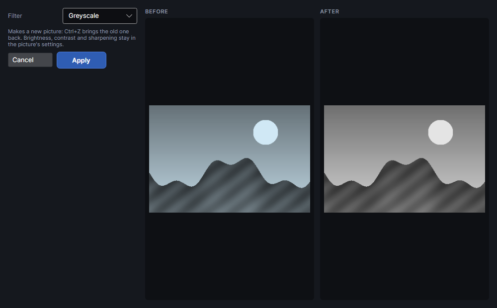

| Filter | Slider (default) | What it does |
|---|---|---|
| **Greyscale** | none | Colour turned to grey. |
| **Saturation** | **Less ← colour → more**, −1 to +1 (0.4) | Less or more colour. |
| **Pencil sketch** | **Line width**, 0 to 1 (0.4) | Dark lines where the picture changes, white elsewhere. |
| **Emboss** | **Strength**, 0 to 1 (0.3) | A grey relief lit from the top left. |
| **Comic** | **Tones**, 0 to 1 (0.2) | A few flat tones (3 to 8 per colour) with dark outlines. |
| **Black and white** | **Threshold**, 0 to 1 (0.5) | Pure black and white: darker than the threshold goes black. |
| **Mosaic grid** | **Tile size**, 0 to 1 (0.12) | Square tiles (the slider × 100 pixels) with thin white gaps. |

The preview is worked out on a copy at most 900 pixels across; **Apply** filters the full picture.

## Eraser

**Eraser** rubs out parts of a picture: drag over them and they turn white, so they aren't
engraved. Background clutter, a stray mark, a corner.

- The brush is 3 mm across, shown as a circle round the pointer.
- A stroke works on the top picture under where you start it (on a visible, unlocked layer). The
  picture doesn't have to be selected.
- Each stroke is one step to undo (`Ctrl+Z`).
- Erased parts become white and see-through, so they're never burned, even with **Invert (for dark
  materials)** ticked. To clear a whole backdrop at once, use [Remove background](#remove-background).

Press `Esc` or choose another tool to stop erasing.

## Crop
<!-- windows: CropWindow -->

**Crop** cuts the picture down to part of it. An orange box on the picture shows what's kept.

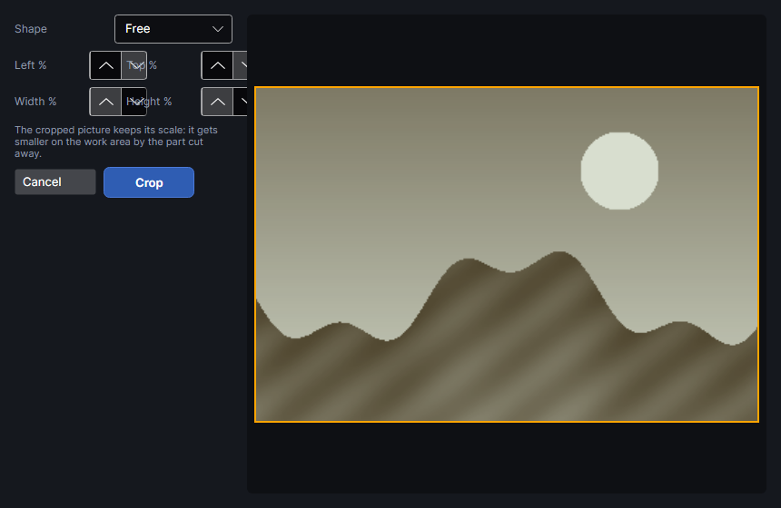

| Setting | Range (default) | What it does |
|---|---|---|
| **Shape** | **Free** | Or **Square 1:1**, **4:3**, **3:4**, **3:2**, **2:3**, **16:9**: changing the width sets the height to match (and the other way round), in true pixels. |
| **Left %**, **Top %** | 0 to 99 (0) | Where the kept part starts, as a share of the picture's width and height. |
| **Width %**, **Height %** | 1 to 100 (100) | How much is kept. |

**Crop** keeps the picture's scale: the kept part stays exactly where it was on the work area, and
the picture gets smaller by the part cut away. Its tone settings and image mask are kept.

## CMYK split

**CMYK split** separates a colour picture into four pictures, one per ink (cyan, magenta, yellow,
black), for screen printing: each one is black where its ink goes, grey where some of it goes, white
elsewhere. Each goes on its own new Picture layer (**Cyan ·**, **Magenta ·**, **Yellow ·**,
**Black ·** and the picture's name, in the ink's colour), in the same place and size, with
**Halftone (dots)** dithering at the usual screen angles: cyan 15°, magenta 75°, yellow 0°, black
45°.

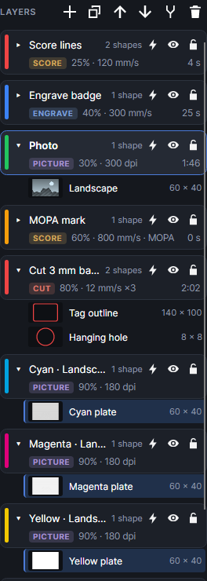

- Mark each plate on its own screen. **Laser → Layer by layer** runs one layer at a time with a
  pause between ([Work area](work-area.md)).
- The plates are made from the picture as its tone settings show it: **Brightness**, **Contrast**,
  **Gamma** and **Invert** are applied to the colours first, so each plate starts with those at
  their defaults. **Sharpen** is copied onto each plate, and an image mask ([Image mask](#image-mask))
  is kept. The original picture stays; turn its layer's output off.

## Remove background
<!-- windows: BackgroundWindow -->

**Remove background** makes a picture's backdrop see-through, so it isn't engraved, even with
**Invert (for dark materials)** ticked. The picture's tone settings and image mask are kept. It works best on
logos, scans and objects on a plain backdrop, and uses no AI and nothing online.

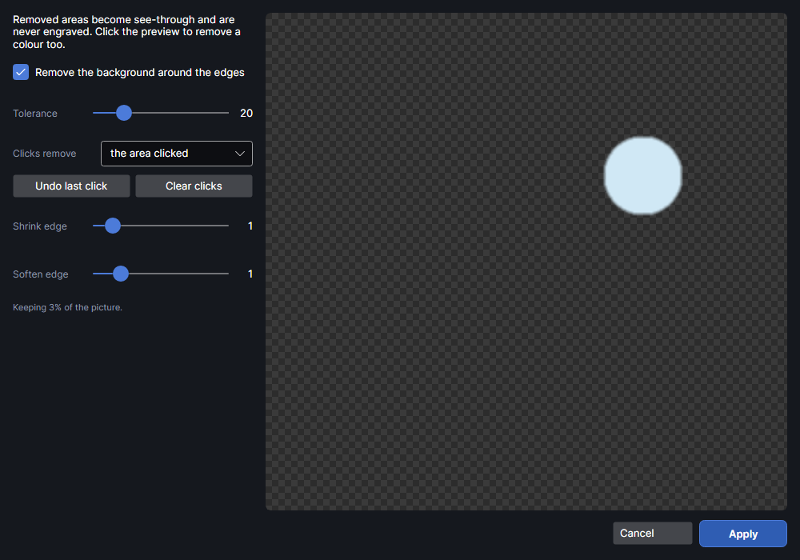

| Setting | Range (default) | What it does |
|---|---|---|
| **Remove the background around the edges** | on | Finds the main colours along the picture's edges (up to three) and removes them, spreading in from the edges. |
| **Tolerance** | 1 to 100 (20) | How different a colour can be and still count as background. Raise it if bits of backdrop remain; lower it if the subject's edges get eaten. |
| **Clicks remove** | **the area clicked** | Click the preview to remove a colour too: **the area clicked** removes the patch joined to the click, **that colour everywhere** removes it all over. **Undo last click** and **Clear clicks** take clicks back. |
| **Shrink edge** | 0 to 10 px (1) | Pulls the kept edge in, to drop a halo of backdrop colour. |
| **Soften edge** | 0 to 6 px (1) | Feathers the cut edge over this many pixels. |

The preview shows the result on a checkerboard (see-through) at up to 900 pixels across, and says
how much of the picture is kept. **Apply** works at full size and replaces the picture's pixels;
`Ctrl+Z` undoes it.

## Try it

- [Import a picture and set its tone](tutorial:pic-import)
- [Trace a picture into outlines](tutorial:pic-trace)
- [Centre-line trace](tutorial:pic-centreline)
- [Engraving lines](tutorial:pic-engraving)
- [A colour picture on metal](tutorial:pic-colour-on-metal)
- [A diffraction picture](tutorial:pic-diffraction)
- [A relief from a depth map](tutorial:pic-depthmap)
- [A relief from a 3D model](tutorial:pic-3d-model)
- [Outlines over a relief](tutorial:pic-depth-outlines)
- [Mask a picture with a shape](tutorial:pic-clip)
- [Turn shapes into a picture](tutorial:pic-shapes-to-picture)
- [Picture filters](tutorial:pic-filters)
- [Rub out parts of a picture](tutorial:pic-eraser)
- [Crop a picture](tutorial:pic-crop)
- [CMYK split for screen printing](tutorial:pic-cmyk)
- [Remove a background](tutorial:pic-remove-background)
- [See pictures as they'll burn](tutorial:pic-as-burned)
