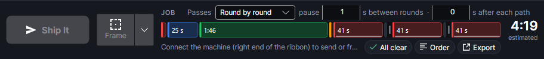
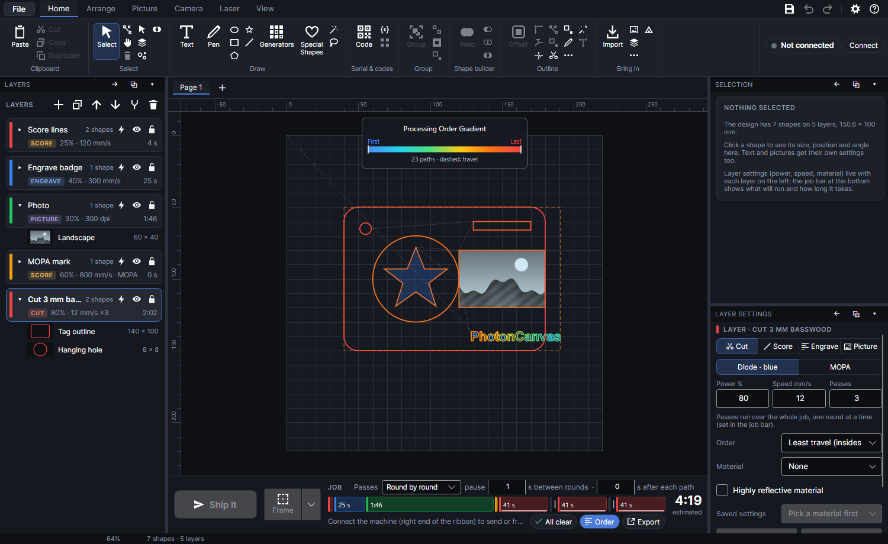
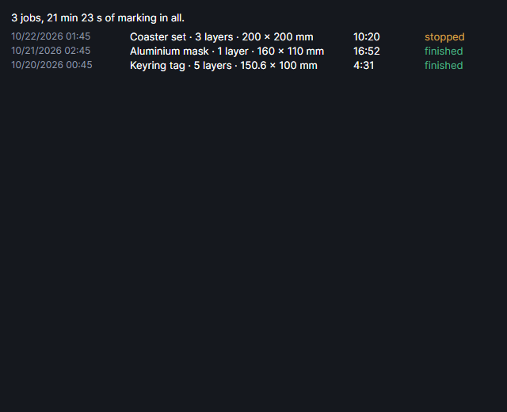
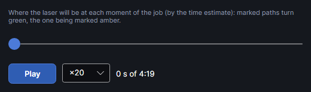

# Running a job

The job bar along the bottom of the window always shows the job as it would run now: what's in it,
the order it runs in, how long it takes and anything worth knowing first. It's rebuilt a quarter of
a second after every change to the design or its settings, so it's never out of date.

Sending a job only uploads it. PhotonCanvas never starts it by itself: nothing moves or fires until
you press the start button on the machine (or start it from the phone, only if you've turned on
**Allow starting jobs from the phone** in [Remote access](remote.md)).

## The job bar

From left to right:

| Part | What it is |
|---|---|
| **Ship It** | Uploads the job to the machine. While a job is on the machine it's replaced by the job's state and **Pause** and **Stop**. |
| **Frame** | Traces round the job with a faint laser dot to show where it lands. The arrow beside it holds the frame's options. |
| **JOB** and the summary | Layers, paths, rounds, and the job's size and position. |
| **Passes** | **Round by round** or **Path by path**, and the pauses. |
| The timeline | One block per layer, in the order they run, each as long as it takes. |
| The caption | What's going on: what to do next, upload and run progress, or the block under the mouse. |
| **Checks** | A chip: **All clear**, or how many things to look at. Click it for the list. |
| **Order** | Shows the processing order on the work area. |
| **Heat** | Spread the heat across layers and objects: runs the job's layers and shapes where the plate is coolest, with waits only where it needs them (thin metal that warps). Reads **Heat: spread** when on. See [Spread the heat](heat-order.md#across-the-whole-job). |
| **Export** | Saves the job to a file instead of sending it. |
| The estimate | How long the job takes, in big numbers. |

In a narrow window the secondary labels (**Passes**, *estimated*) are dropped and **Order**,
**Heat** and **Export** show only their icons (**Heat** adds *On* when it's on), so the timeline
keeps its room.

The same commands are on the ribbon's **Laser** tab, in the **Job** group: **Frame**, **Ship It**,
**Export .xf**, **Export G-code**, **Preview run** and **Show order** (and **Time-lapse**, from its
add-on). **Frame** and
**Ship It** have no keyboard shortcut to begin with; you can give them one in
[Keyboard shortcuts](keyboard-shortcuts.md).

## Ship It

**Ship It** (the big button at the left of the job bar, or **Laser → Ship It**) uploads the job.
It's greyed out until the machine is connected and the job can be built; the caption under the
timeline says which: *Connect the machine (right end of the ribbon) to send or frame.*,
*Fix the problem in Checks to send.* or *Ready to send.* With a GRBL machine chosen in
[Settings → Machines](machine.md#machines-page) it works without a connection: it opens the GRBL
sender instead (see [Sending to a GRBL machine](machine.md#sending-to-a-grbl-machine)).

### What happens when you Ship It

1. Text and codes showing `{date}` or `{time}` are brought up to the minute (an undo step,
   *Update date and time*).
2. The button turns grey and says **Shipping it…** while the job is made ready. A job already
   built for exactly this design and these settings (the one the estimate came from) is used as it
   is; one still being built is waited for. Otherwise it's built now.
3. A safety check: if step-down and focus offsets would lower the head to within 3 mm of the
   material (going by the machine's focus distance), the job isn't sent: *Can't send: Step-down
   and focus offsets would lower the head … mm, but it's only … mm from the material. Reduce them.*
4. The confirmation window, **Ship it to the machine?** (below). **Cancel** stops here.
5. The upload: a thin progress bar runs under the timeline and the caption says *Uploading…*,
   then *Uploaded. Press the start button on the machine to begin (long-press while paused to
   cancel).* The job is named after the design's file (*Untitled* if it isn't saved).
6. The machine says the job is loaded, and the job bar shows **Loaded – press start**. Press the
   start button on the machine to run it.

### The confirmation window

**Ship it to the machine?** lists, in this order:

- **NOT IN THIS JOB:** first, when something looks like part of the job but won't be done (shapes
  on the wrong kind of layer, see [Checks](#checks)).
- Each layer that will run: its name, mode, power, speed and passes, and the laser (*diode*, or
  *MOPA* with its pulse width and frequency). With more than 8 layers (a test grid, say) you get the
  ranges of power, speed and MOPA settings instead, and the first and last layer.
- How the passes run (*Passes run over the whole job, 1 s pause between.* or *Each path runs all
  its passes before the next.*), and the pause after each path if there is one.
- The size and about how long it takes.
- *Machine focus distance: … mm. Make sure this matches your material.* (when the machine reports
  one).
- The serial number, spreadsheet row and date fields it will mark, the work mode (rotary or
  conveyor, marked experimental), the section or single layer being marked (see
  [Work area](work-area.md)), and how far the head moves for focus offsets (it comes back up at the
  end).
- Every check, each with ⚠.
- *ⓘ A job is already loaded on the machine and not started. It will be replaced by this one.*
  and whose it is, when there's one.
- *After upload the machine waits. Nothing moves or fires until you press its start button (or start
  it from the phone, if you've allowed that in Remote access).*

**Ship It** uploads; **Cancel** doesn't.

### Replacing a loaded job

A job that's loaded but not started is cancelled (nothing moves) and replaced by the new one. A
running or paused job is never touched: the upload is refused until it's finished or stopped (see
[Troubleshooting](troubleshooting.md#the-upload-is-refused)). Uploading also stops a frame that's
tracing.

After a job, the F2 Ultra stays in *Job finished* until its button is pressed, and won't take
another job. PhotonCanvas puts it back to *Ready* before the upload, the way xTool Studio leaves
sleep and focusing; nothing moves or fires. Not yet confirmed on the machine: if the upload is
refused with *The machine is still showing the last job as finished*, press the machine's button
once and send again.

### Quick processing

**Laser → Quick on lid close** (off to begin with) turns on quick processing. With it on, the
machine connected and *Ready* or *Job finished*, and something on a layer that's sent, closing the
lid does this by itself:

1. *Lid closed: focusing…*: auto-focus on the material under the head.
2. *Lid closed: finding the material…*: an overview photo; the biggest piece found on the bed.
3. Everything that's sent is moved so its middle is on that piece's middle (an undo step,
   *Quick processing: centred on the material*). With no piece found, the design stays put.
4. **Ship It**, without the confirmation when **Checks** is all clear (with it when it isn't).

The machine then waits for its button as usual: *Quick processing: focused, centred on the
material and loaded. Press the machine's button to start.* It needs a calibrated camera (see
[Camera](camera.md)) and works with xTool machines only. It stays on until you click it again. Not
yet tried on the machine. See also [Materials and tests](materials-and-tests.md).

## Frame

**Frame** shows where the job will land: the head traces round it with a faint laser dot, over
and over, until you click **Stop framing** (the same button, now red). Use it before every job to
check the design sits on the material.

- Framing starts straight away, without the machine's button. The first time in a session (and
  whenever a job is loaded on the machine) **Start framing?** asks first; it says how big the frame
  is, that a loaded job will be cleared (send it again when you're done), and not to look into the
  beam. Click **Start framing**.
- While it traces, move or change the design and the frame follows it. The caption says *Framing.
  Move the design to adjust; click Stop framing when it's where you want it.*
- The machine's button also stops it, and so does shipping a job.
- It frames the job as built: only layers that are sent, and only the section or layer being
  marked.
- With the rotary or conveyor the frame only shows the galvo's own direction: a thin box across the
  middle of the field, since the object or belt doesn't move while framing.
- With a GRBL machine chosen, **Frame** is greyed out: frame from its sender window (laser off) instead.

### Frame options

The arrow on the right of **Frame** opens its options. They're remembered.

| Setting | Range | Default | Effect |
|---|---|---|---|
| **Rectangle around everything** | | on | Traces the box round the whole job. |
| **Snug outline (round or angled designs)** | | | Traces a tight outline round everything (like a rubber band round it): shows where a round or angled design really reaches. |
| **Power %** | 0.5–15 | 6.4 | The dot's power. Keep it low: it's the real laser. |
| **mm/s** | 100–20,000 | 16,000 | How fast the dot goes round. |

Changing them while framing re-traces at once.

## Passes and pauses

A layer's **Passes** (in its [layer settings](layer-settings.md)) say how many times it runs. The
job bar says how passes are put together across the job.

| **Passes** | What runs |
|---|---|
| **Round by round** (the default) | Every layer's first pass, then every layer's second pass, and so on. Layers with fewer passes drop out of later rounds. Each path has the rest of the round to cool before its next pass. |
| **Path by path** | Each path runs all its passes, one straight after another, before the next path starts (what xTool Studio does). No pauses between rounds, but a path's passes heat it up in turn. |

The pauses, beside it:

| Setting | Range | Default | Effect |
|---|---|---|---|
| **pause … s between rounds** | 0–3,600 s, steps of 0.5 | 1 | A wait before each round after the first, e.g. to let the material cool or to look. Only with **Round by round**. |
| **… s after each path** | 0–600 s, steps of 0.5 | 0 | A wait with the laser off after every pass of each cut or score path, so heat can leave before the next one (thin metal, masks, anything that warps). **Checks** says how much time it adds. |

Layers whose order is **Spread the heat** work out their own waits and passes (see
[Spread the heat](heat-order.md)), so these settings don't touch them:

- When every cut and score layer spreads the heat, the pause after each path is hidden.
- When every layer in the job does, **Passes** and both pauses are hidden.
- When only some do, the label *s after each path* gets an asterisk, and its tip says those layers aren't
  paused.

Neither pause helps a job of many small engraved squares (a colour test): the path pause is only
for cut and score paths, and a one-pass job has no rounds. For that, use **Heat** in the job bar
([Spread the heat across the whole job](heat-order.md#across-the-whole-job)): it adds waits only
where the plate needs them, and its own **Cool down after each part (s)** as a fixed minimum.

## The summary line

After **JOB**: how many layers and paths the job has (*cuts with the passes* when passes or
pieces make more), how many rounds when there's more than one, and the job's size and where its top
left corner is on the bed, e.g. *3 layers · 23 paths · 3 rounds · 140 × 100 mm at 40, 50*. In
front of it, when they apply: the section being marked, *Only* and the layer's name, and the work
mode (rotary or conveyor).

## The timeline

The job as a strip, left to right in the order it runs.

- One block per layer, in the layer's colour, as wide as the time it takes (tiny ones get a
  minimum width). The label is the layer's name, passes and time when there's room.
- With **Round by round** and more than one round, each round is shown: the layers in it, a notch
  between rounds, and a grey block for the pause.
- The active layer's block is underlined. Click a block to make its layer active and bring up its
  settings.
- Hover over a block: its details show in the caption and a tip, e.g. *Cut 3 mm basswood · round 2
  of 3* and *Cut at 80%, 12 mm/s · 41 s this round*. Fills are called *Engrave*.
- While a job runs, what's done is lit and a white line marks where it's got to.
- With nothing to run it says *Nothing to run yet*, or why the job can't be built.

Each layer's time also shows on its row in the [Layers](layers.md) panel.

## The estimate

The big time at the right is how long the job should take (*45 s*, *3:07*, *1:02:30*), pauses
included. *–* means the job can't be built. It's worked out the way the F2 Ultra was timed doing
it (October 2026, within about 2 % on the jobs it was checked against):

| What | Takes |
|---|---|
| Starting the job | 1.5 s |
| Lines (cut, score) | Their length at the layer's speed. |
| Fills | Each line piece at the speed, plus 2.9 ms for the laser to go on and off. The gaps between pieces are jumped at 3000 mm/s, so a fill of many small shapes (text) costs more than its area suggests. |
| Pictures | Each dot burned: its **Dot time µs** plus 0.41 ms. Blank stretches are jumped. Timed at 80 mm/s from 300 to 670 dpi, the time didn't follow the speed: the number of dots and their time decide it. |

PhotonCanvas learns from finished jobs. After each finished job estimated at more than 10
seconds, it divides the real time by the estimate, keeps that between 0.5 and 4 (half to four
times as long), and mixes it into a running correction: 40 % this job, 60 % the correction so far.
That correction is used for the time left while a job runs and for the laser's position on the
work area, not for the estimate itself. It
started again from nothing when the estimate changed (October 2026).

The estimate also goes to the machine with the job, rounded to the second, in the same place
xTool Studio puts its own, so the machine's screen can show how long the job takes and count it
down. It's left out, as xTool Studio leaves it out, for jobs on a [curved surface](work-area.md#curved-surface)
and when the estimate is under half a second. Exported .xf files carry it too.

## Checks

The chip at the right of the timeline says how the job looks:

| Chip | Means |
|---|---|
| **All clear** (green tick) | Nothing to warn about. |
| **1 check**, **3 checks** (amber) | Things worth knowing before you send. The job can still be sent. |
| **Can't build** (red) | The job can't be made; **Ship It** stays grey. |
| **Empty** | There's nothing in the design. |

Click it for the list under **CHECKS**: each warning in full, *No problems found.*, or what stops
the job. The common ones:

| Message (shortened) | What to do |
|---|---|
| *Layer "…" is a Picture layer, which only engraves pictures, so its shapes won't be done.* | Change the layer to Cut, Score or Fill, or move the shapes. |
| *Layer "…" is a Cut layer, so its picture won't be engraved.* | Move the picture to a Picture layer, or trace it. |
| *Layer "…" is hidden, so it will not be processed.* | Show the layer, or leave it hidden on purpose. |
| *"…" and "…" are the same size and in the same place, so both will be processed.* | Delete the old copy. |
| *"…" runs after the cut layer "…". Parts may move or drop before it is processed.* | Move that layer above the cut layer. |
| *… open path(s) can't be filled and were skipped.* | Close them, or put them on a Cut or Score layer. |
| *… mm of lines lying on top of each other will be cut only once.* | Nothing: overlapping lines are removed for you. |
| *"…" is on highly reflective material and may throw reflections.* | Put it near the exhaust fan, or use anti-reflective marking spray. |
| *Layer "…" lowers the head by up to … mm while cutting (step-down).* (or *while engraving*) | Check the material is at least that thick. |
| *Layer "…" spreads the heat: … paths …, the sheet stays under about +… °C.* | Information: what the heat order worked out. |
| *Spread the heat: … of … parts reordered …, each starting on … at most about +… °C warmer than at the start …* | Information: what spreading the heat across the job worked out, and the waits it added. |
| *Spread the heat: the waits (…) are a big share of the job.* / *some waits reached the 2-minute cap* | Tape or clamp the plate to a metal block and set **How it's held** under **Heat**, or allow more warming. |
| *Pausing … s after each of … paths adds about ….* | Lower the pause, or tidy the drawing (see [Troubleshooting](troubleshooting.md#the-pause-after-each-path-adds-hours)). |
| *Rotary attachment: experimental.* / *Conveyor: experimental.* | Try a small test on scrap first. |
| *Curved surface: the head follows it in … mm steps. Experimental.* | Try it on scrap first. |
| *On a curved surface, fills leave out the pause before each line, overscan and turning per pass.* | Information: each band's lines are marked straight. |
| *Curved surface is on, but it needs at least 3 measured heights…* | Measure more points, or type the shape, in the Curved surface window. |

Everything that stops a job, and what to do about it, is in [Troubleshooting](troubleshooting.md).

## Order

**Order** in the job bar, **Laser → Show order** and **View → Processing order** are the same
switch: they show on the work area the order the job runs in.

- Each path is coloured by when it's first marked, from blue (first) through cyan, green, yellow
  and orange to red (last). Later passes of the same path aren't drawn again.
- Thin dashed grey lines are the travel moves between paths. Above 300 cuts they're left out, as
  they'd hide the order.
- A dashed orange rectangle shows the job's outer edges.
- The key at the top, **Processing Order Gradient**, has **First** and **Last** at its ends and
  says how many paths there are (and, with **Spread the heat**, how many pieces they were cut
  into), how many cuts with the passes, and whether travel is shown.

It follows the job as it's rebuilt. Use it to check holes are cut before their outlines, and to
see what a layer's **Order** setting does.

## Export

**Export** in the job bar (or **Laser → Export .xf** and **Laser → Export G-code**, or the same two
in the **File** menu) saves the job instead of sending it. The job is built again from the design
as it is now; if it can't be, *Can't export* says why. The file is named after the design (*job*
if it isn't saved).

| Choice | What you get |
|---|---|
| **Job package for the machine (.xf)…** (**Export .xf**) | Exactly the file **Ship It** uploads to an xTool machine. |
| **G-code as text (.gcode)…** (**Export G-code**) | The motion G-code inside that package, as plain text, to read or check. It's xTool's own dialect, for an xTool machine; a GRBL machine's G-code is saved from its sender window. |

## Working out the heat order

A layer that spreads the heat (or the whole job, with **Heat** on) works out its order from how the
sheet warms, which can take a while on a big design (more with the finer heat model). When the job takes more than a moment to
build, **Working out the heat order… 42%** and a bar show under the timeline instead of the
caption, so it doesn't look stuck. Every change to the design starts it again; the older build is
stopped. **Ship It** waits for it (**Shipping it…**). See [Spread the heat](heat-order.md).

## While a job runs

Once the machine has the job, **Ship It** gives way to the job's state and two buttons:

| State | Pause | Stop | Caption |
|---|---|---|---|
| **Loaded – press start** | greyed | cancels the loaded job | Whose job it is (*Loaded: "Coaster", sent from this computer at 14:05.*), *Press the start button on the machine, or Stop to cancel it.* and about how long it takes once started. |
| **Running** | **Pause** | cancels the job | *Elapsed 1:02 · about 3:20 left* |
| **Paused** | **Continue** | cancels the job | the elapsed time, which stops counting while paused |

- **Stop** cancels at once. It can't be resumed.
- The machine's own button works too: a short press starts the job, pauses it while it runs and
  carries on when it's paused; a long press while it's paused cancels it.
- The time left comes from the machine's own progress once it's past 2%, else from the estimate
  and what past jobs taught it.
- On the work area, paths already marked turn green, the one being marked amber, and a dot shows
  where the laser is. The machine only reports how long it's been running, so this is worked out
  from the time, not read from the machine.
- The timeline fills up as the job goes.
- A job loaded by xTool Studio, the phone app or another computer is shown too: *Loaded: a job that
  wasn't sent from this program*. **Stop** cancels it.

The cameras are dark while a job runs, because the machine turns its lights off.

## When it finishes

- The caption says *Finished in 4:31.* (or *The job ended.* when it was stopped) and the job bar
  goes back to **Ship It**.
- A short sound plays (two beeps on Windows).
- The job goes into the [job history](#job-history).
- If the job was a test (etch rate, cut test, tone test, line test, close-up position, bevel test,
  Align MOPA), its window opens on the results. After a round of
  [Exact depth](materials-and-tests.md), its window opens to measure.
- Serial numbers and spreadsheet rows move on for the next run, if the design is still the one
  you sent: *Ready for the next run: … (Ctrl+Z goes back.)* When marking in sections, they move on
  only after the last section.

## Job history
<!-- windows: JobHistoryWindow -->

**Settings → Tools → Job history…** lists every job run from this computer, newest first: when it
ran, the design, how many layers, its size, how long it took, and whether it **finished** or was
**stopped**. The top line adds them up: how many jobs, and how much marking time in all (finished
jobs only). A job that was cancelled before it started isn't listed.

## Preview run
<!-- windows: RunPreviewWindow -->

**Laser → Preview run** plays the job back on the work area, sped up: what's marked when. Use it
to check the order of a long job, or to see when a part will be done.

- Drag the slider to any moment of the job, or click **Play** (**Pause** stops it).
- The speed: **×1**, **×5**, **×20** (the default) or **×100**.
- *0 s of 4:19* says where you are.
- Marked paths turn green, the one being marked amber, and a dot shows where the laser is.

It plays the job as it was when you opened the window, by the time estimate (no acceleration).
After changing the design, close it and open it again. Closing it clears the marks.

## Sent with every job

- **Exhaust fan gear** and **Purifier speed (%)**, from
  [Settings → Equipment](machine.md#equipment), go at the start of every job, as xTool Studio
  does it. Experimental: not yet heard on the machine.
- The MOPA offset: once the MOPA laser has been lined up with the blue one
  (**Camera → Align MOPA**, see [Camera](camera.md)), every MOPA layer's work is moved by the
  measured difference, so it lands where the design says.

## Try it

- [Ship a job](tutorial:job-ship-it)
- [Frame the job](tutorial:job-frame)
- [Passes and pauses](tutorial:job-passes)
- [Read the job bar](tutorial:job-read-the-bar)
- [See the processing order](tutorial:job-show-order)
- [Export the job](tutorial:job-export)
- [Preview the run](tutorial:job-preview-run)
- [Pause, continue or stop a job](tutorial:job-pause-stop)
- [Job history](tutorial:job-history)
