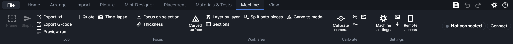
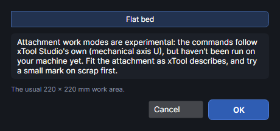
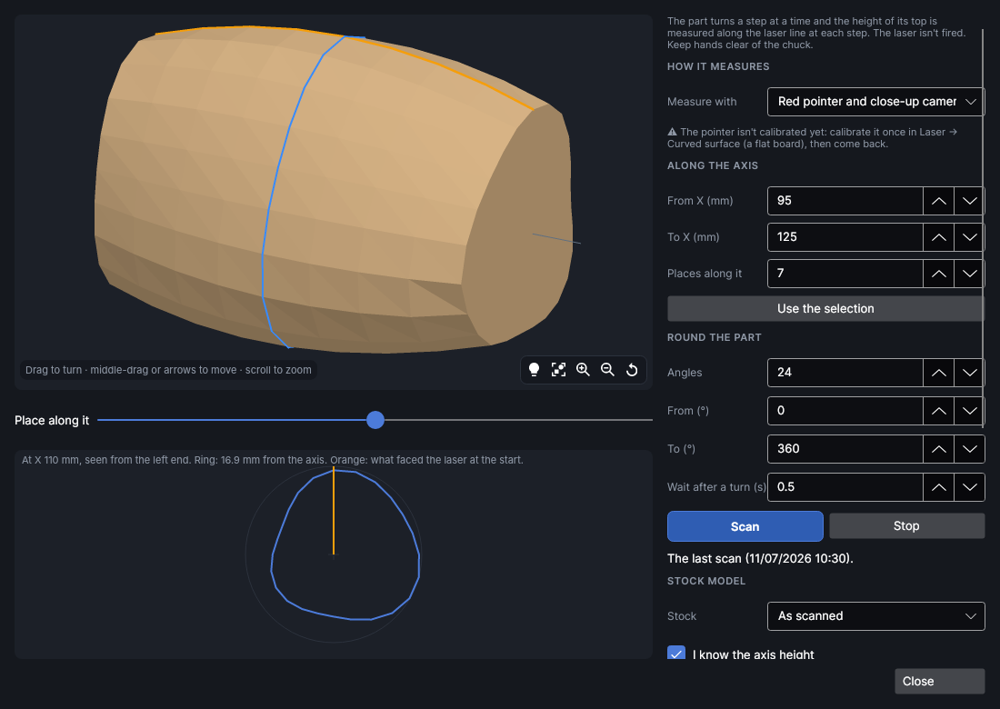
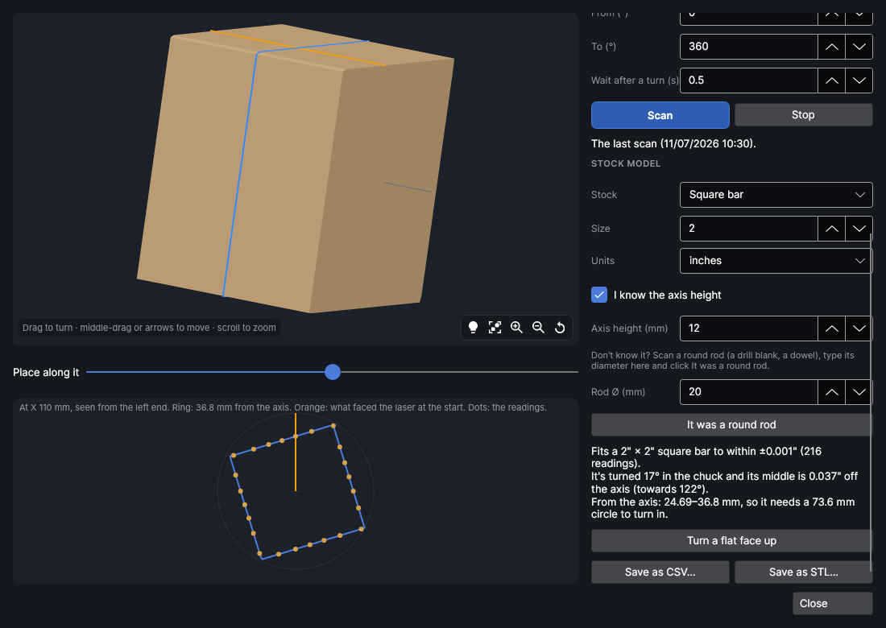
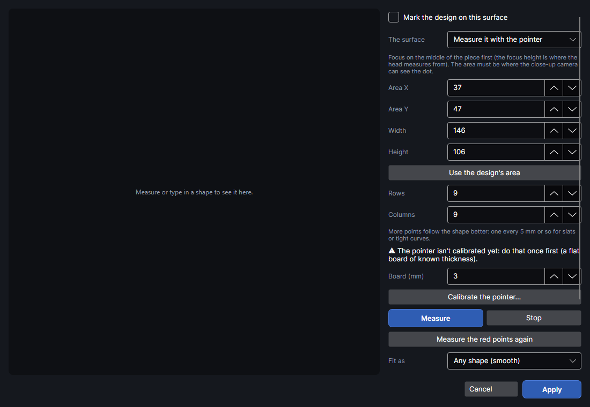
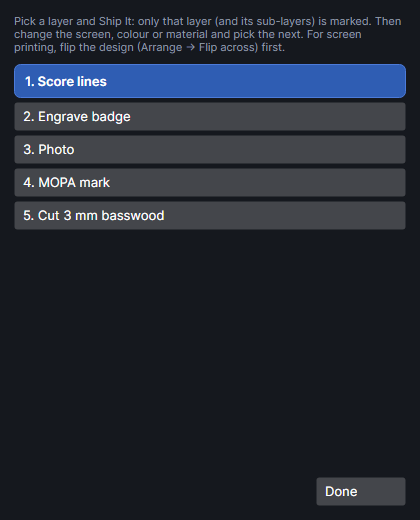
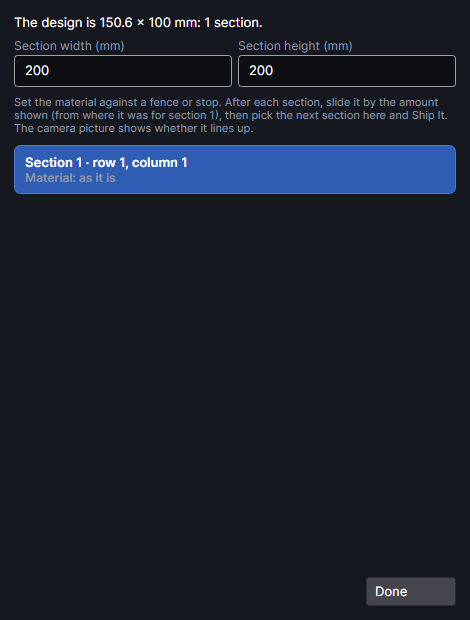

# Work area: rotary, curved, layer by layer, sections, pieces

The **Work area** group on the **Machine** tab changes where and how a job is marked: on a rotary
attachment or the conveyor instead of the flat bed, on a curved piece, one layer at a time, one
section at a time for a design bigger than the bed, or across several pieces that go together.

| Button | What it's for |
|---|---|
| **Work mode** | Flat bed, rotary attachment or conveyor, and their settings. Hidden unless you have an attachment. |
| **Curved surface** | Mark on a curved piece: the head follows it in height steps. |
| **Scan the part** | On the rotary: turn the part a step at a time and measure its top at each step, for a model of its shape. Shows only in the rotary work mode. |
| **Layer by layer** | Mark one layer at a time, with a stop between to change the screen, colour or material. |
| **Sections** | Mark a design bigger than the work area, moving the material between sections. |
| **Split onto pieces** | Mark one design across several pieces (four boards making one picture): a page per piece, lined up by the camera. From the Split onto pieces add-on, which has its own page under **Add-ons**. |
| **Carve to model** | Engrave rotary stock down to a 3D model. From the Carve stock to a model add-on, with its own page under **Add-ons**. |

In a narrow window, the small buttons show only their icons: hover over one for its name.

## Work mode

<!-- windows: WorkModeWindow -->

**Work mode** chooses what the job is marked on: the **Flat bed** (the usual 220 × 220 mm), a
**Rotary** attachment (round things: cups, tumblers, rings) or the **Conveyor** feeder (long pieces,
up to 610 mm).

> **Note:** The **Work mode** button is hidden until you tick an attachment in Settings →
> **Equipment** (**RA2 Pro rotary (rollers and chuck)**, **RA3 rotary (rollers and chuck)**,
> **My own rotary (homemade or another make)** or **Conveyor feeder**). You're asked this once when the program first starts. Only the attachments
> you tick are offered. Untick the one in use and jobs go back to the flat bed.

> **Warning:** The rotary and conveyor modes are experimental. Their commands follow xTool Studio's
> own (the mechanical U axis), but they haven't been run on the machine yet. Fit the attachment as
> xTool describes and try a small mark on scrap first. Every job made for them says so in the job
> bar.

Choose the mode at the top, set its settings, and click **OK**. The work area on the canvas changes
to the mode's size and the view fits it; the status bar says the mode. **Cancel** changes nothing.

### Rotary

| Setting | Range | Default | What it does |
|---|---|---|---|
| **Attachment** | the ones you have: RA2 Pro · rollers, RA2 Pro · chuck, RA3 · rollers, RA3 · chuck, Your own rotary | the first | Which attachment and how it holds the object. |
| **Object Ø (mm)** | 2 to 200 | 60 | The object's diameter where it's marked. With rollers it sets how far round the design goes; with the chuck it also sets the scale. |
| **Laser line (mm)** | 1 to 219 | 110 | Where the laser draws across the object, measured from the back edge of the 220 mm field (110 is the middle). Put it over the top of the object, along the rotary's axis. **Frame** a job to see the line, and change the number until the line sits there. |

- The work area becomes the field's width (220 mm) × once round the object. The window shows
  "Once round": π × the diameter. Only the first 375 mm can be used (xTool Studio's limit).
- Design X runs along the object (the galvo), design Y goes round it (the attachment turns it). The
  middle row of the design faces the laser at the start, unless the page has a **rotary start
  line**: an orange guide across the page labelled "Rotary start: faces the laser". Then that line
  faces the laser at the start, whatever is drawn. Pages made for the rotary (a stacked model's
  finishing page) have one; drag it like any guide, or drop it on the ruler to remove it.
- The camera photo on the canvas is a photo of the bed, so on the rotary it's shown at its real size
  with the laser line on the row that faces the laser (the rotary start line, or the middle of the
  design), and cut off at the edges of the work area. Directly round that row, what you see under
  the design is what's under it on the part now; further round the page it's the part's far side, which
  the photo can't show.
- A line drawn all the way round the object (from one edge of the area to the other, at the same
  place across) is cut once round and then **2 mm further**, over where it started. Otherwise the
  start and end meet at the one spot where the rotary is speeding up and slowing down, and a single
  pass leaves a short stretch there not cut through. A Cut layer's **Overcut** is used instead when
  it's longer (up to 10 mm). A line up to 1 mm short of round is closed the same way.
- The rotary never turns faster than 10 turns a second. Moves between paths, the turn to the start
  and the turn back at the end are held to that, and so is a layer's speed where it turns the object
  (a job check says when a layer is slowed down). The machine's own travel speed would spin a thin
  rod about 30 turns a second.
- On the rotary a layer's **Focus offset (mm)** can go up to 60 mm either way (10 mm on the flat
  bed), for surfaces much nearer the middle than where you focused.

#### Turning the rotary

The **Turn the rotary** box in the rotary settings turns the object straight away, with the laser
off. The rotary's motor is set to hold first, then turned, and it keeps holding the object still
afterwards. Keep hands clear of the chuck. If the machine won't turn it that way (older firmware),
the turn goes as a short laser-off job instead, which starts as soon as it arrives, after you confirm.

| Setting | Range | Default | What it does |
|---|---|---|---|
| **Turn by (°)** | −3600 to 3600 | 90 | How far to turn the object, in degrees. Positive turns it the way a design runs down the page; negative the other way. Click **Turn**. It saves the settings above first. |
| **Turn scale** | 1 to 100000 | worked out | The machine's units for one whole turn when it turns the rotary straight away. It starts from your scale and the belt factor stored on the machine (32 ÷ 0.7459 = 42.901 for a 32-a-turn chuck). If you've measured it over many turns, type the exact figure; it's kept when you click **OK**, **Turn** or **Turn once**. |
| **It made (turns)** | 0.05 to 20 | 1 | For the one-turn check: how many turns the object really made when you clicked **Turn once**. |

- **Turn once** turns the object one whole turn. Put a tape mark on the chuck first. If it doesn't come
  back to the mark, type how many turns it made under **It made (turns)** (a quarter past is 1.25, a
  quarter short 0.75) and click **Correct**. Turning outside a job uses the machine's conveyor feed,
  which has its own scale, so this check matters even when jobs already turn the right amount.
- **Stop turning** stops a turn part way.
- **Let the motor go** lets the motor go limp, so you can turn the object by hand.

The rotary has no home: each job starts wherever the object is, and turns it back to there at the
end. A job that is stopped part way (Stop, or a long press on the machine's button) skips that, so
the object is left turned and the next job starts in the wrong place. When a rotary job sent from
PhotonCanvas is stopped, the program works out how far the object had turned. It uses the
machine's own progress when it reports one, and the time otherwise. It then shows a **Rotary 85°**
chip (with the angle) in the job bar, and **Return rotary to start** in the Turn the rotary box.
Click it to turn the object back, or click **It's already back** if you turned it by hand. The angle
is worked out, not measured, so it can be a little out. A pencil line across the chuck and the
object shows what's left, and **Turn by (°)** takes up the rest. If you stop again before turning
back, the turns add up. The program only knows while it's open and connected.

#### Your own rotary

**Your own rotary** is a rotary you made (or another make) plugged into the machine's rotary port.
Tick **My own rotary (homemade or another make)** in Settings → **Equipment** first. It has its own
settings:

| Setting | Range | Default | What it does |
|---|---|---|---|
| **Holds the object** | Chuck, Rollers | Chuck | A chuck turns the object with the motor; rollers turn it by its surface. |
| **Units a turn** | 1 to 100000 | 128 | Chuck: the machine's units for one whole turn of the object. xTool's chucks take 128; other gearing or motor steps need their own number. |
| **Roller scale** | 0.001 to 1000 | 0.59917 | Rollers: the machine's scale for a millimetre of surface (the RA2 Pro's). |
| **It turns the other way** | off | off | Tick if a test mark comes out mirrored round the object (the motor turns the other way from xTool's). |

To check the scale, make a design as tall as the work area (once round), mark a line across it, and
put a tape flag on the object. Run it on scrap and count how far the object turned while it drew the
line. Only count that slow turn: the quick turns before and after just go to the start and back. If it isn't one
whole turn, type 1 under **Turns asked** and what it made under **Turns made** (a quarter is 0.25),
and click **Correct the scale**: the number is multiplied by asked ÷ made. Click **OK** to keep it,
and run the test again to check.

> **Warning:** The machine drives your rotary through its own port as if it were xTool's. Check
> the motor and wiring suit the port before you plug it in, and keep a hand near the stop button on
> the first test.
- With rollers the scale round the object is fixed (the RA3's is four times the RA2 Pro's). With
  the chuck it's worked out from the diameter, so the diameter must be right for the design to come
  out the right size.

### Conveyor

| Setting | Range | Default | What it does |
|---|---|---|---|
| **Belt calibration %** | 90 to 105 | 100 | The belt's calibration from xTool Studio's conveyor calibration. |
| **Angle** | −10 to 10 | 0 | The belt's angle compensation from the same calibration (0 if never calibrated). |

**Read from the machine** fills both in from the calibration stored on the machine (needs the
connection). The work area becomes 610 × 220 mm: design X moves the belt, and the laser draws across
it.

### Scan the part

<!-- windows: RotaryScanWindow -->

**Scan the part** (Machine tab, Work area group, in the rotary work mode) measures a part held in the
rotary before you mark or carve it: a glued stack of slices, a branch, a turned blank that isn't quite
round. The part is turned a step at a time, and at each step the height of its top is measured along
the laser line. Together the readings make a model of the stock: how far the surface reaches from the
rotary's axis all the way round and along it, shown in 3D. The laser is never fired, but the rotary
turns and the head moves up and down, so keep hands clear of the chuck. This is experimental and
hasn't been tried on the machine yet.

How it measures:

- **Pointer and close-up camera**: at each step the pointer is aimed at several places along the
  laser line and the close-up camera reads how far below the head's focus each dot lands (laser
  triangulation, the same as [Curved surface](#curved-surface)). Calibrate the pointer once first with
  **Calibrate along the laser line…** (below). You don't need to focus on the part first: at each angle
  the machine's own auto-focus finds the height of the part's top in the middle of the field (so keep
  part of the stock under X 110), then the pointer reads the places around that height. Each head height
  reads about 8 mm either side of it, so the head steps up through the heights that the auto-focus and
  the last angle found (a little either side), often in one height, and stops as soon as every place is
  read. If the auto-focus doesn't work, or nothing is read around its height (it caught the chuck, say),
  the head searches its whole range, which takes a minute or two longer.
  Only places within 5 mm of where the pointer was calibrated are read (X 80 to 185 mm along the laser
  line after **Calibrate along the laser line…**), so put the part of the stock you want scanned there.
  Places outside are skipped, and a warning under **Places along it** says how many. A spot further than
  8 mm from the head's focus isn't read at that head height (it's past what was calibrated): the head
  tries the next height up.
- **Calibrate along the laser line…** (shown with the pointer) calibrates the pointer over the strip a
  scan reads: X 85 to 180 mm, 10 mm either side of the laser line, 33 spots at each of 9 heights.
  Take the part out of the chuck, lay a flat, matt board on the bed where it was (about 95 × 20 mm
  along the line), and auto-focus on it: the focus is taken as the board's height. It takes about five
  minutes and replaces the saved calibration, which [Curved surface](#curved-surface) uses too (its
  calibrated area shows there). The head goes back to the board's focus afterwards.
  The pointer hops from place to place and stays on each for about half a second while it's
  photographed. If fewer than half the places are read, the status line says where the photos are
  (see [Measure it with the pointer](#measure-it-with-the-pointer)).
- **The machine's auto-focus**: one reading an angle, wherever the machine focuses (the middle of the
  field), but it reaches any height. Put the part's axis under the middle of the field.

| Setting | Range | Default | What it does |
|---|---|---|---|
| **Measure with** | Pointer and close-up camera, The machine's auto-focus | Pointer | How the top is measured (above). |
| **From X (mm)** / **To X (mm)** | 0 to 220 | 95 / 125 | Where along the rotary's axis to measure (the work area's X). Pointer only. |
| **Places along it** | 1 to 60 | 7 | How many places between them, at every step. |
| **Use the selection** | | | Sets the X range to the selected shapes (all of them if none is selected) and, on a rotary page, the angles to how far round they reach from the job's start (the rotary start line, or the middle of the design). This is how to say which area needs scanning. |
| **How many stops** | 2 to 360 | 4 | How many times it stops to measure on the way round. It's a count, not an angle: 4 over a whole turn is every 90°, 8 is every 45°. The line under the box shows the step and the angles. Choosing a **Stock** sets it to see every side: 4 for a rod or **As scanned**, 8 for a square or rectangular bar (each face and corner), 12 for a hexagon. |
| **From (°)** / **To (°)** | −3600 to 3600 | 0 / 360 | The span of the turn, from where the part is now. Positive is the way a design runs down the page. 0 to 360 is a whole turn (360 itself isn't measured again). |
| **Whole turn, every side** | | | Sets 0° to 360° and the stops for the stock chosen. |
| **Wait after a turn (s)** | 0 to 10 | 0.5 | Extra wait after each turn, for the part to stop moving. The machine doesn't say when a turn is done, so the wait is worked out from its length, plus this. Scan turns go at a third of the speed of Work mode's turns (a quarter turn takes about 1.6 s), so a heavy bar doesn't slip. |
| **Stock** | As scanned, Round rod, Square bar, Rectangular bar, Hexagon bar | As scanned | What the model is. **As scanned** uses what was measured. A standard stock (a 2" square bar, a round rod) is taken to be exactly that shape: the scan only works out how it sits in the chuck, and the model is the exact shape (see below). |
| **Size** / **Units** | 0.01 to 1000, mm or inches | 2 inches | The standard stock's size: a rod's diameter, a bar's width, a hexagon across the flats. |
| **Height** | 0.01 to 1000 | 2 inches | A rectangular bar's other side. |
| **I know the axis height** / **Axis height (mm)** | −200 to 200 | off | How high the rotary's axis is above the bed, the way you'd type a focus height. A part's top height minus this is how far it reaches from the axis. The 3D model needs it. |
| **Rod Ø (mm)** | 1 to 200 | 20 | For **It was a round rod**: the diameter of a round rod you scanned. |

- **Scan** asks first, then turns and measures. When it's done it turns the part back to where it
  started (on round on a whole turn, if that's shorter). The readings are kept for next time.
- **Stop** stops at once, where it is: the part isn't turned back. The window then shows **Return to
  start** with the angle, which turns it back.
- **It was a round rod**: if you don't know the axis height, put a round rod (a dowel, a drill blank)
  in the chuck, scan it over a whole turn, type its diameter and click this. The axis height is the
  average top height less the radius (allowing for a rod held a little off-centre). It stays right
  until the rotary is moved.
- **Turn the high side up** turns the part (the shorter way) so the highest point read is on top,
  under the laser line.
- The stock model as it stands (the fitted standard stock, or the scan) is kept for other tools to work
  from, with the axis height it was made with.
- **Save as CSV…** saves the readings as a spreadsheet, one row an angle and one column a place
  (distances from the axis, gaps filled, when the axis height is known; top heights otherwise).
  **Save as STL…** saves the stock model as a 3D file (needs a whole turn, two or more places and
  the axis height): X along the axis, the axis at 0, what faced the laser at the start on top (+Z).

#### Standard stock

When the part is a standard stock, choose it under **Stock** and type its size (for a 2" × 2" square
bar: **Square bar**, **Size** 2, **Units** inches). The readings are then only used to find how the
stock sits: how far it's turned in the chuck, how far its middle is off the axis, and (if **I know the
axis height** is off) the axis height too, which is then filled in. The model is the exact shape in
that place, so a few readings are enough: 8 stops round a square bar do. The readings show as dots
on the end-on view, over the fitted outline, and the words say how far the readings are from the
shape on average. Readings far from what the rest agree on (a misread spot) are left out, up to a third
of them, and the words say how many. Over 0.5 mm on average is a loose fit: the size is wrong or the
stock isn't that shape. Over 2 mm the readings don't match the shape at all, so it isn't a real result:
places were misread, and the log says what the camera saw at each point. **Turn the high side up** becomes
**Turn a flat face up**, which turns the bar (the shorter way) until the face nearest the top lies
level on top. The same shape is used all along the part, so a bar held crooked in the chuck fits
loosely.

What it shows:

- The 3D view: the stock model, the axis (grey), an orange line along what faced the laser when the
  scan started, and a blue ring round the place chosen with **Place along it**. Places that weren't
  read are filled in from the readings either side.
- Below it, that place end-on with the axis in the middle and the start (orange) at the top; without
  the axis height, its top height against the angle turned.
- In words: how many points were read, the highest and lowest, how much it rises and falls as it
  turns, and, fitting it as a round part, how far off the axis it sits and which angle its high side
  is at. With the axis height: the nearest and furthest the surface comes to the axis, so the circle
  it needs to turn in and the biggest round it could be cut to.

> **Note:** The angle at a point is the turn that brings it to the top, counted the way a rotary job
> turns the part, so it lines up with a rotary page: a point at angle θ sits θ/360 of the way round
> from the job's start line. Start the scan with the part where a job would start.

### What changes on an attachment

- Fill lines on the conveyor always run across the belt (90°): scan angles and turning per pass
  are left out.
- A picture layer's scan angle, crosshatch and turning per pass only work on the flat bed: on an
  attachment its pictures are burned in straight rows. The job bar warns.
- **Frame** only traces the galvo's own direction: a thin box across the middle of the field (the
  object or belt doesn't move while framing).
- **Curved surface** is left out, and **Sections** is greyed out.

## Curved surface

<!-- windows: CurvedSurfaceWindow -->

**Curved surface** marks a design on a piece that isn't flat: a bowl, a bottle lying on its side, a
barrel of slats, a board that sits at a slant. You give PhotonCanvas the shape (measured with the red
pointer and the close-up camera, or typed in), and every job is then marked in height bands that
follow it. It works on the flat bed only.

> **Warning:** Experimental, not yet tried on the machine: calibrating the pointer, measuring a
> real piece, and a curved job being accepted by the machine are all still to be checked. Try it on
> scrap first. Every curved job says so in the job bar.

### How a curved job is marked

The head doesn't follow the surface continuously: as xTool Studio does, it steps through height
bands, highest first (0.2 mm apart unless you change **Height steps**). In each band it marks just
the parts of the design whose surface lies in that band: lines are cut where they cross into the next
band, fill lines likewise, and pictures are split into one picture per band. The head's height for
each band is the surface's height there, less the layer's own focus offset, so focus offsets still
work.

In the job:

- Parts of the design outside the measured area get guessed heights: the job bar warns. Measure an
  area that covers the whole design.
- A Cut or Score layer's **Step down/pass** is left out: the head's height follows the surface
  instead. An Engrave layer's still lowers each pass further below the surface.
- A picture layer's scan angle, crosshatch and turning per pass are left out (straight rows).
- Fills leave out the pause before each line, overscan and turning per pass; the job bar says so.
- With fewer than 3 measured heights (and no typed shape), the design is marked flat; the job bar
  says so.
- With a rotary or conveyor work mode, the curved surface is left out.

### The window

Before anything is measured, the left side shows the bed from above (*Seen from above: what Measure
will do*): the area to measure in blue with a white dot for each spot the pointer will be aimed at
(red when the area runs off the bed), the square the pointer is calibrated on in green, and your
design in orange, with grid lines every 20 mm.

Once there's a surface, the left side is a 3D view of it: a mesh over the area, the measured points (white; red
when they disagree with their neighbours) and your design's outline lying on it. Drag to turn it, scroll to zoom, middle-drag or the arrow keys to move
it, and press **F** to see it all again.
Heights are drawn taller than life so small curves show; the corner says by how much, and the range
of heights.

- **Mark the design on this surface**: tick it to have jobs follow the surface. Untick it to keep
  the measurements but mark flat.
- **The surface**: **Measure it with the pointer**, or **Type in a cylinder or drum**.
- **Height steps (mm)** (0.05 to 1, default 0.2): how far the head moves between bands. Smaller
  follows the surface more closely and takes longer.
- **Apply** keeps the surface with the design (saved with it; `Ctrl+Z` undoes it). **Cancel**
  closes without changing anything: points measured in the window are only kept by **Apply** (a
  pointer calibration is kept either way).

While the window is open the rest of the program waits; the window has its own **Auto-focus**
buttons for the board and the piece.

With **Measure it with the pointer**, the right side is laid out as numbered steps: **1 · Calibrate
the pointer (once)**, **2 · Focus on the piece**, **3 · Where to measure**, **4 · Measure** and
**5 · Check the shape**.

### Calibrate the pointer

Measuring uses the pointer and the close-up camera: the camera looks at the pointer at a slant, so its spot
lands in a different place in the close-up picture as the surface rises or falls. Calibrating once
records that. The spot doesn't have to be a round dot: on the F2 Ultra it's a short line. The program
finds the whole spot, its middle and which way it runs, and reads a line by where it crosses the path
the spot was seen to move along during calibration, so it doesn't matter how much of the line shows.
It looks for whatever got brighter, so any colour of pointer works. (Calibrations made before version
0.1.102 used only the brightest part of the spot: calibrate again once.) It's kept for good, and **Focus on selection** on the Machine tab uses it too.

This is step 1 in the window. Once it's done the step says *✓ Calibrated on a … mm board* with the
date, and there's nothing more to do there; calibrate again only if the head or its camera gets
knocked.

1. Put a flat, matt board (plywood, MDF or card, not shiny) across the middle of the bed, about
   95 × 30 mm. The green strip in the picture on the left is where it has to be. On the rotary, take
   the part out and lay the board where it goes.
2. Click **Auto-focus on the board**: its focus height becomes **Board thickness**. Or measure the
   board with calipers and type it in (0.5 to 150 mm). It starts at the board used last time, else
   3 mm. It must be right: any error in it is added to every height measured later.
3. Click **Calibrate…** and **Start**. The head moves up and down, 8 mm either side of
   its focus on the board, in nine steps of 2 mm. At each step the pointer stops on 44 spots over
   X 85 to 180 and Y 95 to 125 (as far along as the close-up camera sees it) and is photographed. The
   laser isn't fired. About seven minutes. Spots more than 5 mm outside the calibrated area aren't read.

It fails if the dot was seen in fewer than a third of the photos: check the close-up camera sees the
area, and that the board isn't shiny. The calibration is saved with the board thickness and date.

### Measure it with the pointer

**2 · Focus on the piece**: put the piece in and focus on its middle (**Auto-focus now**, or type
its height at the right end of the ribbon): heights are measured from the focus height, up to 8 mm
above or below it. The step shows the focus height the machine has now.

**3 · Where to measure** is a rectangle on the bed, in mm from the bed's top-left corner as it shows
on the canvas. The pointer is aimed at **Rows** × **Columns** spots spread evenly over it.

| Setting | Range | Default | What it does |
|---|---|---|---|
| **X (left edge)**, **Y (top edge)** | 0 to 220 mm | see below | The rectangle's top-left corner. |
| **Width (mm)**, **Height (mm)** | 2 to 220 mm | see below | Its size. It must stay on the 220 × 220 mm bed, and where the close-up camera can see the dot. |
| **Rows**, **Columns** | 3 to 40 | 9 × 9 | How many points. More follow the shape better: one every 5 mm or so for slats or tight curves. |

Under them a line says how many spots that is, how far apart, and about how long measuring takes. It
warns when the area runs off the bed (**Measure** then won't start), and when it reaches well
outside the calibrated area: spots up to 5 mm outside it are worked out by extending the
calibration, so they may be less exact; spots further out aren't read.

The area starts as the one measured last, else the design's area plus 3 mm, else a 50 mm square in the
middle of the bed. **Use the design's area** sets it to the selection's area (or the whole design's)
plus 3 mm round it. In the rotary work mode the canvas is the part unrolled, not the bed, so the design's
area is changed to where it is on the bed now: X as it is, and Y with the row that faces the laser on the
laser line (Work mode's **Laser line**), so a design over the rod on the canvas is measured over the rod.
The design drawn in the window's plan is moved the same way, and the line under the boxes says so.

**4 · Measure**:

- **Measure** checks the machine is idle, moves the head to the focus height, turns the fill lights
  on (to at least 50%, so the close-up camera can see the part), and for each point aims the pointer and photographs it with the close-up camera (each photo is
  compared with one with the pointer off, so only the dot is left). The pointer is turned off while
  it moves to the next point, then held still on it for about half a second while it's photographed,
  so you see it hop from spot to spot rather than streak across. The lights and pointer are put
  back afterwards. The status line says how many points were read: a point can't be read when the dot
  isn't seen, or the surface there is more than 8 mm from the focus.
- When points aren't read, look in the [data folder](machine.md#the-data-folder): the **pointer-photos**
  folder has the newest measurement's photos, and the day's diary in **logs** says for each point
  whether a spot was seen, where, and how long it was.
- **Stop** stops measuring.
- Points more than 0.6 mm from the smooth surface through the other points are shown red and left
  out of the fit. **Measure the red points again** measures just those (the button only shows when there are some).

**5 · Check the shape**: choose how the points become a surface:

| **Fit as** | For | Notes |
|---|---|---|
| **Any shape (smooth)** | Bowls, waves, anything | A smooth sheet through or near every point. **Smoothing** (0 to 1, default 0.3): 0 goes through every point exactly, 1 is very smooth and rides over bad points. |
| **Cylinder** | A round object lying on its side | The best cylinder through the points (6 points at least); its diameter is shown. |
| **Drum of flat slats** | A barrel or slatted tube | A many-sided drum with flat faces. **Slats round it** (3 to 200, default 12): the faces round the whole object. The size across the flats is shown. |
| **Flat, at a slant** | A flat piece that doesn't lie level | A tilted plane. |

The line underneath says how many points there are and how closely they sit on the surface.

### Type in a cylinder or drum

For a round object lying on its side. Measure it with calipers: that's far more exact than the
pointer.

| Setting | Range | Default | What it does |
|---|---|---|---|
| **Shape** | Cylinder, Drum of flat slats | Cylinder | Round, or made of flat slats. |
| **Slats round it** | 3 to 200 | 12 | Drum only: the faces round the whole object. |
| **Axis runs** | Front to back (along Y), Left to right (along X) | Front to back | Which way the object lies on the bed. |
| **Axis X**, **Axis Y** | −100 to 320 mm | 110, 110 | A point the axis passes through, seen from above. **Axis through the design's middle** puts it there. |
| **Top height** | 1 to 150 mm | 50 | The height of the top above the bed, as you'd focus on it. |
| **Diameter** | 2 to 400 mm | 80 | For slats: across the flats. |

## Layer by layer

<!-- windows: LayerByLayerWindow -->

**Layer by layer** marks one layer at a time, with a stop between layers to change something: the
screen and ink colour when making screen-printing screens, or the material or its colour. Each
layer is its own job, sent with **Ship It** as usual.

The window lists the layers that would be marked (output layers with shapes on them), numbered in
order. The first one is picked when it opens.

1. Click a layer: from now on the job bar builds a job of only that layer (and its sub-layers).
2. **Ship It** and press the machine's start button.
3. Change the screen, colour or material, then click the next layer and ship again.
4. **Done** closes the window, and jobs mark the whole design again.

The window stays open beside the canvas while you work. For screen printing, flip the design first
(Arrange tab → **Flip across**; see [Arranging](arrange.md)); **CMYK split** on the Picture tab makes
one picture per ink, each on its own layer (see [Pictures](pictures.md)).

> **Note:** Serial numbers and spreadsheet rows move on once, after the last layer's job finishes
> (not after each layer), so every layer of a piece marks the same number.

## Sections

<!-- windows: SectionsWindow -->

**Sections** marks a design bigger than the 220 × 220 mm work area, a section at a time: the material
is moved by hand between sections, against a fence or stop, so the pieces meet. Greyed out unless the
work mode is the flat bed. Not yet burned on the machine (it's built from commands already checked).

**Mark in sections** says how big the design is (everything on output layers) and how many sections
that makes.

| Setting | Range | Default | What it does |
|---|---|---|---|
| **Section width (mm)** | 10 to 220 | 200 | The largest width of one section. |
| **Section height (mm)** | 10 to 220 | 200 | The largest height of one section. |

The design is cut into a grid of sections that size, numbered row by row from the top left. Each
section is marked in the same place: the middle of the work area. Under each section the list says
how to move the material for it, from where it was for section 1 ("Material: as it is" for the first;
then, say, "move it 200 mm left from where it was for section 1").

1. Set the material against a fence or stop, placed for section 1.
2. Click **Section 1 · row 1, column 1**: the canvas outlines that part of the design ("Marking
   this section") and the job bar builds a job of only that part. **Frame** traces where it will
   land.
3. **Ship It** and press the machine's start button.
4. Slide the material by the amount shown for the next section, click it, and ship again. The camera
   picture shows whether it lines up.
5. **Done** closes the window, and jobs mark the whole design again.

How the sections are cut: lines are cut at the section's edge; fills keep their whole outline and are
clipped line by line, so the lines meet across sections; pictures are clipped dot by dot. Serial
numbers and spreadsheet rows only move on after the last section.

## Try it

- [Mark on a rotary or the conveyor](tutorial:area-work-mode)
- [Calibrate the pointer](tutorial:area-calibrate-pointer)
- [Scan a part in the rotary](tutorial:area-rotary-scan)
- [Mark on a curved piece](tutorial:area-curved-surface)
- [Mark one layer at a time](tutorial:area-layer-by-layer)
- [Mark a design bigger than the bed](tutorial:area-sections)
