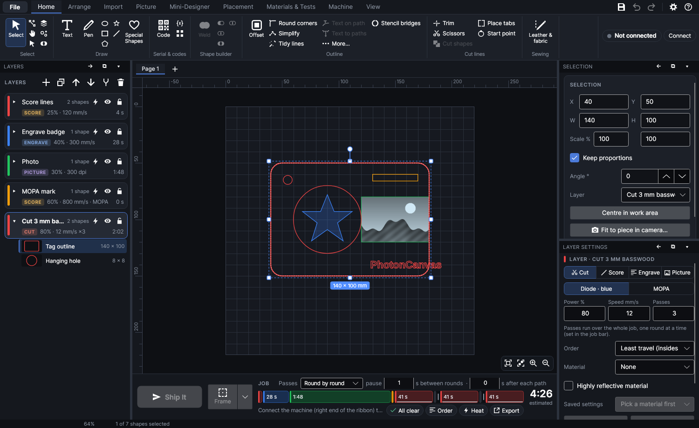
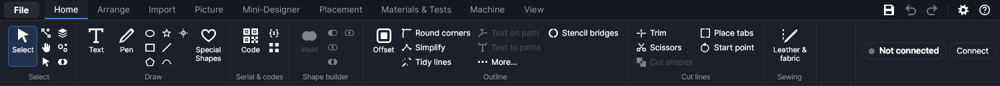
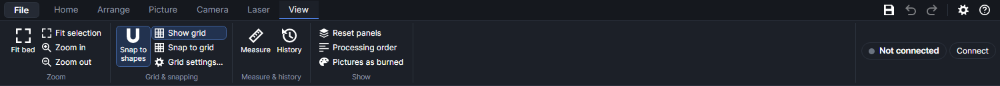
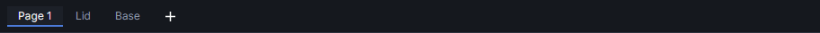
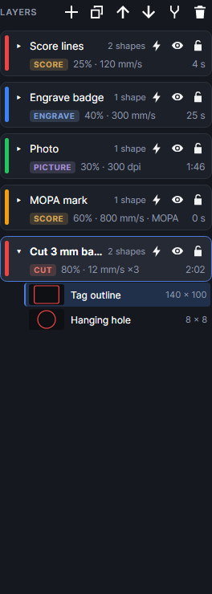
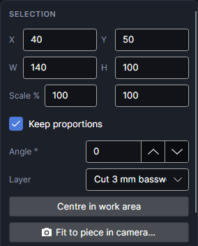
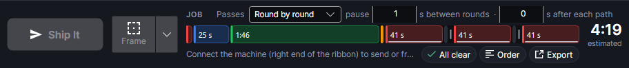
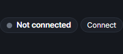

# The workspace

A tour of the main window: what each part is for and where to find things. How to select, move,
zoom and snap on the work area itself is on [Working on the canvas](canvas.md).

## The window at a glance

1. **The ribbon** along the top: the commands, in tabs. The **File** button sits at its left end;
   **Save**, **Undo**, **Redo**, **Settings** and **Help** at its right end.
2. **The machine panel** at the right end of the ribbon, whichever tab is open: the connection,
   the cameras, the lights and the focus height.
3. **The Layers panel** on the left: every layer, what it does and how long it takes.
4. **The tool options bar** and **the pages bar** above the work area.
5. **The work area** (the canvas) in the middle: the machine's 220 × 220 mm field, with rulers.
6. **The job bar** under the work area: **Ship It**, **Frame**, the run order and the time.
7. **The Selection** and **Layer settings** panels on the right.
8. **The status bar** along the bottom: the cursor position, the zoom and messages.

The window's title shows the design's name ("Untitled" until it's saved) and a • while it has
changes that aren't saved yet.

## The ribbon

The commands are grouped in tabs. Click a tab's name to open it. Each group has its name under it.
Hover over any button for a tip saying what it does (and its shortcut, if it has one); hover over
a tab's name for what the tab holds.

| Tab | Groups | Explained in |
|---|---|---|
| **Home** | Clipboard, Select, Draw, Serial & codes, Group, Shape builder, Outline, Bring in | [Working on the canvas](canvas.md) (Clipboard, Select), [Drawing](drawing.md), [Editing shapes](editing-shapes.md), [Files](files.md) |
| **Arrange** | Align, Flip & rotate, Order, Repeat, Transform | [Arranging](arrange.md) |
| **Picture** | Add, Turn it into, Shape, Edit, Relief, Clean up | [Pictures](pictures.md) |
| **Camera** | See the bed, Place, Set up | [Camera](camera.md) |
| **Laser** | Materials, Colour on metal, Job, Work area, Machine | [Materials and tests](materials-and-tests.md), [Running a job](running-jobs.md), [Work area](work-area.md), [The machine and settings](machine.md) |
| **View** | Zoom, Grid & snapping, Measure & history, Show | [The View tab](#the-view-tab) below |

- A button that can't do anything right now is greyed out. **Group** needs two or more shapes
  selected, most of the **Picture** tab's commands need a picture selected, and so on. **Paste** is
  always on, since a picture or SVG copied in another program can be pasted too.
- When a picture is selected, the **Picture** tab's name lights up.
- Some buttons and groups only appear when you have the equipment, or have chosen to show the
  feature, in Settings → Equipment: **Work mode** (a rotary or the conveyor), the
  **Colour on metal** group and button, **Diffraction**, and **Console**. See
  [The machine and settings](machine.md).
- The ribbon opens on the tab you used last, also after a restart.

### Folding the ribbon

Double-click any tab's name to fold the ribbon down to its row of tabs, for more room on the
work area. Click a tab's name to bring it back.

### When the window is narrow

When a tab doesn't fit, labels give way a group at a time from the right: first the small
buttons' labels, then the big buttons' labels. The icons stay, and their tips still say what each
one does. If it still doesn't fit, the ribbon scrolls sideways.

### The File button

**File**, left of the tabs, opens the file menu:

| Items | What they do |
|---|---|
| **New** (`Ctrl+N`), **New from template…**, **Open…** (`Ctrl+O`), **Open recent** | Start or open a design. See [Files](files.md). |
| **Save** (`Ctrl+S`), **Save as…** (`Ctrl+Shift+S`), **Save as template…**, **Earlier versions…** | Save the design, keep it as a template, or go back to an earlier version. See [Files](files.md). |
| **Import…** (`Ctrl+I`), **Import, one layer per colour…** (`Ctrl+Shift+I`), **Import picture…** (`Ctrl+J`) | Bring in drawings and pictures. See [Files](files.md). |
| **Export job package (.xf)…**, **Export G-code (.gcode)…** | Save the job to a file instead of sending it. See [Running a job](running-jobs.md). |
| **Export design as SVG…**, **DXF…**, **PNG…** | Save the drawing for other programs. See [Files](files.md). |
| **Settings…** | The settings window, at its Machine page. See [The machine and settings](machine.md). |
| **Keyboard shortcuts…** | Change the shortcuts. See [Keyboard shortcuts](keyboard-shortcuts.md#changing-shortcuts). |
| **Fonts…** | Star the fonts you use and hide the rest. See [Drawing](drawing.md). |
| **Exit** | Close the program (it asks first if there are unsaved changes). |

### The buttons at the top right

| Button | What it does |
|---|---|
| **Save** (the disk) | Saves the design (`Ctrl+S`). The first time, it asks where. |
| **Undo**, **Redo** (the curved arrows) | Undo the last change, or redo it (`Ctrl+Z`, `Ctrl+Y`). The tip names the step, for example "Undo Move shape". Greyed when there's nothing to undo or redo. See [Undo, redo and history](canvas.md#undo-redo-and-history). |
| **Settings** (the gear) | The settings window: machine connection, camera calibration, grid, libraries, equipment, appearance, updates. See [The machine and settings](machine.md). |
| **Help** (the ?) | The help menu: see [The Help menu](#the-help-menu). |

## The View tab

| Button | What it does | More |
|---|---|---|
| **Fit bed** | Shows the whole work area (`Home`). | [Zooming and panning](canvas.md#zooming-and-panning) |
| **Fit selection** | Zooms to the selection, or to the whole design when nothing is selected (`F`). | [Zooming and panning](canvas.md#zooming-and-panning) |
| **Zoom in**, **Zoom out** | Zoom about the middle of the view (`Ctrl+=` and `Ctrl+-`). | [Zooming and panning](canvas.md#zooming-and-panning) |
| **Snap to shapes** | On: dragged shapes line up with other shapes, guides and the work area's edges and centre lines. | [Snapping](canvas.md#snapping-the-grid-and-guides) |
| **Show grid** | Shows or hides the grid on the work area. | [The grid](canvas.md#the-grid) |
| **Snap to grid** | On: dragged shapes land on the grid's minor lines. | [The grid](canvas.md#the-grid) |
| **Object snaps** | On: points you pick land on other shapes' ends, middles, centres, quadrants and crossings, and square onto or touching a line (`F3`). | [Object snaps](canvas.md#object-snaps) |
| **Snap points…** | A menu to tick each kind of object snap on or off, and **Tracking**. | [Object snaps](canvas.md#object-snaps) |
| **Grid settings…** | Grid spacing and colours, and how close something must be to snap. | [Grid settings](canvas.md#grid-settings) |
| **Measure** | A tool: drag between two points to measure. | [Measure](canvas.md#measure) |
| **History** | Every step you can undo, to go back to any of them (`Ctrl+H`). | [Undo, redo and history](canvas.md#undo-redo-and-history) |
| **Reset panels** | Puts the Layers, Selection and Layer settings panels back where they started. | [Moving, floating and folding panels](#moving-floating-and-folding-panels) |
| **Processing order** | Colours the paths on the work area by when they run, first to last. | [Processing order](canvas.md#processing-order) |
| **Pictures as burned** | Shows pictures as they'll come out on their material. | [Pictures as burned](canvas.md#pictures-as-burned) |

The toggles (**Snap to shapes**, **Show grid**, **Snap to grid**, **Object snaps**,
**Processing order**, **Pictures as burned**) look pressed while they're on, and are remembered between runs, except
**Processing order**, which starts off.

## The work area

The middle of the window is the work area: the machine's 220 × 220 mm field on a darker
surround, with rulers along the top and left. Everything about working on it (selecting, moving,
zooming, snapping, guides, measuring, editing points, the right-click menu) is on
[Working on the canvas](canvas.md).

- Drag a file from your computer onto the window to import it, or drop a project file to open
  it. See [Files](files.md).
- The close-up camera's picture opens in the bottom-right corner of the work area
  (Camera → **Close-up**). See [Camera](camera.md).

## The pages bar

A project can hold several pages. Each page is a design of its own, with its own layers, shapes
and guides, and its own job: **Ship It**, **Frame** and the job bar always work on the page on
screen. All the pages are saved together in the one project file.

The pages bar, just above the work area, has a tab for each page and a **+** after them.

- Click a page's tab to show it.
- **+** adds a new, empty page after the one on screen, with the same layers and layer settings,
  and shows it. New pages are called Page 2, Page 3 and so on.
- Double-click the tab of the page on screen to rename it.
- Right-click a tab for **Rename…**, **Duplicate** (a copy of the page, with everything on it,
  placed after it and named "… copy"), **Move left**, **Move right** and **Delete page**. A
  project always keeps at least one page.

Showing another page, adding, moving, renaming and deleting pages are all undo steps.

## The tool options bar

While a tool with settings or a tip is chosen, a strip appears above the pages bar. Values you set
here are kept between runs.

| Tool | What the bar shows |
|---|---|
| **Polygon** | **Sides**: 3 to 64 (6 to start with). |
| **Star** | **Points**: 3 to 64 (5 to start with), and **Inner size %**: 5 to 95 (50 to start with), how far in the inner corners are. |
| **Pen**, **Text** | A line saying how the tool works. |
| **Pick piece** | **Tolerance**, **Smoothness**, **Corners** and **Ignore under**: how the outline of a piece on the camera picture is found. |
| **Trace edge** | **Smoothness** and **Corners**, and how the tool works. |
| **Edit points** | The keys for editing points. See [Edit points](canvas.md#edit-points). |

The drawing tools and their settings are explained in [Drawing](drawing.md).

## The side panels

Three panels sit beside the work area: **Layers** on the left, **Selection** and **Layer
settings** on the right. Each has a slim title bar with buttons to move it, float it or fold it.

### The Layers panel

One card per layer, top to bottom in the order they run: the layer's colour, name, how many
shapes it has, whether it's sent to the laser, shown and locked, what it does (cut, score,
engrave, picture), its power and speed, and how long it takes. Click a layer to see its settings
in **Layer settings**; the arrow on a card lists its shapes. New drawings and imports go on the
active layer. Everything about layers is in [Layers](layers.md).

### The Selection panel

The Selection panel shows where the selected shapes are, how big they are and how they're
turned, and lets you type exact values. A change applies straight away, and typing into one box
counts as a single undo step. Lengths are in millimetres, or inches if you chose them (see
[Units and colours](#units-and-colours)).

| Setting | What it does |
|---|---|
| **X**, **Y** | Where the selection's top-left corner is, measured from the work area's top-left corner (0, 0): X to the right, Y down. −1000 to 1000 mm. Type a value to move it there. |
| **W**, **H** | The selection's width and height (the box around it). 0.01 to 2000 mm. Typing a value resizes it from its top-left corner. A box is greyed when the selection has no size in that direction (a straight horizontal or vertical line). |
| **Scale %** | Two boxes: the size across and down compared with the shape as drawn or imported (100 = original), along the shape's own sides, so a turned shape stretches without slanting. 0.1 to 100 000. Each shape keeps its centre; several shapes keep their spacing in proportion. "mixed" when the selected shapes differ. |
| **Keep proportions** | Ticked (the default): changing **W**, **H** or one **Scale %** box changes the other by the same amount. Unticked: they change separately. |
| **Angle °** | The shape's own rotation, clockwise, from −180 to 180; 0 = as drawn or imported. The arrows step 15°. Shapes that share an angle turn together about the selection's centre; otherwise each turns about its own centre. "mixed" when they're turned differently. |
| **Layer** | The layer the selected shapes are on. Choose another to move them there (`Ctrl+1` to `Ctrl+9` also do it). "Several layers" when they're on more than one. |
| **Centre in work area** | Moves the selection so its centre sits in the middle of the 220 × 220 mm work area. |
| **Fit to piece in camera…** | Snaps the selection onto the real piece the camera sees: moves, turns and (if you choose) resizes it to match. See [Camera](camera.md). |

The line under the buttons says how many shapes are selected. When part of the selection is
outside the work area it adds, in orange, "⚠ Partly outside the work area – it can't be sent
like this." Move it back inside before you send the job.

More cards appear under the selection card for some kinds of shape, when one of them is
selected on its own:

- **Text**: the words, font, size and the other text settings. See [Drawing](drawing.md).
- **Shape**: a rectangle, ellipse, polygon or star drawn with its tool stays editable: its width,
  height, corner radius, sides or points. See [Drawing](drawing.md).
- **Code**: what a QR code, Data Matrix or barcode says, with **Edit code…** and
  **Variables…**. See [Drawing](drawing.md).
- **Picture**: brightness, contrast, gamma, sharpen and invert, and buttons to trace it, make a
  depthmap or remove its background. See [Pictures](pictures.md).

With nothing selected, the panel shows a **Nothing selected** card: how many shapes and layers
the design has and how big it is ("The design is empty." when there's nothing), with a reminder
that layer settings live with the layers and that the job bar shows what will run.

### The Layer settings panel

The settings of the active layer: what it does (**Cut**, **Score**, **Engrave**, **Picture**),
which laser (**Diode · blue** or **MOPA**), **Power %**, **Speed mm/s**, **Passes** and everything
else, with the material it's for. Selecting shapes that are all on one layer makes that layer
active, so its settings come up. Every setting is explained in [Layer settings](layer-settings.md).

### Moving, floating and folding panels

Each panel's title bar has three buttons at its right:

| Button | What it does |
|---|---|
| **→** or **←** | Moves the panel to the other side of the work area (it goes below the panels already there). |
| **⧉** | Floats the panel in a window of its own, which you can move and size anywhere, even onto another screen. Close that window to dock the panel back. |
| **▾** / **▸** | Folds the panel to its title bar, or opens it again. |

- Panels on the same side share its height. Drag the line between two open panels to share it
  differently. A folded panel takes only the height of its title.
- Drag the line between a side and the work area to make that side wider or narrower.
- A side with no panel on it closes up, and the work area takes the room.
- A floating window remembers its place and size for the next time that panel floats. If you
  close the program while a panel floats, it floats again next time.
- Where every panel is, and how wide the sides are, is kept between runs.
- View → **Reset panels** puts everything back where it started: **Layers** on the left,
  **Selection** and **Layer settings** on the right, the usual widths, no floating windows.

A tutorial that points at a folded panel opens it by itself.

## The job bar

Under the work area, always in view: what will run, in what order and for how long. It's rebuilt
as you change the design, so it's always current.

- **Ship It** uploads the job; the machine waits for its start button. While a job runs it
  becomes **Pause** and **Stop**.
- **Frame** traces around the job with a faint laser dot to show where it lands; its arrow
  chooses a rectangle or a snug outline, and the frame's power and speed.
- **Passes**: **Round by round** or **Path by path**, with the pause between rounds and after
  each path.
- The timeline: a block for each layer, as long as it takes, in the order they run. Click a block
  to bring up that layer's settings.
- The total time, estimated.
- **All clear** (or the number of checks worth reading), **Order** (the same as
  View → **Processing order**) and **Export**.

Everything about the job bar is in [Running a job](running-jobs.md).

## The machine panel

At the right end of the ribbon, whichever tab is open.

- The status: **Not connected**, or the machine and its state (idle, running, paused, framing…).
  Click it to connect or disconnect, to calibrate the camera or to open the machine settings.
  **Connect** connects to the last machine, or the one found on the network.
- When connected: **Photo**, **Show** and **Live** for the camera picture under the design,
  **Close-up** for the camera in the laser head, **Lights**, and the **Focus** height (▼ and ▲,
  or type it) with **Auto-focus**.

See [The machine and settings](machine.md) and [Camera](camera.md).

## The status bar

Along the bottom of the window, from left to right:

- **The cursor position** over the work area, for example "X 40   Y 50 mm".
- **The zoom**, for example "64%".
- **Messages**: what's selected ("1 of 7 shapes selected"), or the design ("7 shapes · 5 layers"),
  what the tool in use expects next, and the result of the last command (for example a
  measurement). With an empty design it says how to start: "Draw with the Home tab, or drag a
  file in (SVG, DXF, PDF, pictures). New material? Laser → Test grid."

## The Help menu

The **?** at the top right opens the help menu:

| Item | What it opens |
|---|---|
| **Help guide** (`F1`) | This guide. `F1` in any other window opens the guide at the page about that window. See [Welcome](index.md). |
| **Tutorials** | The list of tutorials: short guided walks through each feature. See [Welcome](index.md). |
| **Getting started** | The short tour shown at the first start, with the connection setup. See [The first start](getting-started.md#the-first-start). |
| **Keyboard shortcuts** | Every shortcut on one page, with **Change shortcuts…** to change them. See [Keyboard shortcuts](keyboard-shortcuts.md). |
| **Safety and disclaimer** | The safety notice and the disclaimer you accepted at the first start. |
| **About PhotonCanvas** | The version, the licence (free to use, all rights reserved) and credits. |

The same items are on the **Help** page of the settings window.

## Units and colours

In Settings → Appearance:

- **Lengths in**: **Millimetres** or **Inches**. This changes the rulers, the cursor position, the
  size shown under a selection, measurements, and the Selection panel's position and size. Layer
  settings (speed, line spacing, kerf…), the grid spacing and nudging with the arrow keys stay in
  millimetres.
- **Colours**: **Dark** (the default) or **Light**. The change takes effect the next time the
  program starts.

## Try it

- [Find your way around the window](tutorial:ws-tour)
- [Move, float and fold the panels](tutorial:ws-panels)
- [Several pages in one project](tutorial:ws-pages)
- [Move, resize and turn shapes](tutorial:ws-move)
- [See the run order and pictures as burned](tutorial:ws-view)
- [Find help in the program](tutorial:ws-help)
