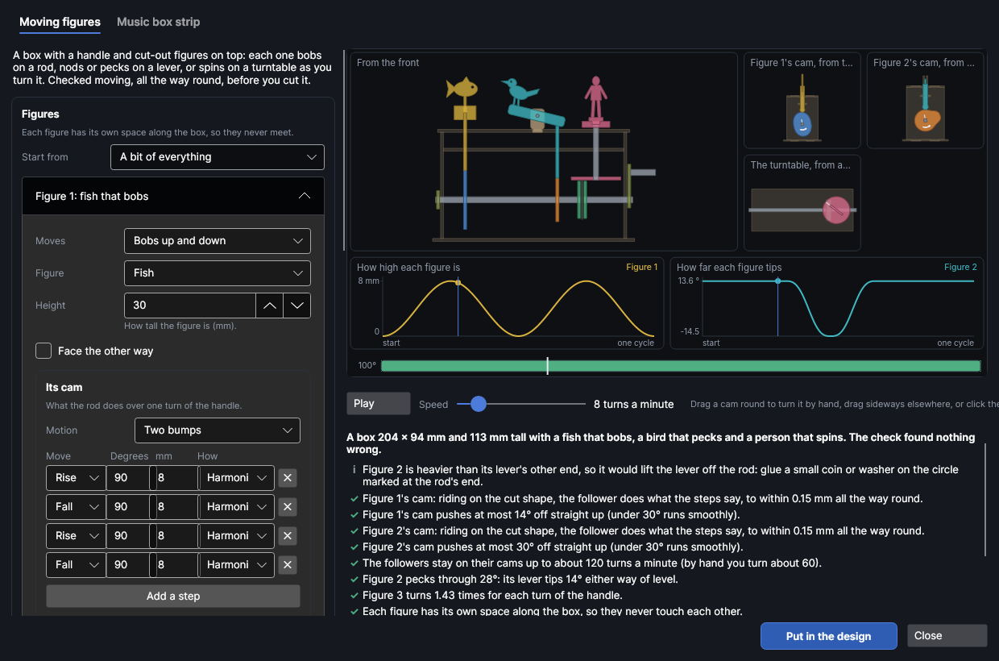
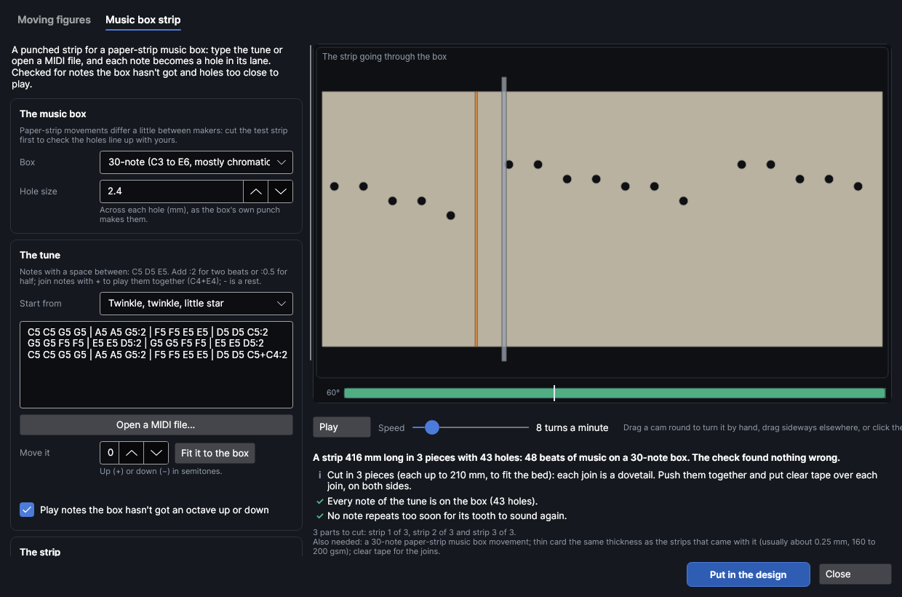

# Toys and automata

An add-on (Settings → Add-ons → **Toys and automata**): on when PhotonCanvas is installed, and can be turned off. It uses the [mechanism maker](mechanisms.md)'s cams and motion check, so that add-on must be on too. Its button is **Home → Draw → Automata**, and **Edit toy…** is on the right-click menu of a toy's parts.

**Automata** makes two kinds of toy, cut from sheet material:

- **Moving figures**: a crank box with cut-out figures on top. Turning the handle turns a shaft along
  the box, and each figure moves its own way: it **bobs** up and down on a rod, **nods** or **pecks**
  on a lever, or **spins** round on a turntable. Watch it move first: the check turns it all the way
  round, looking for cams the rods can't follow, levers tipped too far, turntables that would slip
  and handles that hit the base.
- **Music box strip**: a punched strip for a paper-strip music box (the little hand-crank movements
  that play a strip of card). Type the tune or open a MIDI file; each note becomes a hole in its
  lane. The check finds notes the box hasn't got, repeated notes too close to sound and holes so
  close the card would tear.

Then it puts the parts in the design, named and marked, on a cut layer with your material's kerf.

> **Note:** The toys have been checked on screen and in tests, but not yet cut on the machine. Cut
> your first box in card or scrap plywood, and cut the music box's test strip (every note once)
> before a long tune: makers' strips differ a little.

## The Toys and automata window
<!-- windows: AutomataWindow -->

Click **Automata** on the **Home** tab (in the **Draw** group). The **Toys and automata** window
opens over the program.

- **Top:** a tab for each kind, **Moving figures** and **Music box strip**. Each keeps its own
  settings while you look at the other.
- **Left:** its settings, and the **Material** it's cut from. Every change is checked again straight
  away.
- **Right:** the toy moving: the box from the front with every figure, each cam from the handle's
  side, the turntables from above, and charts of how high each figure is and how far each lever
  tips. For a strip, the strip going past the box's comb, its notes lighting up as they play.
- **Under that:** a one-line summary, each thing the check found (✓ fine, **i** good to know, **!**
  worth fixing, ✕ a problem to fix), the parts to cut and what else you need (dowels, rubber bands,
  a coin, the music box movement).
- **Put in the design** puts the parts in your design (see [Put it in the design](#put-it-in-the-design)).
  **Close** (or `Esc`) closes the window; your settings are kept for next time.

**Play** / **Pause** starts and stops it, and **Speed** is how fast the handle turns, 1–60 turns a
minute. Drag a cam round to turn it by hand; in the front view (or the strip), drag sideways. Click
the strip along the bottom to go to that point; it's red where something goes wrong.

## Moving figures

The box is the mechanism maker's automaton box, with figures on it instead of plain platforms: a
square shaft along the box with a handle on one end, a shelf under the top, and tabs in slots made
for your sheet's thickness. Each figure has its own space along the box, wide enough for everything
it does, so no two figures ever meet.

**Start from** picks a ready-made box: **A bit of everything** (a fish bobbing, a bird pecking, a
dancer spinning), **Pecking birds**, **Boats on the waves**, **Dancer and flowers**, **Nodding cat**
and **Rocket launch**. Change anything and it becomes **Your own**. Each figure has its own section
(**Figure 1: a fish that bobs**…): click one to open it. **Add a figure** adds another (up to 6);
**Take this figure away** removes one.

| Setting | What it does |
|---|---|
| **Moves** | **Bobs up and down**, **Nods or pecks on a lever** or **Spins on a turntable**. |
| **Figure** | Which cut-out: a **Bird**, **Fish**, **Cat**, **Person**, **Boat on waves**, **Flower**, **Star**, **Heart**, **Rocket**, **Tree** or a **Blank card (draw your own)** to draw or stick a picture on. **None (put your own on)** leaves the rod, lever or stand bare for a figure you make yourself. |
| **Height** | How tall the figure is, 10–150 mm. |
| **Face the other way** | Turns the figure round. |

### Bobbing

The figure rides on top of its own rod, which its cam lifts and lets down. The figure slots onto the
rod's top with a cross joint: a slot up from the bottom of the figure's little plinth, a slot down
from the top of the rod, each half the joint deep, so they lock at right angles and the figure faces
the front of the box. The plinth is wider than the slot in the top, so the figure can't drop in.

**Its cam** sets what the rod does over one turn of the handle, step by step, exactly as in the
mechanism maker's [cam and follower](mechanisms.md#cam-and-follower): **Motion** picks a ready-made one
(**Up and down**, **Up, wait, down, wait**, **Two bumps**…), or set each step's **Move** (Rise,
Wait, Fall, Drop), **Degrees** and **mm**. **Base radius**, **Foot** and **Foot size** are the cam's
smallest radius and the end of the rod that rides on it. **Starts** sets how far into its steps
each cam is when the handle starts, so the figures don't all move together.

### Nodding and pecking

The figure stands on the end of a lever. The lever tips on a pin between two posts slotted into the
top, and its cam's rod pushes up under it: as the rod rises, the lever tips. The lever rests on the
rod (it's level when the rod is half way up), so its weight keeps it down.

| Setting | What it does |
|---|---|
| **Pivot** | From the rod to the lever's pivot, 14–80 mm. Further away tips it more gently: the check says how far it tips. |
| **Arm** | From the pivot to where the figure stands, 0–150 mm. |
| **Figure behind the pivot: it dips as the rod rises (a peck, a hammer)** | Puts the figure on the far side of the pivot, facing away from it, so its head goes down as the rod comes up: a pecking bird, a hammer blow. |

A figure behind the pivot is usually heavier than the lever's other end, which would lift the lever
off its rod: then a circle is engraved at the rod's end, and the check asks you to glue a small coin
or washer on it.

The check says how far each lever tips: under 35° each way of level runs smoothly; past 55° the rod
would slip off it. The pivot is set high enough that the lever and its figure never touch the top.

### Spinning

The figure stands on a turntable. Inside the box, a drive wheel on the shaft (three discs: two sides
and a smaller middle for a rubber band or O-ring to sit in) presses up under a disc on an upright
spindle, off its middle. Turning the handle turns the wheel, and the band turns the disc. The
spindle goes up through the shelf and the top to a two-layer stand that the figure slots into.

| Setting | What it does |
|---|---|
| **Wheel** | The drive wheel's radius with its band on, 8–60 mm. |
| **Offset** | From the turntable's middle to where the wheel touches it, 4–60 mm. The figure turns **Wheel ÷ Offset** times for each turn of the handle: a smaller offset spins it faster. |

Over 4 turns for each turn of the handle the check warns that the band may slip; an offset so small
the wheel would rub the spindle is a problem.

### The box

| Setting | What it does |
|---|---|
| **Crank** | From the shaft to the handle, 10–120 mm (default 28). The shaft sits high enough for the handle to clear the base. |
| **Handle turns** | **Anticlockwise** or **Clockwise**, looking at the handle's side. It matters for cams with a sudden drop. |
| **Shaft** | The shaft's width, 2–25 mm (default 6). **Square shaft: sets every cam's timing by itself** (on by default) gives the cams and wheels square holes, so they turn with it and stay in step. |
| **Pivot pins** | The dowel the levers tip on, 1–10 mm (default 3: a bamboo skewer). It turns freely in the lever and is held snug in the posts. |
| **Spindles** | The round dowel each turntable turns on, 2–12 mm (default 5). |
| **Band** | How thick the rubber band or O-ring round each drive wheel is, 1–6 mm (default 2.5). |

What else you need is listed under the picture: the shaft and handle dowels (with lengths), pivot
pins, spindles, rubber bands, coins and glue.

## Music box strip

For a hand-crank paper-strip music box movement: the strip goes in one side, and wherever a hole
passes a tooth of the comb, that note plays.

**The music box**

| Setting | What it does |
|---|---|
| **Box** | **30-note (C3 to E6, mostly chromatic)**: 70 mm strips, lanes 2 mm apart, the first 6 mm in. **15-note (C major, two octaves)**: 41 mm strips, lanes 2 mm apart, the first 6.5 mm in. **Another box (set its sizes)** shows **Strip width**, **Lane spacing**, **First lane** (from the edge to the lowest note's holes) and **Its notes** (lowest first, as names: C3 D3 G3…). Measure a strip that came with your box. |
| **Hole size** | Across each hole, 0.5–6 mm (default 2.4), as the box's own punch makes them. |

**The tune** is written as notes with a space between: a name and an octave, like `C5 D5 E5`
(`F#5` or `Bb4` for sharps and flats). Add `:2` for two beats, `:0.5` for half a beat (or `:1/2`);
one beat when there's nothing. Join notes with `+` to play them together (`C4+E4+G4`), write `-` for
a rest, and use `|` between bars if you like (it's ignored). Anything the check can't read is listed
in red.

- **Start from** fills in a tune: **Twinkle, twinkle, little star**, **Ode to Joy (Beethoven)**,
  **Frère Jacques**, **Greensleeves (opening)**, or **Every note, lowest first (a test strip)**.
  Typing changes it to **Your own**.
- **Open a MIDI file…** reads a `.mid` file into the tune as text you can change: every track and
  channel except the drums, each note put on the nearest quarter of a beat, starting at its first
  note, and moved to the key that fits the box best.
- **Move it** moves every note up (+) or down (−) in semitones; **Fit it to the box** picks the move
  that leaves the fewest notes out.
- **Play notes the box hasn't got an octave up or down** (on by default) plays a note the box lacks
  an octave or two away, where it has one; otherwise it's left out. Either way the check says how
  many.

**The strip**

| Setting | What it does |
|---|---|
| **Beat** | How much strip one beat takes, 2–40 mm (default 8). Longer plays slower for the same turning and gives repeated notes more room. |
| **Lead-in** | Blank strip before the first note, 5–100 mm (default 30), with a pointed end to feed it in by. An arrow engraved near the start shows which way it goes in. |
| **Lanes from the other edge** | As if the strip were turned over: for a box that reads its lowest note from the other edge. (If a cut strip plays upside down, you can also just turn it over.) |

What the check looks for:

- Notes the box hasn't got, and notes moved an octave.
- The same note again too soon: closer than the hole size plus 0.8 mm and the holes run together and
  the card tears (a problem); closer than about twice the hole size and the tooth may not have
  sprung back to play it again (worth fixing). A longer **Beat** fixes both.
- Two neighbouring notes at once where the lanes are closer than the holes are wide: their holes
  run into one.

A strip longer than the bed is cut into pieces, each as long as fits, joined where there are no holes
nearby. Each join is a dovetail (a tab on one piece that locks into a notch in the next); where the
notes are too close together for one, a straight join. Pieces are numbered in the margin. Push them
together in order and put clear tape over each join, on both sides, so it runs smoothly through the
box. Cut strips from thin card the same thickness as the ones that came with the box (usually about
0.25 mm, 160–200 gsm), with your card's cut settings picked under **Cut with** so the holes come out
their drawn size.

## Material and kerf

**Cut with** lists the cut settings in your material library. Picking one brings its thickness and,
from your cut test (Laser → Tests → **Cut test**, see [Materials and tests](materials-and-tests.md)), its kerf and slot fit; the kerf is set on the
cut layer so parts come out their drawn size. **Thickness** and **Slot fit** (moving figures only)
set the slots for the box's tabs, the cross joints and the posts. **Engrave the parts' names and
marks** engraves names, numbers, the cams' turning arrows and lining-up ticks, and the coin circles
on a light Score layer, before the parts are cut out.

## Put it in the design

**Put in the design** puts the parts on a page of their own (when the page shown already has
something on it), on two layers:

- **Toy · cut**: the parts' outlines, cut with your material's settings.
- **Toy · marks**: names and marks, engraved lightly first, while the sheet is still whole.

Each part's outline and marks are grouped, and the parts are nested onto the bed by their real
shape; what doesn't fit goes on further pages, a bed each. To change a toy later, right-click one of
its parts and choose **Edit toy…**: the window opens with its settings, and **Update in the design**
replaces the old parts (from every page) with the new ones.
