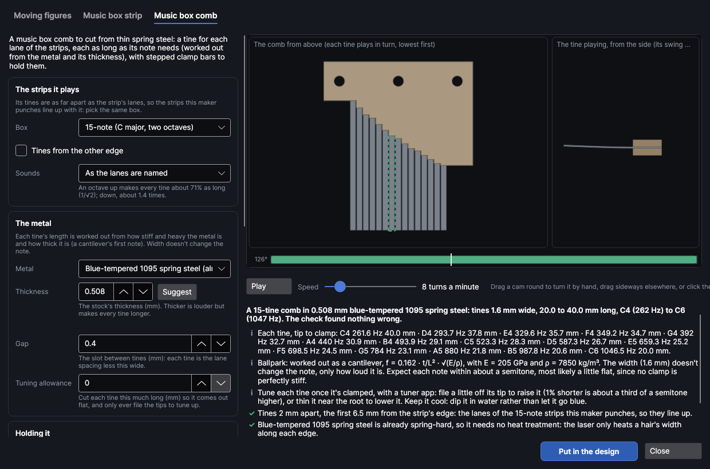

# Toys and automata

An add-on (Settings → Add-ons → **Toys and automata**): on when PhotonCanvas is installed, and can be turned off. It uses the [mechanism maker](mechanisms.md)'s cams and motion check, so that add-on must be on too. Its button is **Home → Draw → Automata**, and **Edit toy…** is on the right-click menu of a toy's parts.

**Automata** makes two kinds of toy, cut from sheet material:

- **Moving figures**: a crank box with cut-out figures on top. Turning the handle turns a shaft along
  the box, and each figure moves its own way: it **bobs** up and down on a rod, **nods** or **pecks**
  on a lever, or **spins** round on a turntable. Watch it move first: the check turns it all the way
  round, looking for cams the rods can't follow, levers tipped too far, turntables that would slip
  and handles that hit the base.
- **Music box strip**: a punched strip for a paper-strip music box (the little hand-crank movements
  that play a strip of card). Type the tune or open a MIDI file; each note becomes a hole in its
  lane. The check finds notes the box hasn't got, repeated notes too close to sound and holes so
  close the card would tear.
- **Music box comb**: the steel comb that plays the notes, to cut from thin spring steel on a fiber
  laser. Each tine is as long as its note needs, worked out from the metal and its thickness, and
  the tines are as far apart as the strip's lanes, so the strips it punches line up with it. Two
  thick clamp bars hold each tine at its root.

Then it puts the parts in the design, named and marked, on a cut layer with your material's kerf.

> **Note:** The toys have been checked on screen and in tests, but not yet cut on the machine. Cut
> your first box in card or scrap plywood, and cut the music box's test strip (every note once)
> before a long tune: makers' strips differ a little.

## The Toys and automata window
<!-- windows: AutomataWindow -->

Click **Automata** on the **Home** tab (in the **Draw** group). The **Toys and automata** window
opens over the program.

- **Top:** a tab for each kind, **Moving figures**, **Music box strip** and **Music box comb**. Each keeps its own
  settings while you look at the other.
- **Left:** its settings, and the **Material** it's cut from. Every change is checked again straight
  away.
- **Right:** the toy moving: the box from the front with every figure, each cam from the handle's
  side, the turntables from above, and charts of how high each figure is and how far each lever
  tips. For a strip, the strip going past the box's comb, its notes lighting up as they play. For
  a comb, the comb from above with each tine lit in turn, and that tine from the side, plucked and
  ringing.
- **Under that:** a one-line summary, each thing the check found (✓ fine, **i** good to know, **!**
  worth fixing, ✕ a problem to fix), the parts to cut and what else you need (dowels, rubber bands,
  a coin, the music box movement).
- **Put in the design** puts the parts in your design (see [Put it in the design](#put-it-in-the-design)).
  **Close** (or `Esc`) closes the window; your settings are kept for next time.

**Play** / **Pause** starts and stops it, and **Speed** is how fast the handle turns, 1–60 turns a
minute. Drag a cam round to turn it by hand; in the front view (or the strip), drag sideways. Click
the strip along the bottom to go to that point; it's red where something goes wrong.

## Moving figures

The box is the mechanism maker's automaton box, with figures on it instead of plain platforms: a
square shaft along the box with a handle on one end, a shelf under the top, and tabs in slots made
for your sheet's thickness. Each figure has its own space along the box, wide enough for everything
it does, so no two figures ever meet.

**Start from** picks a ready-made box: **A bit of everything** (a fish bobbing, a bird pecking, a
dancer spinning), **Pecking birds**, **Boats on the waves**, **Dancer and flowers**, **Nodding cat**
and **Rocket launch**. Change anything and it becomes **Your own**. Each figure has its own section
(**Figure 1: a fish that bobs**…): click one to open it. **Add a figure** adds another (up to 6);
**Take this figure away** removes one.

| Setting | What it does |
|---|---|
| **Moves** | **Bobs up and down**, **Nods or pecks on a lever** or **Spins on a turntable**. |
| **Figure** | Which cut-out: a **Bird**, **Fish**, **Cat**, **Person**, **Boat on waves**, **Flower**, **Star**, **Heart**, **Rocket**, **Tree** or a **Blank card (draw your own)** to draw or stick a picture on. **None (put your own on)** leaves the rod, lever or stand bare for a figure you make yourself. |
| **Height** | How tall the figure is, 10–150 mm. |
| **Face the other way** | Turns the figure round. |

### Bobbing

The figure rides on top of its own rod, which its cam lifts and lets down. The figure slots onto the
rod's top with a cross joint: a slot up from the bottom of the figure's little plinth, a slot down
from the top of the rod, each half the joint deep, so they lock at right angles and the figure faces
the front of the box. The plinth is wider than the slot in the top, so the figure can't drop in.

**Its cam** sets what the rod does over one turn of the handle, step by step, exactly as in the
mechanism maker's [cam and follower](mechanisms.md#cam-and-follower): **Motion** picks a ready-made one
(**Up and down**, **Up, wait, down, wait**, **Two bumps**…), or set each step's **Move** (Rise,
Wait, Fall, Drop), **Degrees** and **mm**. **Base radius**, **Foot** and **Foot size** are the cam's
smallest radius and the end of the rod that rides on it. **Starts** sets how far into its steps
each cam is when the handle starts, so the figures don't all move together.

### Nodding and pecking

The figure stands on the end of a lever. The lever tips on a pin between two posts slotted into the
top, and its cam's rod pushes up under it: as the rod rises, the lever tips. The lever rests on the
rod (it's level when the rod is half way up), so its weight keeps it down.

| Setting | What it does |
|---|---|
| **Pivot** | From the rod to the lever's pivot, 14–80 mm. Further away tips it more gently: the check says how far it tips. |
| **Arm** | From the pivot to where the figure stands, 0–150 mm. |
| **Figure behind the pivot: it dips as the rod rises (a peck, a hammer)** | Puts the figure on the far side of the pivot, facing away from it, so its head goes down as the rod comes up: a pecking bird, a hammer blow. |

A figure behind the pivot is usually heavier than the lever's other end, which would lift the lever
off its rod: then a circle is engraved at the rod's end, and the check asks you to glue a small coin
or washer on it.

The check says how far each lever tips: under 35° each way of level runs smoothly; past 55° the rod
would slip off it. The pivot is set high enough that the lever and its figure never touch the top.

### Spinning

The figure stands on a turntable. Inside the box, a drive wheel on the shaft (three discs: two sides
and a smaller middle for a rubber band or O-ring to sit in) presses up under a disc on an upright
spindle, off its middle. Turning the handle turns the wheel, and the band turns the disc. The
spindle goes up through the shelf and the top to a two-layer stand that the figure slots into.

| Setting | What it does |
|---|---|
| **Wheel** | The drive wheel's radius with its band on, 8–60 mm. |
| **Offset** | From the turntable's middle to where the wheel touches it, 4–60 mm. The figure turns **Wheel ÷ Offset** times for each turn of the handle: a smaller offset spins it faster. |

Over 4 turns for each turn of the handle the check warns that the band may slip; an offset so small
the wheel would rub the spindle is a problem.

### The box

| Setting | What it does |
|---|---|
| **Crank** | From the shaft to the handle, 10–120 mm (default 28). The shaft sits high enough for the handle to clear the base. |
| **Handle turns** | **Anticlockwise** or **Clockwise**, looking at the handle's side. It matters for cams with a sudden drop. |
| **Shaft** | The shaft's width, 2–25 mm (default 6). **Square shaft: sets every cam's timing by itself** (on by default) gives the cams and wheels square holes, so they turn with it and stay in step. |
| **Pivot pins** | The dowel the levers tip on, 1–10 mm (default 3: a bamboo skewer). It turns freely in the lever and is held snug in the posts. |
| **Spindles** | The round dowel each turntable turns on, 2–12 mm (default 5). |
| **Band** | How thick the rubber band or O-ring round each drive wheel is, 1–6 mm (default 2.5). |

What else you need is listed under the picture: the shaft and handle dowels (with lengths), pivot
pins, spindles, rubber bands, coins and glue.

## Music box strip

For a hand-crank paper-strip music box movement: the strip goes in one side, and wherever a hole
passes a tooth of the comb, that note plays.

**The music box**

| Setting | What it does |
|---|---|
| **Box** | **30-note (C3 to E6, mostly chromatic)**: 70 mm strips, lanes 2 mm apart, the first 6 mm in. **15-note (C major, two octaves)**: 41 mm strips, lanes 2 mm apart, the first 6.5 mm in. **Another box (set its sizes)** shows **Strip width**, **Lane spacing**, **First lane** (from the edge to the lowest note's holes) and **Its notes** (lowest first, as names: C3 D3 G3…). Measure a strip that came with your box. |
| **Hole size** | Across each hole, 0.5–6 mm (default 2.4), as the box's own punch makes them. |

**The tune** is written as notes with a space between: a name and an octave, like `C5 D5 E5`
(`F#5` or `Bb4` for sharps and flats). Add `:2` for two beats, `:0.5` for half a beat (or `:1/2`);
one beat when there's nothing. Join notes with `+` to play them together (`C4+E4+G4`), write `-` for
a rest, and use `|` between bars if you like (it's ignored). Anything the check can't read is listed
in red.

- **Start from** fills in a tune: **Twinkle, twinkle, little star**, **Ode to Joy (Beethoven)**,
  **Frère Jacques**, **Greensleeves (opening)**, or **Every note, lowest first (a test strip)**.
  Typing changes it to **Your own**.
- **Open a MIDI file…** reads a `.mid` file into the tune as text you can change: every track and
  channel except the drums, each note put on the nearest quarter of a beat, starting at its first
  note, and moved to the key that fits the box best.
- **Move it** moves every note up (+) or down (−) in semitones; **Fit it to the box** picks the move
  that leaves the fewest notes out.
- **Play notes the box hasn't got an octave up or down** (on by default) plays a note the box lacks
  an octave or two away, where it has one; otherwise it's left out. Either way the check says how
  many.

**The strip**

| Setting | What it does |
|---|---|
| **Beat** | How much strip one beat takes, 2–40 mm (default 8). Longer plays slower for the same turning and gives repeated notes more room. |
| **Lead-in** | Blank strip before the first note, 5–100 mm (default 30), with a pointed end to feed it in by. An arrow engraved near the start shows which way it goes in. |
| **Lanes from the other edge** | As if the strip were turned over: for a box that reads its lowest note from the other edge. (If a cut strip plays upside down, you can also just turn it over.) |

What the check looks for:

- Notes the box hasn't got, and notes moved an octave.
- The same note again too soon: closer than the hole size plus 0.8 mm and the holes run together and
  the card tears (a problem); closer than about twice the hole size and the tooth may not have
  sprung back to play it again (worth fixing). A longer **Beat** fixes both.
- Two neighbouring notes at once where the lanes are closer than the holes are wide: their holes
  run into one.

A strip longer than the bed is cut into pieces, each as long as fits, joined where there are no holes
nearby. Each join is a dovetail (a tab on one piece that locks into a notch in the next); where the
notes are too close together for one, a straight join. Pieces are numbered in the margin. Push them
together in order and put clear tape over each join, on both sides, so it runs smoothly through the
box. Cut strips from thin card the same thickness as the ones that came with the box (usually about
0.25 mm, 160–200 gsm), with your card's cut settings picked under **Cut with** so the holes come out
their drawn size.

## Music box comb

The comb is the row of steel teeth (tines) in a music box: each one is a little springy beam, held
at its root and free at its tip, that rings at one note when it's plucked. This tab makes one to cut
from thin spring steel on a fiber laser, for the strips the **Music box strip** tab punches (or any
other notes you give it).

### How the tines are worked out

Each tine is a cantilever ringing in its first bending mode:

`f = 0.162 × t / L² × √(E / ρ)`

where `t` is the metal's thickness, `L` the tine's length from its tip to the clamp, `E` how stiff
the metal is (Young's modulus) and `ρ` how heavy (its density). So for one sheet of metal, each
tine's length is `L = √(k × t / f)`: a note an octave up wants a tine about 71% as long (1/√2), and
stock twice as thick makes every tine about 1.4 times as long. For blue-tempered spring steel
(`E` = 205 GPa, `ρ` = 7850 kg/m³), `k` is about 825 500 with `t` and `L` in mm: middle C (261.6 Hz) in
0.508 mm steel is 40.0 mm long, and C6 (1046.5 Hz) 20.0 mm.

The **width** isn't in the formula (a wider tine is stiffer and heavier in step), so it only sets how
loud the tine is and how hard it is to pluck. Here it's the strip's lane spacing less the **Gap**
between tines: 2 mm lanes and a 0.4 mm gap make 1.6 mm tines.

It's ballpark, which is plenty for a toy: the notes come out within about a semitone, most likely a
little flat, because no clamp is perfectly stiff. Real combs are tuned by grinding, and so is this
one (see [Tuning it](#tuning-it)). The check lists every tine's note, frequency and length.

### Settings

**The strips it plays**

| Setting | What it does |
|---|---|
| **Box** | The movement whose strips it plays: **15-note** or **30-note**, or **Another box (set its sizes)** to give the **Strip width**, **Lane spacing**, **First lane** and **Its notes**, as on the strip tab. The tines are the lane spacing apart, the lowest one the first lane in from the strip's edge, so the comb and the strips line up. |
| **Tines from the other edge** | The lowest note at the other end, as **Lanes from the other edge** on the strip. |
| **Sounds** | The comb an octave or two up or down from the lanes' names. The strips play the same tune in any octave; up makes the tines shorter, down longer. |

**The metal**

| Setting | What it does |
|---|---|
| **Metal** | **Blue-tempered 1095 spring steel** (the default, already hardened), **Annealed 1075 or 1095** (to harden after cutting), **301 stainless, full hard**, **Phosphor bronze** or **Brass**. Each has its own stiffness and weight, so its own tine lengths. |
| **Thickness** | The stock's thickness, 0.1–3 mm (default 0.508 mm, 0.020"). **Suggest** picks the thickest shim sold (0.010" to 0.040") that keeps the bass tine within 45 mm, the treble tine at least 10 mm and the tines at least twice as wide as they're thick. Picking cut settings under **Cut with** whose material is 1.2 mm or thinner brings its thickness. |
| **Gap** | The slot between neighbouring tines, 0.1–2 mm (default 0.4). Narrower makes wider, louder tines, but below about 0.25 mm ringing tines may touch, and the slivers cut out of the slots may not drop free. |
| **Tuning allowance** | Cuts every tine this much longer (0–5 mm, default 0), so they all come out flat and you only ever file the tips to bring them up. |

**Holding it**

| Setting | What it does |
|---|---|
| **Line the tips up, as on a real comb** | On (the default): the tips are in one line, where the strip plucks them, and the roots step back, longer for lower notes. The clamp bars have the same stepped edge. Off: the roots are in one line and the tips step instead, so a plain straight bar clamps it, but whatever plucks it must reach each tip. |
| **Base** | Solid metal behind the longest tine's root, 6–40 mm (default 12), where the bolts go. |
| **Clamp bars** | The clamp bars' thickness, 1–10 mm (default 3). |
| **Bolts** | Their size, M1.5 to M8 (default M3). There's a bolt about every 25 mm, at least two. |

The base also reaches 8 mm past the outside tines on each side. Two **Clamp bars** with the same
outline sandwich the comb's base: each one's front edge steps to sit exactly on each tine's root,
which is what sets the tine's length (and so its note). Cut both from steel plate, 3 mm or thicker,
or thick aluminium: wood or acrylic gives a little, and the notes go flat and dull. Stack them all
the same way up (don't turn a bar over: its steps would then be the wrong way round), the engraved
bar on top, and bolt through. The top bar is engraved with each tine's note by its root, and two
ticks where the strip's edges are.

What the check looks for:

- The tines on the strip's lanes (always, for a box from the list).
- Tines short and stubby for their thickness (under 10 mm, or under 12 times the thickness): hard to
  pluck and tune, and likely flat. Thinner stock, or the comb an octave down, lengthens them.
- Tines over 60 mm: they ring quietly and can buzz. Thicker stock, or the comb an octave up,
  shortens them (real combs weight their bass tines with lead instead).
- Tines less than 1.5 times as wide as they're thick, which wobble sideways as well as up and down.
- A gap under 0.25 mm.
- Annealed steel, which must be hardened after it's cut.

### The stock

Real combs are hardened spring steel: hardness hardly changes a tine's note (steel's stiffness is the
same soft or hard), but a soft tine bends and stays bent the first time it's plucked hard, and sounds
dull. The easy way is metal that's already spring-hard:

- **Blue-tempered 1095 spring steel shim** (sold in 0.010" to 0.040" sheets and rolls) is hardened
  and tempered to about HRC 48–52. Cut it and use it: the laser only heats a hair's width along each
  edge.
- **301 stainless, full hard** is as good and doesn't rust; it can't be hardened by heat, so it must
  be bought full hard.
- **Phosphor bronze** (spring temper) and **brass** (half hard) ring more softly and die away
  sooner, but cut and file easily.

0.5 mm (0.020") is a good start for a 15-note comb (tines 20 to 40 mm); **Suggest** finds the size
for other notes. Thicker is louder but makes every tine longer and stiffer to pluck.

### Hardening annealed spring steel

Annealed (soft) 1075 or 1095 cuts and flattens more easily, but must be hardened and tempered after
cutting:

1. **Harden:** heat the comb evenly to just past non-magnetic (a magnet stops sticking), about
   800–830 °C, cherry red, in a forge, a heat-treat oven or with a big torch.
2. **Quench** at once in warm oil (canola at about 50 °C, or quenching oil), outdoors, with a lid to
   hand. A thin comb warps in a plain quench: clamp it between two thick steel or aluminium plates
   instead (a plate quench). It's now glass-hard and will snap if bent.
3. **Clean** the scale off with fine abrasive, so you can see the temper colour.
4. **Temper** to spring hardness: an hour at about 370–400 °C (700–750 °F), for about HRC 45–50. A
   kitchen oven can't get that hot; a heat-treat oven or a toaster-oven-sized kiln can. Tempered
   too low (straw coloured), the tines are brittle and snap.

Hardening and tempering change the notes very little, but check them again afterwards.

### Cutting it on a fiber laser

> **Safety:** Cutting steel throws sparks and molten metal. Keep the lid shut, nothing flammable on
> or under the bed, and the fume extraction on.

Fiber lasers cut thin metal by taking off a little with each pass. For the comb:

- **Many quick passes, not a few slow ones**, so the thin tines don't heat up, warp, or lose their
  temper (tempered steel softens past about 300 °C).
- **Start from:** 100% power, about 100 mm/s, 30 to 40 kHz, and the longest pulse your laser has
  (on a MOPA laser, 350 to 500 ns). Add passes until it drops through: about 20 to 40 for 0.5 mm.
  Run a cut test on an offcut first (**Laser → Tests → Cut test**), and pick its settings under
  **Cut with**, so the kerf is allowed for and the tines come out their drawn width.
- **Raise the sheet** on spacers or a honeycomb so it's clear of the bed, and hold it flat at the
  edges with magnets or tape: molten metal under a sheet lying on the bed can weld it down.
- **Thicker plate for the clamp bars** (3 mm steel) takes many more passes; lower the focus as it
  cuts deeper (a step down of about 0.1 mm every few passes), or follow your own settings for that
  plate.
- **Afterwards**, push out any sliver left in a slot, and smooth each tine's edges along its length
  with a fine stone or 400-grit paper: a rough edge is where a tine starts to crack.

### Tuning it

Clamp the comb up first: the clamp sets the notes. Then pluck each tine and check it with a tuner app
on your phone.

- **Too flat (low): raise it** by filing a little off its tip. It takes very little: 1% shorter is
  about a third of a semitone higher, so 0.2 mm off a 20 mm tine.
- **Too sharp (high): lower it** by thinning the tine near its root (a fine grinding wheel or file
  across its top, just in front of the clamp), or with a small dab of solder on the underside of its
  tip.
- **Keep it cool:** grind a little at a time and dip it in water. Steel that turns blue has been
  softened.

With **Tuning allowance** every tine starts flat, so you only ever file the tips.

## Material and kerf

**Cut with** lists the cut settings in your material library. Picking one brings its thickness and,
from your cut test (Laser → Tests → **Cut test**, see [Materials and tests](materials-and-tests.md)), its kerf and slot fit; the kerf is set on the
cut layer so parts come out their drawn size. **Thickness** and **Slot fit** (moving figures only)
set the slots for the box's tabs, the cross joints and the posts. **Engrave the parts' names and
marks** engraves names, numbers, the cams' turning arrows and lining-up ticks, and the coin circles
on a light Score layer, before the parts are cut out.

## Put it in the design

**Put in the design** puts the parts on a page of their own (when the page shown already has
something on it), on two layers:

- **Toy · cut**: the parts' outlines, cut with your material's settings.
- **Toy · marks**: names and marks, engraved lightly first, while the sheet is still whole.

A comb's two clamp bars are cut from thicker plate, so they go on a page of their own, on a cut layer
named for it (**Toy · cut (3 mm steel)**): cut the comb on its page with the shim's settings, then
the clamp bars on theirs with the plate's.

Each part's outline and marks are grouped, and the parts are nested onto the bed by their real
shape; what doesn't fit goes on further pages, a bed each. To change a toy later, right-click one of
its parts and choose **Edit toy…**: the window opens with its settings, and **Update in the design**
replaces the old parts (from every page) with the new ones.
