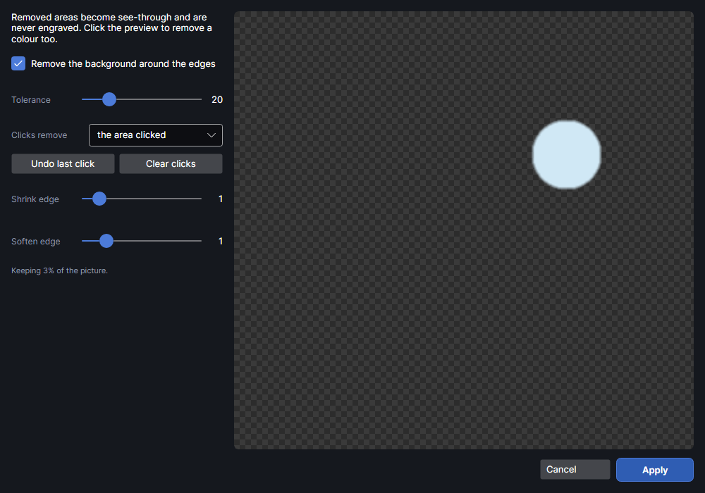

# Remove background

This add-on makes a picture's backdrop see-through so it isn't engraved, on your computer with nothing sent online. It adds **Remove background** to the Picture tab (in its **Edit** group), to the right-click menu and to the Selection panel's Picture settings.

## Remove background
<!-- windows: BackgroundWindow -->

**Remove background** makes a picture's backdrop see-through, so it isn't engraved, even with
**Invert (for dark materials)** ticked. The picture's tone settings and image mask are kept. It works best on
logos, scans and objects on a plain backdrop, and uses no AI and nothing online.

| Setting | Range (default) | What it does |
|---|---|---|
| **Remove the background around the edges** | on | Finds the main colours along the picture's edges (up to three) and removes them, spreading in from the edges. |
| **Tolerance** | 1 to 100 (20) | How different a colour can be and still count as background. Raise it if bits of backdrop remain; lower it if the subject's edges get eaten. |
| **Clicks remove** | **the area clicked** | Click the preview to remove a colour too: **the area clicked** removes the patch joined to the click, **that colour everywhere** removes it all over. **Undo last click** and **Clear clicks** take clicks back. |
| **Shrink edge** | 0 to 10 px (1) | Pulls the kept edge in, to drop a halo of backdrop colour. |
| **Soften edge** | 0 to 6 px (1) | Feathers the cut edge over this many pixels. |

The preview shows the result on a checkerboard (see-through) at up to 900 pixels across, and says
how much of the picture is kept. **Apply** works at full size and replaces the picture's pixels;
`Ctrl+Z` undoes it.

## Tutorials

- [Remove a background](tutorial:pic-remove-background)
