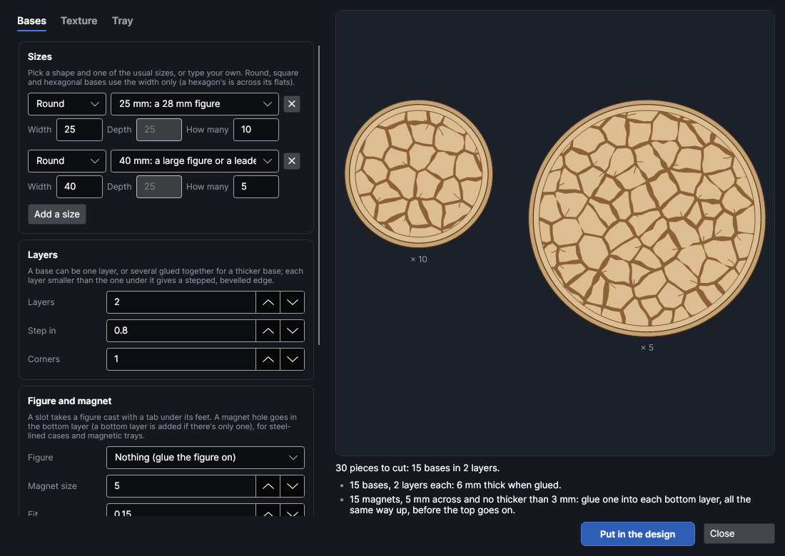
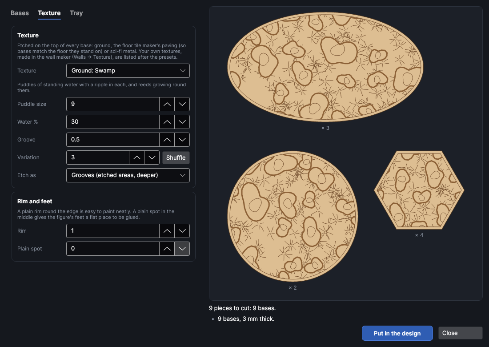
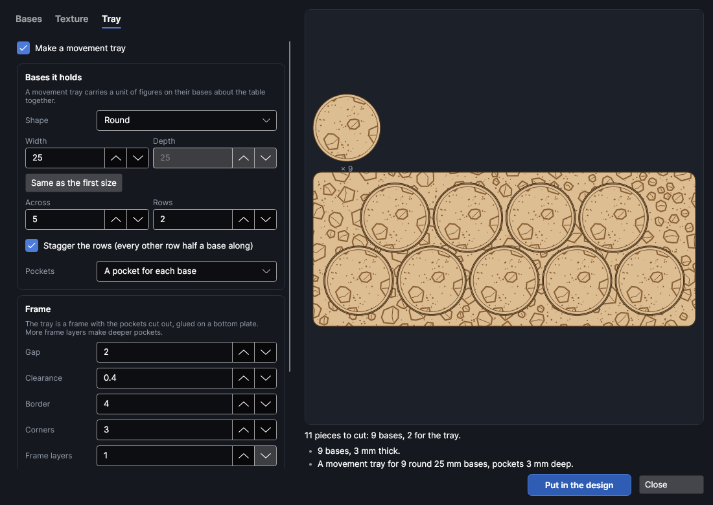

# Miniature bases

An add-on (Settings → Add-ons → **Miniature bases and movement trays**): on when PhotonCanvas is installed, and can be turned off. It uses the floor tile maker's paving and the wall maker's own textures, so **Floor tile maker** and **Textured wall maker** have to be on too. Its button is **Mini-Designer → Accessories → Bases**, and **Edit bases…** is on the right-click menu of the pieces it made.

**Bases** makes bases for tabletop figures, cut from sheet material with ground etched on the top:
cracked earth, rocks, gravel, grass, sand, swamp, forest floor, lava or ice, the same flagstones,
cobbles, floorboards and brick as [Floor tiles](floortiles.md) (so the figures match the floor they
stand on), or sci-fi deck plates and grating. Bases come round, oval, square, rectangular or
hexagonal in the usual sizes, in one layer or several stepped in, with a slot for slotted figures and
a hole for a magnet. It also makes **movement trays** that carry a unit of bases about the table.

> **Note:** The bases have been checked on screen and in tests, but not yet cut on the machine. Cut
> one base and one tray pocket first and try them together; change **Clearance** if the bases are
> too tight or too loose in the tray, and the etch layer's power if the texture is too faint or too
> deep.

## The Bases window
<!-- windows: BasesWindow -->

Click **Bases** on the **Mini-Designer** tab (in the **Accessories** group). The **Miniature bases** window opens. The
settings are on the left in tabs; the preview on the right shows one base of each size with its
layers stacked (and how many of it there are) and the movement tray with bases sitting in it, and
updates as you change things. Under it are the number of pieces and any problems: a red ✕ has to be
fixed before the bases can go in, a yellow ! is worth a look, and a grey • is just for your
information.

Press **Put in the design** and the pieces go on a page of their own, nested onto the bed (more pages
if they need more than one bed). Every base gets its own layout of cracks, stones or leaves, so no two
look alike. To change a set later, select any of its pieces, right-click and choose **Edit bases…**,
change the settings and press **Update in the design**: the old pieces are replaced wherever they are.

## Bases

List the sizes you want, one line each: the **Shape**, one of the usual **Size**s for it (or type
your own **Width** and **Depth**), and **How many**. **Add a size** adds a line; ✕ takes one off.

| Shape | Uses | Usual sizes |
|---|---|---|
| Round | the width | 20, 25, 28.5, 32, 40, 50, 60, 80, 100, 130 mm |
| Oval | width and depth | 60 × 35, 75 × 42, 90 × 52, 105 × 70, 120 × 92, 170 × 105 mm |
| Square | the width | 20, 25, 30, 40, 50 mm |
| Rectangle | width and depth | 25 × 50, 30 × 60, 40 × 20, 50 × 100 mm |
| Hexagon | the width, across its flats | 25, 30, 50 mm |

| Setting | Range (default) | What it does |
|---|---|---|
| **Layers** | 1 to 4 (1) | Layers glued into each base, for a thicker base. |
| **Step in** | 0 to 10 mm (0.8) | How much smaller each layer is than the one under it, all round: a stepped edge, like a bevel. |
| **Corners** | 0 to 20 mm (1) | How much square and rectangular bases' corners are rounded off. |
| **Figure** | Nothing | *A slot for a slotted figure*: a slot for the tab under the figure's feet, through every layer but the bottom one (right through, with one layer). |
| **Slot length**, **Slot width** | 20 × 2.2 mm | The slot's size: a little wider than the tab is thick. |
| **Magnet size** | 0 to 30 mm (0, none) | A hole for a round magnet in the bottom layer, for steel-lined cases and magnetic trays. With one layer, a plain bottom layer is added for it. Use magnets no thicker than the sheet. |
| **Fit** | −1 to 2 mm (0.15) | Play round the magnet in its hole. |
| **Thickness** | 0.5 to 20 mm (3) | Your sheet's thickness. |
| **Cut with**, **Etch with** | As set on the layers | Cut and engrave (fill) settings from your material library. The cut's kerf goes on the cut layer, so bases and pockets come out the size they're drawn. |
| **Match the floor in the design** | | Takes the texture, its sizes, the sheet thickness and the etch style from floor tiles made with the floor tile maker (the selected ones, or the first in the design). |

## Textures

Pick one in **Texture**; the list is grouped as Ground, Paving and Sci-fi. The sizes it asks for
change with it.

| Texture | Sizes (defaults) | What it looks like |
|---|---|---|
| Cracked earth | plate 4 mm | Dry, cracked mud: plates of many sides with cracks of different widths, and fine cracks into them. |
| Rocky ground | rock 6 mm, rocks 30% | Rocks with a groove round each and a facet or two, gravel between. |
| Gravel | stone 1.4 mm, cover 35% | Small stones etched in: scree, rubble, a gravel path. |
| Grass | tufts 3.5 mm apart | Tufts of blades scored from their roots, a little earth between. |
| Sand ripples | ripples 1.6 mm apart | Wind ripples in broken wavy lines, a pebble here and there. |
| Swamp | puddle 9 mm, water 30% | Puddles with a ripple in each, reeds round them. |
| Forest floor | leaf 2.6 mm, cover 35% | Fallen leaves, a root or two and twigs. |
| Lava cracks | plate 6 mm | Rounded plates with wide channels between, to paint glowing. |
| Cracked ice | cracks 7 mm apart | Smooth ice with long branching cracks. |
| Dungeon flagstones | split 50%, slab 8 mm | Square slabs, some split, with chipped corners. |
| Flagstones, Cobblestones, Floorboards, Stone blocks, Brick paving, Herringbone brick, Square tiles | | The floor tile maker's paving, at sizes for a base. |
| Hexagons, Metal deck plates, Tread plate | | The floor tile maker's sci-fi floors. |
| Grating | slot 0.8 mm, panel 10 mm | Panels of grating, the slots turned on every other panel. |
| Plain | | No texture: smooth tops to sculpt or flock yourself. |

- **Groove**: how wide the etched gaps or outlines are. Below about 0.3 mm they may not show once
  painted.
- **Variation**: each number gives a different random layout; **Shuffle** picks the next one.
- **Cracks %**: how many paving stones have a crack scored across them.
- **Etch as**: *Grooves* etches the gaps as filled areas (deeper and the most real). *Lines* scores
  round each stone or plate instead, which is much quicker.
- **Rim**: a plain band round the top's edge with a line scored along its inside, easy to paint
  neatly (0 takes the texture to the edge).
- **Plain spot**: a plain round spot in the middle, so the figure's feet have a flat place to be glued.

Your own textures are made in the wall maker (**Walls** → **Texture** → **Your own texture**) and are
listed here too, marked "(yours)". **Tile width** scales them.

## Movement trays

Tick **Make a movement tray** on the **Tray** tab. A tray is a frame with the pockets cut out, glued on
a bottom plate.

| Setting | Range (default) | What it does |
|---|---|---|
| **Shape**, **Width**, **Depth** | Round 25 mm | The bases it holds. **Same as the first size** takes the first size in the list. |
| **Across**, **Rows** | 5 × 2 | Bases side by side along the front, and rows front to back. |
| **Stagger the rows** | off | Every other row moved along half a base (and one base shorter). Round bases nest into the gaps, so the tray is shallower. |
| **Pockets** | A pocket for each base | Or *One open pocket for the whole unit*, which takes any mix of bases. |
| **Gap** | 2 mm | Space between neighbouring bases. The frame between two pockets is the gap less twice the clearance: the list warns when it's too thin. |
| **Clearance** | 0.4 mm | Play round each base in its pocket, all round. |
| **Border** | 4 mm | The frame's width round the outside. |
| **Corners** | 3 mm | How much the tray's corners are rounded off. |
| **Frame layers** | 1 to 4 (1) | Frame layers stacked on the bottom plate, for deeper pockets. |
| **A bottom plate under the frame** | on | Without it the tray is just a frame. |
| **Under each base** | A hole to push each base out | Or a hole for a magnet that holds a magnetised base (the size of the bases' magnets, or 5 mm), or nothing. Put the tray's magnets in the other way up to the bases' so they pull. |
| **Etch the texture on the frame too** | on | The same ground on the tray, so it disappears into the table. |
| **How many trays** | 1 | |

## Layers and order

The pieces go on three layers, run in this order: **Bases · lines** (light scoring) and **Bases ·
etch** (the texture, a Fill layer) first, while the sheet is whole, then **Bases · cut**. Set the etch
layer's power and speed for the depth you want (Materials & Tests → Tests → Material test helps). Glue each base's
layers lined up on their middles, the textured one on top; with magnets, glue the magnets into the
bottom layers first, all the same way up.

## Try it

- [Base a unit and make its movement tray](tutorial:make-bases)
