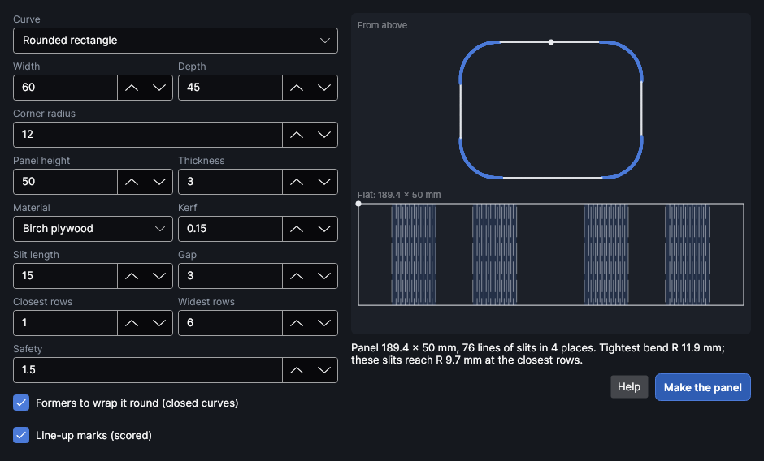

# Bend to shape

<!-- windows: BendHingeWindow, BendPreview -->

**Bend to shape** makes a flat panel that bends into a curve you draw: a living hinge with slits
only where the panel has to bend, and only as close together as each part's bend needs. Straight
stretches stay solid and stiff, gentle curves get a few widely spaced lines of slits, tight corners
get close ones. Use it for curved box sides, lamp shades, round-cornered trays, wavy screens and
anything else that is one curve seen from above, standing up.

It's an add-on: turn it on or off in **Settings → Add-ons**. When it's on, it's the
**Bend to shape** button in the **Draw** group of the **Home** tab.

## Draw the curve

The curve is the shape seen from above. The middle of the panel's thickness follows it, and the
panel stands **Panel height** tall. Draw it with the pen, shapes or text tools (or import it), select
it, then click **Bend to shape**. A closed shape (a rounded rectangle, an oval, a blob) makes a
panel that goes all the way round; an open line makes a panel with two free ends.

Without a selection, pick **Rounded rectangle** or **Oval** under **Curve** and type its size.

> **Tip:** Sharp corners can't bend: no hinge goes round a point. Round them first with
> **Rounded corners**; the window says how big the radius has to be.

## How it decides where the slits go

The panel bends by twisting the thin strips between lines of slits. Each strip can twist only so
far before it cracks, and how far depends on how thin it is (thinner twists further), how long its
free length is (from the gap in one line to the gap in the next, half of **Slit length** less
**Gap**) and the material. The window walks along the curve and puts each line of slits as far
from the last one as the bend between them allows. Where the curve is gentle enough for the solid
sheet to bend by itself, there are no slits at all.

The preview shows the curve from above, coloured: grey where the panel stays solid, blue where
it's slit, red where even the closest rows can't bend that tight. Under it is the flat panel
with its slits; the dot marks where the panel starts (on a closed curve, where its two ends meet,
always put in the flattest stretch).

## Settings

| Setting | Range | Default | What it does |
|---|---|---|---|
| **Curve** | | The selected shape | The selected shape, or a **Rounded rectangle** or **Oval** of the **Width**, **Depth** and **Corner radius** you type. |
| **Panel height** | 5–1000 mm | 50 | How tall the bent panel stands; the slits run this way. |
| **Thickness** | 0.5–20 mm | 3 | The sheet's thickness. |
| **Material** | | Birch plywood | How the sheet copes with bending: Birch plywood, Poplar plywood, MDF, Cast acrylic, or **From my own bend…** (below). |
| **Kerf** | 0–2 mm | from the Cut layer, else 0.15 | How wide the laser cuts. Taken from your first Cut layer that has a kerf. |
| **Slit length** | 2–500 mm | 15 | Each slit's length. Longer slits bend tighter but make a floppier panel. At least twice the gap plus 1 mm. |
| **Gap** | 0.5–50 mm | 3 | The uncut material between slits in a line. |
| **Closest rows** | 0.3–20 mm | 1 | The closest lines of slits may get, for the tightest bends. It must leave at least 0.3 mm of material after the kerf. |
| **Widest rows** | 0.5–50 mm | 6 | The furthest apart lines get, for gentle bends. |
| **Safety** | 1–5 | 1.5 | Every part is made able to bend this many times tighter than it needs to. Raise it if a test cracks; lower it for a stiffer panel. |
| **Formers to wrap it round** | | on | For a closed curve: two formers (top and bottom), the curve brought in by half the thickness, to glue the panel round. |
| **Line-up marks** | | on | Short scored marks on the panel's top edge in the middle of each slit stretch, and matching marks on the formers' edges (plus one where the panel's ends meet), so you can line it up while gluing. |
| **Split into pieces that fit the work area** | | on | Shown when the panel is longer than the work area: it's made in pieces, each join in a solid stretch where there is one. |

Under the preview, the window says how long the panel is, how many lines of slits it has and where,
the tightest bend in the curve and the tightest these slits reach. When a part is too tight it says
how big a radius would work, or how long the slits would need to be.

## Your own material

The built-in materials are cautious, rough figures: plywood and MDF vary a lot. For a better fit,
choose **From my own bend…** and fill in a regular living hinge you've bent in your sheet (for
example one from **Generators → Living hinge**): its **Slits** length, **Gap**, **Between rows**,
and the tightest radius it went round without cracking (**Bent round R**; wrap it round jars or
tins of known size). Click **Use this bend**. Use the same **Thickness** and **Kerf** as that hinge.
The window remembers it, and the rest of your settings, for next time.

## Making it

Click **Make the panel**. The panel's outline and its slits go on your Cut layer (one is made if
there isn't one), the marks on a Score layer, and the formers beside the panel, all grouped. The
curve you drew stays where it was.

1. Cut a short test first if you can: the stretch with the tightest bend matters most.
2. Bend the panel slowly, by hand, round the formers; glue it to them along its top and bottom edges.
3. On a closed curve, the two ends meet in a solid stretch on the formers.

> **Note:** How tight a hinge really bends depends on the sheet (glue lines, voids, grain) and on how
> cleanly the laser cut it. The window's figures are a guide; your own bend test makes them yours.
