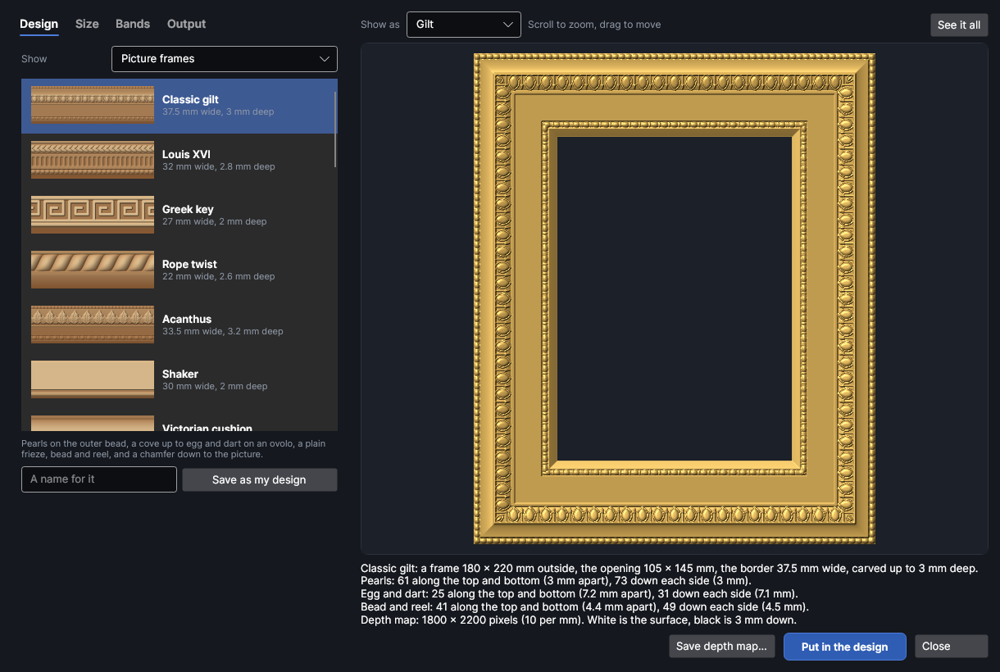
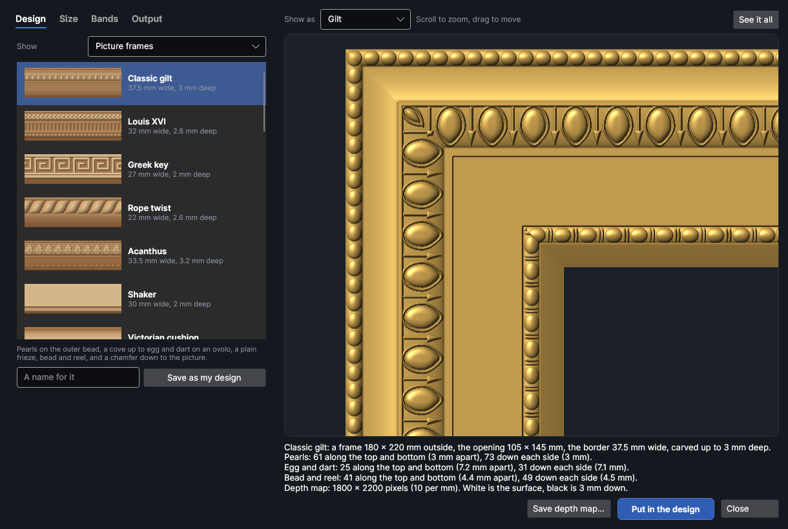
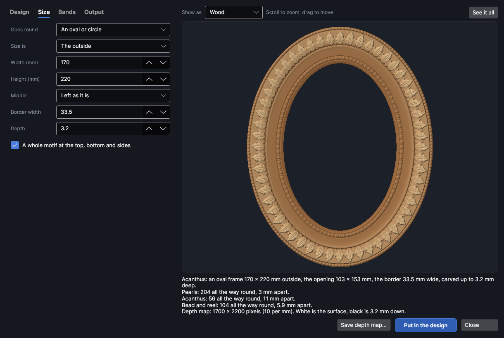
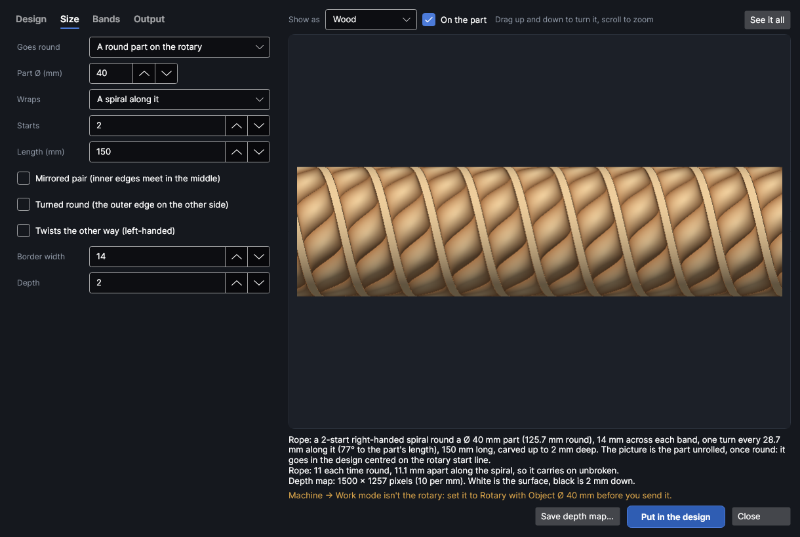
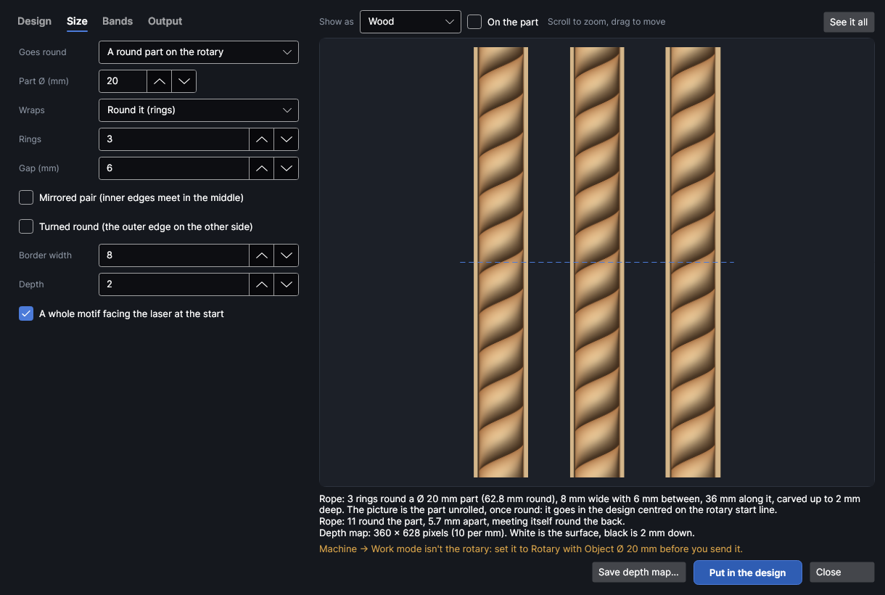
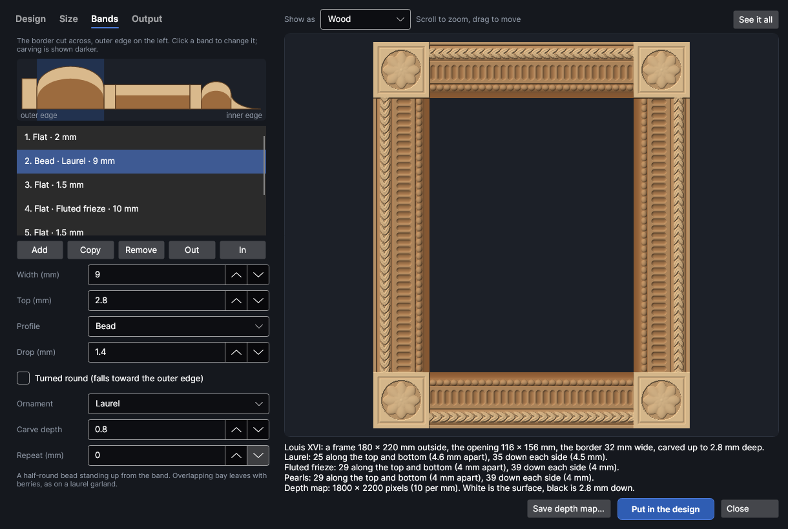
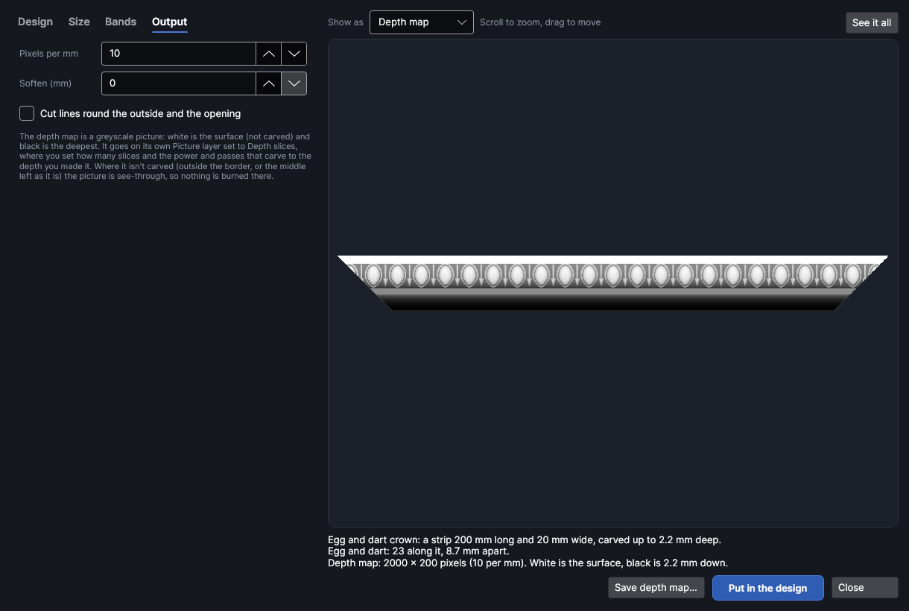
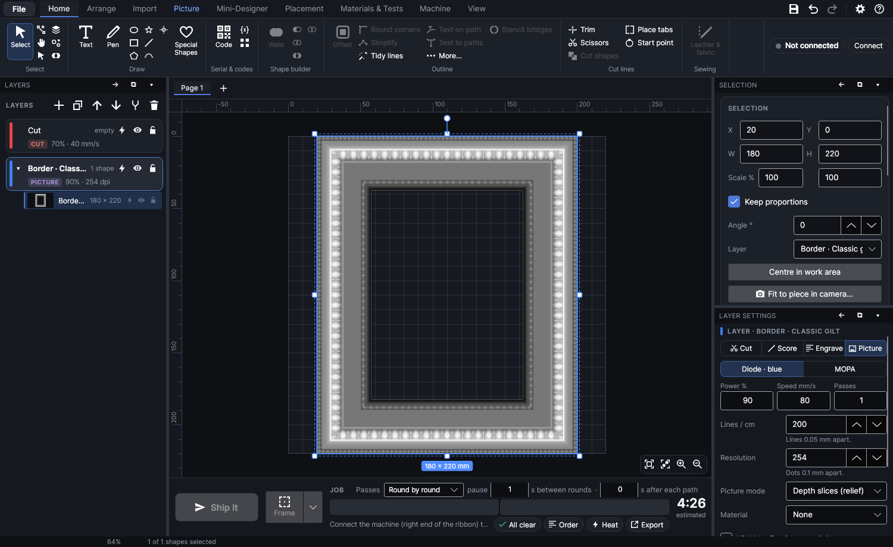

# Borders

An add-on (Settings → Add-ons → **Border and moulding maker**): on when PhotonCanvas is installed, and can be turned off. Its button is **Import → Generate → Borders**, and **Edit border…** is on the right-click menu of a border it made. **Machine → Work area → Wrap a pattern** opens it on a round part in the rotary (see [Round a part on the rotary](#round-a-part-on-the-rotary)).

**Borders** makes carved borders: picture and mirror frames, cabinet and drawer edges, furniture
trim and ornament bands. Pick one of the ready-made designs (egg and dart, dentils, rope, Greek key,
acanthus, bead and reel, reeding, ogees, coves and dozens more), say what it goes round and how big
it is, and it is drawn to fit: whole repeats along every side, mitred corners, a motif in the
middle of each side. It can also go round a pen, a tool handle or a table leg turning in the rotary,
as rings, flutes or a spiral. You see it lit as carved wood, gilt or metal. Then it goes in the design as a
depth map (a greyscale picture, white the surface and black the deepest) on its own Picture layer
set to **Depth slices (relief)**, ready to carve.

> **Note:** The borders have been checked on screen and in tests, but carving them as depth slices
> hasn't been tried on the machine yet. Carve a short length on scrap first and measure how deep it
> goes.

## The Border maker window
<!-- windows: BordersWindow -->

Click **Borders** on the **Import** tab (in the **Generate** group). The **Border maker** opens over
the program.

- **Left:** four tabs. **Design** picks the design, **Size** says what it goes round and how big,
  **Bands** changes the design itself and **Output** sets the depth map's detail.
- **Right:** the border as it will carve. Under it, a summary: its size, how deep it's carved, how
  many repeats of each ornament fit along each side and how far apart, and the depth map's size in
  pixels. Warnings are in orange (bigger than the work area, very fine detail).
- **Save depth map…** saves the depth map as a PNG picture (see [Save the depth map](#save-the-depth-map)).
- **Put in the design** puts it in your design (see [Put it in the design](#put-it-in-the-design)).
  **Close** (or `Esc`) closes the window. The settings you last made a border with are kept for
  next time.

### The preview

**Show as** shows the border lit from the top left as **Wood** (darker the deeper it's burned, as
on wood), **Gilt**, **Metal**, or as the **Depth map** itself.

Scroll the wheel to zoom in on what's under the pointer, drag to move, and click **See it all** (or
double-click the picture) to see the whole border again. Whatever is in view is drawn again at the
screen's full detail, so you can look closely at a corner. On a strip made in pieces, dashed lines
show where it's split.

## Design

**Show** picks which designs are listed:

- **Picture frames**: whole frame mouldings, from plain to ornate (they go round a frame).
- **Cabinet and furniture edges**: router-bit profiles and carved edges (they're made as a strip).
- **Ornament bands**: every ornament on its own band between two small fillets, to use as it is
  or to start your own design from.
- **My designs**: the ones you've saved.

Click a design to use it; its picture shows a short length of it, and the line under the list says
what it is. Picking a frame design makes the border go round a frame, and picking an edge makes a
strip; ornament bands and your own designs keep what you had.

Changing a design's bands makes it your own (its name gets " (changed)"). To keep it, type a name
in **A name for it** and click **Save as my design**: it's saved at the width and depth it has now,
under **My designs**. **Delete from my designs** takes the chosen one away again.

### The ready-made designs

**Picture frames** (28): Classic gilt, Louis XVI, Greek key, Rope twist, Acanthus, Shaker,
Victorian cushion, Scoop, Ogee, Art Deco, Gothic, Celtic plait, Arts and Crafts, Federal, Baroque
scroll, Bamboo, Basketweave, Rococo shells, Dutch ripple, Pearled, Reeded, Anthemion, Romanesque,
Hammered, Country hearts, Starry, Ivy and Fish scale.

**Cabinet and furniture edges** (28): Roman ogee, Classical ogee, Cove and bead, Cock bead,
Chamfer, Round-over, Thumbnail, Bullnose, Reeded edge, Fluted, Dentil crown, Cornice, Rope edge,
Gadrooned, Twisted gadroons, Egg and dart crown, Meander frieze, Acanthus frieze, Bead and reel,
Billet, Dogtooth, Laurel garland, Wave frieze, Ribbon and reed, Bamboo edge, Barley twist, Shelf
front and Linen chest.

**Ornament bands** (39): one for each ornament in the [list of ornaments](#ornaments).

## Size

| Setting | What it does |
|---|---|
| **Goes round** | **A frame** (a rectangle), **An oval or circle**, **A strip** (a straight length for an edge, a shelf front or trim), or **A round part on the rotary** (see [Round a part on the rotary](#round-a-part-on-the-rotary)). |
| **Size is** | Frames and ovals: whether **Width (mm)** and **Height (mm)** are **The outside** of the frame or **The opening** inside it (the picture or mirror it holds; the border is added round it). |
| **Width (mm)**, **Height (mm)** | The frame's size, 10–3000 mm (180 × 220 to start). The same width and height make a circle. |
| **Corners** | Frames only. **Mitred**: the sides meet on the diagonal, as a frame's four sticks do, and the pattern turns the corner on the mitre. **Corner blocks**: a square in each corner with a carved rosette, the sides running between them. **Rounded**: the whole border bends round the corners. |
| **Corner radius** | With **Rounded** corners: how round the outside corners are (mm). |
| **Four separate mitred sticks** | Mitred frames: make the frame as four sticks with mitred ends, each its own picture (top, right, bottom and left side), to carve one at a time and glue up. For a frame bigger than the work area. |
| **Middle** | What happens inside the frame. **Left as it is**: not carved (it's see-through in the depth map), for a frame you'll cut the opening out of, or a mirror. **Level with the inner edge** or **Carved to the bottom**: a sunk panel, for a door, a box lid or a plaque. |
| **Length (mm)** | Strips: the strip's length along its outer edge. |
| **Mitred ends** | Strips: both ends cut at 45° (the outer edge longest), to meet another strip at a corner. |
| **Longest piece** | Strips: a strip longer than this is made in pieces that carry on from each other (**Part 1 of 3** and so on), each its own picture, to carve one after the other. 0 = one piece. |
| **Border width** | How wide the border is across (mm). Every band is made wider or narrower in proportion. |
| **Depth** | How deep the deepest part is carved below the surface (mm). Every height is scaled to suit. |
| **A motif on each corner** (**A motif on each end** on a strip) | A motif sits right on each corner (or end). Off: the gap between two motifs sits there, which usually turns a mitre more neatly. |
| **A whole motif in the middle of each side** | The repeats are fitted so a whole motif sits in the middle of every side (of the strip, or at the top, bottom and sides of a rounded frame or oval). |

The repeats are always fitted to a whole number along each side, so the pattern never ends half
way through a motif; the summary says how many fit and how far apart they are.

## Round a part on the rotary

Choose **A round part on the rotary** under **Goes round** (or click **Wrap a pattern** on the
**Machine** tab, in the **Work area** group, which opens the maker that way) to wrap the border round
a round part held in the rotary: a pen, a tool or knife handle, a chair spindle, a table leg. The
pattern is made to go once round the part exactly, with a whole number of repeats, so where it meets
itself round the back there's no seam.

| Setting | What it does |
|---|---|
| **Part Ø (mm)** | The part's diameter where the border goes. The pattern goes once round exactly this size. **Use Work mode's** puts in the **Object Ø** that **Machine → Work mode → Rotary** is set to (the button shows when Work mode is the rotary). Opening the maker with **Wrap a pattern** starts with it. |
| **Wraps** | **Round it (rings)**: the border goes round the part, its width along the part. **Along it (flutes)**: copies of the border run along the part side by side, all the way round, like the flutes or reeds on a column. **A spiral along it**: the border winds along the part, like a barley twist or a rope. |
| **Rings** | Round it: how many rings along the part, all the same. |
| **Gap (mm)** | Round it: the plain space between one ring and the next, along the part. |
| **Copies round** | Along it: how many copies side by side round the part. Each is made just wide enough that they go round without a gap, so **Border width** follows it (the summary says how wide). |
| **Starts** | A spiral: how many spirals wind side by side. 1 is a single twist, 2 a double barley twist. The more starts (and the wider the border), the steeper it winds: the summary says how far along the part it goes in one turn. |
| **Length (mm)** (on a part) | Along it and a spiral: how far along the part the pattern runs. |
| **Mirrored pair (inner edges meet in the middle)** | Each copy is the design and its mirror image side by side, so it's the same both ways across: a frame moulding becomes a collar, an edge a bead, and flutes meet edge to edge. |
| **Turned round (the outer edge on the other side)** | The design turned round across. With **Mirrored pair**, the outer edges meet in the middle instead. |
| **Twists the other way (left-handed)** | A spiral winds the other way, like a left-hand thread. |
| **A whole motif facing the laser at the start** | Rings: a whole motif sits on the row that faces the laser when the job starts. |

**On the part** (above the picture) shows the border round the part from above, as the laser sees
it: drag up and down to turn the part, scroll to zoom. Untick it to see the part unrolled, as the
depth map is made: along the part across, once round down. The dashed line across it is the row
that faces the laser when the job starts.

**Put in the design** puts the depth map in once round the part, centred on the rotary start line
(if the design has none, one is put half way round, where the job starts anyway), in the middle of
the laser's field across. Its layer is called **Rotary wrap ·** and the design's name, in **Depth
slices (relief)** mode, with the lines running along the part (0°) and no turn between slices, so the
rotary steps round between lines rather than turning back and forth. There are no cut lines round a
part.

Before you send it, set **Machine → Work mode** to **Rotary** with **Object Ø** the same as **Part Ø**.
The job's checks say if Work mode isn't the rotary, if **Object Ø** is set to another size (the
pattern would stop short of meeting itself round the back, or run over), or if the picture has been
stretched round the part. The summary warns of the same while you make it, and if the pattern is
longer along the part than the laser reaches across.

> **Note:** Wrapping round a part has been checked on screen and in tests, but not carved on the
> machine yet. Try a short ring on a scrap dowel of the same size first, and check where the pattern
> meets itself round the back.

## Bands

A design is a row of bands across the border, from its outer edge to its inner edge. Each band has a
shape across (its profile, like a moulding plane or a router bit leaves it) and can have an
ornament carved along it.

At the top, the border cut across, its outer edge on the left: each band's profile, the carving
shown darker. Click a band there or in the list under it to change it. **Add** puts a new band at
the inner edge, **Copy** puts another like the chosen one beside it, **Remove** takes it away, and
**Out** and **In** move it toward the outer or inner edge.

| Setting | What it does |
|---|---|
| **Width (mm)** | How wide this band is across. |
| **Top (mm)** | The band's highest level, above the deepest point of the border. |
| **Profile** | Its shape across: see [Profiles](#profiles). |
| **Drop (mm)** | How far the profile falls from its top: the cove's or ogee's fall, the bead's height. |
| **How many** | Reeds, flutes or steps across the band; strands of a plait or rope; lines of waves. |
| **Turned round (falls toward the outer edge)** | The profile the other way round: a cove that rises toward the picture instead of away from it. |
| **Ornament** | The pattern carved along the band: see [Ornaments](#ornaments). |
| **Carve depth** | How deep the ornament is carved into the band's surface (mm). |
| **Repeat (mm)** | One repeat's length along the band, before it's fitted to the sides. 0 = its natural length for the band's width. |

Changing a band changes **Border width** and **Depth** on the **Size** tab to match.

### Profiles

**Flat**, **Slope (chamfer)**, **Cove** (a hollow quarter circle), **Round-over (ovolo)** (a
rounded quarter circle), **Ogee** (an S curve, hollow then round), **Reverse ogee** (round then
hollow), **Bead** (a half-round standing up), **Cushion** (a broad, low rounded swell), **Thumbnail**
(flat, rounding over tightly at the edge), **Reeds** (rounded ridges side by side), **Flutes**
(hollow grooves side by side), **Steps** and **V groove**.

### Ornaments

| Kind | Ornaments |
|---|---|
| Classical | **Egg and dart**, **Dentils**, **Bead and reel**, **Pearls**, **Leaf and dart**, **Water leaf**, **Palmette**, **Acanthus**, **Laurel**, **Rosettes**, **Fluted frieze**, **Gadroons**, **Twisted gadroons** |
| Keys and scrolls | **Greek key**, **Meander**, **Wave scroll**, **Guilloche** |
| Twists and weaves | **Rope**, **Barley twist**, **Plait**, **Basketweave**, **Ribbon and stick**, **Bamboo** |
| Medieval | **Billet**, **Dogtooth**, **Nailhead**, **Interlaced arches**, **Quatrefoils**, **Chevron** |
| Natural and folk | **Shells**, **Ivy vine**, **Fish scale**, **Hearts**, **Stars**, **Lozenges**, **Herringbone** |
| Textures | **Ripple**, **Waves**, **Hammered** |

All of them are drawn as original art for this program; the name under **Ornament** says what each
one is when you pick it.

## Output

| Setting | What it does |
|---|---|
| **Pixels per mm** | The depth map's detail, 1–40 (10 to start, which is 254 dpi). 10 suits most carving; more only makes bigger files. A picture is kept within 6000 pixels a side and 30 million pixels in all: if it would be bigger, it's made at fewer pixels per mm and the summary says so. |
| **Soften (mm)** | Blurs the heights a little, rounding sharp walls off: kinder to wood. 0 = crisp. |
| **Cut lines round the outside and the opening** | Also puts cut lines round each piece (and round a frame's opening) on the design's **Cut** layer (a new one if there isn't one), to cut it out after carving. |

The depth map is a greyscale picture: white is the surface (not carved) and black is the deepest,
**Depth** mm down. Where nothing is carved (outside the border, or a middle left as it is) the
picture is see-through, so nothing is burned there.

## Put it in the design

**Put in the design** makes the depth map and puts it in your design on a new Picture layer called
**Border ·** and the design's name, in **Depth slices (relief)** mode, and makes that layer active.
It goes in the middle of the work area if it fits, otherwise at its top left corner. A frame made
as four sticks, or a strip in pieces, is one picture a piece, one under another 5 mm apart, grouped.

Then set the layer's **Slices**, power, speed and passes so it carves to the depth you made it (see
[Depth slices](layer-settings.md#depth-slices)), and try it on scrap first. **Relief preview**
(Picture tab, in **Effects**, when the 3D model relief add-on is on) shows the picture lit as
the relief it carves.

To change a border later, right-click it and click **Edit border…**: the Border maker opens with its
settings, and the button reads **Update in the design**, which puts the new one where the old one was
on the same layer.

## Save the depth map

**Save depth map…** saves the depth map as a PNG picture, to carve in another program or keep. A
border made in pieces saves one picture a piece, named after the file you give with the piece's name
added ("Frame - top side.png").

## Tutorials

- [Carve a picture frame](tutorial:draw-border-frame)
- [Wrap a pattern round a pen or table leg](tutorial:wrap-rotary-pattern)
