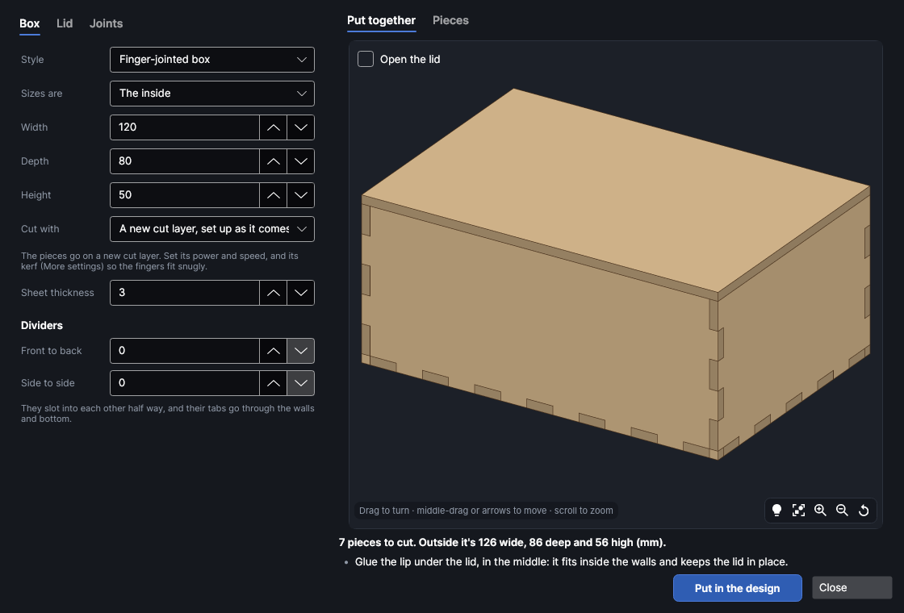
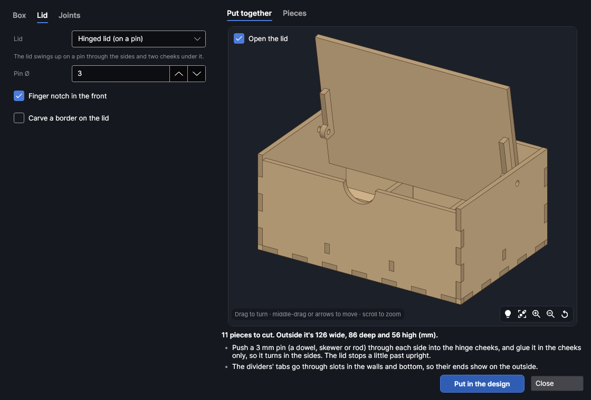
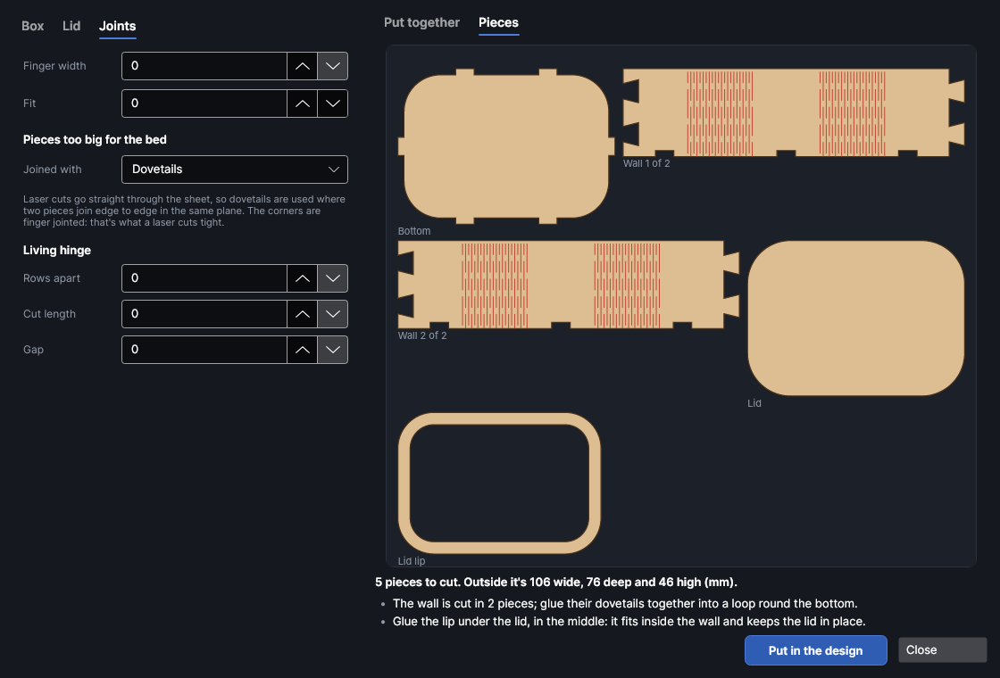
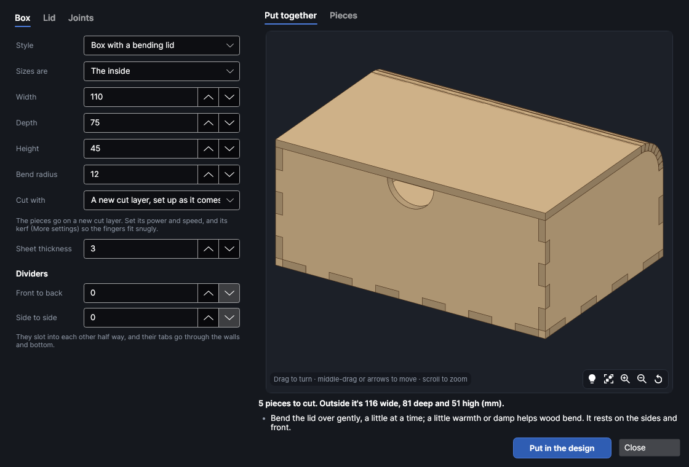
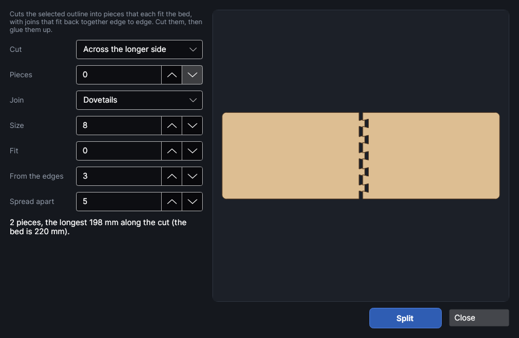

# Boxes and joints

An add-on (Settings → Add-ons → **Box and joinery maker**): on when PhotonCanvas is installed, and can be turned off. Its buttons are **Import → Generate → Boxes** and **Home → Cut lines → Split with joints**; **Edit box…** is on the right-click menu of a box it made, and **Split with joints…** on the menu of a closed outline. It uses the **Border and moulding maker** add-on to carve a border on a lid, so that one is turned on with it.

**Boxes** makes boxes that slot together from flat sheet:

- **Finger-jointed boxes**, with no lid (a tray), a **lift-off lid** with a lip under it, a
  **sliding lid** that slides out to the front, or a **hinged lid** that swings up on a pin. Add
  **dividers** front to back and side to side: they slot into each other half way and their tabs
  go through the walls and bottom.
- **Rounded boxes**: a bottom with one long wall bent round it, its corners bending on living
  hinges (rows of slits), with a lift-off lid or none.
- **Boxes with a bending lid**: the back goes on over the top as the lid, bending on a living hinge.

Any of them can have a carved border on the lid, made by the border maker and put over the lid
ready to carve. Pieces bigger than the bed are cut in pieces joined with dovetails (or jigsaw
knobs or fingers), and **Split with joints** does the same to any outline you draw.

> **Note:** The boxes have been checked on screen and in tests, but not yet cut on the machine.
> Cut a small one from scrap first, to check your kerf and the fit.

## The Box maker window
<!-- windows: BoxesWindow -->

Click **Boxes** on the **Import** tab (in the **Generate** group). The **Box maker** opens over
the program. To change a box you've already put in the design, right-click one of its pieces and
choose **Edit box…**.

- **Left:** three tabs. **Box** sets the style, size and sheet; **Lid** the lid and the border on
  it; **Joints** the fingers, the fit, and how pieces too big for the bed are joined.
- **Right:** **Put together** shows the box in 3D (drag to turn it, scroll to zoom; tick **Open the
  lid** to see it open). **Pieces** shows each piece as it will be cut, with how many of it. Under
  them, how many pieces there are and the box's outside size, then anything to know: how to put it
  together, and warnings in orange (a tight bend, a gap) or red (it can't be made like that).
- **Put in the design** puts the pieces in (see [Put it in the design](#put-it-in-the-design)).
  **Close** (or `Esc`) closes the window. The settings you last made a box with are kept for next time.

### The Box tab

- **Style:** **Finger-jointed box**, **Rounded box (bent corners)** or **Box with a bending lid**.
- **Sizes are:** **The inside** (what fits in it) or **The outside** (how big it is, walls and lid
  included). **Width**, **Depth** and **Height** in mm. Inside, the height is from the bottom to the
  underside of the lid.
- **Corner radius** (rounded box): how round its corners are, inside. **Bend radius** (bending lid):
  how round the bend over the back is. Tighter bends need closer rows of slits and can crack; the
  window warns when a bend is tight for the sheet.
- **Cut with:** cut settings from your [material library](material-library.md). The pieces go on a cut
  layer with those settings, kerf included, so the fingers come out the width they're drawn and
  press together snugly. Without a kerf measured the joints will be loose: measure it first with
  the Kerf gauge or a Cut test.
- **Sheet thickness:** measure your sheet. The fingers are as deep as the sheet is thick, so a
  sheet sold as 3 mm that's really 2.8 mm leaves them sticking out a little.
- **Dividers:** how many go **Front to back** and **Side to side**. They're as high as the lid
  allows: lower under a hinged lid, whose back swings down into the box as it opens, or under a
  bending lid's bend.

### The Lid tab

- **Lid:** **No lid (a tray)**, **Lift-off lid**, **Sliding lid** or **Hinged lid (on a pin)**. A
  rounded box has a lift-off lid or none; a bending lid box's lid is its back.
  - A **lift-off lid** has a lip glued under it, a ring that fits inside the walls and keeps it in place.
  - A **sliding lid** slides out to the front, over the front (which is lower), between runners
    inside the sides and back (their tabs go through them) and a cap glued on top. It has a finger
    hole near the front.
  - A **hinged lid** sits between the sides, on the front, and swings up on a pin through the sides
    and two cheeks tabbed under it near its back corners. The pin is set far enough from the back for the
    lid to clear it, leaving a small gap at the back. Glue the pin in the cheeks only, so it turns in
    the sides. The lid stops a little past upright.
- **Lip / runners:** how wide a lift-off lid's lip is, or how far a sliding lid's runners and cap
  reach in over it.
- **Pin Ø:** the hinge pin: a dowel, a bamboo skewer, a nail or a length of 1.75 mm filament.
- **Finger notch in the front:** a half-round notch at the top of the front, to get a finger under
  a hinged or bending lid.
- **Carve a border on the lid:** a border from the border maker over the lid's top, inset **From
  the edge**, with mitred corners (rounded on a rounded box). Pick its **Design**, **Border width**
  and **Carve depth**. See [Carve a border on the lid](#carve-a-border-on-the-lid).

### The Joints tab

- **Finger width:** how wide the fingers at the corners are. 0 makes them about three times the
  sheet. Each edge gets an odd number, so the corners work out.
- **Fit:** play in every joint on top of the kerf. 0.1 makes them looser, -0.05 tighter. With the
  kerf measured, 0 presses together snugly.
- **Pieces too big for the bed:** panels longer than the bed, and a rounded box's long wall, are
  cut in pieces. **Joined with** says how: **Dovetails**, **Jigsaw knobs**, **Square fingers** or a **Straight**
  cut. Dovetails and jigsaw knobs lock the pieces together; fingers and a straight cut need glue.
- **Living hinge** (rounded and bending lid boxes): **Rows apart** is how far apart the rows of
  slits are (closer bends more easily, but the strips between get thinner); **Cut length** is how long
  each slit is and **Gap** how much sheet is left between two in a row. 0 works each out from the sheet.

#### Why the corners aren't dovetailed

A laser cuts straight down through the sheet, so it can't cut the sloping sides of a woodworker's
dovetail corner, and dovetails at a corner would leave gaps. Where two pieces meet edge to edge in
the same plane, though, dovetails lock them together tightly, so that's where they're used: to join
a wall or panel cut in pieces, and in [Split with joints](#split-with-joints). The corners are
finger jointed, which a laser cuts tight.

## The box with a bending lid

The back and the lid are one piece. The back is finger jointed to the sides and bottom; above it a
band of slits lets the sheet bend over the sides' rounded back corners, and the lid rests on the
sides and the front. Bend it gently, a little at a time; a little warmth or damp helps wood bend.

## Put it in the design

Click **Put in the design**. The pieces go on a cut layer named **Box · cut** (set up from **Cut
with**, if you picked settings there), each piece's outline with its living hinge slits, nested to
fit the bed with 2 mm between them. When they don't all fit, the rest go on more pages, a bed each.
With a box opened by **Edit box…** the button says **Update in the design**, and the box's old
pieces are taken out first.

Every piece remembers the box's settings: right-click one and choose **Edit box…** to change it.

### Carve a border on the lid

With **Carve a border on the lid** ticked, the border goes in as a depth map (a greyscale picture,
white the surface and black the deepest) on a new Picture layer named **Box lid ·** and the design,
set to **Depth slices (relief)** and put before the cut layer, so it's carved while the sheet is
whole. It lies exactly over the lid wherever the lid was put on the bed. Right-click it and choose
**Edit border…** to change its design. Carve a short test on scrap first and measure how deep it goes.

## Split with joints
<!-- windows: SplitWindow -->

Draw or select a closed outline bigger than the bed (a shelf, a sign, a panel) and click **Split
with joints** on the **Home** tab (in the **Cut lines** group), or right-click it and choose
**Split with joints…**.

- **Cut:** **Across the longer side**, **Up and down** (cuts across the width) or **Side to side**
  (cuts across the height).
- **Pieces:** how many. 0 makes as few as fit the bed.
- **Join:** **Dovetails**, **Jigsaw knobs**, **Square fingers** or **Straight**.
- **Size:** how far each tail reaches across the seam. About 2½ times the sheet thickness is a good start.
- **Fit:** play between the pieces on top of the kerf.
- **From the edges:** how far from the outline's edges the tails stop, so nothing thin breaks off.
- **Spread apart:** how far apart the pieces are put.

Click **Split**: the outline is replaced by its pieces, on the same layer. Cut them, then glue them
up. Anything engraved on it stays as it is, on its own layer.
