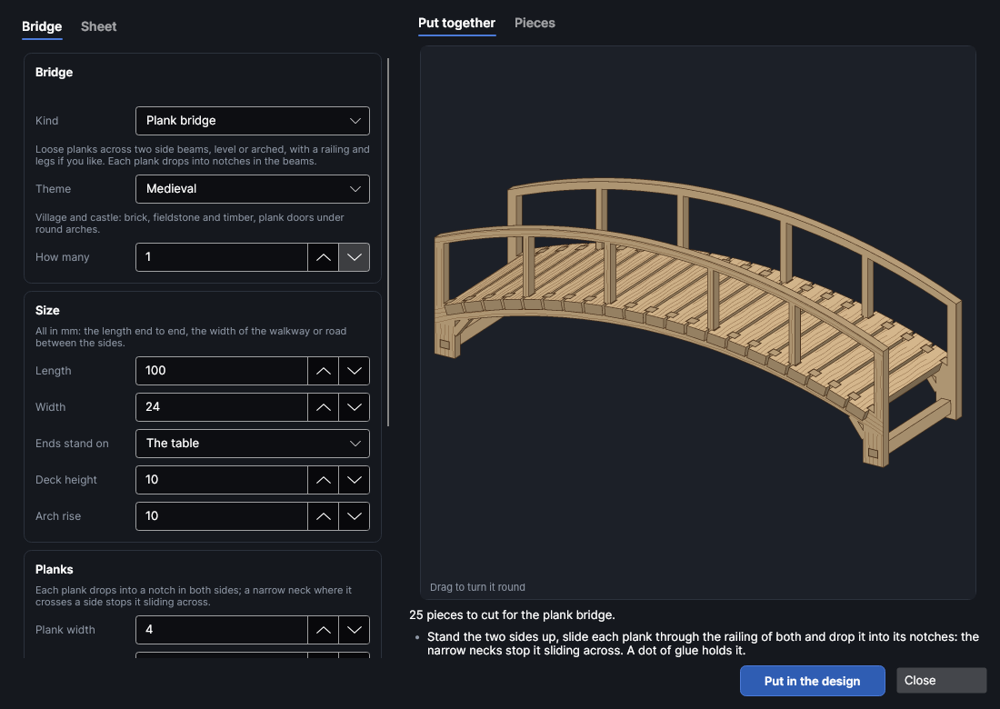
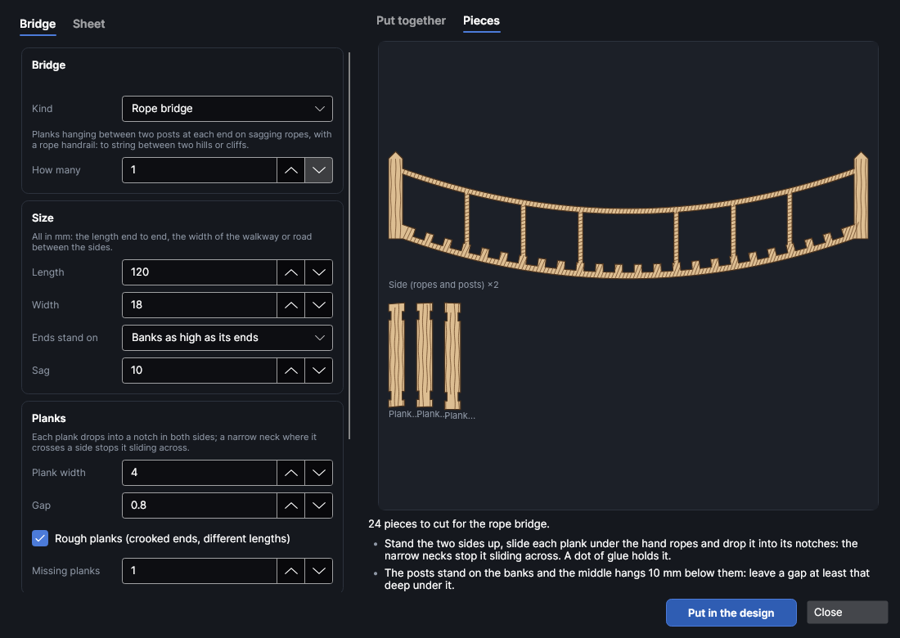
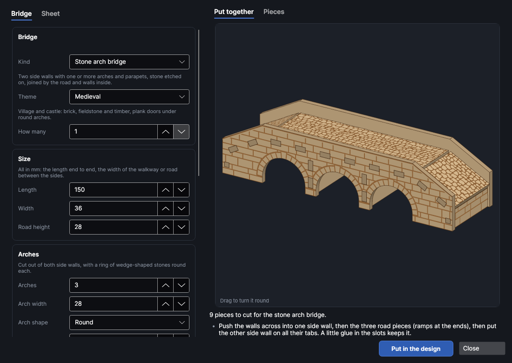

# Miniature bridges

An add-on (Settings → Add-ons → **Miniature bridge maker**): on when PhotonCanvas is installed, and can be turned off. Its button is **Home → Draw → Bridges**, and **Edit bridge…** is on the right-click menu of the pieces it made.

**Bridges** makes flat-pack bridges for tabletop games, dioramas and model railways, cut from one
sheet: **plank bridges** (level or arched footbridges with a railing, standing on legs or resting on
the banks), **rope bridges** (planks hanging on sagging ropes between posts, to string between two
hills or cliffs) and **stone arch bridges** (one or more arches, a parapet, and stone etched on the
sides in the same textures as the wall maker, **Home → Draw → Walls**). Everything slots together,
so it stands up square on its own; a drop of glue keeps it that way.

> **Note:** The bridges have been checked on screen and in tests (every piece is put together in
> 3D and checked for clashes, empty slots and pieces that don't join), but not yet cut on the
> machine. Cut a short bridge first and check how the planks drop into their notches and the tabs
> go into their slots; change **Slot fit** if they're too tight or too loose.

## The Miniature bridges window
<!-- windows: BridgesWindow -->

Click **Bridges** on the **Home** tab (in the **Draw** group). The **Miniature bridges** window
opens. On the left, the **Bridge** tab has the kind of bridge, its size and its style; the **Sheet**
tab has the sheet it's cut from. On the right, **Put together** shows the bridge in 3D (drag it to
turn it round; scroll to zoom in on a part, middle-drag or the arrow keys to move it, and press **F** or the first button in its corner to see it all again) and **Pieces** shows its pieces flat, one of each, with how many of each there are.
Under them are the number of pieces and notes: how it goes together, a red ✕ that has to be fixed
before the bridge can go in, a yellow ! worth a look.

Press **Put in the design** and every piece goes on a page of its own, nested onto the bed (more
pages if they need more than one bed). **How many** cuts several of the same bridge. To change it
later, select any of its pieces, right-click and choose **Edit bridge…**, change the settings and
press **Update in the design**: the old pieces are replaced wherever they are.

## The size

All sizes are in mm. **Length** is the bridge from end to end, **Width** the walkway (or road)
between its two sides. Changing **Kind** starts again from sizes that suit that kind of bridge for
the figures chosen on the **Sheet** tab (28 mm unless you change it).

| Kind | Defaults for 28 mm |
|---|---|
| **Plank bridge** | 100 long, 24 wide, deck 10 high at the ends, arched 8 higher in the middle, a 14 mm railing |
| **Rope bridge** | 120 long, 18 wide, sagging 10, between 3.5 mm posts, a 14 mm hand rope |
| **Stone arch bridge** | 100 long, a 36 mm road 32 high, one round arch 40 wide, a 7 mm parapet, from 3 mm sheet |

For plank and rope bridges, **Ends stand on** says what's under the ends:

- *The table*: the bridge stands on the table. **Deck height** is how high the deck is at the
  ends; a plank bridge gets a leg at each end (and any **Middle legs**), a rope bridge's posts go
  down to the table.
- *Banks as high as its ends*: the ends rest on two hills, banks or cliffs and the middle spans
  the gap between them. The note under the preview says how far a rope bridge hangs below the banks.

**Arch rise** lifts a plank bridge's middle above its ends (0 makes it level); a rope bridge's
**Sag** is how far its middle hangs below its ends.

## Themes

**Theme**, under **Kind**, is a look to start from, the same as the wall maker's, so a bridge matches
the walls, floors and scatter made in that theme. Change anything afterwards.

| Theme | Stone bridge | Plank and rope bridges |
|---|---|---|
| Medieval | Stone blocks, round arches, a straight parapet, cobbles | As they were |
| Dungeon | Dungeon blocks, round arches, battlements, flagstones | As they were |
| Cave | Cave rock, flatter arches, no parapet, flagstones | Rough planks |
| Sci-fi | Sci-fi panels, flatter arches, a plain road | A metal gantry: grating on the planks, rivets on the beams and rails, no grain |
| Desert | Sandstone, round arches, flagstones | As they were |
| Gothic | Fine stone blocks, pointed arches, battlements, cobbles | As they were |

A pointed arch stands taller than a round one as wide, so picking *Gothic* raises the road to clear it.

## Planks

Plank and rope bridges have loose planks. Each one drops into a notch in the top of both sides, as
deep as the sheet is thick so it sits flush. Where a plank crosses a side it's a little narrower (a
neck): the wider plank on either side stops it sliding across, and the planks keep the sides the
right distance apart.

| Setting | What it does |
|---|---|
| **Plank width** | How wide each plank is along the bridge (4 mm is about 25 cm at 28 mm). |
| **Gap** | The gap between planks. The bit of side between two notches is the gap plus both necks: it has to be at least 1 mm or the planks are too close together. |
| **Rough planks (crooked ends, different lengths)** | Each plank's ends are cut a little crooked and some reach further than others, in three shapes. Good for a rope bridge. |
| **Missing planks** | Rope bridges: planks left out here and there, never the two at either end or two side by side. |
| **Metal deck: grating on the planks, rivets on the beams (sci-fi gantry)** | Etches grating on every plank instead of grain, and scores rivets along the beams and the rail. |
| **Beam depth** | Plank bridges: how deep the side beams are under the deck. It has to be at least the sheet plus 1.2 mm. |
| **Middle legs**, **Leg width** | Plank bridges standing on the table: legs under the middle of a long bridge, besides the ones at the ends. Each leg has knee braces up to the beam, and where the legs are tall enough a **spreader** goes through both, low down, to keep them square. |

## Railing

**A railing** (plank bridges) gives each side a post at both ends and every few planks, with a rail
along the top; **A hand rope** (rope bridges) gives each side a rope at **Height** over the deck with
thin ropes down to the deck. **Post every** (or **Rope every**) sets how many planks there are
between posts, at least two, the same from both ends. The planks are passed through the railing
from the side before they're dropped into their notches, so the railing has to stand at least the
sheet's thickness plus a little over the deck. **Post thickness** sets how thick a rope bridge's end
posts are.

## Stone arch bridges

A stone bridge is two side walls with the arches cut out of them, standing on the table, joined by
the road (its tabs go through slots in both walls) and by walls across inside: one near each end
and one over each pier between two arches. Round each arch is a ring of wedge-shaped stones with a
keystone at the top.

| Setting | What it does |
|---|---|
| **Arches**, **Arch width** | How many arches, and how wide each is at the bottom. |
| **Arch shape** | *Round* (a half circle), *Segmental (flatter)* (a quarter as high as it's wide) or *Pointed*. |
| **Straight sides** | How high each arch's sides go straight up from the table before it curves. |
| **Ring depth** | How deep the ring of stones round each arch is. |
| **Pier width** | With more than one arch: how wide the piers between them are (0 picks a width to suit). |
| **Road height** | How high the road is over the arches. The arch and its ring have to fit under it; if not, the note says how high to make it. |
| **Road** | *Level* from end to end, or *Humped (ramps up from the ends)*: a ramp up from each end at **End height** to a level top over the arches, as three pieces. |
| **Parapet**, **Parapet height** | Walls along the road's edges: *Straight*, *Battlements* (on a level road) or *None*. A smooth coping runs along the top. |
| **Road surface** | *Cobbles*, *Flagstones* or *Plain*, etched on the road. |
| **Texture** | The stone on the walls' outer faces and on the end walls: the wall maker's textures (brick, stone blocks, fieldstone and the rest), with their sizes and **Groove**. |
| **Wear %**, **Detail size** | How weathered the stone looks (0 new and crisp, 50 the usual look, 100 ancient and battered: nicked edges, knocked corners, pits and cracks) and how big the smallest of those marks are (mm), as in the wall maker. |

**Match the walls in the design** takes the texture, its sizes and the sheet from walls made with
the wall maker (the ones selected, or the first in the design), your own textures included, so a
bridge can lead into a castle in the same stone.

## The sheet

| Setting | Range (default) | What it does |
|---|---|---|
| **Thickness** | 0.3 to 20 mm (2, or 3 for stone) | The sheet's thickness. Every slot, notch and tab is sized from it. |
| **Slot fit** | −0.5 to 2 mm (0.1) | Added to the thickness for the slots and notches: more is looser. 0.1 is a snug fit to glue. |
| **Figures** | 15, 28, 32 or 54 mm (28) | The size of figures the bridge is for. Changing it scales every size. |
| **Wood grain and rope twist scored on** | On | Grain on planks, beams and posts, and a twist on the ropes, as light scored lines. |
| **Carve as a relief** | Off | Carves the detail from a greyscale depth map on a **Bridge · relief** picture layer, in depth slices, instead of etching it at one depth: every stone or plank at its own height, its edges rounded into the gaps, grain and rope cut shallow. The most real, and much the slowest; set its depth on that layer. |
| **Variation** | 1 to 9999 (1) | Stones, grain and rough planks are laid out at random; each number gives a different layout, and **Shuffle** picks the next one. |
| **Cut with** | As set on the cut layer | Cut settings from your material library. Their kerf goes on the cut layer, so the slots come out the width they're drawn, and the material's thickness and slot fit from your cut test are filled in. |
| **Etch with** | As set on the etch layer | Engrave (fill) settings from your library for the stone and the road. |

## Layers and order

The pieces go on three layers, run in this order: **Bridge · lines** (light scoring for the grain
and ropes) and **Bridge · etch** (the stone and the road, a Fill layer) first, while the sheet is
whole, then **Bridge · cut**. Each piece is named for what it is (*Side wall*, *Plank*), so you can
tell them apart on the bed.

## Putting it together

The notes under the preview say how each one goes together:

- **Plank and rope bridges**: stand the two sides up, slide each plank through the railing of both
  sides and drop it into its notches. Put any spreaders through the legs first.
- **Stone bridges**: push the walls across and the road (ramps and top) into one side wall, then
  put the other side wall on all their tabs.

Etched faces point outwards. A tiny drop of wood glue (or superglue) in each joint keeps it square.

## Try it

- [Make a footbridge and a stone bridge](tutorial:make-bridges)
