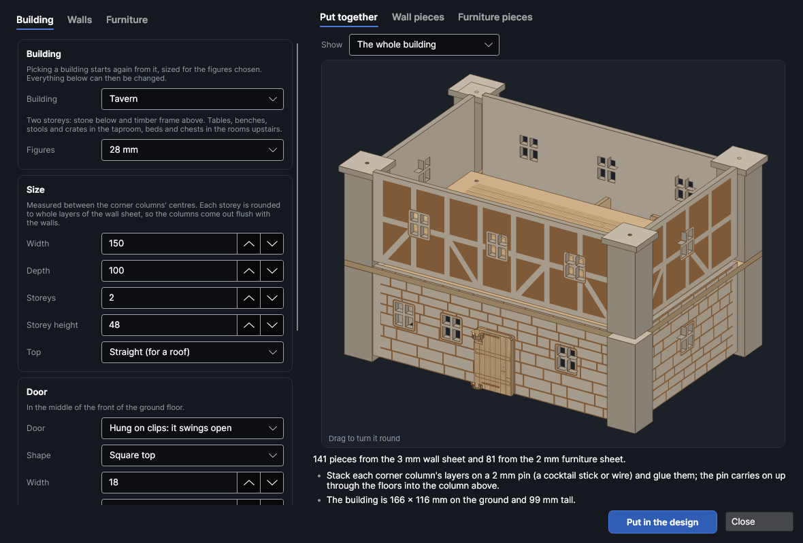

# Whole buildings

An add-on (Settings → Add-ons → **Whole-building kits**): on when PhotonCanvas is installed, and can be turned off. It needs the **Textured wall maker** and the **Mini furniture maker** add-ons, which make its pieces. Its button is **Home → Draw → Buildings**, and **Edit building…** is on the right-click menu of the pieces it made.

**Buildings** makes a whole building for tabletop games and dioramas in one go: pick a
**Cottage**, a **Tavern** or a **Watchtower** and you get every wall with its doorway and windows,
the corner columns the walls slide into, a floor between the storeys, a door that swings open, and
the furniture for every room. Each piece is made the way the wall maker
([Textured walls](walls.md)) and the furniture maker ([Mini furniture](furniture.md)) make it, so
the walls have your texture etched on and the furniture slots together.

> **Note:** The buildings have been checked on screen and in tests (every wall, column and floor is
> put together in 3D and checked for clashes, and every piece of furniture stands inside its room),
> but not yet cut on the machine. Cut one corner column and the end of one wall first, check the
> wall slides into the slot, and change **Slot fit** on the **Walls** tab if it's too tight or too loose.

## The Whole buildings window
<!-- windows: BuildingWindow -->

Click **Buildings** on the **Home** tab (in the **Draw** group). The **Whole buildings** window
opens. On the left are three tabs: **Building** (which building, its size, storeys, door and
windows), **Walls** (the sheet the walls are cut from and their texture) and **Furniture** (what's
in each room, and the sheet it's cut from). On the right, **Put together** shows the building in 3D
(drag it to turn it round), and **Wall pieces** and **Furniture pieces** show the pieces flat, one of
each, with how many of each there are. Under them are the number of pieces and notes: how it goes
together, a red ✕ that has to be fixed before the building can go in, a yellow ! worth a look.

Press **Put in the design** and every piece goes into the design, nested onto the bed, a page per
bed: first the walls' sheet, then the furniture's (when it's a different thickness, so each sheet's
pages can be cut from the right material). To change it later, select any of its pieces, right-click
and choose **Edit building…**, change the settings and press **Update in the design**: the old
pieces are replaced wherever they are.

## Pick a building

**Building** starts again from one of these, sized for the **Figures** chosen (15, 28, 32 or 54 mm;
changing **Figures** later scales every size, the furniture's too). Everything can then be changed.

| Building | What you get (at 28 mm) |
|---|---|
| **Cottage** | One storey, 110 × 80 mm between the corner columns, fieldstone walls, an arched door that swings, arched windows with a cross, and a table, two chairs, a bed, a chest and a bookshelf. |
| **Tavern** | Two storeys, 150 × 100 mm: stone blocks below and timber frame above, square windows. A taproom with two long tables, four benches, three stools, two crates and a bar counter; three beds, two chests and a chair upstairs. |
| **Watchtower** | A 72 mm square tower of two storeys with arrow slits, a floor on top with battlements round it. Crates and a chest below, two bunks, a table and stools above. |

## Size, storeys, door and windows

On the **Building** tab:

- **Width** and **Depth** are measured between the corner columns' centres (the building's outside
  is a column wider each way). **Storeys** (1 to 4) are storeys with rooms; a floor lies on the walls
  between each. **Storey height** is rounded to whole layers of the wall sheet (a note says so), so
  the columns, a stack of layers, come out exactly as tall as the walls and the floor lies flat on both.
- **Top**: *Straight (for a roof)*, or *A floor on top behind battlements*: a floor on the top
  storey with a low wall of battlements round it, **Battlements** high.
- **Door**: in the middle of the ground floor's front. *Hung on clips: it swings open* is the
  furniture maker's door for a wall, cut from the furniture sheet, on two clips slid onto the side of
  the doorway; *Loose in the doorway* is the wall maker's door that just sits in it; *Just a
  doorway* leaves it open. Its **Shape**, **Width** and **Height**.
- **Windows**: how many in the **Front and back** walls and in **Each side** wall of every storey
  (the battlements have none, and the ground floor's front fits them round the door), their
  **Shape** (*Arrow slit* for towers), size, **Sill** height above the floor and **Bars**.

## Walls and columns

On the **Walls** tab:

- **Thickness**: the wall sheet. The walls, the corner columns and the floors are all cut from it.
  Tick **Two panels back to back** for walls textured inside and out (twice as thick).
- **Slot fit**: added to the wall's thickness for the columns' slots. **Columns**: how wide the
  corner columns are. Pick your material in **Cut with** to bring in its thickness, slot fit and
  kerf.
- **Ground floor** and **Upper storeys**: the wall maker's textures (brick, stones, planks, timber
  frame and the rest), sized for the figures. **Etched as** grooves or scored lines, and
  **Variation** for a different layout of stones and planks.

Each corner column is a stack of layers with a slot for each wall and a hole up the middle: stack
them on a 2 mm pin (a cocktail stick or a piece of wire) and glue them. The floor between storeys has
a hole over each column too, so the pin carries on up into the column above and holds the storeys in
line. The floor has floorboards etched on it where it shows inside the walls.

Walls that come out the same are cut together: a cottage's two side walls are one piece ×2, a
tower's upper storey is **Walls, storey 2** ×4. Each wall also carries the wall maker's settings, so
**Match the walls in the design** in the furniture maker can fit a door or shelf to it.

## Furniture

On the **Furniture** tab, the list holds the furniture maker's pieces and the storey each stands on.
Pick one to change **Storey**, **How many** (0 leaves it out) and its **Width**, **Depth** and
**Height**; pick a kind under the list and press **Add** for more, or **Remove** it. The furniture
comes in the furniture maker's standard style; for other legs, backs or lids, make that piece with
**Home → Draw → Furniture** instead.

**Thickness** is the furniture sheet (2 mm suits 28 mm figures; use 1 mm for 15 mm figures). If a
piece of furniture is too small for the sheet, it's left out with a yellow ! saying why, and the rest
of the building still goes in.

The 3D view stands the furniture in its rooms, biggest first, against the back wall and clear of the
doorway; that's only for the picture, nothing joins it to the floor. **Show** picks *The whole
building*, *With the front cut away* (the front and right-hand walls left out, to see into the rooms)
or one storey on its own.

## Putting it together

1. Stack and glue the corner columns of the ground floor on their pins.
2. Slide the ground floor's walls into the columns' slots: the front wall (with the doorway) at the
   front. A drop of glue in each slot.
3. Lay the floor on top, its holes over the pins, and push the pins up through. Build the next
   storey's columns on the pins and slide its walls in; and so on to the top (the top columns get a
   wider cap).
4. Slide the door's clips onto the side of the doorway, one at the floor and one high up, and drop
   the door's pins into them.
5. Put the furniture together as the furniture maker says and stand it in the rooms.
