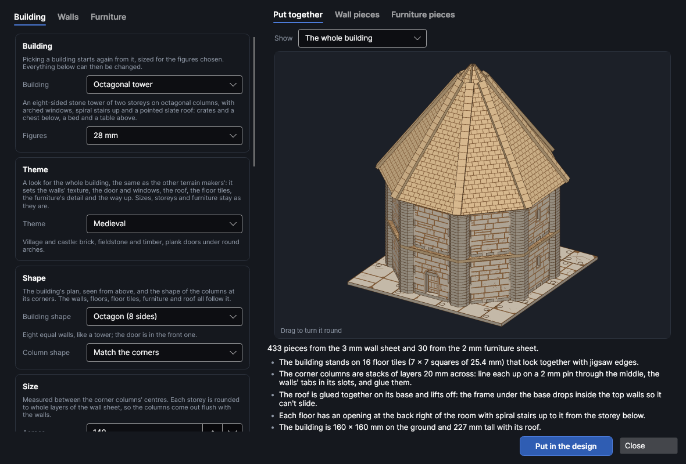
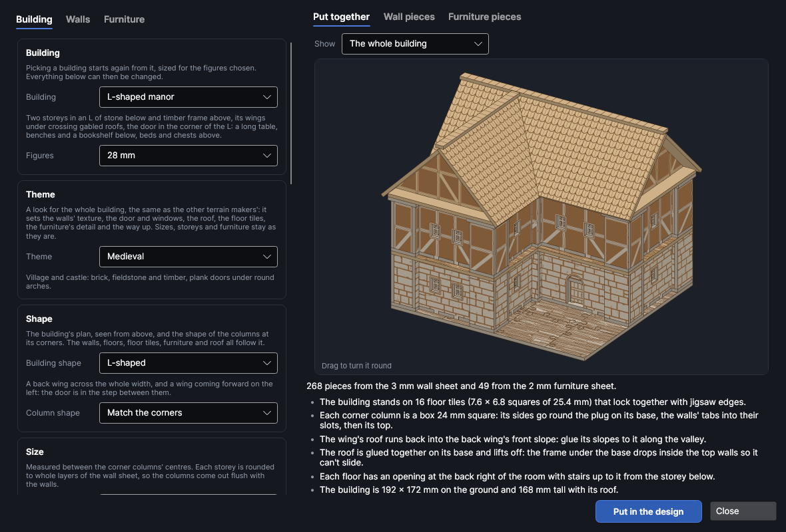
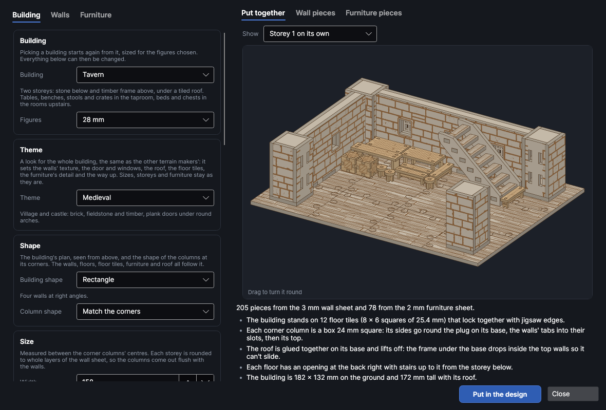

# Whole buildings

An add-on (Settings → Add-ons → **Whole-building kits**): on when PhotonCanvas is installed, and can be turned off. It needs the **Textured wall maker**, **Mini furniture maker**, **Floor tile maker**, **Stairs, ladders and floors** and **Roofs and towers** add-ons, which make its pieces. Its button is **Home → Draw → Buildings**, and **Edit building…** is on the right-click menu of the pieces it made.

**Buildings** makes a whole building for tabletop games and dioramas in one go: pick a
**Cottage**, a **Tavern** or a **Watchtower** (or a sci-fi outpost, a gothic chapel, a dungeon crypt,
an adobe house, an octagonal tower or an L-shaped manor) and you get every wall with its doorway and windows,
the corner columns the walls go into, the floor tiles it stands on, a floor between the storeys
with stairs or a ladder up to it, a roof that lifts off, a door that swings open, and the furniture
for every room. Each
piece is made the way the wall maker ([Textured walls](walls.md)), the furniture maker
([Mini furniture](furniture.md)), the floor tile maker ([Floor tiles](floortiles.md)), the stair
maker ([Stairs and floors](stairs.md)) and the roof maker ([Roofs and towers](roofs.md)) make it, so the walls have your texture etched on, the tiles
jigsaw together and the furniture slots together.

> **Note:** The buildings have been checked on screen and in tests (every wall, column and floor is
> put together in 3D and checked for clashes, and every piece of furniture stands inside its room),
> but not yet cut on the machine. Cut one corner column and the end of one wall first, check the
> wall's tabs go into the column's slots, and change **Slot fit** on the **Walls** tab if they're too tight or too loose.

## The Whole buildings window
<!-- windows: BuildingWindow -->

Click **Buildings** on the **Home** tab (in the **Draw** group). The **Whole buildings** window
opens. On the left are three tabs: **Building** (which building, its size, storeys, door and
windows), **Walls** (the sheet the walls are cut from and their texture) and **Furniture** (what's
in each room, and the sheet it's cut from). On the right, **Put together** shows the building in 3D
(drag it to turn it round), and **Wall pieces** and **Furniture pieces** show the pieces flat, one of
each, with how many of each there are. Under them are the number of pieces and notes: how it goes
together, a red ✕ that has to be fixed before the building can go in, a yellow ! worth a look.

Press **Put in the design** and every piece goes into the design, nested onto the bed, a page per
bed: first the walls' sheet, then the furniture's (when it's a different thickness, so each sheet's
pages can be cut from the right material). To change it later, select any of its pieces, right-click
and choose **Edit building…**, change the settings and press **Update in the design**: the old
pieces are replaced wherever they are.

## Pick a building

**Building** starts again from one of these, sized for the **Figures** chosen (15, 28, 32 or 54 mm;
changing **Figures** later scales every size, the furniture's too). Everything can then be changed.

Each comes with box walls 12 mm thick on boxed corner columns 24 mm across (the octagonal tower's columns are octagonal stacks) (see [Walls and columns](#walls-and-columns)); the sizes below are between the columns' centres.

| Building | What you get (at 28 mm) |
|---|---|
| **Cottage** | One storey, 118 × 88 mm between the corner columns, fieldstone walls on flagstone tiles under a thatched roof, an arched door that swings, arched windows with a cross, and a table, two chairs, a bed, a chest and a bookshelf. |
| **Tavern** | Two storeys, 158 × 108 mm: stone blocks below and timber frame above, square windows, stairs up, floorboard tiles and a clay-tiled roof. A taproom with two long tables, four benches, three stools, two crates and a bar counter; three beds, two chests and a chair upstairs. |
| **Watchtower** | An 80 mm square tower of two storeys with arrow slits, a ladder up to each floor, a floor on top with battlements round it, on dungeon flagstones. Crates and a chest below, two bunks, a table and stools above. |
| **Sci-fi outpost** | One storey, 118 × 93 mm of sci-fi panels under a corrugated lean-to roof, on a sci-fi deck, with a metal blast door with angled corners glued into its doorway and wide angled windows. Bunks, lockers, a mess table, chairs and crates with metal panels and rivets. |
| **Gothic chapel** | One tall storey, 88 × 144 mm, of fine stone blocks under a steep slate roof, on chequered tiles, with a pointed door that swings and three tall pointed windows down each side. Six pews, an altar, two high-backed chairs and a bookshelf. |
| **Dungeon crypt** | One squat storey, 108 mm square, of dungeon blocks under a low slate roof, on dungeon flagstones, with a studded door glued into its arched doorway and small barred windows high up. A tomb, chests, crates and a bench. |
| **Octagonal tower** | Two storeys of stone blocks, 140 mm across, its eight walls 58 mm long between the centres of its octagonal columns (20 mm across, stacked on pins), under a steep pointed slate roof, with arched windows in every wall, spiral stairs up and an arched door that swings. Crates and a chest below, a bed and a table above. |
| **L-shaped manor** | Two storeys in an L, 168 × 148 mm with wings 78 mm wide: stone blocks below and timber frame above, square windows, under clay-tiled gables that meet over the corner, the door in the step between the wings. A long table, benches and a bookshelf below, beds and chests above. |
| **Adobe house** | Two storeys, 108 × 88 mm: sandstone below and adobe plaster above, a flat roof behind a low wall, a ladder up, on sandstone slabs, with small square windows. A low round table, stools, a chest and crates below, two beds and a chest above. |

## Themes

**Theme**, under **Building**, is a look for the whole building, the same as the other terrain
makers', so a themed building matches walls, roofs, floor tiles, scatter and furniture made on their
own in that theme. It sets the walls' texture (stone below and timber frame above on a medieval
building of two storeys or more; sandstone below and adobe above in the desert), the door's shape
and look, the windows' shape, size and bars (lowering their sill if they're taller), the roof's
covering and pitch, the floor tiles, the furniture's faces and the way up (a ladder for sci-fi and
desert, spiral stairs for gothic; *None* stays *None*). The size, storeys and furniture list stay as
they are. A watchtower keeps its arrow slits in the medieval, dungeon and gothic looks.

A door that swings is only made for square, arched and pointed doorways: a sci-fi or cave doorway
gets a loose door instead (a note says so).
## Building shape and column shape

On the **Building** tab, **Shape** picks the building's plan as seen from above. The walls, the
corner columns, the floors between storeys, the floor tiles, the furniture and the roof all follow it.

- **Building shape**:
  - *Rectangle*: four walls at right angles (the usual).
  - *L-shaped*, *T-shaped* and *U-shaped*: a back wing across the whole **Width**, with wings
    **Wing width** wide coming forward to the full **Depth**. An L's wing is on the left and its door
    is in the step between the wings. A T's wing comes from the middle with the door in its front. A
    U has a wing at each end round a courtyard, with the door in the courtyard.
  - *Hexagon*, *Octagon* and *Round*: equal flat walls all round, like a tower. **Width** becomes
    **Across**: from the middle of one side to the middle of the side opposite, between the columns'
    centres. *Round* has as many **Sides** as you pick (an even number from 6 to 24, 10 to start
    with; more is rounder but each wall is narrower). The door is in the front wall. Where that wall
    is too short for the door, the door is made narrower (down to two thirds of its width), and
    with flat walls a door that would swing on clips sits loose in the doorway instead. A note says
    so.

  Each wall of another shape gets **Each side** windows, or fewer if the wall is too narrow (the
  front fits them round the door).
- **Column shape**: the corner columns' shape.
  - *Match the corners* (the usual) picks for each corner: square at right angles, octagonal at an
    octagon's corners, and hexagonal or round at others.
  - Or pick *Square*, *Chamfered square* (its corners cut off), *Octagonal*, *Hexagonal*, *Round* or
    *Fluted* (round with grooves down it, kept clear of the walls' slots).

  A column only takes walls at the angles its sides allow. A square or chamfered column needs right
  angles, an octagonal one 45° steps, and a hexagonal one 60° steps. Where the shape you picked
  doesn't suit a corner (a square column on an octagon, say), that corner gets the nearest shape that
  does, and a note says so. Round and fluted columns suit any corner. Their width is **Columns** on
  the **Walls** tab.

  With box walls, square columns are boxes (see [Walls and columns](#walls-and-columns)). Every other
  shape is a stack of layers on a 2 mm pin, the same as flat walls' columns, with slots at the
  corner's angles for the box walls' end tabs.

## Size, storeys, roof, floor tiles, door and windows

On the **Building** tab:

- **Width** and **Depth** are measured between the corner columns' centres (the building's outside
  is a column wider each way). **Storeys** (1 to 4) are storeys with rooms; a floor lies on the walls
  between each. **Storey height** is rounded to whole layers of the wall sheet (a note says so), so
  the columns come out exactly as tall as the walls and the floor lies flat on both.
- **Top**: *Straight (for a roof)*, or *A floor on top behind battlements*: a floor on the top
  storey with a low wall of battlements round it, **Battlements** high.
- **Way up**: *Stairs*, *Spiral stairs*, *Ladder* or *None (a plain floor)*. Each floor gets an
  opening in its back right corner, away from the door (in a building of another shape, in the
  biggest square corner of the room that's clear of the door), with the stair maker's stairs or ladder
  standing under it on the storey below. The furniture is kept clear of them, and of the space
  under the opening upstairs.
- **Roof** (with straight walls on top): the roof maker's roof. Only the roofs that suit the
  building's shape are listed:
  - A rectangle can have *Gable*, *Hipped* or *Lean-to*, with its ridge along the longer side.
  - An L, T or U gets *Gables (meeting over the corners)*: the back wing's gable roof, with each
    wing's gable roof running back into its front slope and cut along the valley where they meet.
  - A hexagon, an octagon or a round tower gets *Pointed*: a triangular slope over every wall, rising
    to a point. Two crossed boards standing in slots in the base hold the slopes up, and a cap lies
    over each hip. Glue a bead or a cocktail stick on top as a finial.
  - *None (a flat top)* suits any shape. It's built on a base as
  big as the column caps, resting on them, with a frame under the base that drops inside the top
  walls so it can't slide; the gable ends get the top storey's wall texture. It's glued together and
  lifts off to show the rooms. Pick its **Covering** (slate, wooden shingles, clay tiles, thatch and
  the rest, etched on the slopes and sized for the figures), its **Pitch** and how far the
  **Eaves** reach past the walls.
- **Floor tiles under the building**: the floor tile maker's jigsaw tiles, cut from the wall sheet,
  covering the building's outside and as much **Yard** round it as you like (rounded up to a whole
  grid square where the edge row would be thinner than half a square). The walls and columns
  stand on them. Pick their **Texture** (flagstones, floorboards, cobbles and the rest) and the
  **Grid square** they're laid out on (25.4 mm, an inch, for 28–32 mm figures). Untick it to stand
  the building straight on the table.
- **Door**: in the middle of the ground floor's front (or the door wall of an L, T or U, above). With box walls, the first choice hangs the
  wall maker's door on pins inside the wall so it swings open (a portcullis slides up instead), and
  *Loose in the doorway* glues it into a groove round the doorway. With flat walls, the first choice is
  the furniture maker's door for a wall, cut from the furniture sheet, on two clips slid onto the side
  of the doorway, and *Loose in the doorway* is the wall maker's door that just sits in it. *Just a
  doorway* leaves it open. Its **Shape** (square top, round arch, pointed arch, angled corners or a rough cave mouth), **Look**
(the wall maker's door: planks, iron studs, a metal blast door, a portcullis or a stone slab),
**Width** and **Height**.
- **Windows**: how many in the **Front and back** walls and in **Each side** wall of every storey
  (the battlements have none, and the ground floor's front fits them round the door), their
  **Shape** (*Arrow slit* for towers, angled corners for sci-fi, rough for a cave), size, **Sill** height above the floor and **Bars**.
  With box walls, **In the windows** is what fills them: a frame with the bars in it (the usual), a
  shutter glued in, shutters that swing open, or nothing (the bars left in the wall).

## Walls and columns

On the **Walls** tab:

- **Walls**: *Boxes* (the usual) or *Flat*. A box wall is the wall maker's box wall
  ([Boxed walls](walls.md#boxed-walls)): a textured outside and inside, a base, a top, ends and ribs,
  lined round its door and windows, **Wall thickness** thick (12 mm for 3 mm sheet). Its corner
  columns are boxes too: four sides with slots for the walls' tabs, on a base plate with a plug, flush
  on top under the floor above, with a cap on the top storey (battlements round a parapet). A flat
  wall is one sheet thick in columns of stacked layers; tick **Two panels back to back** for walls
  textured inside and out (twice as thick). Buildings made before box walls keep their flat walls.
- **Panel thickness**: the wall sheet. The walls, the corner columns, the floors, the stairs, the roof and the floor tiles are all cut from it.
- **Slot fit**: added to the slots the walls go into. **Columns**: how wide the corner columns
  are. Box walls need columns at least the wall's thickness plus two sheets and 2 mm across (picking
  *Boxes* widens them if they're too thin). Pick your material in **Cut with** to bring in its thickness, slot fit and
  kerf.
- **Ground floor** and **Upper storeys**: the wall maker's textures (brick, stones, planks, timber
  frame and the rest), sized for the figures. **Etched as** grooves or scored lines, and
  **Variation** for a different layout of stones and planks.

With flat walls, each corner column is a stack of layers with a slot for each wall and a hole up the
middle: stack them on a 2 mm pin (a cocktail stick or a piece of wire) and glue them. The floor
between storeys has a hole over each column too, so the pin carries on up into the column above and
holds the storeys in line. With box walls the floor is glued onto the walls' and columns' tops. The floor has floorboards etched on it, and the stairs or ladder up to it are the stair
maker's, cut from the same sheet.

Walls that come out the same are cut together: a cottage's two side walls are one piece ×2, a
tower's upper storey is **Walls, storey 2** ×4. A box wall's other pieces are listed after it
(**Side walls: back**, **Side walls: base** and so on). Each wall also carries the wall maker's settings, so
**Match the walls in the design** in the furniture maker can fit a door or shelf to it.

## Furniture

On the **Furniture** tab, the list holds the furniture maker's pieces and the storey each stands on.
Pick one to change **Storey**, **How many** (0 leaves it out) and its **Width**, **Depth** and
**Height**; pick a kind under the list and press **Add** for more, or **Remove** it. The furniture
comes in the furniture maker's standard style; for other legs, backs or lids, make that piece with
**Home → Draw → Furniture** instead.

**Thickness** is the furniture sheet (2 mm suits 28 mm figures; use 1 mm for 15 mm figures).
**Joints** *Push fit (grip ribs, no glue)* adds the furniture maker's small ribs to every slot, so
the furniture holds together without glue; **Grip** sets how tight. **Faces** is the furniture
maker's detail: *None*, *Wood grain*, *Planks and grain*, *Metal panels and rivets (sci-fi)* or
*Stone (cracks and pits)*; the floors between storeys match it (floorboards, deck plates or stone,
or plain with *None*). If a
piece of furniture is too small for the sheet, it's left out with a yellow ! saying why, and the rest
of the building still goes in.

The 3D view stands the furniture in its rooms, biggest first, against the back wall and clear of the
doorway; that's only for the picture, nothing joins it to the floor. **Show** picks *The whole
building*, *With the front cut away* (the roof and the front and right-hand walls left out, to see into the rooms)
or one storey on its own.

## Putting it together

1. Jigsaw the floor tiles together, if you made them, and stand the building on them.
2. Box walls: build each wall as the wall maker says (the faces on the base, the ends, ribs and
   linings, the door hung on its pins before the back goes on, the top). Build each corner column
   round the plug on its base, the walls' end tabs in its sides' slots as you go, then its top.
   Flat walls: stack and glue the corner columns of the ground floor on their pins, and slide the
   walls into the columns' slots.
3. The front wall (with the doorway) goes at the front. A drop of glue in each slot.
4. Put the stairs or ladder together as the stair maker says and stand it in the back right
   corner, under where the opening will be. Lay the floor on top, its holes over the pins, and push
   the pins up through (flat walls; box walls' floors are glued on). Build the next storey the same
   way on the floor; and so on to the top (the top columns get a wider cap).
5. Flat walls: slide the door's clips onto the side of the doorway, one at the floor and one high
   up, and drop the door's pins into them.
6. Put the furniture together as the furniture maker says and stand it in the rooms.
7. Glue the roof together on its base as the roof maker says, and lift it onto the top storey's
   column caps, the frame underneath inside the walls. A pointed roof: slot the two cross boards
   together halfway and stand them in the base's slots, then glue the slopes to them and to each
   other along the hips, then the hip caps. An L, T or U: glue the back wing's roof first, then each
   wing's slopes up into the valley against it.
