# City builder

An add-on (Settings → Add-ons → **City builder**): on when PhotonCanvas is installed, and can be
turned off. It needs the **Building editor** and **Map to terrain** add-ons (and the makers they use, the
**Mini furniture maker** among them), the **Floor tile maker**, the **Miniature bridge maker** and the
**Scatter terrain maker**: every building on the map is a building editor building, the battle map
reader finds a picture's grid the way Map to terrain does, and the ground, bridges, walls, trees and
scenery are cut by the others. Its button is **Home → Draw → City**.

**City** lays out a whole town, village or city on one big map: the ground of every square (grass,
paving, water, fields…), the roads laid over it (each named, two squares wide for a street and four
for a high road, on bridges over water), the buildings standing on it, fences, hedges and town walls
from point to point (capped at their ends, a gatehouse wherever a road goes through), and trees,
rocks, wells and carts. Start from an empty map, from the sample village, or
from a 2D battle map picture: the city builder reads it as a best guess of the town seen from above
and you put right whatever it got wrong. Each building opens in the [building editor](houseeditor.md)
to change its rooms, doors, furniture and roof, and comes out as its laser-cut pieces.

> **Note:** The 3D view is a light one on purpose: plain blocks and flat colours, no textures and no
> engraving depth, so even a big town turns round quickly. The textures are on each building's own
> pieces (and in the building editor's 3D view).

## The City builder window
<!-- windows: CityWindow -->

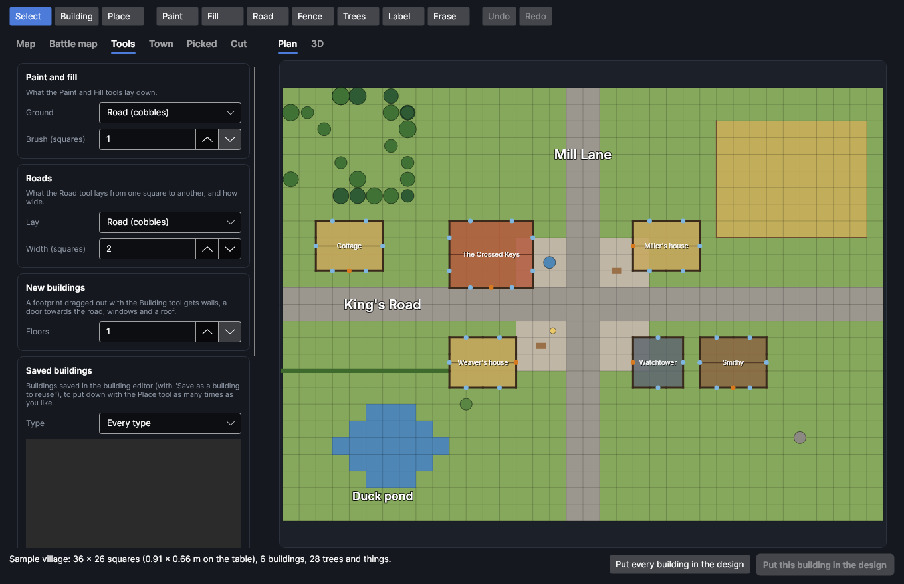

Click **City** on the **Home** tab (in the **Draw** group). The **City builder** window opens with
the last map you worked on (the first time, a small sample village). It's laid out like a map maker:

- **The toolbar** along the top: a new map, open and save as (the first three buttons), **Undo**
  and **Redo**, **Snap** (where what you put down lands), **Plan** or **3D**, and the window's jobs,
  each opening its page on the right: **Town maker** (a town made for you), **Battle map** (reading a
  picture), **Picture** (saving the map as a battle map picture) and **Cut** (putting the town's
  pieces in the design). **Help** has this page and the tutorial.
- **The tools** down the left (the number keys `1` to `0` pick them, top to bottom), and beside them
  what the tool picked puts down, in pictures: the grounds to paint, the roads, walls and fences, the
  trees and things, your saved buildings.
- **The plan** in the middle: the map from above, to draw on (or the town in 3D). The buttons in its
  bottom right corner show the whole map and zoom in and out.
- **The tabs** on the right: **Picked** (what's picked on the plan, to change it), **Town** (every
  building, to find one) and **Map** (its name, look and size). A page opened from the toolbar shows
  here instead; close it with the cross in its corner, or press its button again.
- **The bar** along the bottom: the square under the pointer, what was last done, how big the map is
  on the table, how many buildings, roads and trees there are, and whether any buildings stand on
  the same squares (they show red on the plan).

The map is saved as you go and opens again next time.

### Moving round the plan

Scroll to zoom in on what's under the pointer; drag with the middle mouse button (or hold Shift and
drag) to move round; press `F` to see the whole map again. The grid shows once you're zoomed in far
enough, and each building's name once it's big enough to read.

## The tools

| Tool | What it does |
|---|---|
| **Select** | Click a building, a road, a wall or fence, a tree or thing or a label to pick it (its settings show on the **Picked** tab); Ctrl and click picks more, or takes one out again. Drag a box from an empty spot to pick everything inside it. Drag anything picked to move it all, a whole square at a time (the mouse wheel turns it while you drag). A road or wall picked on its own shows handles to stretch and bend it (see [Roads and walls](#roads-and-walls)). Double-click a building to open it in the [building editor](houseeditor.md). See [Picking several things](#picking-several-things) for the keys. |
| **Building** | Drag out a rectangle: a new building stands on it, with walls round it, a door towards the nearest road or paving, windows along the walls and a roof (as many floors as **Floors** beside the tools says). With the right button, click a building to take it away. |
| **Place** | Put down a saved building (pick it from the pictures beside the tools first; see [Saved buildings](#saved-buildings)): click where its top left corner goes. `R`, the right button or Ctrl + the mouse wheel turns it before you click. |
| **Paint** | Paint the ground picked from the pictures beside the tools (grass, dirt, cobbled road, paving, sand, water, rock, fields or an inside floor), as many squares across as **Brush (squares)**. The right button paints grass. |
| **Fill** | Pick a ground the same way, then click a patch of one ground to fill it all with it (the right button fills it with grass). |
| **Road** | Drag from one point to another to lay a road there, round one corner; hold Ctrl for a straight line however it slants. What it's laid with (**Cobbles**, a **Dirt track**, **Paving** or **Sand**, in pictures beside the tools) and how many squares wide: **Lane (2)** for a street, **High road (4)**, or any **Width (squares)**. It gets a street name of its own, stops at the first building in its way, and crosses water on a bridge. Drawn on from the end of another of the same kind, it carries that one on. The right button takes a road away. |
| **Wall** | Drag to put up the kind picked beside the tools: a **Fence**, a **Hedge**, a **Stone wall** or a **Town wall**, as **A line** (it bends in eighths of a turn unless you hold Ctrl) or **A rectangle** all the way round. Drawn on from the end of another of the same kind, it carries that one on, and closes into a ring when it meets its own start. The right button cuts a gap in one. |
| **Things** | Click to put down the tree or thing picked from the pictures beside the tools: under **Trees and rocks** a tree, a pine tree, a bush or a boulder; **In the street** a well, a cart, crates and barrels, a lamp, a statue, a horse trough, a notice board or a fountain (two squares by two); **On the square** a market stall, an outdoor bar, a players' stage (three squares by two) or a gallows; and under **Defences** a guard tower (two squares by two: put it on a grid point of a town wall and it stands astride the wall). The right button takes them away. |
| **Label** | Click to write the **Text** beside the tools there, turned as far as **Turn (degrees)** says (`R` turns it 15° more, Shift+`R` back): a district's name, a number for your game master's key. Labels always read the right way up. The right button takes one away. |
| **Erase** | Drag over labels, trees, roads, fences and buildings to take them away. |

**Snap** on the toolbar says where what you put down and drag lands: on **Whole** squares, **Half**
squares or anywhere (**Free**). A road keeps its middle line where its squares fall (on a grid line
for an even width, through the middles of squares for an odd one); trees and small things go to
quarter squares.

**Undo** and **Redo** on the toolbar (`Ctrl+Z`, `Ctrl+Y`) go back and forward a step at a time.

### Picking several things

With **Select**, everything picked shows orange, and these keys work on all of it:

| Key | What it does |
|---|---|
| `R` (Shift+`R`) | Turn it a quarter turn about its middle, clockwise (the other way). Four turns bring it back where it was. |
| Arrow keys | Move it a square. |
| `Delete` | Take it away. |
| `Ctrl+C`, `Ctrl+X`, `Ctrl+V` | Copy it, cut it, and put a copy down with its top left corner on the square under the pointer. |
| `Ctrl+D` | Put a copy beside it. |
| `Ctrl+A` | Pick everything on the map. |
| `Esc` | Pick nothing. |

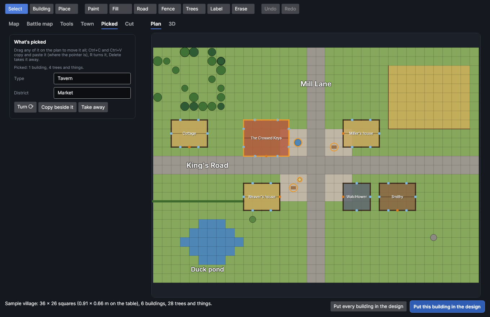

### Roads and walls

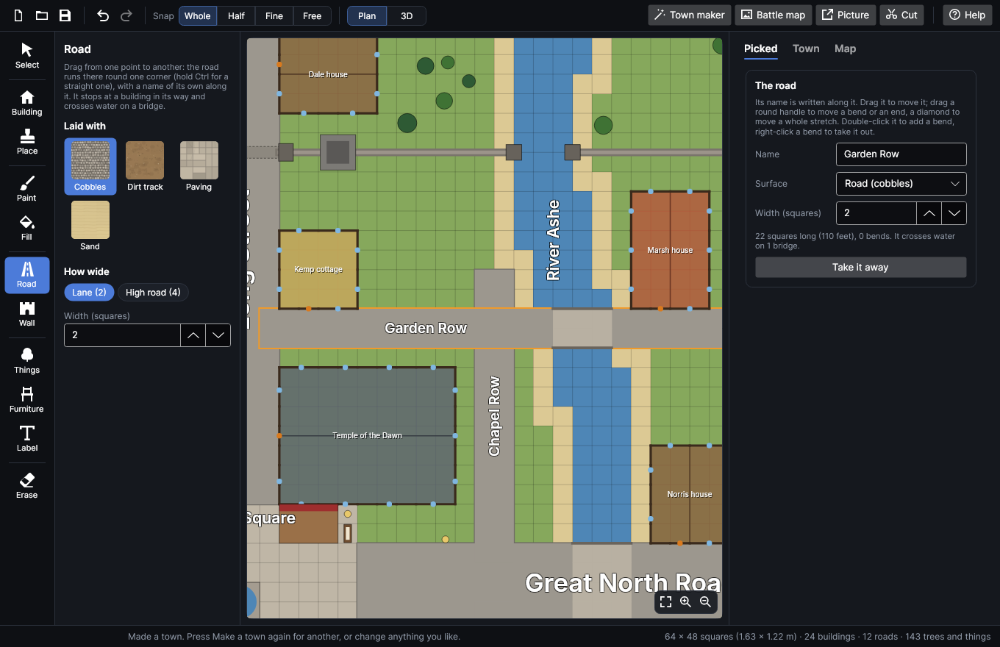

Roads lie on top of the ground: take one away and the grass (or the river) is still under it. Each has
its name written along it, the right way up (left to right, or reading upwards), slid along clear of
the roads crossing it. Roads can cross and overlap each other, but never run through a building: one
laid, moved or widened into a building stops short of it (or goes back where it was) and the bar at
the bottom says why. Where a road crosses water it's on a bridge, drawn on the plan, on the picture
and in 3D, and cut with **Put the bridges in the design**.

Walls and fences run from point to point, on the grid or at any angle. Where a road goes through a
town wall there's a gatehouse as wide as the road (through a fence or hedge, just a gap), and
moving the road takes its gate with it. Where water crosses one, it stops either side. A guard tower
put astride one splits it, each side meeting the tower. Every other end is capped: a turret on a town
wall, a pillar on a stone wall, a post on a fence. A wall ticked **Ruined** has no caps or
gatehouses: its ends and gaps are left broken.

Pick a road or wall on its own with **Select** and handles show on it: drag a round one to move a
bend, a corner or an end, and a diamond (halfway along each stretch) to move that whole stretch
sideways. Double-click the road or wall to put a new bend there; right-click a round handle to take
that bend out. Dragging the road or wall itself moves all of it.

## The map

On the **Map** tab:

- **Name**: the town's name.
- **Look**: the theme new buildings are made in (medieval, dungeon, cave, sci-fi, desert or
  gothic): their walls' texture, doors, windows and roofs.
- **Squares across** and **Squares down**, then **Make it this size**: the map's size, up to 300
  squares each way. Squares added at the right and bottom are grass; buildings that would hang off
  the edge are taken away.
- **Square (mm)**: one square on the table. 25.4 mm (an inch) is the usual battle map square for
  28–32 mm figures.
- The first three buttons on the toolbar start a new map (all grass, the size above), open one and
  save the map as a file (once saved, changes go on being saved to the file). **Sample village**
  brings back the sample.

## Making a town for you

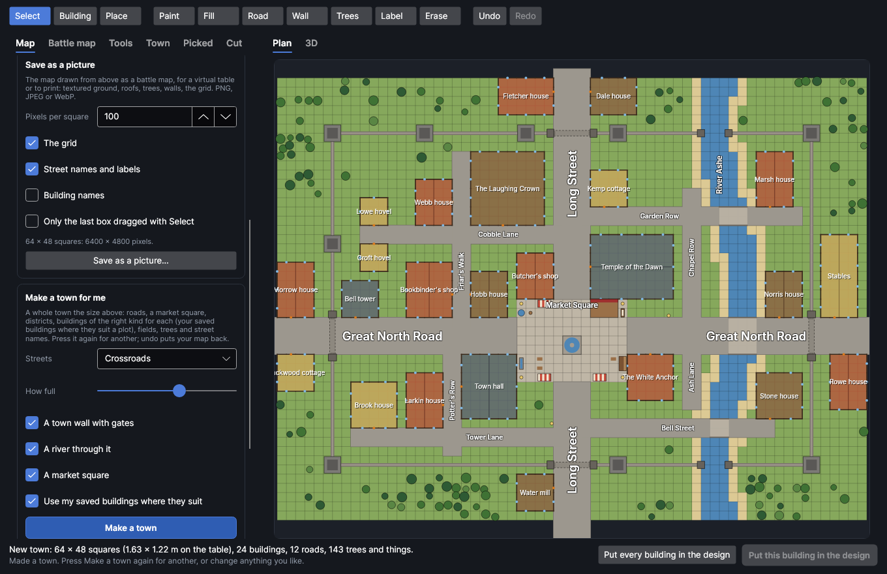

**Town maker** on the toolbar opens its page: it makes a whole town **Squares across** by **Squares
down** (up to 300 each way, in a few seconds), in the map's **Look**:

- **Streets**: how its roads run. **Crossroads**: two main roads crossing, with lanes off them in
  each quarter. **Main street**: one wide street through the town with lanes off it (and back streets
  in a big town). **Grid of streets**: streets in a grid, the main two wider. **Winding road**: a main
  road wandering across, and lanes wandering along beside it. **Riverside**: a river along the
  bottom with a paved quay, a main road along the town, lanes down to the water and back streets.
- **How full**: further left, a house here and there; further right, buildings packed side by side.
- **A town wall with gates**: a town wall all the way round it, with a gatehouse wherever a road goes
  through, a guard tower astride each corner and others every dozen squares or so, guardhouses by the
  gates and farms with fields outside. Nothing is built against it, inside or out.
- **A river through it**: a river down one side with a square of shore along each bank, a bridge
  wherever a road crosses it, warehouses along it. Lanes running along it stop short of the bank.
- **A market square**: a paved square where the main roads meet, with a temple, a town hall and a
  tavern facing it, and on it a fountain in the middle (a well on a small square), a players' stage,
  market stalls, an outdoor bar, a notice board, a horse trough, a well, carts, crates, a statue and
  lamps, clear of the roads through it. A dungeon or gothic town's square has a gallows too.
- **Use my saved buildings where they suit**: a plot gets one of your saved buildings when its
  district (and type) suits, turned to face the road.

Press **Make a town** for the town; press it again for another one (each is different), and undo
puts your map back. The high roads through it are four squares wide and the lanes two, each with its
own name. Every building faces its road with its door, is of the right kind for its part of town,
which is its **District**, and is the size such a building is on a battle map of five-foot squares (a
cottage four squares by four, a town house four or five by six, a tavern eight by eight, a temple
nine by thirteen): shops, workshops and taverns in the market, houses round it, a noble quarter of
manors, warehouses at the docks, hovels at the town's edge, barns and a stable on the farms. There's a
square of ground between buildings, so none touch. A town has one of each trade's shop or workshop,
one smithy, stable and mill (a few more in a city), and each building has a name of its own: a
family's for the houses and cottages (*the Ashford house*, *Thorne cottage*), *Baker's shop*,
*The Golden Goose*; change any of them on the **Picked** tab. There are lamps along the high roads,
trees in the gardens and woods outside. Under the button it says what was made. Then change anything
you like: it's an ordinary map.

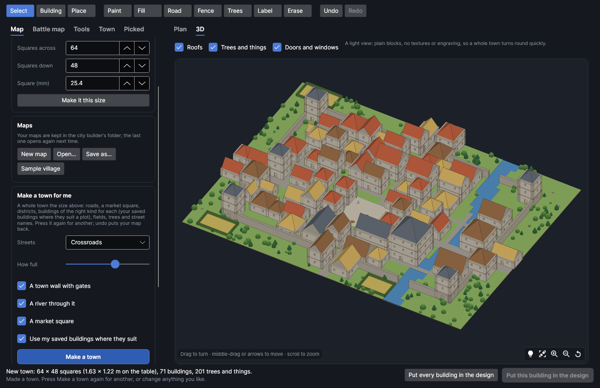

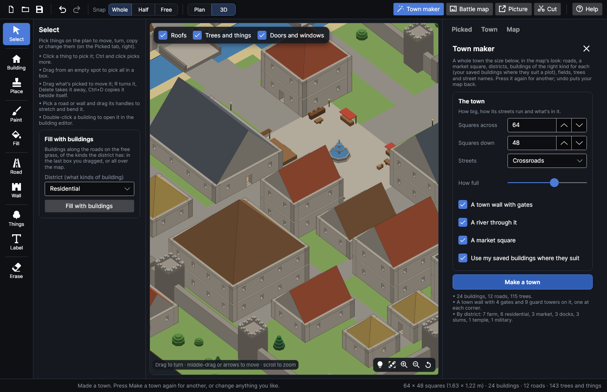

### Filling the roads with buildings

**Fill with buildings** (beside the tools when **Select** is picked) puts buildings along the roads (and round paved squares) on the free grass,
facing the road, as full as **How full** says, of the kinds for the **District** picked, a square apart
and clear of the walls and fences, with names the town hasn't got yet; your saved buildings where they
suit, if that's ticked. With **Select**, drag a box first to fill only inside it
(it stays dashed on the plan until you click again); otherwise it fills the whole map. Lay out roads
with **Road**, then fill each part of town with its own district.

## Saving it as a battle map picture

**Picture** on the toolbar opens its page; **Save as a picture…** there saves the map drawn from above
as a battle map, for a virtual table or to print: textured ground (cobbles, flagstones, grass, water with its banks, fields),
every roof with its tiles, thatch or slates lit from one side, shadows, trees, wells and carts,
fences, hedges and town walls, and the grid. Pick PNG, JPEG or WebP when you save it.

- **Pixels per square**: 70 to 140 suits most virtual tables. To print it, 100 pixels to a square
  printed an inch across is 100 dots to the inch. A very big map is drawn at fewer pixels to a square
  (at most 16,000 pixels each way); it says so under the settings.
- **The grid**, **Street names and labels**, **Building names**: what's drawn over it.
- **Only the last box dragged with Select**: just that part of the map (drag a box with **Select**
  first), say one street for tonight's game.

## Reading a battle map
<!-- windows: CityWindow -->

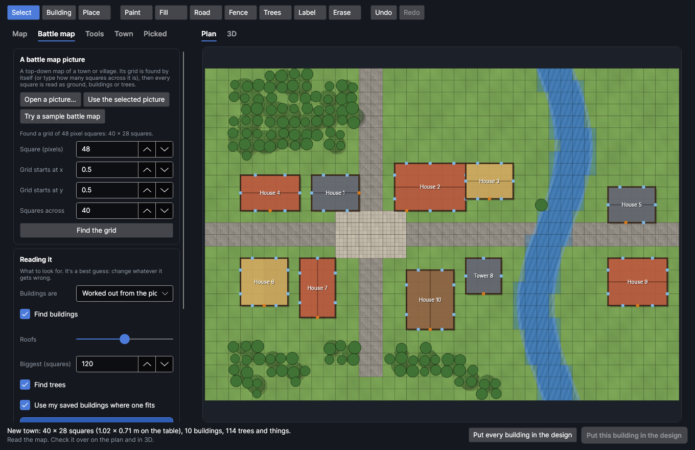

Press **Battle map** on the toolbar, then **Open a picture…** and pick a top-down map of a town (PNG, JPEG,
WebP…), or **Use the selected picture** for one already in the design, or **Try a sample battle
map** to see how it works. The picture shows under the plan and its grid is found by itself (the thin
lines that repeat evenly right across the picture, dark or light, to a fraction of a pixel; the heavy
outlines of the buildings don't pass for a coarser grid): check **Square (pixels)**, **Grid starts at
x** and **Grid starts at y**, or press **Find the grid** again. For a picture with no grid lines, type
how many **Squares across** it is.

Then press **Read the map**. It makes a new map from the picture (undo puts the old one back):

- **The ground**: every square sorted by its colour into grass, dirt, cobbled road, paving, sand,
  water, rock or fields.
- **Buildings seen from above**: each roof is found as its own patch of colour with an outline
  drawn round it (a line, or a clean change of colour), at whatever angle it sits: a rectangle, or
  an L or a T of two or three, with the grid's own lines taken out first so they don't pass for an
  outline and the two slopes of a pitched roof (one lit, one in shade, the ridge between them)
  joined into one. What's cobbled or gravelled inside (strokes running every way, where a roof's
  tiles run in rows) is a road or a yard, not a roof; so is a strip that runs off the picture at both
  ends. A roof square to the grid becomes a building on whole squares, matched to its footprint; one
  at an angle keeps its angle (see **Tilt** on the **Picked** tab). Each gets walls round it, a door
  towards the road, windows and a roof whose covering is guessed from its colour (red: clay tiles,
  yellow: thatch, brown: wooden shingles, grey: slate). Its size guesses how many floors it has and
  what it is (a shed, a house, a hall, a tower).
- **Buildings drawn as floor plans**: rooms closed in by walls drawn in dark lines. Rooms that share
  a line are one building, with that line as a wall inside it, and a gap in its outside line is its
  door.
- **Trees**: the green squares that are clearly darker or busier than the usual grass, and the
  yellow-green ones busy with leaves; a clump of a few squares is one tree, sized to it.

The settings:

- **Buildings are**: **Worked out from the picture** looks for both; pick **Seen from above
  (roofs)** or **Drawn as floor plans (walls in lines)** when you know which.
- **Find buildings**, **Find trees**: untick either to leave them out.
- **Roofs**: how much of a roof's outline has to show. Further left finds more roofs (and more
  mistakes: sheds, carts, patches of yard), further right only the clearest.
- **Biggest (squares)**: anything bigger than this is ground (a market square, a field), not a building.
- **Use my saved buildings where one fits**: a rectangular roof the same size as one of your saved
  buildings (either way round) gets that building, turned so its door faces the road, instead of one
  made up.
- **Show the picture under the plan** and **Ground colours** (how strongly the ground read is painted
  over the picture), to check one against the other.

It's a best guess: paint the ground, move, turn, copy and change the buildings to put right what it
got wrong.

## What's picked

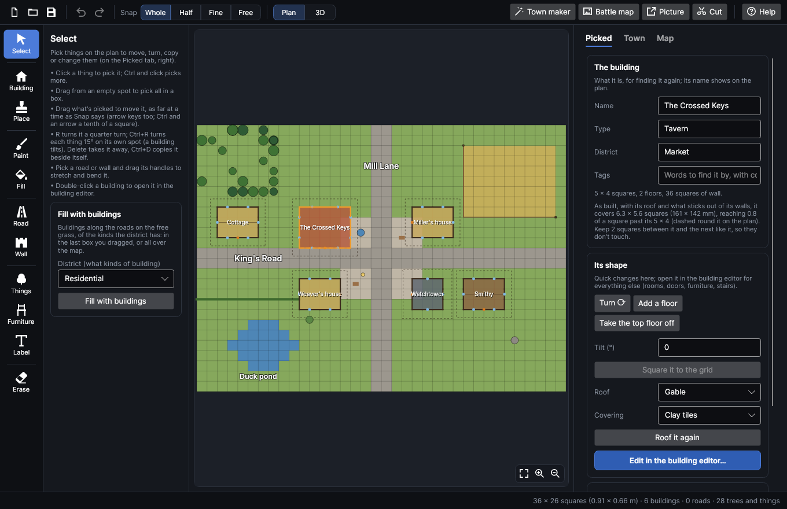

Click a building with **Select** and the **Picked** tab shows it (double-click it to go straight to
the building editor):

- **Name**, **Type** (house, shop, tavern, temple…: anything you like), **District** (residential,
  market, docks…) and **Tags** (words to find it by, with commas between). The name shows on the plan.
- **Tilt (°)**: a building read off a map at an angle keeps its angle, clockwise degrees past its
  quarter turns, turning about its own middle; type another, or 0 to straighten it. **Square it to
  the grid** straightens it and puts it back on whole squares. (A tilted building draws, picks, turns
  and cuts like any other; it stands on every square it covers any part of.)
- **Turn ⟳** turns it a quarter turn. **Add a floor** puts another floor on top (the top floor's
  walls and windows again; doors upstairs become windows) and moves its roofs up onto it; **Take the
  top floor off** does the opposite.
- **Roof** (gable, hipped, lean-to or flat) and **Covering** change all its roofs at once; **Roof it
  again** puts new roofs over the top floor's rooms, a rectangle at a time.
- **Edit in the building editor…** opens it in the [building editor](houseeditor.md): change
  anything (rooms, walls at any angle, doors and windows, furniture, stairs, roofs), close the editor,
  and the building on the map is changed to match.
- **Copy it** puts a copy beside it; **Take it away** takes it off the map.
- **Save as a building to reuse** saves it with the building editor's saved buildings (with its name,
  type, district, tags and a picture), so you can put it down again and again with **Place**, and it's
  in the building editor's saved buildings too.
- **Put this building in the design** puts its pieces in the design (see [Cutting the
  buildings](#cutting-the-buildings)).

With several things picked, the **Picked** tab says what they are. Type a **Type** or **District**
there and every building picked gets it; with only trees and things picked, change what they are and
their **Size** together. **Turn ⟳**, **Copy beside it** and **Take away** do what `R`, `Ctrl+D` and
`Delete` do, and **Put the picked buildings in the design** cuts the buildings among them. A label picked on its own shows its **Text**, **Size** and **Turn (degrees)** to change.

A road picked on its own shows its **Name** (written along it), **Surface** (cobbles, a dirt track,
paving or sand), **Width (squares)** (2 for a street, 4 for a high road; it won't widen into a
building), how long it is and how many bridges it crosses on, and **Take it away**. A wall or fence
picked on its own shows its **Kind**, **Ruined** (no caps or gatehouses, its ends left broken), how
long it is with its gates and end caps, and **Take it away**.

## The town's buildings

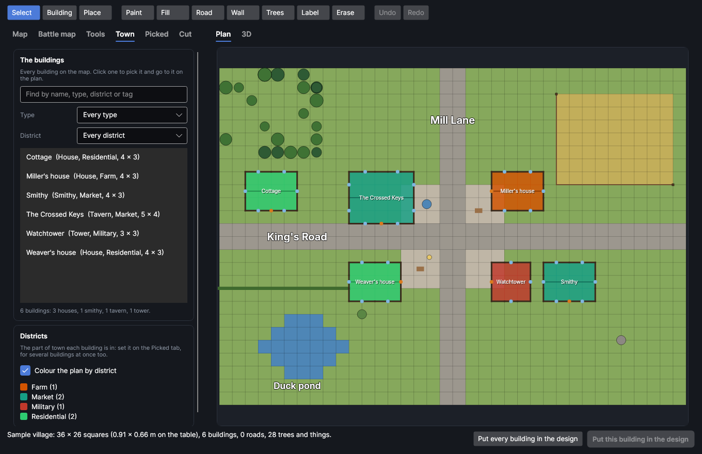

The **Town** tab lists every building on the map with its type, district and size. Type in the box to
find one by its name, type, district or a tag, or show just one **Type** or **District**; click one to
pick it and go to it on the plan. Under the list it counts the buildings of each type.
**Colour the plan by district** shows each building in its district's colour (the same colour every
time for the same name), with a key underneath.

## Saved buildings

Pick **Place** and your saved buildings (saved here, or in the building editor) are listed beside the
tools, each with its picture, type and size. **Type** shows just one type. Click one, then click the
map to put it down. **Look again** reads the list again after saving one in the building editor.

## The 3D view

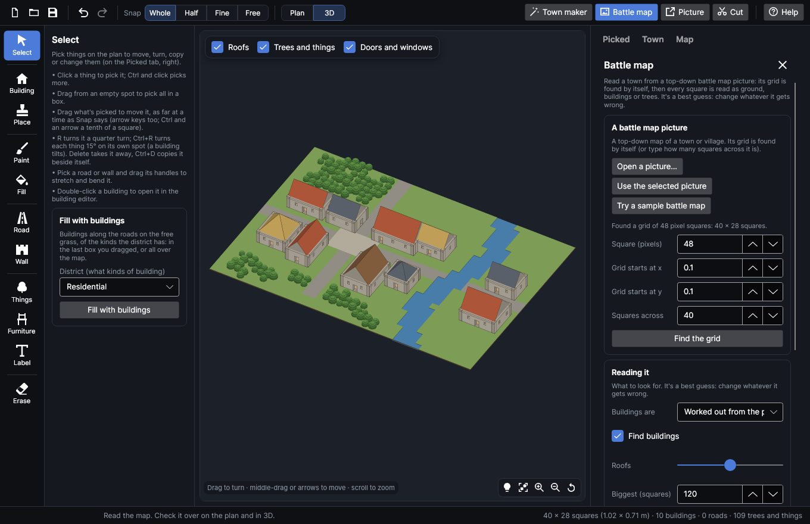

**3D** on the toolbar shows the whole map put together: drag to turn it round, scroll to zoom in on a part,
middle-drag or the arrow keys to move it, and press `F` (or double-click) to see it all again. Along its top, untick
**Roofs** to look into the buildings, **Trees and things** to see the ground clearly, or **Doors and
windows** to make a very big town quicker still. The building picked shows orange.

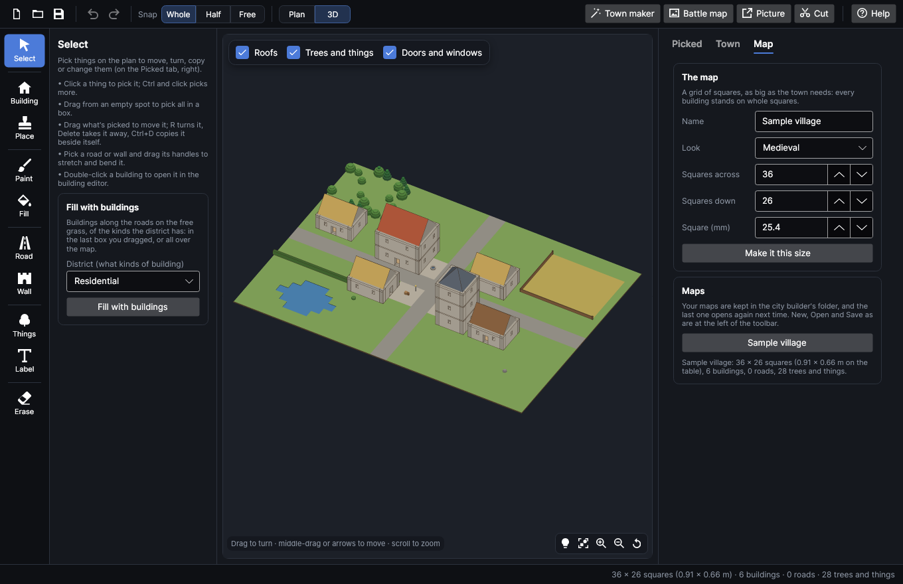

## Cutting the buildings

**Put this building in the design** (on the **Picked** tab) puts the picked building's pieces in the
design, the same way the building editor's **Put in the design** does: nested onto the bed, a page per
bed, its walls, columns, floors, tiles and roofs; with several picked, **Put the picked buildings in
the design** does each of them. **Put every building in the design** (under **Cut** on the toolbar)
does it for every building on the map, one after the other, each on pages of its own; a big town is a
great many pieces, so it may be better to do a few buildings at a time.

Each building is made at its own grid square: open it in the building editor to change its sheet,
walls (box or flat), textures and sizes before cutting.

## Cutting the ground, bridges, walls, trees and scenery

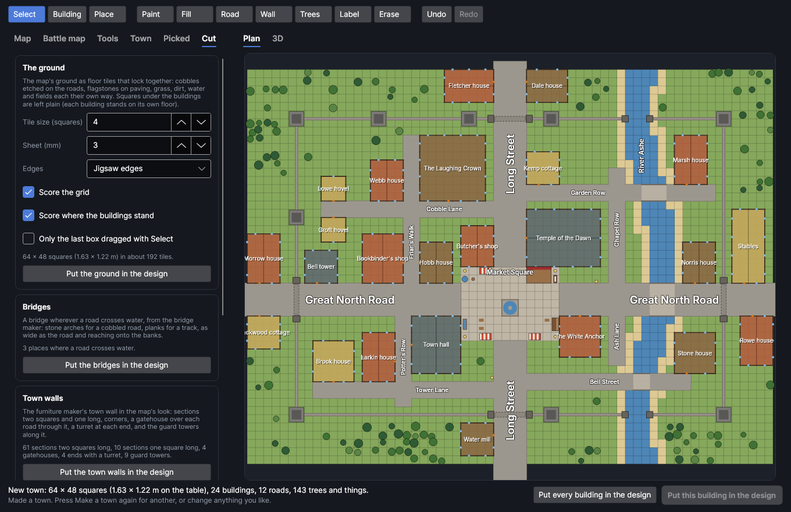

**Cut** on the toolbar opens the page that puts the rest of the town in the design. Tick **Only the
last box dragged with Select** to cut just the part of the map in the box you last dragged with
**Select**; otherwise it's the whole map.

**Put the ground in the design** cuts the map's ground as floor tiles that lock together, the
[floor tile maker](floortiles.md)'s way, each square etched with its own ground: cobbles on the roads,
flagstones on paving, sand, rock, tufts of grass, pebbles on dirt tracks, ripples on water and furrows
in the fields. Squares under the buildings are left plain (each building stands on its own floor),
with the building's outline scored round them.

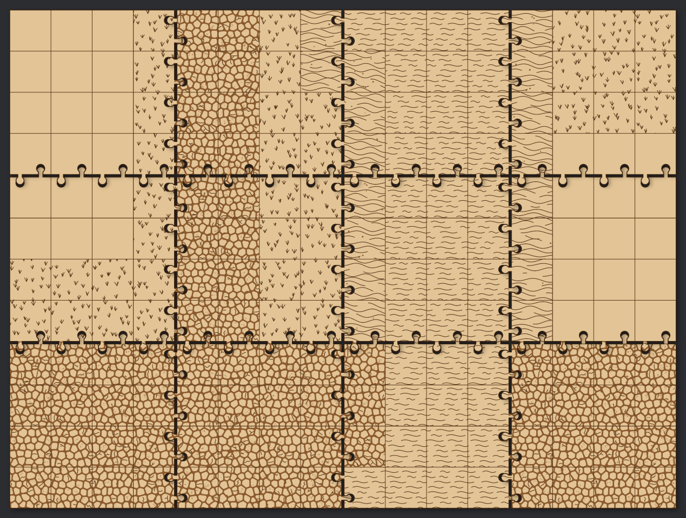

- **Tile size (squares)**: the biggest tile, in squares each way; each must fit on the bed.
- **Sheet (mm)**: how thick the sheet is.
- **Edges**: how the tiles join: **Jigsaw edges**, **Clips**, **Magnets** or **Plain edges**. The
  edges round the outside of the map (or the box) are plain.
- **Score the grid** and **Score where the buildings stand**: the grid lines, and each building's
  outline, scored on.

Under them it says how many tiles that is. A big town is a great many tiles, so at most 400 are made
at once: drag a box round a part with **Select** and cut it a part at a time.

**Put the bridges in the design** makes a bridge with the [bridge maker](bridges.md) wherever a road
crosses water: stone arches for a cobbled or paved road (flagstones on a paved one), planks for a dirt
track, as wide as the road and reaching half a square onto each bank, in the map's look. Each goes on
pages of its own.

**Put the town walls in the design** makes the town wall and its guard towers with the
[furniture maker](furniture.md)'s town pieces, in the map's look (a stone wall with a wall walk and
merlons, a fortress wall, a log palisade, an armoured defence wall, a sandstone wall or a gothic city
wall): a corner piece wherever the wall turns (the parapet round the outside of the turn, or the
inside where it turns in), a gatehouse over each road through it as wide as the road, an end with a
turret wherever else it stops (at a river, say), and the rest in sections two squares, one square and
half a square long. The wall isn't cut under a guard tower: the sections either side meet it. Under it, it says
how many of each that is.

**Put the trees in the design** makes the map's trees as the furniture maker's: two profiles halved
together in a round base, bark and leaves etched, in the map's look (oaks and pines, dead trees,
palms, giant mushrooms, or trees in planters), each as big as it is on the map (to the nearest quarter
square, so trees of a size are cut together). At most 150 at once: a big town's woods are cut a box
at a time. Bushes aren't cut.

**Put the scenery in the design** makes the [scenery maker](scatter.md)'s pieces for the map's wells,
carts, boulders, crates (as barrels) and fences (each run of fence in sections of up to four
squares), and the furniture maker's horse troughs, players' stages, market stalls, outdoor bars,
notice boards, fountains, gallows (there's no sci-fi gallows, so a sci-fi map gets the medieval one), street
lamps and statues, each in the map's look: a lantern post, a brazier, a torch or a light pylon, and a knight, an angel,
a warlord, an idol, a spearman or a trooper on a pedestal. Hedges and stone walls aren't cut.

Each set goes in the design with its settings, like anything the furniture maker makes: right-click
one of its pieces and choose **Edit furniture…** to change its sheet or sizes.
