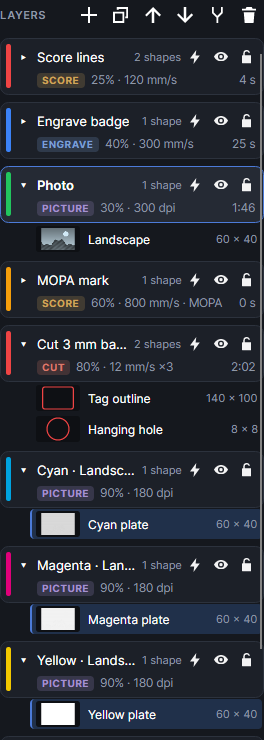

# CMYK split

An add-on (Settings → Add-ons → **CMYK split**): on when PhotonCanvas is installed, and can be turned off. Its button is **Picture → Effects → CMYK split**.

## CMYK split

**CMYK split** separates a colour picture into four pictures, one per ink (cyan, magenta, yellow,
black), for screen printing: each one is black where its ink goes, grey where some of it goes, white
elsewhere. Each goes on its own new Picture layer (**Cyan ·**, **Magenta ·**, **Yellow ·**,
**Black ·** and the picture's name, in the ink's colour), in the same place and size, with
**Halftone (dots)** dithering at the usual screen angles: cyan 15°, magenta 75°, yellow 0°, black
45°.

- Mark each plate on its own screen. **Machine → Layer by layer** runs one layer at a time with a
  pause between ([Work area](work-area.md)).
- The plates are made from the picture as its tone settings show it: **Brightness**, **Contrast**,
  **Gamma** and **Invert** are applied to the colours first, so each plate starts with those at
  their defaults. **Sharpen** is copied onto each plate, and an image mask (Image mask)
  is kept. The original picture stays; turn its layer's output off.

## Tutorials

- [CMYK split for screen printing](tutorial:pic-cmyk)
