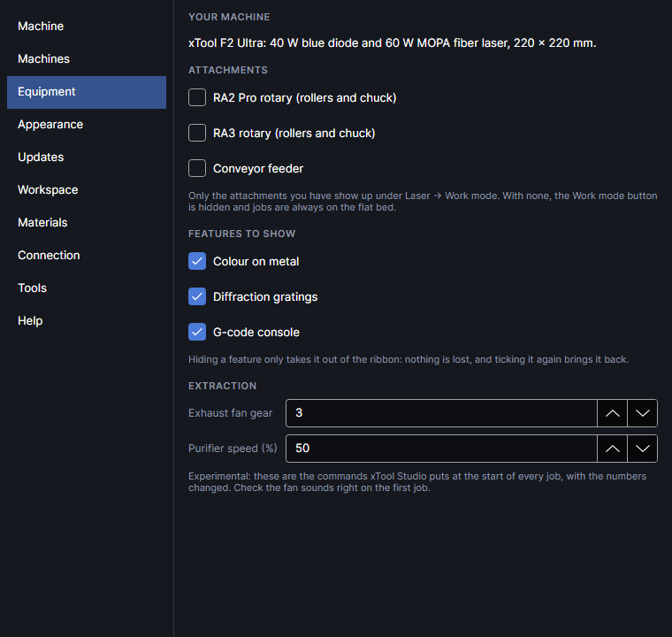
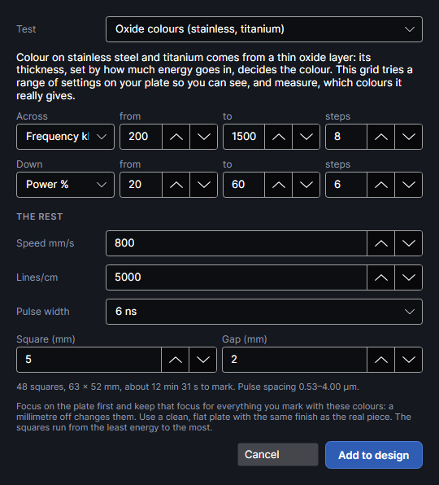
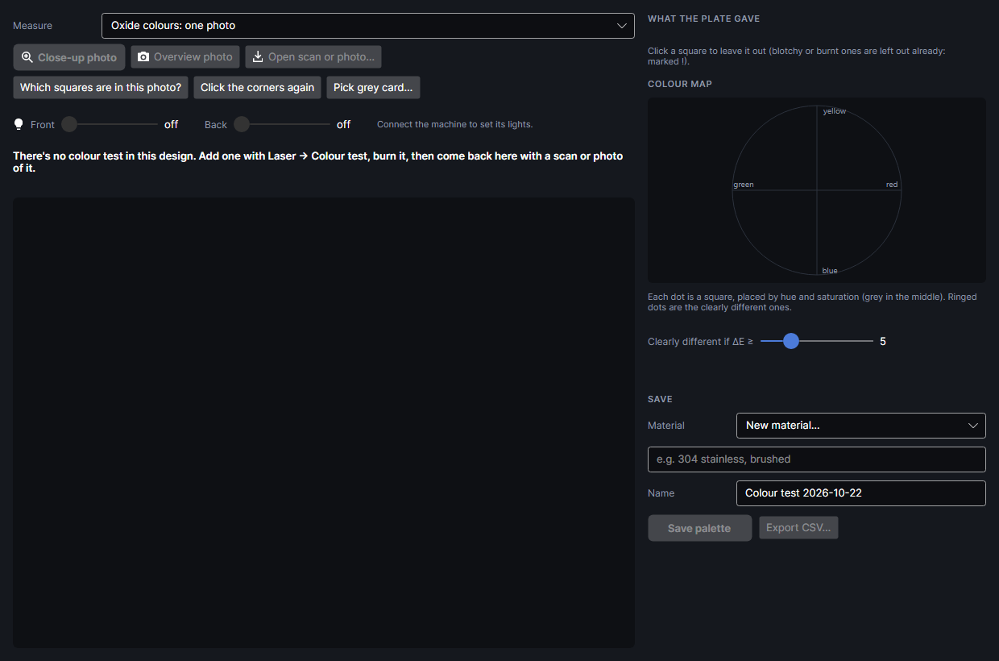
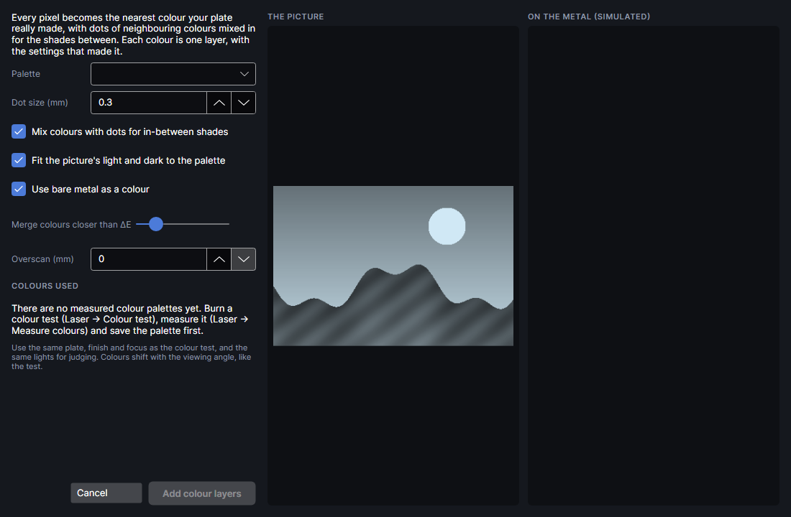

# Colour on metal

This add-on is for the MOPA laser on stainless steel and titanium. It adds **Colour test** and **Measure colours** to the Tests window (**Materials & Tests → Tests**, under *Colour on metal*) and **Colour on metal** to the Picture tab's **Turn it into** group. Settings → Equipment → Features to show can still hide them on a machine without a MOPA.

## Colour tests and palettes

The MOPA laser colours stainless steel and titanium by growing a thin oxide layer: its thickness,
set by how much energy goes in, decides the colour. Which colours a plate really gives depends on the
plate, so you burn a colour test and measure it. The measured palette is what
**Picture → Colour on metal** uses (see [Colour pictures](#colour-pictures)).

While the add-on is on, its buttons show unless you hide them: **Settings → Equipment → FEATURES TO
SHOW → Colour on metal** (the same question is asked at the first start). Hiding them only takes the
buttons out of the ribbon; nothing is lost. To take the whole feature away, turn the add-on off in
Settings → Add-ons.

### Colour test
<!-- windows: ColourTestWindow -->

Adds a colour test grid for the MOPA: one setting across, another down, the rest fixed.

**Test** chooses the kind:

- **Oxide colours (stainless, titanium)**: frequency 200–1500 kHz across (8 steps), power 20–60 %
  down (6 steps), at 800 mm/s, 5000 lines/cm (0.002 mm apart), 6 ns pulses, 5 mm squares. Frequency
  does most of the work, power fine-tunes it.
- **Diffraction gratings (polished stainless)**: each pulse leaves a mark a set distance from the
  last (speed ÷ frequency: 300 mm/s at 300 kHz is 1 µm), and a row of them diffracts light like a
  grating. Frequency 200–500 kHz across (7 steps, labelled as the pitch in µm), power 20–45 % down
  (6 steps), at 300 mm/s, lines 0.06 mm apart, 60 ns pulses, 6 mm squares, 0.2 mm run-up past each
  square at steady speed. Tilt the burned test under a lamp: the best squares show bright rainbows.

| Setting | Range | What it does |
|---|---|---|
| **Across**, **Down** | **Speed mm/s**, **Lines/cm**, **Power %**, **Frequency kHz**, **Pulse ns** | With **from**, **to** and **steps** (1–20). A new choice fills in a range: speed 200–1600, lines 300–1000, power 20–60, frequency 200–1500, pulse 4–200. |
| **Power %** | 1–100 | Hidden while swept, as are the others. |
| **Speed mm/s** | 2–15000 | |
| **Lines/cm** | 10–10000 | Fill line density. Finer is longer and hotter. |
| **Frequency kHz** | 1–4000 | Brought down to the most the pulse width allows. |
| **Pulse width** | 2–500 ns | The MOPA's 16 pulse widths; swept values move to the nearest. |
| **Square (mm)**, **Gap (mm)** | 2–20, 0.5–10 | |
| **Spread the heat: run each square where the plate is coolest** | on or off | On (the start). Turns on [Spread the heat across the whole job](heat-order.md#across-the-whole-job) for the design when the test is added. |
| **Sheet metal**, **Thickness (mm)**, **How it's held** | as under **Heat** in the job bar | Stainless steel, 0.5 mm, in air on the honeycomb to start. Greyed while spreading is off. The rest (how warm it may get, a fixed cool-down) is under **Heat** in the job bar. |

Below a pulse width's full-power frequency the MOPA can't deliver all its power, roughly in
proportion, so low-frequency squares get less than the power says. The line under the settings gives
the number of squares, the size, the time and, when frequency is swept, the pulse spacing.

**Add to design** puts it 10 mm in from the top-left corner. Each square is its own filled layer
(`Colour test R3 C5`), lines straight across. The layers are in order from the least energy per
area to the most. With spreading on, each square runs where the plate is coolest, far from the one
just done, with waits only where the plate needs them: heat from one square doesn't shift its
neighbour's colour or bow the plate out of focus. With it off, they run in layer order, so the
plate warms gradually, but the hottest squares come last on a plate that's already warm. The time
on the line under the settings leaves out the waits (the job bar's estimate has them). The axis labels go on **Colour test labels** (MOPA 30 % at
1000 mm/s). Focus on the plate first and keep that focus for everything you mark with these colours:
a millimetre off changes them. Use a clean, flat plate with the same finish as the real piece.

▶ [Burn a colour test](tutorial:mat-colour-test)

### Measure colours
<!-- windows: MeasureColourWindow -->

Reads the colour of every square of a burned colour test and saves them as a palette on the
material.

**Measure**: **Oxide colours: one photo**, or **Gratings: five views** (chosen for you when the test
is a grating test). Then a picture of the plate:

| Button | What it does |
|---|---|
| **Close-up photo** | The close-up camera: the truest colours. It sees only part of the bed, so put a block of squares under it and measure the rest the same way. Needs the machine connected. |
| **Overview photo** | The overview camera's picture, already lined up with the bed: quick, but its colour isn't calibrated and its lights shine at an angle. A first look. |
| **Open scan or photo…** | A file (PNG, JPEG, TIFF, BMP, WebP). A flatbed scan is best; a phone photo works taken straight on in soft, even light, ideally with a grey card in view. |
| **Which squares are in this photo?** | For a photo of part of the grid: click the first and the last square of the block on the chart on the right. Results from each photo add up. |
| **Click the corners again** | Clears the corner clicks. |
| **Pick grey card…** | Click two opposite corners of a grey or white card in the picture: its colour is taken as neutral, which corrects the light's tint. |
| **Save as the close-up camera's position** | After a close-up photo, if the plate hasn't moved since it was burned: the corners you clicked teach where the close-up camera looks at this focus height. Later close-up photos then place themselves. |
| **Front**, **Back** | The machine's fill lights (when connected). Keep them the same for every photo you compare; they're saved with the palette. |

Except for the overview photo (and a close-up whose position is known), you then click the middle of
the four corner squares in the photo, in the order the step line asks, each named by its settings and
outlined on the chart. Outlines show the area read in each square: check they sit inside. The
corners also teach the close-up camera's angle, so the next close-up photos come out straight.

**WHAT THE PLATE GAVE** shows every square's measured colour. Blotchy squares are left out already
(marked !); click a square to leave it out or bring it back. The **COLOUR MAP** places each square by
hue and saturation (grey in the middle); ringed dots are the clearly different colours, set by
**Clearly different if ΔE ≥** (2–15, default 5). The summary gives how many clearly different
colours, the lightness range, the strongest colour and the hues reached.

**Material** (a new one goes under *Metal*), **Name**, then **Save palette**. **Export CSV…** writes
every square's settings and colour (L, a, b and sRGB) to a spreadsheet file.

In **Gratings: five views**, photograph the plate from five fixed views with the lamp kept still:
**Straight**, then tilted 45° from the top, right, bottom and left edges' sides (pick each under
**View**; the close-up camera works for the straight one). Each view is measured on its own. **THE
VIEWS TOGETHER** plays them as an animation, **Save GIF…** saves it, the summary lists the strongest
squares and the views they light up at, and a notes box records where the lamp and camera were.
**Save grating set** keeps it all on the material.

▶ [Measure a colour test](tutorial:mat-measure-colours)

## Colour pictures
<!-- windows: ColourPictureWindow -->

**Colour on metal** makes a colour picture on stainless steel or titanium with the MOPA laser, using
the colours your plate really made. Each pixel becomes the nearest measured colour, with dots of
neighbouring colours mixed in for the shades between, and each colour becomes one Engrave layer
with the settings that made it.

It needs a measured palette first: burn a **Colour test** (Materials & Tests → Tests), read it with **Measure
colours** and save the palette (see [Colour tests and palettes](#colour-tests-and-palettes)). Until then the
window says there are no palettes and **Add colour layers** stays grey.

| Setting | Range (default) | What it does |
|---|---|---|
| **Palette** | | A measured palette from the material library: material, palette name and date. |
| **Dot size (mm)** | 0.05 to 3 (0.3) | Size of one colour dot. Smaller = finer, but heat makes neighbouring colours bleed: 0.2–0.5 mm is a good start. |
| **Mix colours with dots for in-between shades** | on | Dithering between palette colours. Off: each dot takes the nearest colour only (posterised). |
| **Fit the picture's light and dark to the palette** | on | Squeezes the picture's lightness into the range the palette really has, so shadows and highlights both land on a colour. |
| **Use bare metal as a colour** | on | Unmarked metal counts as a colour (usually the lightest). If the palette has no bare-metal reading, a light grey stands in. |
| **Merge colours closer than ΔE** | 2 to 20 (5) | Palette colours closer than this count as one: fewer layers, fewer near-duplicates. |
| **Overscan (mm)** | 0 to 2 (0) | Run-up past each line with the laser off: steadier colour right to the edges, a little slower. |

The right half shows the picture and the result simulated in the measured colours. **Colours used**
shows a chip per colour; hover one for the settings that made it and its share of the picture. The
summary gives the dots, colours, layers and the marking time.

**Add colour layers** adds one Engrave layer per colour (named **Colour ·**, the colour and its test
square, e.g. **R2 C5**), least energy first, over the picture at the same place, size and angle.
Bare metal needs no layer. If the picture is alone on its layer, that layer stops being sent; if it
shares it, turn its output off yourself. See-through parts stay bare.

> **Tip:** Use the same plate, finish and focus as the colour test, and the same lights for judging.
> Colours shift with the viewing angle, as on the test.

## Tutorials

- [Burn a colour test on metal](tutorial:mat-colour-test)
- [Measure a colour test](tutorial:mat-measure-colours)
- [A colour picture on metal](tutorial:pic-colour-on-metal)
