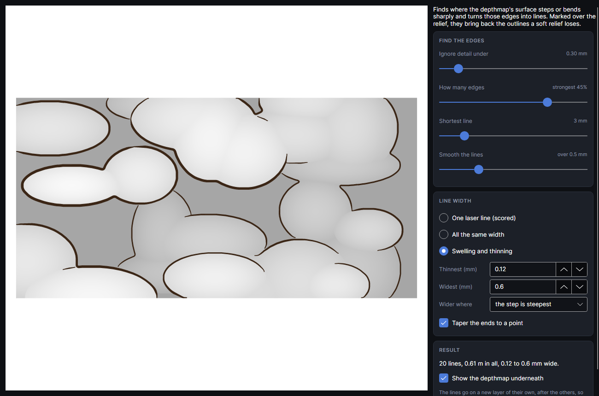

# Depth outlines
<!-- windows: DepthOutlinesWindow -->

An add-on (Settings → Add-ons → **Depth outlines**): on when PhotonCanvas is installed, and can be turned off. Its button is **Picture → Relief → Depth outlines**.

**Depth outlines** finds the edges in a depthmap, the places where the surface steps or bends
sharply (a face against the leaves behind it, one leaf over another), and turns them into lines to
mark over the relief. A relief from a soft depthmap can look washed out; the lines put the drawing
back, like an ink outline over a watercolour. Select the depthmap picture first.

The preview shows the lines dark over the depthmap (wheel zooms, drag pans). **Show the depthmap
underneath** only affects the preview.

**Find the edges**

| Setting | Range (start) | What it does |
|---|---|---|
| **Ignore detail under** | 0.10 to 2.00 mm (0.30) | The depthmap is smoothed this much before edges are looked for. Small: fine detail and texture get lines too. Large: only the big forms. It also stops the small steps of an 8-bit depthmap showing as contour rings. |
| **How many edges** | strongest 1 to 60% (18) | How many of the possible edge points become lines, strongest first. A line that starts on a strong edge carries on along it while it's at least half as strong. |
| **Shortest line** | 0 to 20 mm (3) | Lines shorter than this are dropped: fewer specks and flecks. |
| **Smooth the lines** | 0 to 2 mm (0.5) | Evens out the pixel steps along each line, so it reads as a drawn stroke. |

**Line width**

- **One laser line (scored)**: open lines, one pass of the beam each, on a new Score layer. The
  thinnest and quickest.
- **All the same width**: filled lines **Width (mm)** wide (0.05 to 3, start 0.3), on a new
  engrave (fill) layer.
- **Swelling and thinning**: filled lines from **Thinnest (mm)** (start 0.12) to **Widest (mm)**
  (start 0.6). **Wider where** picks what makes a line wide: **the step is steepest** (tall edges
  bold, gentle ones fine), **the surface is highest** (the outlines of raised parts bold) or **the
  surface is deepest** (lines down in the crevices bold, like shadows).
- **Taper the ends to a point** (filled lines only, on at the start): each line narrows to a point
  over its last few widths instead of stopping square, so it looks drawn with a brush.

The **Result** box says how many lines there are, their length in all and their width. **Add to
design** puts them on a new layer called **Outlines** and the picture's name, placed exactly over the
picture. The layer goes after the others, so the lines are marked over the finished relief. Filled
lines are merged into one shape where they cross; their fill's line density sets how solid they
come out.

Pictures larger than 2000 pixels along their longer side are searched from a copy averaged down to
2000, which is about 0.2 mm a pixel on a 370 mm picture. The lines haven't been marked over a
relief on the machine yet: try the width and power on a scrap of the same material first.

## Tutorial

- [Outlines over a relief](tutorial:pic-depth-outlines)
