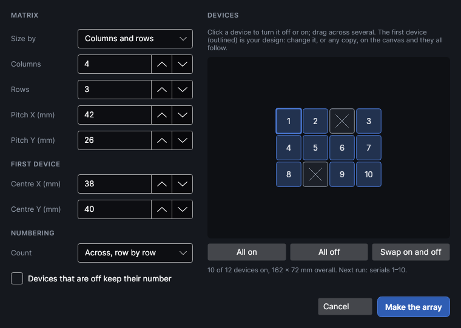
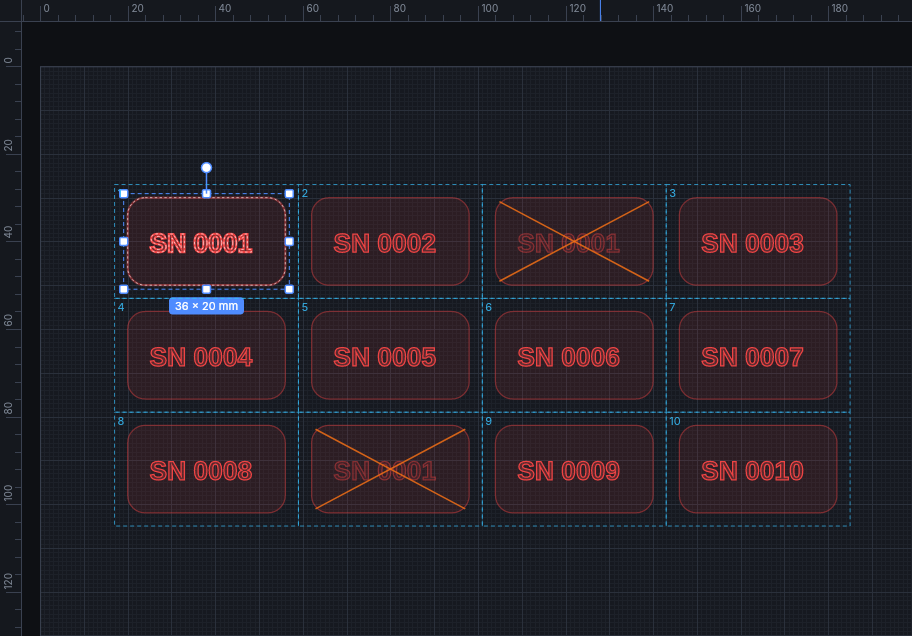

# Device array

An add-on (Settings → Add-ons → **Device array**): on when PhotonCanvas is installed, and can be turned off. Its button is **Arrange → Repeat → Device array**, and **Change device array…**, **Turn device off** and **Turn device on** are on the right-click menu of a device array's shapes.

A **device array** marks the same design on a matrix of parts held in a tray or jig: a row of
pens, a sheet of dog tags, a fixture full of knife blanks. You say how many devices across and down
(or the area to fill), the **pitch** (centre to centre) across and down, and where the first one
is. Every device gets its own copy of the design, and text and codes with
[fields](drawing.md#fields-serial-numbers-dates-and-spreadsheets) count on from one device to the
next, so each gets its own serial number or spreadsheet row. Any device can be turned off (an empty
pocket, a part that's already done) without moving or renumbering the others.

Unlike a [grid array](arrange.md#grid-array), the copies stay tied to the first device: change the
design on any of them (move it, resize it, change the words) and all of them change.

> **Note:** The device array has been checked on screen and in tests, but not yet marked on the
> machine. Frame the job first, and mark one tray on scrap parts to check the pitch.

## Make a device array
<!-- windows: DeviceArrayWindow -->

1. Draw the design for one device where it goes on the first part (top left of the tray). Add any
   text with `{serial}` or a spreadsheet heading, and a QR code if you like.
2. Select it and click **Device array** on the **Arrange** tab (in the **Repeat** group).
3. Set the matrix, watch it on the work area, then click **Make the array**.

The window:

- **Size by**: **Columns and rows** to say how many, or **An area** to fill one: give **Area width
  (mm)** and **Area height (mm)**, measured from the first device's top-left edge, and as many
  whole devices as fit at the pitch are made (the columns and rows are shown).
- **Columns** and **Rows**: how many devices across and down (up to 200 each, 2,500 in all).
- **Pitch X (mm)** and **Pitch Y (mm)**: from the centre of one device to the centre of the next,
  across and down: the spacing of the pockets in your tray. A pitch smaller than the design makes the
  devices overlap, and the window warns about it.
- **Centre X (mm)** and **Centre Y (mm)**: where the middle of the first device is on the work area.
  Changing them moves the whole array.
- **Count**: the order the devices are numbered in: **Across, row by row**, **Down, column by
  column**, or **back and forth** (a snake, turning at the end of each row or column).
- **Devices that are off keep their number**: ticked, every place in the tray always has the same
  number, so a device that's off leaves a gap in the serials (and the next run starts after the whole
  tray). Unticked, only the devices that are on are numbered, one after another, and the next run
  starts straight after the last one marked.
- **Devices**: the matrix as squares, the first device outlined, each with its number. Click a
  device to turn it off or on, or drag across several. **All on**, **All off** and **Swap on and
  off** do the whole tray. Under it: how many devices are on, the size of the whole array, and the
  serial numbers or rows the next run marks.

Shapes whose output is off when you make the array (an outline of the part, as a guide) stay guides:
they're shown on every device but never marked.

## Change it on the canvas

The first device is your design and the others are copies that follow it:

- **Edit any device**: move, resize or turn the design on any device, or change its words, and every
  device changes the same way. Dragging any device moves the whole array.
- **Turn a device off**: right-click one of its shapes and choose **Turn device off** (or **Turn
  device on**), or switch off its output (the lightning) or its eye in the Layers panel. A device
  that's off is shown faded and isn't marked; the others stay as they are. Deleting a copy turns its
  device off too.
- **See the devices**: while a device array's shape is selected, each device's place is outlined on
  the canvas with its number, and the ones that are off are crossed out.

- **Change the matrix**: right-click and choose **Change device array…**, or select it and click
  **Device array** again. **Keep as plain copies** stops it being an array (every device stays as
  ordinary shapes, the ones that are off stay off), and **Remove the array** takes the copies away,
  leaving the first device as it was.
- Deleting the first device deletes the whole array. Copying a copy and pasting it gives a plain
  shape; duplicating the whole array gives a second array.

The array is saved in the design. With the add-on off, every device is still an ordinary shape and
marks the same; the copies just don't follow the first one until it's on again.

## Serial numbers and spreadsheets

Each device marks the next value: with the serial at 100 and four devices on, they mark 100, 101,
102 and 103, and after the run the serial goes on to 104 (when going on to the next number after each run is
ticked in **Variables**). A spreadsheet works the same way, one row per device. The job bar shows what the next
run marks, and the job won't send if the tray needs more numbers or rows than are left.
