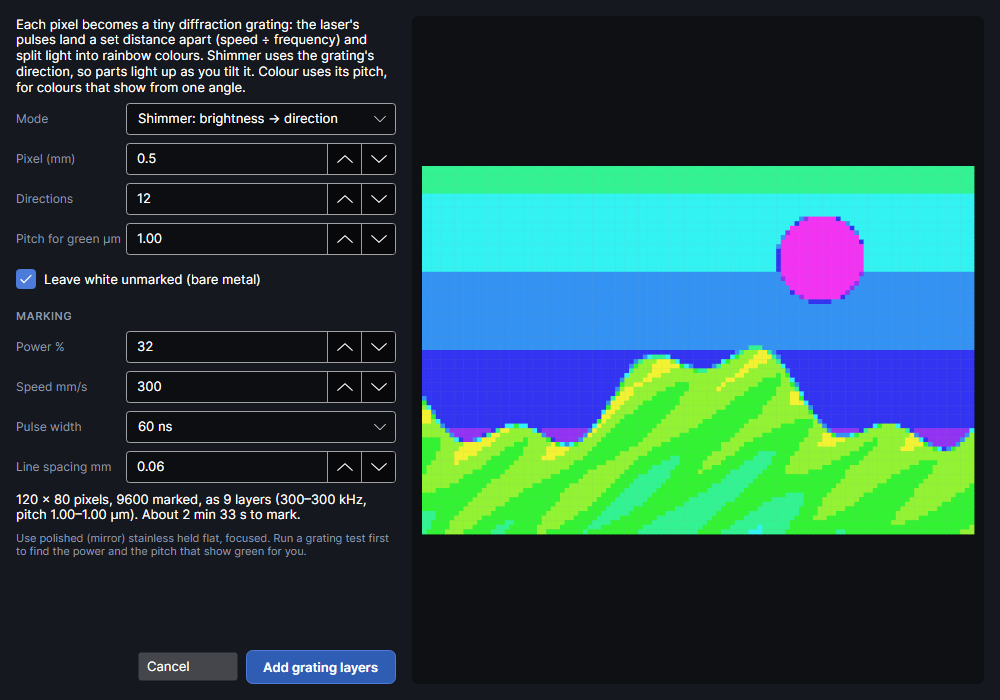

# Diffraction pictures

This add-on turns a picture into tiny diffraction gratings on polished stainless with a MOPA laser: the plate shimmers with rainbow colours as it tilts. It adds **Diffraction** to the Picture tab's **Effects** group while it's on (Settings → Equipment can hide it on machines without a MOPA).

## Diffraction
<!-- windows: DiffractionWindow -->

**Diffraction** turns the picture into tiny diffraction gratings on polished (mirror) stainless with
the MOPA laser. The laser's pulses land a set distance apart along each line (the pitch: speed ÷
frequency, e.g. 300 mm/s at 300 kHz is 1 µm), and a row of them splits light into rainbow colours.
Each pixel of the picture becomes a small patch of grating.

**Mode**

- **Shimmer: brightness → direction:** the scan direction of each pixel follows its brightness
  (dark 0°, light towards 180°, in **Directions** steps), all at the green pitch. Parts of the
  picture light up in turn as you tilt it.
- **Colour: hue → pitch:** each pixel's hue sets its pitch (red to violet), so the colours show from
  one lighting and viewing angle. All pixels scan in one **Direction °**.
- **3D: depth map → floating points (experimental):** for a depth map (light = in front, mid-grey =
  on the surface, dark = behind, white = nothing; the DepthCharge add-on's **Depthmap** makes one). Each point becomes an arc
  of grating pixels whose glint slides as you tilt the plate, so the point seems to float in front
  of or behind the metal.

| Setting | Range (default) | What it does |
|---|---|---|
| **Pixel (mm)** | 0.1 to 5 (0.5) | Size of one grating pixel. Smaller = more detail, more stop-starts. |
| **Directions** | 2 to 36 (12) | Shimmer and 3D: how many grating directions (0–180°) brightness is shared out over. More = smoother shimmer, more layers. |
| **Colours** | 2 to 24 (10) | Colour: how many pitches the hues are shared out over. |
| **Direction °** | 0 to 179 (0) | Colour: the scan direction for every pixel; colours show when the light and your eye line up along it. |
| **3D strength (mm)** | 0.5 to 30 (6) | 3D: how wide the arcs grow for the nearest and farthest points. More = deeper 3D, but busier. |
| **Point spacing (mm)** | 0.2 to 10 (2) | 3D: distance between the points that get arcs. |
| **Outlines and depth steps only (line art, stepped shapes)** | off | 3D: arcs only on outlines and sudden depth changes; off puts points all over (smooth reliefs). |
| **Swap in front and behind** | off | 3D: if it looks inside out under your light. |
| **Pitch for green µm** | 0.3 to 5 (1.00) | The pulse spacing that shows green where you'll look from. Smaller shows bluer, larger redder. Shimmer and 3D use it for every pixel. |
| **Leave white unmarked (bare metal)** | on | Near-white pixels stay bare. |
| **Leave greys and black unmarked** | on | Colour: greys and near-black stay bare (a grating can't show them). |
| **Power %** | 1 to 100 (32) | Keep it low: too much heat blurs the grating and warps thin sheet. |
| **Speed mm/s** | 2 to 15000 (300) | With the frequency, sets the pitch. Each layer's frequency is worked out from it. |
| **Pulse width** | MOPA pulse widths (60 ns) | The pulse width for every grating layer. |
| **Line spacing mm** | 0.01 to 0.5 (0.06) | Gap between fill lines. 0.05–0.06 mm covers the area with little heat. |

The preview shows the pixel map on grey steel: shimmer and 3D pixels coloured by direction, colour
pixels by their colour. The summary gives the pixels, how many are marked, the number of layers,
their frequency and pitch range, and the marking time.

**Add grating layers** adds one MOPA Engrave layer per direction or pitch (named like **Grating 45° ·
1.00 µm**), pixels merged into strips, over the picture. Each layer's frequency is speed ÷ pitch,
kept within what the pulse width allows, and its scan angle turns with the picture. Its
**Overscan (mm)** is set to 0.2, so the beam is at a steady speed where it marks. As with colour
on metal, the picture's own layer stops being sent if the picture is alone on it.

> **Tip:** Run a grating test first (Materials & Tests → Tests → Colour test, Diffraction gratings) to find the power and
> the pitch that show green for you. Hold the plate flat and focused.

## Tutorials

- [A diffraction picture](tutorial:pic-diffraction)
