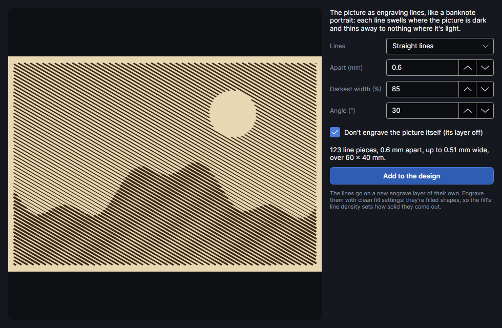

# Engraving lines

An add-on (Settings → Add-ons → **Engraving lines**): on when PhotonCanvas is installed, and can be turned off. Its button is **Picture → Effects → Engraving**.

## Engraving lines
<!-- windows: EngravingWindow -->

**Engraving** redraws the picture as engraving lines, like a banknote portrait: each line swells
where the picture is dark and thins away to nothing where it's light. The result is filled
shapes, so it engraves crisply with ordinary fill settings instead of dots.

| Setting | Range (default) | What it does |
|---|---|---|
| **Lines** | | **Straight lines** (parallel, the classic banknote shading), **Lines following the forms** (parallel lines bent by the picture's light and dark, for a relief look), **Rings** (circles round a centre) or **Spiral** (one spiral from the centre out). |
| **Apart (mm)** | 0.2 to 5 (0.6) | Line spacing, centre to centre. Closer lines show more detail; keep it at least twice the beam's width so lines stay apart. |
| **Darkest width (%)** | 10 to 100 (85) | How wide a line gets at black, as a share of the spacing. Below 100 % the lines never quite touch. |
| **Angle (°)** | −180 to 180 (30) | Straight and following lines: their direction; 0 = left to right. |
| **Bend** | 0 to 5 (1) | Following lines: how far they bend with the picture's light and dark, in line spacings. More gives a stronger relief. |
| **Centre** | two sliders | Rings and spiral: where they start, across then down the picture (default the middle, a little above centre). |

- Lines narrower than 0.06 mm are broken off, so highlights stay clean.
- The picture's tone settings (all but **Sharpen**) and image mask are followed.
- The summary under the settings gives the number of line pieces, the spacing, the widest line and
  the area covered.
- **Don't engrave the picture itself (its layer off)** (on by default) turns the picture's layer's
  output off, when the picture is the only thing on it.

**Add to the design** puts the lines on a new Engrave layer, **Engraving ·** and the picture's name.
Set it up as a clean fill: the fill's **Lines / cm** decides how solid each line comes out
([Layer settings](layer-settings.md)). Close the window to leave without adding anything.

## Tutorials

- [Engraving lines](tutorial:pic-engraving)
