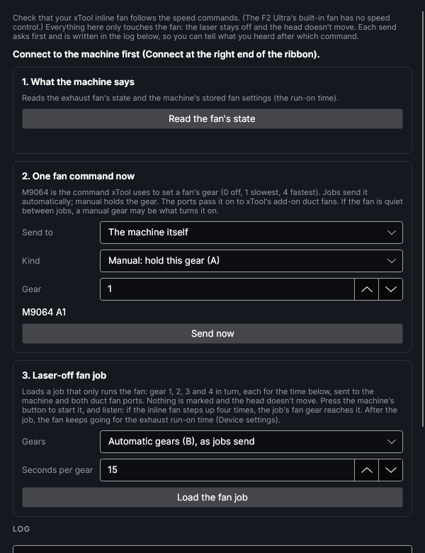

# Exhaust fan test

This add-on adds **Fan test** to the Machine tab's **Settings** group, shown only when
**xTool inline fan (SafetyPro IF2 or duct fan)** is ticked in Settings → Equipment. It's a window
for checking that the inline fan follows the speed commands jobs send.

Everything in it only touches the fan. The laser stays off and the head doesn't move. Each send
asks first, and the **Log** at the bottom lists what was sent and when, with the machine's
replies, so you can match what you heard to the command that caused it.

## The F2 Ultra's built-in fan

The F2 Ultra's own exhaust fan has no speed control. It was tried with this window in November
2026: it ignored every gear, in the fan job and sent on its own, and the machine has no stored fan
speed (writing one is refused). It runs at full speed during each job and for the run-on time after
it (**Device settings → Exhaust & sleep**). That's why the button only shows with an inline fan.

<!-- windows: FanTestWindow -->

## 1. What the machine says

**Read the fan's state** asks the machine about the exhaust fan (connected or not, plus anything
else it reports) and its stored fan settings, such as the run-on time. Only reads.

## 2. One fan command now

Builds one fan command from **Send to**, **Kind** and **Gear**, shows it, and **Send now** sends it
straight away:

| Send to | Command |
|---|---|
| The machine itself | `M9064 A2` (manual) or `M9064 B2` (automatic) |
| Duct fan port (P70) | `G198 P70 "M9064 A2"`: passed on to xTool's older duct fan |
| IF2 inline fan port (P78) | `G198 P78 "M9064 A2 C3"`: passed on to the IF2 (`C2` with gear 0, `C4` automatic) |

Gears are 0 (off) to 4 (fastest). Jobs send the automatic form (`B`); manual (`A`) holds the
gear. If gear 0 turns the fan off, send gear 3 or 4 to bring it back.

## 3. Laser-off fan job

**Load the fan job** uploads a job that only runs the fan: gears 1, 2, 3 and 4 in turn, each for
**Seconds per gear** (15 to begin with), sent to the machine and both duct fan ports, automatic
or manual (**Gears**). It waits for the machine's button, like any job. A job already loaded
but not started has to be cancelled first.

Listen while it runs:

- The fan steps up four times: the job's fan gear works, and **Inline fan gear** in
  Settings → Equipment will make every job quieter.
- Full speed from start to end: the machine ignores the gear.

After the job, the fan keeps running for the exhaust run-on time.

Not yet tried with an xTool inline fan.

## Tutorials

- [Test the exhaust fan's speed](tutorial:fan-test)
