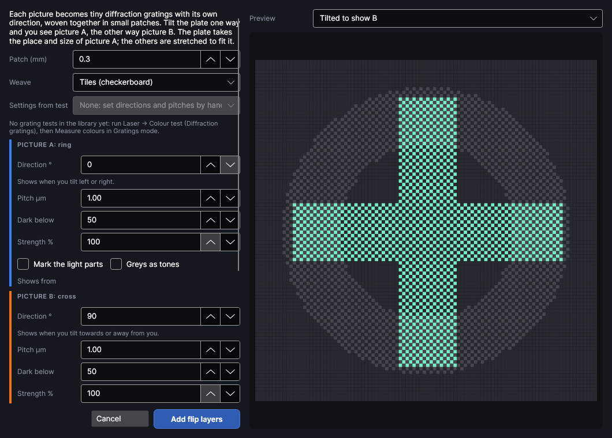

# Flip pictures on metal
<!-- windows: FlipPictureWindow -->

**Flip picture** puts two to four pictures into one polished (mirror) stainless plate with the MOPA
laser, each one showing only when the plate is tilted its way: tilt a tag left and right to see a
name, towards and away from you to see a logo. Banknote security holograms use the same trick.

Each picture becomes diffraction gratings (as with **Picture → Diffraction**) with its own scan
direction. A grating's light spreads along its scan direction, so it glints when the lamp and your
eye are on a line along it, and much less across it. The plate is split into small patches, woven
together like a checkerboard: each patch belongs to one picture and is marked with that picture's
grating where the picture is dark. Because each picture only gets one patch in every two to four,
each is dimmer than a plain diffraction picture.

Select two to four pictures (Shift-click), then click **Picture → Flip picture**. Picture A is the
one added first: the plate takes its place, size and angle, and the others are stretched to fit it,
so use pictures of the same shape.

| Setting | Range (default) | What it does |
|---|---|---|
| **Patch (mm)** | 0.1 to 3 (0.3) | Size of one patch. Smaller keeps more detail, with more stop-starts. |
| **Weave** | Tiles (checkerboard), Columns, Rows, Diagonal stripes (Tiles) | How the pictures' patches are woven. Tiles mix them most evenly; columns or rows can mark faster. |
| **Settings from test** | None, or a grating test in the library | Fills each picture's direction, pitch and power from a grating test photographed from the five views (**Measure colours**, Gratings mode). |
| **Direction °** | 0 to 179 (spread: 0 and 90; 0, 60, 120; or every 45) | Each picture's scan direction. The line under it says which way to tilt. Keep the pictures' directions far apart. |
| **Pitch µm** | 0.3 to 5 (1.00) | Each picture's pulse spacing. Two pictures with the same direction but different pitches show at different tilts or colours. |
| **Dark below** | 1 to 99 (50) | Parts of the picture darker than this (0 black, 100 white) are marked and glint; the rest stays mirror. |
| **Strength %** | 5 to 100 (100) | Share of the marked patches kept. Lower it for a faint, hidden picture, such as a serial number or QR code that only shows at one angle. |
| **Mark the light parts** | off | Marks the light parts of the picture instead of the dark. |
| **Greys as tones** | off | Shows greys as a share of marked patches (an even dither) instead of all or nothing. |
| **Shows from** | the five views | With **Settings from test**: the view this picture should show from. |
| **Power %**, **Speed mm/s**, **Pulse width**, **Line spacing mm** | as Diffraction (32, 300, 60 ns, 0.06) | The marking, as for **Picture → Diffraction**. |

**Preview** shows the woven patches in each picture's colour (A blue, B orange, C green, D
purple), or **Tilted to show A** (B, …): that picture bright, the others as a faint ghost, as a
rough idea of the plate seen from that side. A warning appears when two pictures are less than 30°
apart with the same pitch, because they would show together.

**Settings from test** reads the grating test like this: for each picture, it picks the square that
was most colourful from that picture's view and least from the other pictures' views, and uses its
pitch, power, speed and pulse width. The test squares were all scanned left to right, so Left,
Right and Straight are measured; **Top** and **Bottom** use the same square turned 90°, which is a
good guess rather than a measurement. A note says when a picture did not stand out much from the
others' views on that test.

**Add flip layers** adds one MOPA Engrave layer per picture, named like **Flip A · 0° · 1.00 µm**,
over picture A. Each layer's frequency is speed ÷ pitch, kept within what the pulse width allows,
its scan angle turns with the plate, and its **Overscan (mm)** is 0.2. The pictures' own layers
stop being sent when nothing else is on them.

> **Tip:** Try a small plate first: how much the weaving dims each picture depends on your steel,
> lamp and focus. A single lamp (a phone torch or a spotlight) shows the effect far better than
> diffuse daylight.

## Turning it off

Flip pictures is an add-on: turn it off or on in **Settings → Add-ons** while the program runs.
Off, the **Flip picture** button goes; layers you already added stay as they are.
