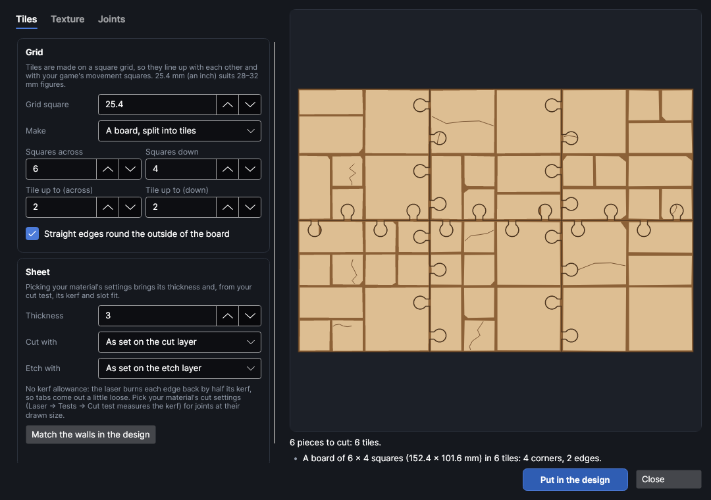
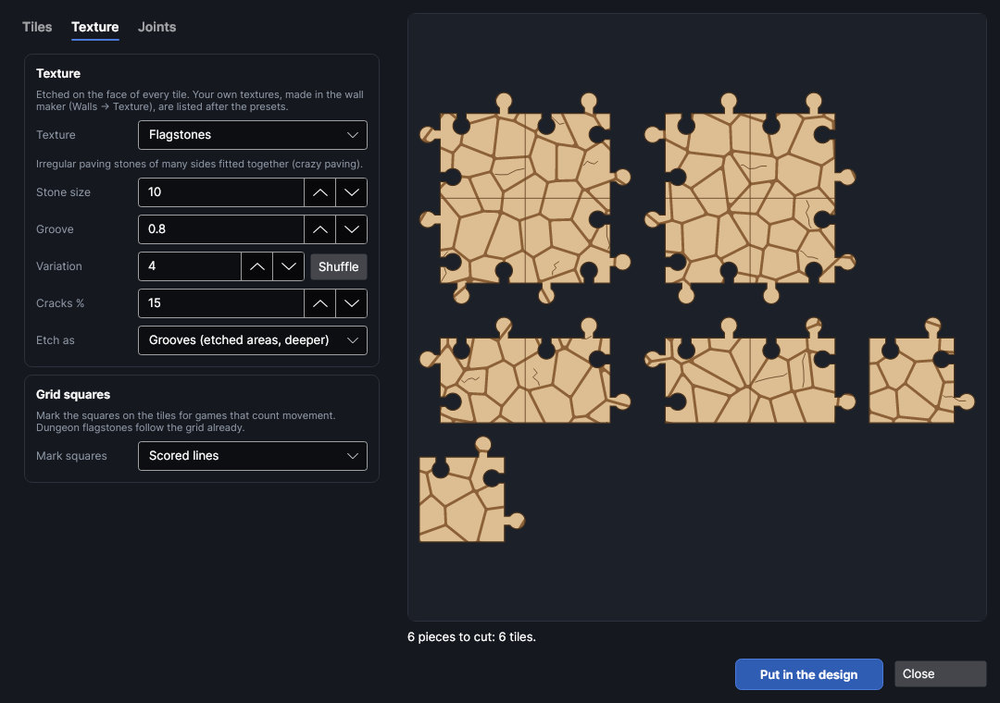
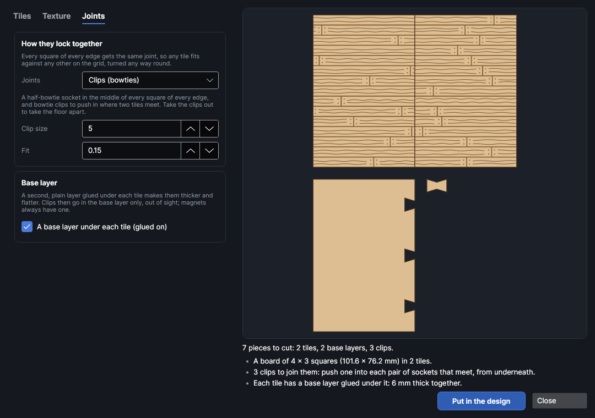
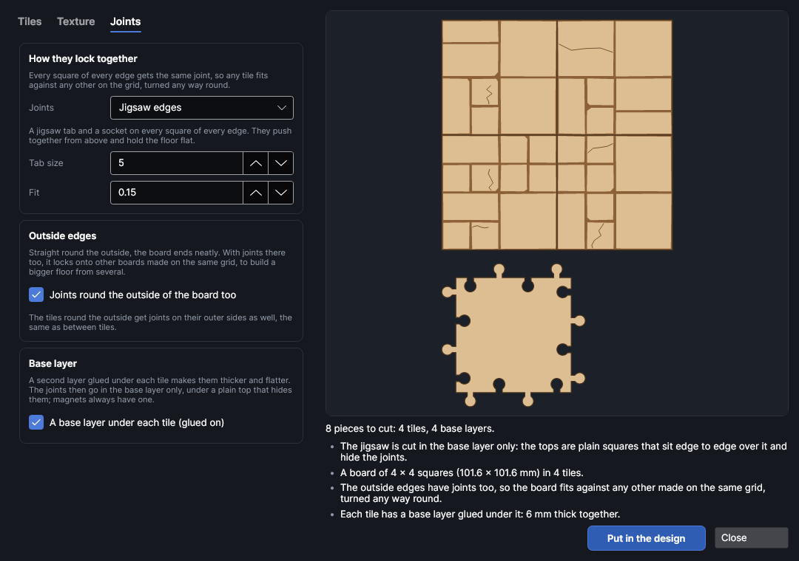

# Floor tiles

An add-on (Settings → Add-ons → **Floor tile maker**): on when PhotonCanvas is installed, and can be turned off. It uses the wall maker's textures, so **Textured wall maker** has to be on too. Its button is **Home → Draw → Floor tiles**, and **Edit floor tiles…** is on the right-click menu of the pieces it made.

**Floor tiles** makes floor tiles for tabletop games, dioramas and model buildings on a square
grid, cut from sheet material with a texture etched on: dungeon flagstones, crazy paving, cobbles,
floorboards, brick, tiles, metal deck plates, cave rock, sci-fi decks, grating, sand or a texture of
your own, in the same themes as the other terrain makers. The tiles lock together with
jigsaw edges, bowtie clips or magnets, and every square of every edge has the same joint, so any
tile fits against any other on the grid, turned any way round. They go with the walls from
[Textured walls](walls.md).

> **Note:** The tiles have been checked on screen and in tests, but not yet cut on the machine. Cut
> two tiles first and push them together before cutting a whole floor; change **Fit** if they're
> too tight or too loose.

## The Floor tiles window
<!-- windows: FloorTilesWindow -->

Click **Floor tiles** on the **Home** tab (in the **Draw** group). The **Floor tiles** window opens.
The settings are on the left in tabs; the preview on the right shows a board put together (so you
can see the joints lock) or the loose tiles side by side, with a base layer and a clip under them if
there are any, and updates as you change things. Under it are the number of pieces and any
problems: a red ✕ has to be fixed before the tiles can go in, a yellow ! is worth a look, and a grey
• is just for your information.

Press **Put in the design** and the pieces go on a page of their own, nested onto the bed (more pages
if they need more than one bed). To change a set later, select any of its pieces, right-click and
choose **Edit floor tiles…**, change the settings and press **Update in the design**: the old pieces
are replaced wherever they are.

## The tiles

| Setting | Range (default) | What it does |
|---|---|---|
| **Grid square** | 5 to 300 mm (25.4) | One square of the grid. 25.4 mm (an inch) is the usual square for 28–32 mm figures; 25 mm for metric grids; about 15 mm for 15 mm figures. Tiles, joints and the textures' default sizes all follow it. |
| **Make** | A board | *A board, split into tiles*: a whole floor cut into tiles. *Loose tiles*: tiles of the sizes you list. |
| **Squares across**, **Squares down** | 0.5 to 200 (6 × 6) | The board's size in squares. A part square (such as 4.5) makes the last column or row narrower, to fill a room exactly. |
| **Tile up to** | 1 to 20 squares (2 × 2) | The biggest tile the board is cut into. Where the board doesn't divide evenly the last column or row is smaller. |
| **Thickness** | 0.5 to 20 mm (3) | Your sheet's thickness. |
| **Cut with** | As set on the cut layer | Cut settings from your material library. Their kerf goes on the cut layer, so tabs and sockets come out the size they're drawn, and the material's thickness and slot fit from your cut test are filled in. |
| **Etch with** | As set on the etch layer | Engrave (fill) settings from your library for the texture. |
| **Match the walls in the design** | | Takes the sheet thickness and fit from walls made with the wall maker (the selected ones, or the first in the design). |

The board's tiles are named by column letter and row number, as the board lies on the screen: **Tile
A1** is the top left one.

### Loose tiles

With **Make** on **Loose tiles**, list the sizes you want: **Across** and **Down** in squares, **How
many**, and which **Straight sides** to leave without joints (for the outside of a layout):

| Straight sides | Makes |
|---|---|
| None | A middle tile, joints all round. |
| One side (edge) | An edge tile: straight along the bottom. |
| Two (corner) | A corner tile: straight along the bottom and the left. |
| Two opposite | A corridor tile: straight along the bottom and the top. |
| Three (end) | The end of a corridor. |
| All four | A tile on its own. |

Turn the tile over to the side you want: any tile fits any other, so the straight sides can face
whichever way the room needs. **Add a tile size** adds a line; ✕ takes one off.

## Themes

**Theme**, at the top of the **Texture** tab, is a look to start from, the same as the wall maker's:
picking one sets the texture, its sizes and how many stones are cracked, so a floor matches the
walls, roofs, scatter and furniture made in that theme. Change anything afterwards.

| Theme | Floor |
|---|---|
| Medieval | Flagstones |
| Dungeon | Dungeon flagstones (cracks on 20% of the stones) |
| Cave | Cave floor (cracks on 30%) |
| Sci-fi | Sci-fi deck |
| Desert | Sandstone slabs |
| Gothic | Chequered tiles |

## Textures

Pick one in **Texture**. The sizes it asks for change with it, and their defaults suit the grid
square (five floorboards, three bricks or four tiles to a square), so the pattern carries on from one
tile to the next.

| Texture | Sizes (defaults, for 25.4 mm squares) | What it looks like |
|---|---|---|
| Dungeon flagstones | squares split 50% | Square slabs that follow the grid: some squares are one big slab, others split into halves or quarters, with chipped corners. The grid shows without any lines. |
| Flagstones | stone 10 mm | Irregular paving stones of many sides fitted together (crazy paving). |
| Cobblestones | stone 4.5 mm | Small rounded cobbles. |
| Floorboards | width 5.08, length 60 mm | Boards with staggered joints, grain and nail holes. |
| Stone blocks | length 12.7, row 8.47 mm | Cut stone in rows of different widths. |
| Brick paving | 8.47 × 4.23 mm | Bricks in rows, each moved along half a brick. |
| Herringbone brick | width 3.175 mm | Bricks twice as long as they're wide, in a zigzag. |
| Square tiles | 12.7 mm | Square tiles in rows. |
| Hexagons | 8 mm | Hexagonal tiles. |
| Metal deck plates | 25.4 × 12.7 mm | Riveted plates, for ships and sci-fi decks. |
| Tread plate | 4 mm | Non-slip metal plate: little bars etched in. |
| Chequered tiles | 12.7 mm | Square tiles, every other one etched dark: halls, chapels and crypts. |
| Cave floor | rock 18, layer 12 mm | Rough rock in uneven slabs, split by cracks and pitted, like the wall maker's cave rock. |
| Sci-fi deck | 25.4 × 12.7 mm | Metal deck panels laid as the wall maker's sci-fi panels: inset plates, vent grilles, hatches, pipe runs, greebles and hazard stripes between bolted ribs. |
| Grating | slots 2.2 mm apart | Open grating: rows of slots etched in each square inside a solid frame, turned square by square. |
| Sandstone slabs | length 16.9, row 8.47 mm | Long sandstone slabs with wind-worn lines and pits. |
| Sand | ripples 3 mm apart | Sand blown into ripples, with the odd pebble: deserts, beaches and arenas. |
| Plain | | No texture. |

- **Groove**: how wide the etched gaps between stones, boards or bricks are.
- **Variation**: stones and boards are laid out at random, differently on every tile; each number
  gives a different set, and **Shuffle** picks the next one. The same number always gives the same
  tiles.
- **Cracks %**: how many of the stones have a crack scored across them.
- **Wear %**: how weathered the texture looks, as in the wall maker: 0 is new and crisp, 50 the usual
  look, 100 ancient and battered (nicked edges, knocked-off corners, pits and cracks; scratches and
  rust pits on metal). Not for tread plate, grating or sand.
- **Detail size**: the size of the smallest of those marks, and of wood grain, bolts and vent slats (mm).
- **Etch as**: *Grooves* etches the gaps as filled areas (deeper and the most real). *Lines* scores
  round each stone instead, which is much quicker. Grain, rivets and cracks are always scored lines,
  on a light **Floor tiles · lines** layer.
- **Mark squares**: the grid squares on the tiles, for games that count movement: *Scored lines*
  or *Etched grooves*. Dungeon flagstones follow the grid already.

Your own textures are made in the wall maker (**Walls** → **Texture** → **Your own texture**) and are
listed here too, marked "(yours)". **Tile width** scales them. The texture is saved in the design
with the tiles.

## Joints

| Joints | How they hold |
|---|---|
| **Jigsaw edges** | A jigsaw tab and a socket on every square of every edge. Going round a tile, each square of edge has its tab first and its socket second; the tile next to it runs along that square the other way, so its tab meets this socket. The tiles push together from above and hold the floor flat. |
| **Clips (bowties)** | A half-bowtie socket in the middle of every square of every edge, and bowtie clips that bridge two tiles. Pull the clips out to take the floor apart. With **Base layer** on, the sockets are only in the base layer, so the clips are hidden underneath and push in from below. |
| **Magnets** | Two holes for round magnets on every square of every edge, in a base layer under the tile. Glue the magnets in before the base goes on: north side up in the holes with a ring scored round them, south side up in the others. Tiles then pull together whichever way they're turned. |
| **None (straight edges)** | Plain tiles that sit side by side. |

- **Tab size** (jigsaw) or **Clip size** (clips): 5 mm by default for 25.4 mm squares. Bigger is
  stronger, but the tab has to fit a quarter of a square from the corner; the list says when it
  doesn't, and warns when what's left beside a corner gets thin.
- **Magnet size**: the magnets' diameter (5 mm). Use magnets no thicker than the sheet.
- **Fit**: the play between a tab or clip and its socket, half of it each side. More is looser.
- **Joints round the outside of the board too** (boards only, off by default): off, the tiles round
  the outside of the board have straight sides there, so the floor ends neatly. On, the outside edges
  get the same joints as between tiles, so the board locks onto other boards made on the same grid
  (turned any way round) to build a bigger floor. Loose tiles have joints on every side but the
  **Straight sides** you pick for them.
- **Base layer**: a second layer glued under each tile, for thicker, flatter tiles. Glue it lined up
  all round. The joints are then in the base layer only: jigsaw tabs and sockets, clip sockets or
  magnet holes are cut in the base, and the top is a plain square (with the texture) that sits edge
  to edge with its neighbours and hides them. The preview shows the tops put together, with one base
  layer underneath.

Where a board isn't a whole number of squares, the part squares at its far edge have no joint (on
both tiles that meet there), and a tile with a part square only fits the others when lined up on the
grid the same way.

## Layers and order

The pieces go on three layers, run in this order: **Floor tiles · lines** (light scoring) and
**Floor tiles · etch** (the texture, a Fill layer) first, while the sheet is whole, then **Floor
tiles · cut**. Set the etch layer's power and speed for the depth you want (Laser → Tests → Material
test helps).

## Try it

- [Make a dungeon floor that locks together](tutorial:make-floor-tiles)
