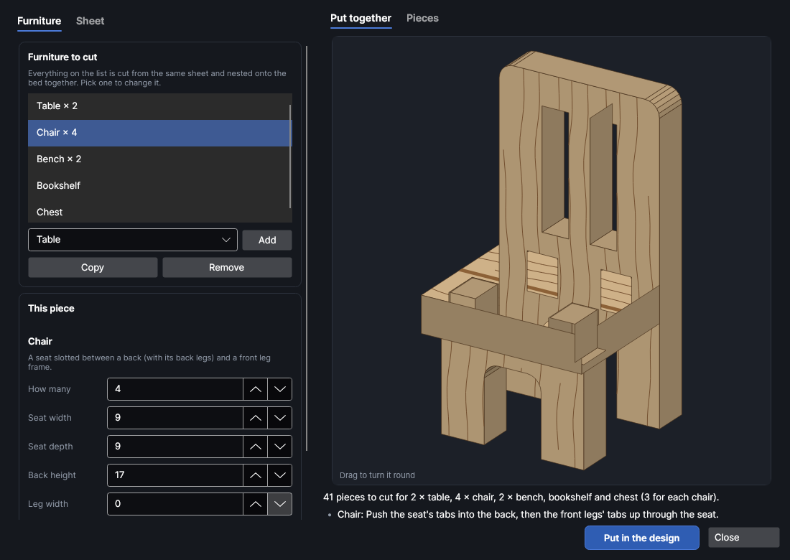
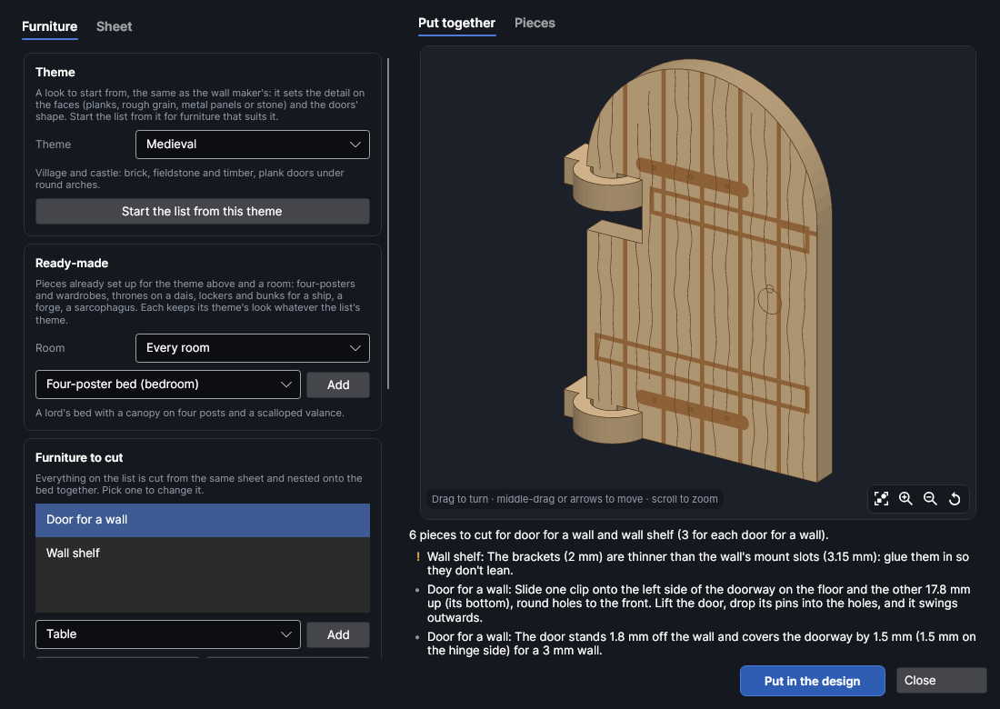
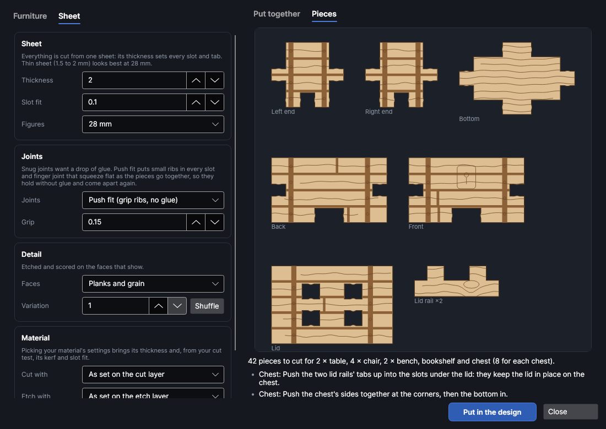

# Mini furniture

An add-on (Settings → Add-ons → **Mini furniture maker**): on when PhotonCanvas is installed, and can be turned off. Its button is **Home → Draw → Furniture**, and **Edit furniture…** is on the right-click menu of the pieces it made.

**Furniture** makes flat-pack furniture for tabletop games, dioramas and model rooms: tables,
benches, stools, chairs, bookshelves, chests, crates and beds, cut from one sheet. The pieces slot
together with tabs and finger joints, so they stand up square on their own (a drop of glue keeps
them that way). Wood grain and planks are etched and scored on the faces that show. It also makes a
**door for a wall** that hangs in a doorway from the wall maker (**Home → Draw → Walls**) and swings
open, and a **wall shelf** whose brackets plug into the walls' mount points.

> **Note:** The furniture has been checked on screen and in tests (every piece is put together in
> 3D and checked for clashes, loose slots and pieces that don't join), but not yet cut on the
> machine. Cut one small piece first, a stool or a chair, and check how the tabs go into the slots
> before cutting a whole room; change **Slot fit** (or, for a push fit, **Grip**) if they're too
> tight or too loose.

## The Mini furniture window
<!-- windows: FurnitureWindow -->

Click **Furniture** on the **Home** tab (in the **Draw** group). The **Mini furniture** window opens.
On the left, the **Furniture** tab has the list of what to cut and the settings of the one picked;
the **Sheet** tab has the sheet it's all cut from. On the right, **Put together** shows the piece of
furniture picked in 3D (drag it to turn it round; scroll to zoom in on a part, middle-drag or the arrow keys to move it, and press **F** or the first button in its corner to see it all again) and **Pieces** shows its pieces flat, one of each,
with how many of each there are. Under them are the number of pieces and notes: how it goes
together, a red ✕ that has to be fixed before the furniture can go in, a yellow ! worth a look.

Press **Put in the design** and every piece of everything on the list goes on a page of its own,
nested onto the bed (more pages if they need more than one bed). To change it later, select any of
its pieces, right-click and choose **Edit furniture…**, change the settings and press **Update in
the design**: the old pieces are replaced wherever they are.

## Themes

**Theme**, at the top of the first tab, is a look to start from, the same as the wall maker's: it sets
the detail on the faces and the shape of any doors for walls on the list, so furniture matches walls
of that theme. **Start the list from this theme** replaces the list with furniture that suits it.

| Theme | Faces | Doors | Start the list from this theme |
|---|---|---|---|
| Medieval | Planks and grain | Round arch | A table, two chairs, a bed, a chest and a bookshelf |
| Dungeon | Planks and grain | Round arch | A trestle table, benches, chests, crates, a bed and a door |
| Cave | Wood grain | Round arch | Stools, a solid-ended table, crates, a chest and a bed |
| Sci-fi | Metal panels and rivets | Square top | A mess table, panel-backed chairs, bunks, lockers, crates and a door |
| Desert | Wood grain | Square top | A low round table, stools, a chest, crates and wall shelves |
| Gothic | Planks and grain | Pointed arch | A long table, high-backed chairs, bookshelves, a chest and a door |

## The list

Everything on the list is cut together. Pick a kind of furniture under the list and press **Add**;
**Copy** adds another like the one picked (to make a second size or style), and **Remove** takes
the one picked off. **How many** sets how many of each to cut: four chairs round a table are one
line, *Chair × 4*.

New furniture comes in at a size to suit the figures chosen on the **Sheet** tab (28 mm unless you
change it). All sizes are in mm and are the outside of the furniture as it stands.

| Kind | What it is | Sizes (defaults for 28 mm) |
|---|---|---|
| **Table** | A top on two leg frames that slot into it. **Legs**: *Four legs* (with a deep apron), *Solid ends*, *Trestles* or *Round, crossed legs* (a round top on two legs crossed in a halving joint). Tick **A rail low down between the legs** for a stretcher. | 30 long, 16 deep, 13 high |
| **Bench** | A plank seat on two solid ends joined by a rail; or any of the table's legs. | 26 × 6, 7.5 high |
| **Stool** | A **Seat shape** round or square on two crossed legs. | 8 across, 7.5 high |
| **Chair** | A seat slotted between a back (with the back legs) and a front leg frame. **Seat height**, and a **Back** that's *Solid*, *Upright slats* or a *Ladder (rails across)*. | seat 9 × 9 at 7.5, back 17 high |
| **Bookshelf** | Two sides, **Shelves**, a top and an optional **A back panel**, with **Books etched on the back** showing between the shelves. | 20 wide, 8 deep, 30 high, 3 shelves |
| **Chest** | A finger-jointed box with iron bands and a lock plate etched on. **Lid**: *Lifts off (a rim under it)*, *Glued on* or *None (open)*. | 16 × 10, 9 high |
| **Crate** | A closed (or open-topped) finger-jointed box with boards and a brace etched on: scatter for any table. | 12 × 12 × 12 |
| **Bed** | A **Head board** and **Foot board**, a mattress that slots between them at **Mattress** height, and side rails; **A pillow and a blanket etched on**. | 32 long, 16 wide, head 13, foot 8 |
| **Door for a wall** | See [Doors and shelves for walls](#doors-and-shelves-for-walls). | doorway 16 × 28 |
| **Wall shelf** | See [Doors and shelves for walls](#doors-and-shelves-for-walls). | 20 long, 5 deep |

**Leg width** sets how wide the legs, ends and posts are; 0 picks a width to suit the sheet.

If a size is too small for the sheet (a slot that would cut a piece in two, a tab with nothing round
it), the list under the preview says what to change and the furniture can't go in until it's fixed.

## Doors and shelves for walls

**Door for a wall** makes a door, with planks, braces, strap hinges and a ring handle on its face,
that hangs in a doorway cut by the wall maker. It doesn't need anything changed in the wall:

- Two identical **clips** slide onto the side of the doorway, one on the floor and one higher up
  (the list under the preview says how high). Each grips the wall with a slot and has a round
  hole standing out in front of the wall.
- The door has a pin at the top and bottom of its hinge side. Lift it, drop the pins into the
  clips' holes, and it swings open outwards. Lift it off again to take the wall apart.
- The door stands just in front of the wall and covers the doorway by **Covers by** all round.

Set **Doorway** (*Square top*, *Round arch* or *Pointed arch*), **Doorway width**, **Doorway height**
and **Wall thickness** to the wall's, and choose which side the **Hinges** are on, seen from the
side the door opens to. Simpler: select the walls in the design (or have any in it) and press
**Match the walls in the design**, which reads them all from the walls. The wall's door has to be
*Doorway (cut through)* or *Doorway and a door to fit it* in the wall maker.

**Wall shelf** makes a shelf on two brackets whose tabs plug into two of the walls' mount points
(the wall maker's **Mount points**), with the shelf glued on top. The note under the preview says
how far apart the mount points want to be for the shelf's length: change the number of mount points
in the wall maker, or the shelf's **Length**, to suit. Set **Wall thickness**, **Wall's sheet** (the mount
slots are as wide as the wall's sheet) and **Slot height** to the wall's, or press **Match the walls
in the design**. The brackets are cut from this sheet: if it's thinner than the wall's, the list says
so and the brackets want a drop of glue; if it's thicker, they won't go in and the shelf can't be
made.

## The sheet

| Setting | Range (default) | What it does |
|---|---|---|
| **Thickness** | 0.3 to 20 mm (2) | The sheet's thickness. Every slot and tab is sized from it. Thin sheet (1.5 to 2 mm) looks best at 28 mm. |
| **Slot fit** | −0.5 to 2 mm (0.1) | Added to the thickness for the slots: more is looser. 0.1 is a snug fit to glue. |
| **Figures** | 15, 28, 32 or 54 mm (28) | The size of figures the furniture is for. Changing it scales every size on the list. |
| **Joints** | Snug, to glue | *Snug, to glue*, or *Push fit (grip ribs, no glue)*: see [Push fit](#push-fit). |
| **Grip** | 0.02 to 0.5 mm (0.15) | Push fit only: how much tighter than the sheet the ribs make each joint. |
| **Faces** | Planks and grain | *None*, *Wood grain* (scored lines along each piece), *Planks and grain* (etched grooves between boards as well), *Metal panels and rivets (sci-fi)* (a panel line round each face with a rivet in its corners) or *Stone (cracks and pits)*. Bands, books, bedding and the door's braces are etched whatever is chosen; a metal or stone door gets just a handle. |
| **Variation** | 1 to 9999 (1) | Grain and plank joints are laid out at random; each number gives a different layout, and **Shuffle** picks the next one. |
| **Cut with** | As set on the cut layer | Cut settings from your material library. Their kerf goes on the cut layer, so the slots come out the width they're drawn, and the material's thickness and slot fit from your cut test are filled in. |
| **Etch with** | As set on the etch layer | Engrave (fill) settings from your library for the planks, bands and books. |

## Push fit

With **Joints** set to *Push fit (grip ribs, no glue)* on the **Sheet** tab, every slot, notch and
finger joint gets small teeth (ribs) on its walls, so the gap at each rib is **Grip** narrower than
the sheet. The ribs squash as the pieces are pushed together and hold them there, so the furniture
stays together without glue and comes apart again. The pieces that were glued change too:

- A chest's lid has two **lid rails** under it, whose tabs push up into slots in the lid, in place of
  the glued rim.
- A wall shelf's brackets have a tab that pushes up through a slot in the shelf, and ribs top and
  bottom that press on the wall's mount slot.
- A door's clips get ribs in the fork that slides onto the wall.

Start with the default 0.15 mm on plywood or MDF. If the pieces won't go together, lower **Grip**;
if they fall apart, raise it. The ribs are tiny, so they need the kerf allowed for: pick your
material's settings in **Cut with** (with its kerf from a cut test). Without it, the laser burns most
of each rib away.

## Layers and order

The pieces go on three layers, run in this order: **Furniture · lines** (light scoring for the
grain) and **Furniture · etch** (the grooves, bands and books, a Fill layer) first, while the sheet
is whole, then **Furniture · cut**. Each piece is named for what it is (*Chair: seat*), so you can
tell them apart on the bed.

## Putting it together

The notes under the preview say how each one goes together. In general: the tabs go through the
slots from the side the slot faces, finger-jointed boxes go together side by side and then the
bottom drops in, and a table's or chair's top goes on last. Etched faces point outwards. A tiny
drop of wood glue (or superglue) in each joint keeps it square, or choose a [push fit](#push-fit) and
leave the glue out.

## Try it

- [Make a tavern's furniture](tutorial:make-furniture)
