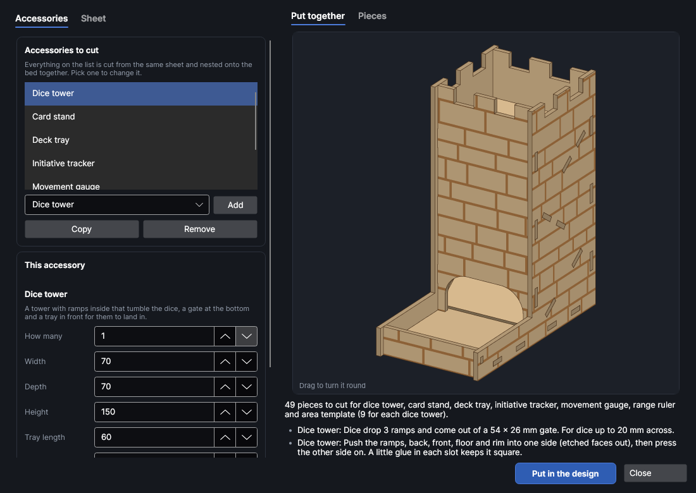
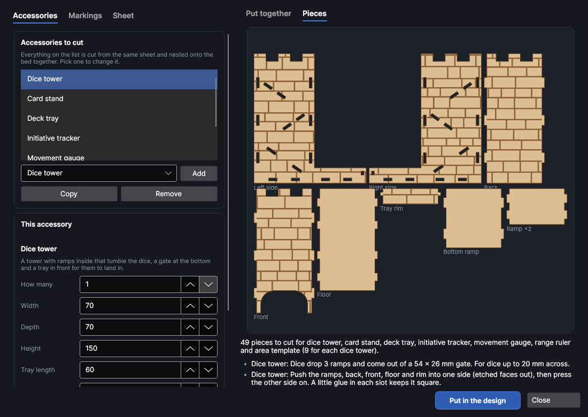
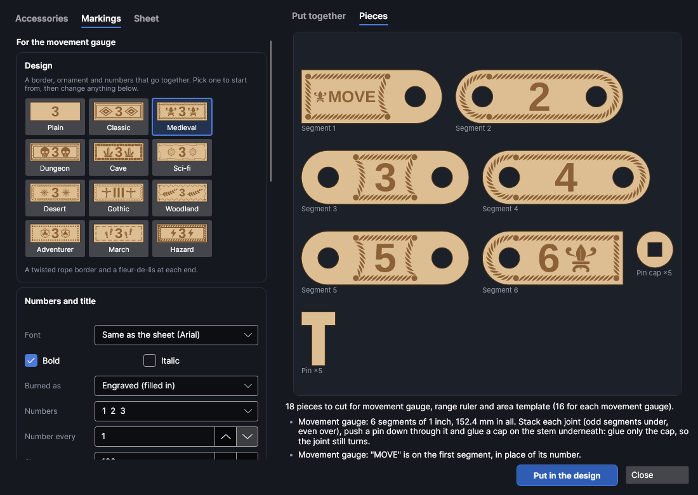
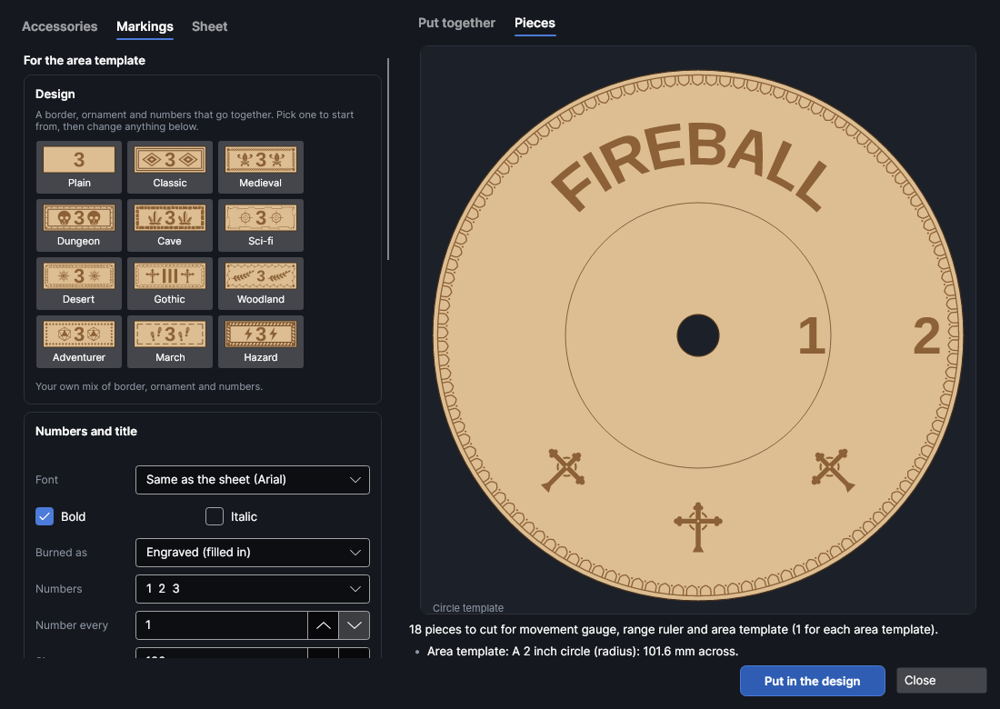

# Game accessories

An add-on (Settings → Add-ons → **Game accessories maker**): on when PhotonCanvas is installed, and can be turned off. Its button is **Designer → Minis & games → Game kit**, and **Edit game accessories…** is on the right-click menu of the pieces it made.

**Game kit** makes accessories for tabletop games, cut from one sheet: a **dice tower** with ramps
inside and a tray for the dice to land in, a **card stand** to hold a hand of cards, a **deck tray**
for the draw and discard piles, an **initiative tracker** with a tile for each player and monster,
and a bendable **movement gauge**, a **range ruler** and **area templates** marked in inches,
centimetres, grid squares or a unit of your own, with fonts, borders, ornaments and designs you
upload. The pieces slot together with tabs, finger joints and pins, so they
stand up square on their own. The faces that show can be etched with wood grain or with one of the
wall maker's textures (**Designer → Buildings → Walls**), so a dice tower can match the scenery.

> **Note:** The accessories have been checked on screen and in tests (every piece is put together
> in 3D and checked for clashes, slots with nothing in them and pieces that don't join), but not yet
> cut on the machine. Cut a small piece first, a ruler or a card stand, and check how the tabs go
> into the slots before cutting a whole dice tower; change **Slot fit** if they're too tight or too
> loose. The markings (borders, ornaments, titles, your own designs) are new and haven't been
> burned on the machine yet either: try one gauge segment first to see how fine the border comes out
> at your engrave settings.

## The Game accessories window
<!-- windows: GameKitWindow -->

Click **Game kit** on the **Designer** tab (in the **Minis & games** group). The **Game accessories** window
opens. On the left, the **Accessories** tab has the list of what to cut and the settings of the one
picked; the **Sheet** tab has the sheet it's all cut from and the finish. On the right, **Put
together** shows the accessory picked in 3D (drag it to turn it round; scroll to zoom in on a part, middle-drag or the arrow keys to move it, and press **F** or the first button in its corner to see it all again) and **Pieces** shows its
pieces flat, one of each, with how many of each there are. Under them are the number of pieces and
notes: how it goes together, a red ✕ that has to be fixed before it can go in, a yellow ! worth a
look.

Press **Put in the design** and every piece of everything on the list goes on a page of its own,
nested onto the bed (more pages if they need more than one bed). To change it later, select any of
its pieces, right-click and choose **Edit game accessories…**, change the settings and press
**Update in the design**: the old pieces are replaced wherever they are.

## The list

Everything on the list is cut together. Pick an accessory under the list and press **Add**;
**Copy** adds another like the one picked (to make a second size), and **Remove** takes the one
picked off. **How many** sets how many of each to cut. All sizes are in mm unless they say otherwise.

| Accessory | What it is | Defaults |
|---|---|---|
| **Dice tower** | See [Dice towers](#dice-towers). | 70 wide, 70 deep, 150 high, a 60 mm tray |
| **Card stand** | Upright ribs with a slanted slot in each **Row**, on a front and a back rail: a hand of cards stands in it, the back row higher than the front. **Slot width** suits the size of a hand; more **Ribs** make a long stand stiffer. | 180 long, 50 deep, 34 high, 2 rows |
| **Deck tray** | An open finger-jointed box the cards lie flat in, in **Piles** side by side with a divider between each and a finger notch at the front and back of each pile. Pick a common size in **Cards** or type your own **Card width** and **Card length**; **Deck height** is how deep the piles are. | Poker cards (63 × 88), 2 piles, 25 deep |
| **Initiative tracker** | See [Initiative trackers](#initiative-trackers). | 8 tiles, 22 × 32 |
| **Movement gauge** | See [Gauges, rulers and templates](#gauges-rulers-and-templates). | 6 one-inch segments, 12 wide |
| **Range ruler** | A straight ruler, ticks along one edge and a number at every whole unit. | 6 inches, 20 wide |
| **Area template** | A **Shape**: a *Circle* with a ring at every unit and a hole in the middle to see the model under it (its size is the radius), a *Cone* as wide at each distance as it is far (from its point), or a *Square* with a grid. | A 3 inch circle |

If a size is too small for the sheet or the dice, the list under the preview says what to change,
and the accessory can't go in until it's fixed. A piece too big for the bed says so too.

## Dice towers

The tower is two sides that everything else tabs into: the back, the front with a gate at the
bottom, a floor that runs out under the gate into the tray, the tray's front rim, and **Ramps**
that slope back and forth down the inside. Dice dropped in the top tumble from ramp to ramp, and the
bottom ramp rolls them out of the gate into the tray.

- **Width**, **Depth** and **Height** are the tower's outside (the depth without the tray).
- **Tray length** is how far the tray reaches out in front, and **Tray sides** how high its sides are.
- **Biggest die** is the biggest die it has to pass, in mm across (a d20 is about 20 to 22 mm). The
  gaps between the ramps, the gap at the end of each ramp and the gate are all sized from it, so
  more ramps or bigger dice need a taller tower: the notes say how tall.
- **Battlements round the top** cuts battlements in the top of the sides, back and front.

To put it together, push the ramps, the back, the front, the floor and the rim into one side, etched
faces out, then press the other side on. A little glue in each slot keeps it square.

## Initiative trackers

A base glued up from layers, the upper ones with a groove along them, and a tile for each player
and monster that stands in the groove in turn order. Set **Tiles**, **Tile width**, **Tile height**
and the **Tile tops** (*Rounded corners*, *Arched* or *Square*). Type the **Names** to etch on the
tiles, one a line (or separated by commas); tiles without a name get a number. Long names are made
smaller to fit, and a long name with a space goes on two lines.

The groove is a little wider than the sheet so the tiles lift out and move easily. A base longer
than the bed is cut in lengths, the joins in each layer halfway between the joins in the layer
under it, so the glued-up base is one solid piece.

## Gauges, rulers and templates

**Marked in** sets what they count in: *Inches* (most wargames), *Centimetres*, *Grid squares
(1 inch = 5 ft)* for role-playing games on a one-inch grid, numbered in feet, or *A unit of your
own*. For your own unit, **Unit length** is how long one unit is in mm (31.75 for a 1¼ inch hex
grid, say), **Counts as** is what each unit adds to the numbers (1 counts 1, 2, 3; 5 counts 5, 10,
15) and **Called** is its name, written after the numbers and on the ruler (*hexes*, *paces*,
*leagues*…). How the numbers, borders and ornaments look is set on the
[Markings](#markings) tab.

The **movement gauge** is **Segments**, each **Each segment** long, on two layers: each is joined to
the next at a unit mark by a pin, so the gauge bends round models and scenery. Each segment shows
the distance to its far end, and the ends are square, so the whole gauge is exactly its segments
long. To put it together, lay the segments out in order (odd ones under, even ones over), push a
pin down through each joint and glue a cap onto the end of its stem underneath. Glue only the cap,
so the joint still turns.

## Markings

Pick a movement gauge, range ruler or area template on the list, then open the **Markings** tab
(between **Accessories** and **Sheet**) to set how it's marked: the numbers and their font, a title,
a border and an ornament. Each little picture shows what you'll get on the wood, and the preview on
the right changes as you go. Each accessory has its own markings, so a gauge and a ruler can look
different; **Use these on every gauge, ruler and template** at the bottom copies the ones you've set
to all of them on the list.

### Designs

A **Design** sets a border, an ornament and a style of number that go together. Pick one to start
from, then change anything under it (the design's name then says it's your own mix).

| Design | Border | Ornament | Numbers |
|---|---|---|---|
| **Plain** | None | None | 1 2 3 |
| **Classic** | Double line | Diamond | 1 2 3 |
| **Medieval** | Rope | Fleur-de-lis | 1 2 3 |
| **Dungeon** | Rivets | Skull | 1 2 3 |
| **Cave** | Stones | Crystals | 1 2 3 |
| **Sci-fi** | Circuit | Reticle | 1 2 3 |
| **Desert** | Greek key | Sun | 1 2 3 |
| **Gothic** | Gothic arches | Gothic cross | I II III |
| **Woodland** | Vine | Laurel | 1 2 3 |
| **Adventurer** | Beads | D20 | 1 2 3 |
| **March** | Dashed | Boot prints | 1 2 3 |
| **Hazard** | Hazard stripes | Lightning | 1 2 3 |

### Numbers and title

| Setting | What it does |
|---|---|
| **Font** | *Same as the sheet* uses the **Font** on the **Sheet** tab. Or pick any font on this computer, or one of your handwriting fonts (marked ✎, made with **Home → Draw → Handwriting**), which are written as single strokes. **Bold** and **Italic** are for computer fonts. |
| **Burned as** | *Engraved (filled in)* fills the letters and designs in (on the etch layer). *Outlined (scored round)* scores round them instead (on the lines layer), which is quicker and finer. *Single lines (one pass, fastest)* draws each letter as one line down its middle, like a pen: the quickest of all, and the way handwriting fonts always come out. |
| **Numbers** | *1 2 3*, *1" 2" 3" (with the unit)*, *I II III (Roman)*, *Dice pips (up to 9)*, *Tally marks (up to 25)* or *No numbers*. Past 9 pips or 25 tallies the number is written instead. |
| **Number every** | 1 numbers every mark, 2 every second, 5 every fifth, and so on (the gauge's segments, the ruler's whole units, the template's rings). The last always has a number. |
| **Size** | 50 to 150 %: the numbers' and title's size as a share of what fits. Anything that wouldn't fit is made smaller, so it never runs into a hole, the border or the edge. |
| **Title** | Words to etch on it, such as *MOVE*, *CHARGE*, *FIREBALL* or your army's name. On a gauge it goes on the first segment in place of its number, on a ruler along the bottom, on a circle template round the top of its edge, on a cone in the widest band and on a square under the number. |
| **Write the unit along the bottom** | Rulers only: the unit's name (*inches*, *cm*, *feet* or your own) at the end of the bottom band. |
| **Finest ticks** | Rulers only: the smallest ticks, from whole units down to sixteenths of an inch, millimetres, quarter squares or tenths of your own unit. *The usual* is quarter inches, millimetres or half squares. Ticks closer than 0.6 mm are left out, since they'd burn into one. |

### Border

The border goes round each segment of a gauge, along the ruler's bottom band, or round a template's
edge, bent round the curves and corners so the pattern meets itself evenly. Pick *None*, *Line*,
*Double line*, *Dashed*, *Beads*, *Rope*, *Zigzag*, *Wave*, *Greek key*, *Vine*, *Rivets*, *Hazard
stripes*, *Circuit*, *Stones*, *Gothic arches*, or *Your design*, which repeats a design you've
uploaded (pick which one in **Design** under the borders). The border is kept clear of the pin holes
and the template's sight hole.

### Ornament

Ornaments are small engraved pictures: *Diamond*, *Star*, *Compass rose*, *Laurel*, *Arrow*,
*Chevrons*, *Boot prints*, *Bullseye*, *Crossed swords*, *Fleur-de-lis*, *Sword*, *Shield*,
*Crown*, *Skull*, *Key*, *D20*, *Flame*, *Crystals*, *Bat*, *Paw*, *Reticle*, *Gear*, *Hazard*,
*Lightning*, *Sun*, *Pyramid*, *Moon and star*, *Gothic cross*, *Quatrefoil* and *Burst*, or none.
**Goes** sets where:

- *At the ends*: at each end of a gauge or ruler, round a circle template (beside the title if it
  has one), at the narrow end of a cone and in the corners of a square.
- *Each side of the title*: one on each side of the title (at the ends if there's no title).
- *With every number*: beside each number, the two made smaller together if they don't fit.

Arrows, chevrons and keys point outwards at the ends of a gauge or ruler. Ticks and rings are broken
round the numbers and ornaments so they stay easy to read.

### Your own designs

Press **Upload a design…** and pick a drawing (SVG, DXF, PDF, Illustrator, EPS, or any other file
PhotonCanvas opens) or a picture (PNG, JPEG, BMP, GIF or WebP). A drawing's closed shapes are filled
in and its open lines scored; a picture's dark parts are traced, so a black logo on white works
best. The design becomes the ornament (*Your design* in the list) and is kept for next time, along
with every other design you've uploaded, so you can pick it on another accessory too. To repeat it
along the border, pick *Your design* under **Border** and choose it in **Design**.

Each accessory keeps its own copy of the design, so it still comes out the same after the file is
moved or deleted. **Remove from the list** takes the picked design off the list for next time;
accessories already using it keep their copy.

## Themes

**Theme**, at the top of the **Sheet** tab, is a look to start from, the same as the wall maker's, so
a dice tower and trackers match the scenery on the table. It sets the faces, their size, the dice
towers' battlements, the initiative tiles' tops and the gauges', rulers' and templates'
[design](#designs). Change anything afterwards.

| Theme | Faces | Dice tower | Initiative tiles | Gauges and rulers |
|---|---|---|---|---|
| Medieval | Stone blocks | Battlements | Rounded tops | Medieval |
| Dungeon | Dungeon blocks | Battlements | Rounded tops | Dungeon |
| Cave | Cave rock | No battlements | Rounded tops | Cave |
| Sci-fi | Sci-fi panels | No battlements | Square tops | Sci-fi |
| Desert | Sandstone | Battlements | Arched tops | Desert |
| Gothic | Brick | Battlements | Arched tops | Gothic |

## The sheet

| Setting | Range (default) | What it does |
|---|---|---|
| **Thickness** | 0.5 to 12 mm (3) | The sheet's thickness. Every slot and tab is sized from it. |
| **Slot fit** | −0.5 to 2 mm (0.1) | Added to the thickness for the slots: more is looser. 0.1 is a snug fit to glue. |
| **Faces** | Stone blocks | What's etched on the faces that show (the tower's walls, the tray's sides, the stand's front rail and the top of the tracker's base): *None*, *Wood grain* or *Planks* like the furniture maker's, or *Brick*, *Stone blocks*, *Fieldstone*, *Tiles*, *Metal plates*, *Hexagons*, *Dungeon blocks*, *Cave rock*, *Sci-fi panels*, *Sandstone* or *Adobe* like the wall maker's. |
| **Texture size** | 0.25 to 10 (2) | The texture's stones, bricks or planks are the wall maker's sizes (for 28 mm walls) times this. |
| **Variation** | 1 to 9999 (1) | Stones, planks and grain are laid out at random; each number gives a different layout, and **Shuffle** picks the next one. |
| **Font** | Arial | The font for the numbers and names. A gauge, ruler or template can have a font of its own on the **Markings** tab. |
| **Cut with** | As set on the cut layer | Cut settings from your material library. Their kerf goes on the cut layer, so the slots come out the width they're drawn, and the material's thickness and slot fit from your cut test are filled in. |
| **Etch with** | As set on the etch layer | Engrave (fill) settings from your library for the texture, numbers, names, borders and ornaments. |

## Layers and order

The pieces go on three layers, run in this order: **Game kit · lines** (light scoring for ticks,
rings, grain and anything outlined or in single lines) and **Game kit · etch** (the texture, numbers and names, a Fill layer) first, while
the sheet is whole, then **Game kit · cut**. Each piece is named for what it is (*Dice tower: left
side*), so you can tell them apart on the bed.

## Try it

- [Make a dice tower and a movement gauge](tutorial:make-game-accessories)
