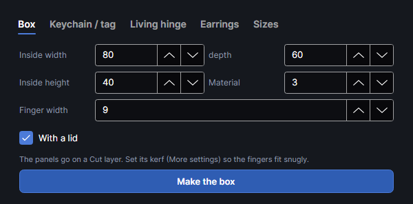
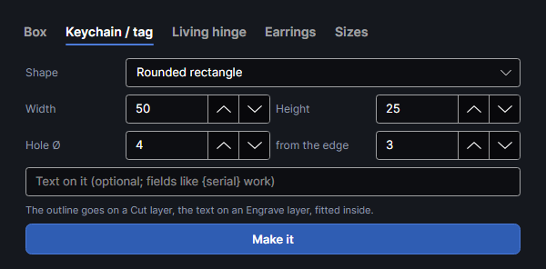
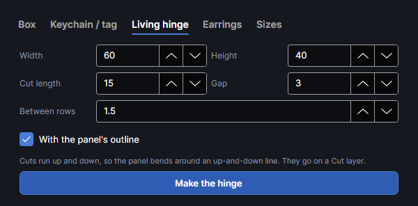
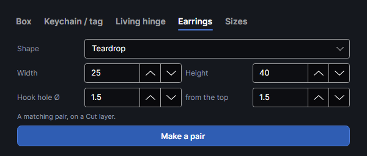
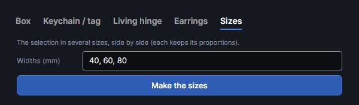

# Generators
<!-- windows: GeneratorsWindow -->

An add-on (Settings → Add-ons → **Generators**): on when PhotonCanvas is installed, and can be
turned off or removed. Its button is **Home → Draw → Generators**, after the program's own drawing
tools.

**Generators** opens a window with five tabs that draw ready-to-cut projects. **Box**, **Keychain /
tag**, **Living hinge** and **Earrings** put their parts on the first visible, unlocked Cut layer
(the keychain's words on an Engrave layer), or on a new layer named "Cut" (or "Engrave") if there's
none, and group them. **Sizes** copies the selection instead. What's made is selected and the
window closes. The results are ordinary shapes: edit them like any other.

### Box

A box with finger joints, drawn as flat panels that slot together.

| Setting | Range | Default | What it does |
|---|---|---|---|
| **Inside width**, **depth** | 10–1000 mm | 80, 60 | The inside of the box. |
| **Inside height** | 5–1000 mm | 40 | From the floor to the underside of the lid (to the top of the walls without a lid). |
| **Material** | 0.5–20 mm | 3 | The thickness of your sheet. Measure it: the joints depend on it. |
| **Finger width** | 1–100 mm | 9 | Roughly how wide each finger is. About three times the thickness is a good start. |
| **With a lid** | | on | Adds a lid panel jointed like the floor. Without it the walls' top edges are plain. |
| **Cut with** | your library's cut recipes | the first with a kerf measured | Cut settings from the [material library](material-library.md). The panels go on a cut layer named after the material, with the recipe's settings and its kerf, and **Material** is set to the material's thickness. Recipes with a kerf measured come first; one without says so. **The design's cut layer, as it is** puts the panels on the first cut layer, as before. |

How it's built:

- Panels: **Bottom**, **Front**, **Back**, **Left**, **Right** and, with a lid, **Lid**, named
  "Box · Front" and so on. The outside of the box is the inside size plus the material's thickness
  on each side (on top only with a lid).
- Each jointed edge gets an odd number of fingers (at least 3) so the corners work out, so the
  real finger width is close to what you set but not exact.
- The panels are laid in a row from 10 mm in from the work area's top-left corner, 3 mm apart. A
  box is usually wider than the 220 mm work area: ungroup (`Ctrl+Shift+G`) and arrange or nest the
  panels (see [Arranging](arrange.md)), and cut what doesn't fit in a second run.
- The panels are drawn at their exact size, fingers and the gaps for them the same width. With
  the kerf on the cut layer they come out that size, so they press together snugly: pick a recipe
  under **Cut with** whose kerf was measured (the cut test's kerf and fit test, see
  [Materials and tests](materials-and-tests.md), or the Kerf gauge add-on), or set the Cut layer's
  kerf yourself (in its **More settings**, see [Layer settings](layer-settings.md)).

### Keychain and tag

The **Keychain / tag** tab draws a keychain or gift tag with its hole and, if you like, words on it.

| Setting | Range | Default | What it does |
|---|---|---|---|
| **Shape** | | Rounded rectangle | **Rounded rectangle** (corners rounded by a fifth of the shorter side), **Circle** (an ellipse of the width and height) or **Tag** (a luggage tag with its left end cut to a point: sharp when the width is at least twice the height, as at the default size, otherwise blunt, with a short flat end). |
| **Width**, **Height** | 10–300, 5–300 mm | 50, 25 | The outside size. |
| **Hole Ø** | 0–30 mm | 4 | The ring hole's diameter; 0 = no hole. |
| **from the edge** | 0.5–50 mm | 3 | From the left end (the top of a circle) to the edge of the hole. |
| Words box | | empty | Optional words to engrave. Fields such as `{serial}` work. |

The outline goes on a Cut layer, in the middle of the work area. The words go on an Engrave layer
as an Arial text fitted (with **Fit W** and **Fit H**) into the part beside the hole, so they stay
inside whatever they say. The text stays editable.

### Living hinge

Rows of staggered slits that let a flat sheet bend.

| Setting | Range | Default | What it does |
|---|---|---|---|
| **Width**, **Height** | 5–1000 mm | 60, 40 | The area that bends. |
| **Cut length** | 1–200 mm | 15 | The length of each slit. |
| **Gap** | 0.5–50 mm | 3 | The uncut material between slits in a line. |
| **Between rows** | 0.3–20 mm | 1.5 | The distance between neighbouring lines of slits. Closer lines bend more easily, but the strips get thinner. In 3 mm plywood, 1.5 mm is a good start. |
| **With the panel's outline** | | on | Also draws the rectangle round the area. |

The slits run up and down, so the panel bends around an up-and-down line; turn the result 90° for
the other direction. Neighbouring lines are shifted by half a slit and gap: every other line runs out
through the top and bottom edges, the others stop half a gap short. The slits are open lines on a
Cut layer, in the middle of the work area; the outline is a separate shape in the same group.

### Earrings

A matching pair of earring blanks with holes for the hooks.

| Setting | Range | Default | What it does |
|---|---|---|---|
| **Shape** | | Teardrop | **Teardrop** (a point at the top, round at the bottom), **Leaf** (pointed at both ends), **Circle**, **Hexagon** (a corner at the top) or **Arch** (a half ring standing on its ends, the band 30% of the smaller size). |
| **Width**, **Height** | 5–100, 5–150 mm | 25, 40 | The size of each earring. |
| **Hook hole Ø** | 0–10 mm | 1.5 | The hole's diameter; 0 = no hole. |
| **from the top** | 0.3–20 mm | 1.5 | From the top of the shape to the edge of the hole. |

The pair goes in the middle of the work area, 5 mm apart, the right one mirrored so a lopsided
shape makes a matching pair. Both are on a Cut layer. A teardrop or leaf is narrow at its tip: keep
the hole far enough down that it doesn't break through the sides.

### Sizes

Copies of the selection in several sizes, side by side. Select the design first: **Make the sizes**
is greyed out when nothing was selected as the window opened.

- **Widths (mm)**: the widths you want, separated by commas, semicolons or spaces (use a point for
  decimals: 12.5). Default 40, 60, 80.
- Each width makes a copy of the whole selection scaled to that width, the height in proportion.
  The copies go in a row to the right of the selection, 5 mm apart, their tops level with it.
  They keep their layers and groups.
