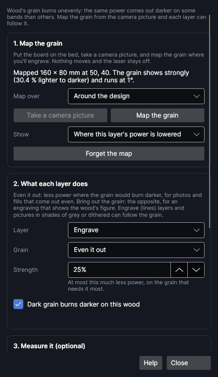

# Grain-aware engraving

Wood isn't one colour. Its grain comes in bands: lighter, softer earlywood and darker, denser
latewood. The laser burns them differently, so a photo or a filled area engraved at one power comes
out blotchy and striped where the grain runs under it. Grain-aware engraving looks at the board
through the camera, maps where the grain is dark and where it's light, and lowers the power, place
by place, where it would come out darker. The engraving comes out even.

It can do the opposite too: **Bring out the grain** lowers the power on the grain that would burn
lighter, so the wood's figure shows through more. And **Place a picture on the grain** moves a
picture to where its dark parts land on dark grain, so the board's own pattern becomes part of it.

It's an add-on: turn it on or off in **Settings → Add-ons**. Turned off, every layer runs at its own
power and the map and settings stay in the project for when it's back on.

<!-- windows: GrainWindow -->
Open it with **Grain** on the **Picture** tab. The window stays open beside the design.

## Map the grain

1. Put the board on the bed and close the lid. Calibrate the camera at about the board's height first
   if you haven't (**Camera → Calibrate**), so the picture lines up with the bed.
2. Click **Take a camera picture**. Nothing moves and the laser stays off.
3. Choose what to map in **Map over**:
   - **Around the design**: under the layers' shapes and 10 mm round them. Enough to even out an
     engraving.
   - **The selected shapes (the board's outline)**: select the board's outline first (**Home → Pick
     piece** outlines it from the camera picture with one click). Only the board is mapped, nothing round it.
     Use this before placing a picture on the grain.
   - **The whole camera picture**: everything the camera sees.
4. Click **Map the grain**. The line above the buttons says how strongly the grain shows (how much
   lighter the light grain is than the dark, in the picture) and which way it runs.

**Show** lays the map over the camera picture on the canvas (dark grain dark), or shows where the
chosen layer's power is lowered (deeper orange = less power).

The map takes out the board's overall colour and uneven lighting (anything wider than about 10 mm)
and camera noise (anything smaller than about half a millimetre); what's left is the grain. It's kept
in the project and undone like any other change. **Forget the map** takes it away.

> **Note:** the overview camera sees about a third of a millimetre per pixel. That's plenty for
> the grain of oak, ash, pine or walnut; very fine, even grain (maple, cherry, birch ply) may show
> too faintly to map, and then there's little to even out anyway.

## What each layer does

Pick a layer in **Layer**, then:

| Setting | What it does |
|---|---|
| **Grain** | **Off**: the layer's power everywhere. **Even it out**: less power where the grain would come out darker. **Bring out the grain**: less power where it would come out lighter, so the grain shows more. |
| **Strength** | At most this much less power, on the grain that needs it most (the rest gets less of a change). 20–30 % is a fair start; a grain test measures it for your wood. Up to 60 %. |
| **Dark grain burns darker on this wood** | On most woods the dark latewood comes out darker. On a few (and on some finishes) the light grain does; the grain test tells you which. |

The power is only ever lowered, never raised above the layer's own setting, so set the layer's power
for the grain that burns lightest.

What can follow the grain:

- **Engrave** layers with **Lines** fill: each scan line is burned in pieces, each at its own power,
  in one pass over the area (no extra time).
- **Picture** layers in **Grayscale** or with a dither (Jarvis, Floyd–Steinberg, Stucki, Atkinson,
  Bayer, halftone, newsprint, line screen): each spot's darkness is scaled before it's dithered or
  given its grey power.

Not: cut and score layers, offset fill, depth slices, and **Threshold** and **Sketch** pictures
(they're all or nothing). The job's checks say so if one of those is set to follow the grain. Parts
of a layer that are off the map run at the layer's own power, and the checks say that too.

## Measure it with a grain test

How much darker dark grain burns, and how much less power makes up for it, depends on the wood and
the settings. The grain test measures it:

1. Map the grain (above).
2. Pick the layer in **Layer** and click **Add a grain test**. Two strips, 15 × 40 mm, go on a new
   page, **Grain test**: one at the layer's power and one at 70 % of it, each laid across the
   grain. A page is its own job, so the test burns without the design.
3. Move the strips onto a spare part of the board (still across the grain, and on the mapped area)
   and **Ship It**.
4. When they're burned, click **Read the test**. It takes a new camera picture (nothing moves) and
   compares how dark each strip came out on dark and light grain.
5. It says what it found, for example "Dark grain came out darker: about 28 % less power there evens
   it out". Click **Use the test's settings** to put that on the tested layer (**Even it out**,
   with that strength and direction).

The test is read from the camera picture, so keep the lid closed and the lights the same as when you
mapped the grain. If the stronger strip didn't come out clearly darker than the weaker one, the test
can't tell how much power the grain is worth: burn it at more power.

## Place a picture on the grain

For an engraving that works *with* the wood: the picture is moved to where its dark parts fall on
dark grain and its light parts on light grain.

1. Map the whole board: select its outline, choose **Map over: The selected shapes**, and **Map the
   grain**.
2. Select the picture.
3. Tick **Allow quarter turns** if it may be turned (by 90°, 180° or 270°).
4. Click **Find the best place**. It tries every place where the whole picture is on the board and
   moves it to the one that matches the grain best. The match is a number from −1 to 1 (1 =
   perfectly): above about 0.3 the grain clearly helps, below 0.25 it only helps a little, and below
   0.1 the picture is left where it is (this board has nothing for it). `Ctrl+Z` puts it back.

Put the picture's layer on **Bring out the grain** too, to make the most of it. Also on the canvas's
right-click menu: **Place on the grain…**.

## How it works

The camera picture's brightness is taken as a logarithm (so lighting divides out), the slow changes
are subtracted (the board's colour and the lighting), and the rest is scaled so the lightest 5 % of the
grain is 0 and the darkest 5 % is 1. Each layer's power is then the layer's power times 1 − strength ×
grain darkness (or × grain lightness, the other way round).

The grain test fits darkness = a + b × grain + c × power to every measured spot on the two strips;
b ÷ c is how much of the power the grain is worth, the strength it suggests.

Placing a picture compares the picture's darkness with the grain's, everywhere it could go, first
every 2 mm and then finely round the best place, and keeps the place with the highest correlation.
