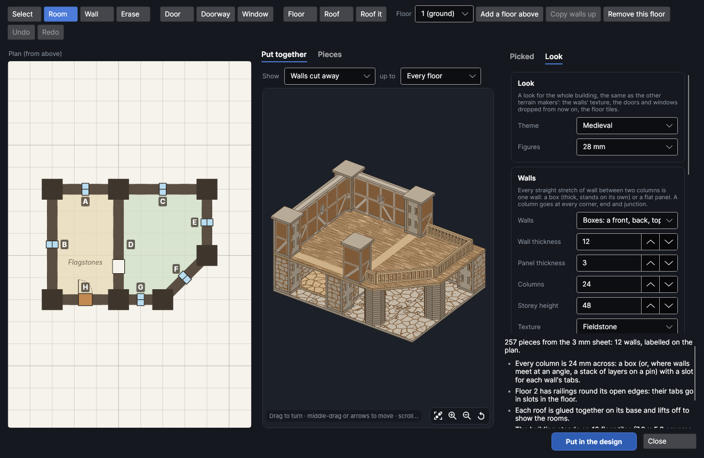
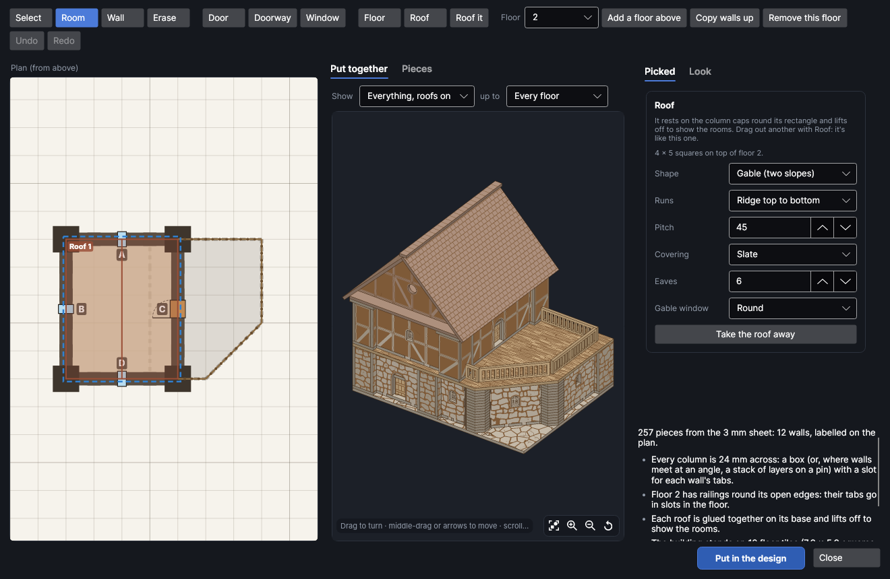
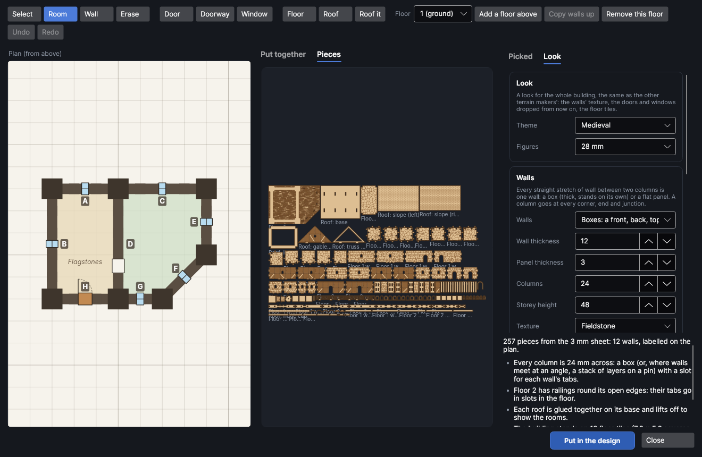

# Building editor

An add-on (Settings → Add-ons → **Building editor**): on when PhotonCanvas is installed, and can be turned off. It needs the **Textured wall maker**, **Mini furniture maker**, **Floor tile maker**, **Stairs, ladders and floors**, **Roofs and towers** and **Whole-building kits** add-ons, which make its pieces. Its button is **Home → Draw → Build**, and **Edit in the building editor…** is on the right-click menu of the pieces it made.

**Build** lets you draw a building yourself, floor by floor, the way you build a house in a
life-sim game: drag out rooms, draw walls along the grid or corner to corner, drop doors and windows
anywhere along a wall and slide them about, give every floor its own shape, and watch it go up in
3D with the walls in front cut away so you can see into the rooms. Put roofs over it (gable, hipped,
lean-to or flat, at any pitch), railings go round balconies and terraces by themselves, and each room
can have a floor pattern of its own. Every wall, column, floor, roof and floor tile then comes out as
pieces to cut, made the way the wall maker ([Textured walls](walls.md))
and the building maker ([Whole buildings](buildings.md)) make them: textured box walls whose tabs
go into slotted columns, floors that lie on the walls, and jigsaw floor tiles to stand it on.

> **Note:** The building editor has been checked on screen and in tests (every wall, column and
> floor is put together in 3D and checked for clashes), but not yet cut on the machine. Cut one
> column and the end of one wall first, check the wall's tabs go into the column's slots, and change
> **Slot fit** on the **Look** tab if they're too tight or too loose.

## The Building editor window
<!-- windows: HouseEditorWindow -->

Click **Build** on the **Home** tab (in the **Draw** group). The **Building editor** opens on the
last building you drew (a small two-room house the first time). Along the top are the tools and the
floors; on the left is the **Plan**, the floor you're on seen from above on a grid of squares; in the
middle, **Put together** shows the whole building in 3D and **Pieces** shows every piece flat; down
the right, **Picked** shows the door, window, room or roof picked on the plan and **Look** the walls'
look and sizes. Under them are the number of pieces and notes: how it goes together, a red ✕ that has to be
fixed before it can go in, a yellow ! worth a look.

Press **Put in the design** and every piece goes into the design, nested onto the bed, a page per
bed. To change it later, select any of its pieces, right-click and choose **Edit in the building
editor…**, change it and press **Update in the design**: the old pieces are replaced wherever they are.

## Drawing on the plan

Pick a tool along the top (or press its letter), then use it on the plan:

| Tool | Key | What it does |
|---|---|---|
| **Select** | S | Click a door or window to change it on the **Picked** tab, or drag it along its wall. **Delete** takes it away. Click inside a room to give it a floor of its own. |
| **Room** | R | Drag from one grid point to another: four walls round the rectangle at once. Drag a room against another and they share the wall between them. |
| **Wall** | W | Drag from one grid point to another: a wall straight along, straight across or corner to corner (diagonal). It snaps to the nearest of those as you drag, and shows how long it is. |
| **Erase** | E | Drag along walls to take them away, click one square of wall, or click a door or window. |
| **Door** | D | Click a wall to put a door in it: in box walls it hangs on pins and swings open. Keep the button down and drag to slide it along the wall. |
| **Doorway** | O | An open doorway with nothing in it, between two rooms, say. |
| **Window** | N | Click a wall to put a window in it, and drag it along. |
| **Floor** | L | Drag over squares to lay floor outside the rooms: a balcony, a landing, the floor of a walkway. Start a drag on a laid square to take floor up. |
| **Roof** | T | Drag a rectangle over rooms for a roof on top of this floor's walls; click a roof to change it on the **Picked** tab. **Delete** takes the picked roof away. |

Walls that close a space in make a **room**: it's shaded on the plan and gets a floor above it. Scroll
on the plan to zoom (toward the pointer), drag with the right or middle button to move about, and
press **F** to fit the whole building in. **Undo** and **Redo** (Ctrl+Z and Ctrl+Y) go back through
every change.

Each straight stretch of wall between two columns is one wall, labelled with a letter on the plan (on
its inside); its pieces are named after it ("Wall C: base", "Floor 2 walls A, D"), so you know where
each goes. A column goes wherever walls meet or end: a corner, a T, a cross, or an angled column where
a diagonal wall comes in (a stack of layers on a pin). Walls that come out the same are cut together.

A new door or window is like the one picked before it (the same shape and size), so pick one you
like and click along the walls to put more of the same in.

### What a wall can hold

- One door or doorway to a wall, and windows all of one kind. Put two doors on one stretch, or two
  different windows, and the wall is cut in two at a grid point between them with a straight column
  there (a note says if they're too close together to be split: move one a square along).
- A wall longer than the bed is cut the same way, with a straight column, where it misses the doors
  and windows.
- A door or window that ends up off a wall (its wall was erased) or at a corner is left out, with a note.
- A wall is at least a column's width long between its columns: a diagonal wall one square long is
  too short for box walls, so draw diagonals two squares or more.

## Floors

**Floor** at the top picks which floor you're drawing (1 is the ground). **Add a floor above** adds an
empty one on top; the floor below shows faintly under it, so you can draw over it. **Copy walls up**
draws the floor below's walls on this floor too (not its doors and windows), to start a storey the
same shape. **Remove this floor** takes it away.

Every floor can be a different shape. The floor between two storeys covers every room under it and
on it, and any floor you lay by hand, so an upstairs smaller than the ground floor stands on a floor as
big as the ground floor, and the rest of it is a terrace you can step out onto through a door. The columns under it are flush with its underside; the walls
above stand on it, and lines are scored on it where each wall and column goes. A floor bigger than the
bed is cut in pieces along walls under it, so each join rests on a wall top (a note says if a join has
no wall under it: glue a strip of sheet under it).

Walls drawn upstairs with nothing under them get a red ✕: close in a room under them, or lay floor.

### Railings

Every edge of a floor with no wall standing on it gets a railing, about a metre high for the figures
(a top rail and a bottom rail with balusters between): round a terrace on the roof of the rooms below,
round a balcony of floor you laid. They show on the plan as a rail with dots. Each straight stretch is
one piece with two tabs under it that go into slots cut in the floor; it stops against a column, and
at a corner the one running left to right carries on past the corner and the other butts up against
it (glue them there). Turn **Railings round its open edges** off on the **Look** tab (under **This
floor**) for a floor with none.

### A room's own floor

Pick **Select** and click inside a room: the **Picked** tab shows the room, and **Floor** gives it a
pattern of its own, any of the floor tile maker's (floorboards, flagstones, cobbles, herringbone brick,
chequered tiles, a sci-fi deck…). Its name shows on the plan. Upstairs it's etched on that room's part
of the floor; on the ground floor it's a loose floor that drops in between the room's walls and columns
("Floor 1, room 2 (chequered tiles)"). *The building's floor* puts it back to the rest.

## Roofs

Pick **Roof** and drag a rectangle over the rooms on the plan: a roof goes on top of that floor's
walls, resting on the column caps round it, and lifts off to show the rooms (the 3D view puts it on
with **Show** at *Everything, roofs on*). A roof over exactly one room has a frame under it that drops
inside the walls so it can't slide; over more than one room (or part of one) it has none, and a note
says so: glue it on, or let it rest on the caps. **Roof it** at the top puts one roof over the top
floor's rooms (one over them all if they make a rectangle together, otherwise one over each
rectangular room).

Click a roof with **Roof** to change it on the **Picked** tab:

- **Shape**: *Gable* (two slopes with an end wall at each end), *Hipped* (sloping on all four sides,
  the ridge along the longer side), *Lean-to* (one slope, with a back wall and sides) or *Flat* (one
  plate, with a floor pattern etched on it).
- **Runs**: which way a gable's ridge runs, or which way a lean-to slopes down.
- **Pitch** (degrees from flat), **Covering** (slate, wooden shingles, fish scale, clay tiles, thatch,
  planks, corrugated metal; a flat roof takes a floor pattern), **Eaves** (how far it reaches past the
  walls) and a **Gable window** in each end wall.
- **Take the roof away**.

A new roof is like the one picked before it. Roofs are numbered on the plan ("Roof 2"), and their
pieces are named after them ("Roof 2: gable", "Roofs 1, 3: base" when two come out the same). A
roof's own pieces and how they go together are the roof maker's ([Roofs and towers](roofs.md)).
A roof under the floor above, or two roofs that overlap, get a yellow !. The floor below's roofs show
as a dashed outline on the plan above them.

## The 3D view

**Show** picks how much of the walls the 3D view draws:

- **Everything, roofs on**: all the walls, and the roofs.
- **Walls cut away**: the walls on your side of the building that face you (or face away from you) are
  left out, wherever you turn it, so you can see into the rooms, like a doll's house. The roofs are off.
- **Walls down**: no walls, just the columns, the floors and the tiles: the plan in 3D.

**up to** shows the floors only up to one of them, to look into the rooms of a lower floor. Drag to
turn the building, scroll to zoom, middle-drag or the arrow keys to move it, and the buttons in the
corner to fit it in again or go back to the first view.

## Doors and windows

On the **Picked** tab, with a door or window picked on the plan:

- **Kind**: *Door that opens*, *Doorway (left open)* or *Window*.
- **Shape**: square, a round or pointed arch, round, an arrow slit, angled corners (sci-fi) or rough (a cave).
- **Width** and **Height** (mm); a window's **Sill** is how high its bottom is above its floor.
- A door's **Looks like** (planks, studded, a metal blast door, a portcullis that slides up, a stone
  slab) and which side it's **Hinged on the** (seen from outside).
- A window's **Bars** and, in box walls, what's **In the window**: a frame with its bars, a shutter
  glued in, shutters that open, or nothing.

**Make every one on this floor like it** makes every other door (or window) on the floor the same.
**Take it away** removes it.

## The look

On the **Look** tab:

- **Theme** and **Figures**: the same themes as the other terrain makers (medieval, dungeon, sci-fi,
  gothic, desert…) and the figures it's for, which scales the walls, doors and windows.
- **Walls**: *Boxes* (thick walls that stand on their own; **Wall thickness**) or *Flat* (a sheet
  thick, in columns of stacked layers). **Panel thickness** is the sheet everything is cut from,
  **Columns** how wide each column is, **Storey height** how high each floor's walls are (rounded to
  whole layers of the sheet).
- **Texture** for the ground floor and **Upstairs**, etched as grooves or scored lines; **Floors**:
  what's etched on the floors between storeys (planks, stone, metal deck plates or nothing).
- **Slot fit** and **Layout** (a different random layout of stones and planks).
- **Square**: the plan's grid square (25.4 mm, an inch, for most tabletop games).
- **Floor tiles under the building**: the floor tile maker's jigsaw tiles under the ground floor
  (its walls' outside), in the **Tiles** texture picked.
- **Cut with** and **Etch with**: your material's settings, so slots come out their drawn width.

## Coming next

Furniture and stairs to drag into the rooms.
