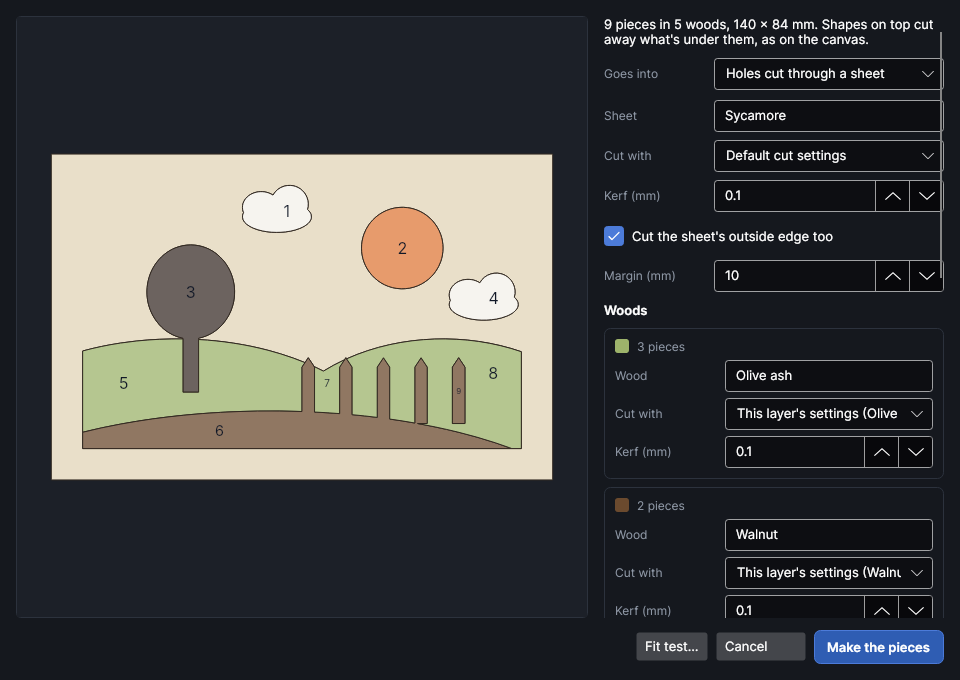
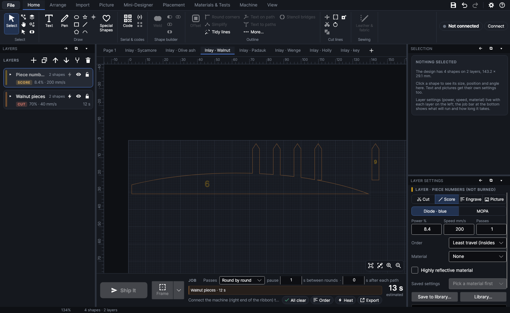

# Inlay and marquetry

An add-on (Settings → Add-ons → **Inlay and marquetry**): on when PhotonCanvas is installed, and can
be turned off. Its buttons are **Home → Cut lines → Inlay** and **Inlay and marquetry** in the
Tests window (**Materials & Tests → Tests**, under *Use your results*); **Inlay and marquetry…** is
on the right-click menu.

## Inlay and marquetry

<!-- windows: InlayWindow -->

Turns a design into pieces of different woods that fit together: veneer inlaid into a pocket in a
board, a marquetry picture cut into a background veneer, a thick piece set right through a board,
or just the pieces, to glue onto a backing. Each piece is cut with the wood's kerf allowed for, so
it comes out the size it's drawn, and every joint gets the same small gap, shared between its two
sides.

Draw the picture with closed shapes, **one layer for each wood** (the layer's colour stands for the
wood). Shapes on top cut away what's under them, just as they look on the canvas: a sky drawn as a
rectangle with a sun on top becomes a sun and a sky with a sun-shaped hole. Touching shapes on one
layer join into one piece. Select the shapes and click **Inlay**.

The preview shows the pieces in their woods' colours with their numbers, on the board (the pocket
shaded) or the sheet the holes are cut in. Hover a piece to see its number, wood and size; scroll to
zoom, drag with the right button to move, double-click to see it all.

| Setting | What it does |
|---|---|
| **Goes into** | **A pocket engraved in a board** (veneer inlay), **Holes cut through a sheet** (a background veneer for marquetry, or a board as thick as the pieces for a through inlay) or **Nothing: the pieces fit each other** (glue them onto a backing). |
| **Pieces (mm)** | Pocket only. How thick the pieces are: measure the veneer with calipers. The pocket goes this deep. Picking a cut recipe of a material with a thickness fills it in. |
| **Engrave with** | Pocket only. The pocket's settings: **Default engrave settings**, or one of your recipes with an etch rate (from the **Etch rate** test). |
| **Depth a pass (mm)** | Pocket only. How deep one pass goes in the board, filled in from the etch-rate recipe. Without one it's a guess, and the pieces may sit proud or sunk. |
| **Sheet** | Holes only. What the holes are cut in (it names its page). |
| **Cut with**, **Kerf (mm)** | For the sheet and for each wood: the cut settings (the layer's own when it's a Cut layer, the default, or a cut recipe from your library) and how wide the cut is. A cut recipe brings its kerf with it; the **Kerf gauge** test measures it. |
| **Cut the sheet's outside edge too** | Holes only. Ticked (default): the sheet is cut out round the picture, **Margin (mm)** away (a background veneer). Unticked: only the holes are cut, in a bigger board. |
| **Wood** | Each layer's wood: its name (from the layer) names its page. The line above says how many pieces it has. |
| **Gap (mm)** | The gap at every joint: between two pieces, and between a piece and the pocket or hole (−0.3 to 0.5, default 0.05). 0.03–0.06 mm is snug for glue; 0 or a little below presses in tight. The **Fit test** finds yours. |
| **Turn the pieces over (cut them mirrored)** | A laser cut is wider at the top, so every piece is a little bigger underneath and every hole a little bigger on top. Ticked, the pieces are cut mirrored: turn each one over before putting it in, and its bigger side shows, so joints close up on the face and pieces wedge into holes like plugs. Ticked by itself for holes in a board; untick it for thin veneer if you like. |
| **Pack the pieces close together** | Each wood's pieces in rows close together, a new row where the bed's width runs out, instead of where they go in the picture. They're never turned, so the grain runs the same way. A **key** page shows where each number goes. |
| **Mark the pieces' numbers on them** | Light marks of each piece's number, on the side facing up when cut (the back, when they're turned over). Unticked, the numbers are only on screen. |

The lines under them say how many passes the pocket takes and how deep that comes out, how many
pages will be made, and anything to watch: pieces of one wood too close together to cut where they
are (tick **Pack the pieces close together**), pieces too thin to cut or under 0.8 mm across, and
slivers between shapes too small to be pieces.

### What it makes

**Make the pieces** adds pages after the one you're on (your design stays as it was, to show where
everything goes), each its own job:

- **Inlay · pocket**: the pocket, filled, the picture's outline half a gap bigger all round. Its
  passes are the thickness ÷ depth a pass, rounded up, each turned by the recipe's turn per pass
  (37° if it has none), so the floor comes out flat.
- **Inlay ·** the sheet's name: the holes, their cut lines half the sheet's kerf inside so they come
  out the drawn size, half a gap bigger. With the edge cut, the sheet's outline too. Where the
  picture rings round some of the sheet (the middle of an O), that middle drops out with the hole,
  so it's cut as a numbered piece of its own, where it is.
- **Inlay ·** each wood's name: its pieces, each cut half a kerf outside its edge (and half a kerf
  inside any hole in it) less half a gap. The layer's own kerf is 0, since it's drawn in. A
  **Piece numbers** layer holds the numbers: marked lightly before the cuts if you ticked that,
  otherwise only on screen.
- **Inlay · key** (packed pieces only): every piece where it goes, with its number. Nothing on it
  is burned.

Burn the pocket (or cut the sheet), then cut each wood's page from that wood. Put the pieces in by
their numbers, turned over if you ticked that, glue, and sand flush. Not yet tried on the machine.

## Fit test

**Fit test…** in the window makes a test of the settings in it: a row of star-shaped holes (or
pockets) in the sheet (or board), each a different gap bigger than the star, labelled with its gap
(−0.04 to +0.1 mm), and on a page of its own a star for each, cut from the first wood with its kerf
allowed for. A star has the sharp points and inside corners that are hardest to fit. With
**Nothing** chosen, the holes are cut in the first wood itself, in a strip.

Burn and cut both pages, push a star into each hole, and type the gap of the snuggest one that
still goes in into **Gap (mm)**. The window remembers it, with your other settings, for next time.

▶ [Inlay veneer into a board](tutorial:inlay-pocket)

## Tutorials

- [Inlay veneer into a board](tutorial:inlay-pocket)
- [Cut a marquetry picture](tutorial:marquetry)
- [Find the gap for your woods](tutorial:inlay-fit-test)
