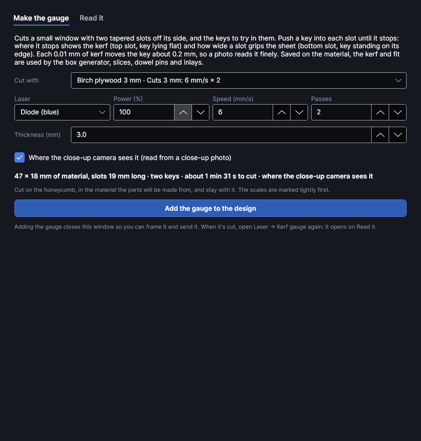
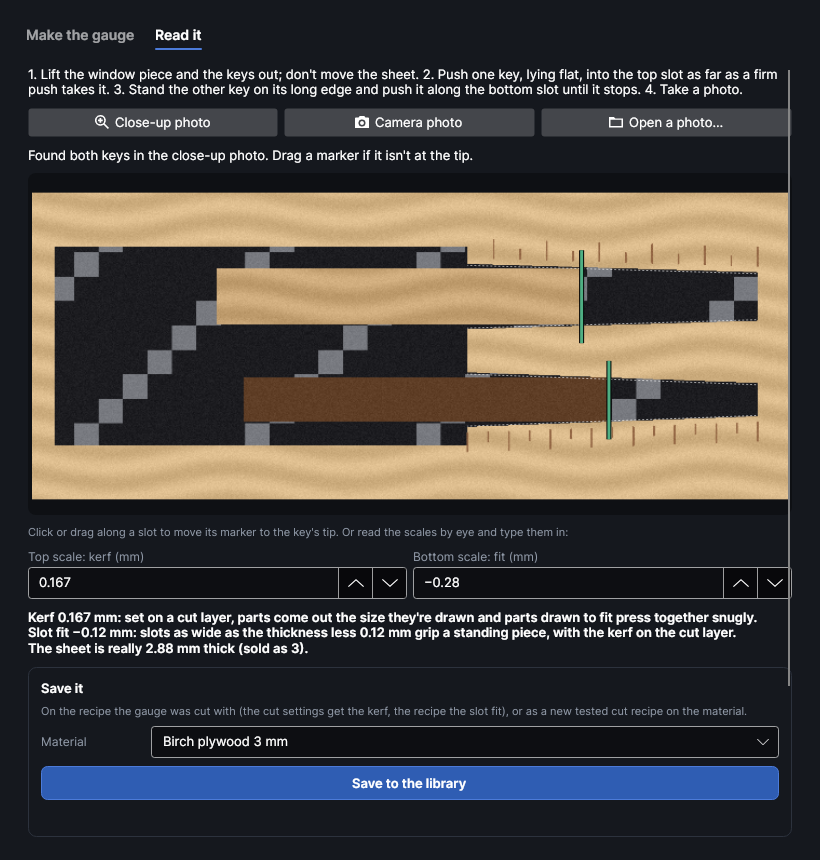

# Kerf gauge (fits first time)
<!-- windows: KerfGaugeWindow -->

An add-on (Settings → Add-ons → **Fits first time (kerf gauge)**): on when PhotonCanvas is installed,
and can be turned off or removed. Its button is **Laser → Tests → Kerf gauge**.

The beam takes a little material away along every cut: the **kerf**. A part comes out half a kerf
smaller all round and a hole half a kerf bigger, so a finger joint, a dowel hole or an inlay drawn to
fit comes out loose. Set the kerf on the cut layer and PhotonCanvas moves every outline to make up
for it ([Layer settings](layer-settings.md)). The **Kerf gauge** measures that kerf, and how wide a
slot grips your sheet, without calipers: a tiny test, two keys pushed in by hand, and a photo.

## How the gauge works

The gauge is a small window cut in the sheet with two slots off its side, and the keys to try in
them cut inside the window (they drop out with it). Each slot narrows steadily from its mouth to its
closed end.

- **Top slot (kerf):** push a key in **lying flat** as far as a firm push takes it. It stops where
  the slot (cut a kerf wider than drawn) is as wide as the key (cut a kerf narrower). The slot narrows
  only 1.1 mm over its whole length, so every 0.01 mm of kerf moves the key's tip about 0.2 mm
  (with 12 mm slots): plain to see, and plain to a photo. The scale above it reads the kerf in mm,
  from 0 to 0.5.
- **Bottom slot (fit):** stand the other key **on its long edge** and push it along the slot until
  it stops. It stops where the slot is as wide as the sheet really is, which gives the slot width for
  slotted builds (egg-crate, crossed slices) and the sheet's real thickness. The scale under it reads
  the slot's drawn width less the thickness, from +0.4 to −1 mm. Sheets under 1.5 mm have only the top
  slot.

Because the reading is a position along a slot whose ends are known, it doesn't depend on the
camera's scale, and the sheet never moves after cutting.

## Make the gauge

1. **Cut with**: the cut settings to measure. Pick a cut recipe from your
   [material library](material-library.md) (the result goes back onto it), a cut layer in the
   design, or **Type them in**. Use settings that cut right through cleanly (the
   [cut test](materials-and-tests.md) finds them).
2. **Laser**, **Power (%)**, **Speed (mm/s)** and **Passes** show the settings and can be changed (a
   changed recipe is saved as a new recipe).
3. **Thickness (mm)**: what the sheet is sold as. The bottom slot is drawn around it.
4. **Where the close-up camera sees it** (on when the close-up camera's position is known at this
   focus height, see [Camera](camera.md)): the gauge goes in the middle of what the close-up camera
   sees, its slots as long as fit (8 to 20 mm). Off: in the middle of the bed, 14 mm slots.
5. The line under it gives the gauge's size, the keys, and the time to cut.
6. **Add the gauge to the design**. Two layers are added: "Kerf gauge marks" (the scales, scored
   lightly, first) and "Kerf gauge" (the keys, then the window, with no kerf allowance). An older gauge
   in the design is replaced. The window closes: frame and send as usual.

## Read it

When the job finishes, the window opens again on **Read it** (or open **Kerf gauge** again). While a gauge is in the design, the work area outlines where the close-up camera looks.

1. Lift out the window piece and the keys. **Don't move the sheet.**
2. Push one key, lying flat, into the top slot as far as a firm push takes it.
3. Stand the other key on its long edge and push it along the bottom slot until it stops.
4. Take a photo:
   - **Close-up photo**: the close-up camera, laid on the bed. The sharpest; nothing moves.
   - **Camera photo**: the overview camera. Coarser: check the markers.
   - **Open a photo…**: any photo of the gauge taken square on, such as a phone held over it. Then
     click the middle of the top slot's mouth (where it opens into the window), and the middle of its
     closed end.

The gauge's part of the photo is shown laid straight, with the slots outlined. PhotonCanvas first
lines the mouth up with the window's edge in the photo (which makes up for a camera position or a
click that's a little off), then looks along each slot for where the key ends and the open slot
begins. A green marker across the slot is a clear find; orange means check it. **Click or drag
along a slot** to move its marker to the key's tip.

You can also read the scales by eye and type them in: **Top scale: kerf (mm)** and **Bottom scale:
fit (mm)**. They follow the markers, and the markers follow them.

What it says:

- **Kerf**: set on a cut layer, parts come out the size they're drawn, and parts drawn to fit press
  together snugly. A key at the very end of its slot means the kerf is off the scale.
- **Slot fit**: slots as wide as the thickness plus this grip a standing piece, with the kerf on the
  cut layer. This is what the slicer's slot fit is.
- **The sheet is really … mm thick**: the standing key's real thickness.

## Save it and use it

- **Material**, **Save to the library**: on the recipe the gauge was cut from, the cut settings get
  the kerf and the recipe the slot fit; with no such recipe on that material, a new tested cut recipe
  is added. The photo of the keys in their slots is kept with the recipe, and the notes say what was
  read.
- From the library the kerf and fit go into: the box generator's **Cut with** (finger joints, see
  [Drawing](drawing.md)), the 3D to slices add-on's cut and dowel-pin settings, and
  the Material tests add-on's **Inlay** (its **Cut with**), see [Materials and tests](materials-and-tests.md).
- **Layer**, **Put the kerf on this layer**: sets the kerf on a cut layer in this design straight away.
- **Remove the gauge from the design**: deletes its two layers.

> **Tip:** The kerf changes with the settings, the focus and the material. Make a gauge for each cut
> recipe you build things with, and again after changing the focus or the lens.
