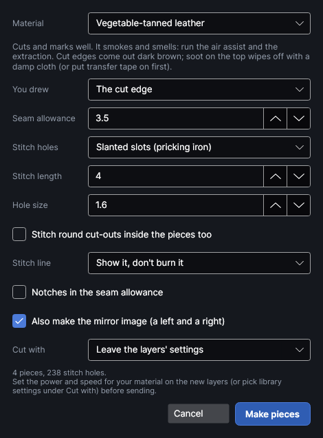
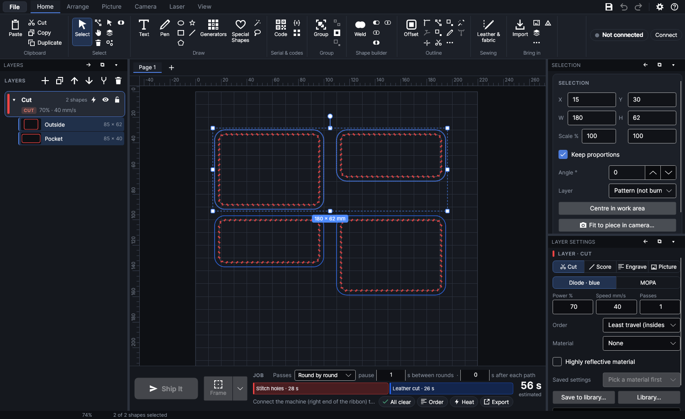

# Leather and fabric

An add-on (Settings → Add-ons → **Leather and fabric**): on when PhotonCanvas is installed, and can be
turned off. Its button is **Home → Sewing → Leather & fabric**, and **Leather and fabric pieces…** is on
the right-click menu and in the command search.

It turns the outlines of pieces for sewn goods (wallets, pouches, bags, patches, clothing, plush
toys) into everything the laser needs: the cut edge and the stitch line a seam allowance apart,
stitch holes along the stitch line for sewing by hand, notches for lining pieces up, and the mirror
image of each piece when you need a left and a right.

## Making pieces

<!-- windows: SewnPatternWindow -->

Draw or import the outline of each piece, select them all, and click **Leather & fabric**. The pieces
show on the work area as you change the settings; **Make pieces** keeps them and **Cancel** puts the
design back as it was.

| Setting | What it does |
|---|---|
| **Material** | What the pieces are cut from. Changing it sets the usual settings for it (below), and the line under it says what to watch out for. |
| **You drew** | **The cut edge**: the outline is where the material is cut and the stitching goes inside it (the usual way for leather). **The sewing line**: the outline is where it is sewn and the cut edge goes outside it (the usual way for sewing patterns). |
| **Seam allowance** | From the cut edge to the stitch line, 0.5–50 mm. Leather is usually stitched 3–4 mm in from the edge; sewing patterns use 10 mm, or 15 mm (5/8"). |
| **Stitch holes** | **None** (for sewing by machine), **Round holes** (like a punch or an awl), **Slanted slots (pricking iron)** or **Diamonds (diamond chisel)**. Slots and diamonds lean 45° from the stitch line, the way an iron's teeth do. |
| **Stitch length** | From one hole to the next, 1–30 mm. Pricking irons are commonly 2.7, 3, 3.38, 3.85, 4 or 5 mm apart. |
| **Hole size** | Round holes: their diameter. Slots and diamonds: their length (slots are 0.38 times as wide, at least 0.3 mm; diamonds 0.45 times). |
| **Stitch round cut-outs inside the pieces too** | Also stitches round holes inside a piece (a window in a card holder, a slot). Off, only the outer edge of each piece is stitched. |
| **Stitch line** | **Show it, don't burn it**: on the Pattern layer, for seeing where the stitching goes. **Burn a light groove**: on a Score layer, like a stitching groover, so the thread sits below the surface of leather. Not for fabric: it would burn through. |
| **Notches in the seam allowance** | Short cuts from the edge in to half the seam allowance (3 mm at most), in the middle of each side (four, evenly round, on a round piece), for matching pieces up before sewing. |
| **Also make the mirror image (a left and a right)** | Every piece again, flipped left to right, 5 mm to the right of the pieces (or below them when there isn't room on the work area). |
| **Cut with** | Settings from your [material library](material-library.md) for the cut and hole layers: the cut recipes of your **Leather** or **Fabric** materials. **Leave the layers' settings** changes nothing on them. |

The line above the buttons gives how many pieces and stitch holes there are, and anything to fix: a
piece too narrow for the seam allowance on both sides (it gets no stitch line or holes), holes so big
they reach the cut edge, or pieces off the work area.

### Where the holes go

There is a hole in every corner (wherever the stitch line bends by more than 35°), and the holes
between two corners are spaced evenly, as close to **Stitch length** as a whole number of stitches
allows: a 32 mm side at 4 mm gets exactly 8 stitches, a 30 mm side gets 7 of 4.29 mm. A round piece
with no corners is spaced evenly all the way round. So the stitching always turns a corner on a hole,
and two pieces sewn together with the same outline get the same number of holes.

To stitch only some edges (the top of a pocket stays open, say), make the piece with **Stitch holes**
set to **None**, then draw the stitching as an open line with the **Line** or **Pen** tool, select only
that line and make it a piece of its own with holes. An open line is a stitch line by itself: holes
from one end to the other, nothing cut.

### Materials

| Material | Usual settings | Watch out for |
|---|---|---|
| **Vegetable-tanned leather** | You drew the cut edge, 3.5 mm in, slanted slots 4 mm apart | Smoke and smell: air assist and extraction. Edges come out dark brown; soot wipes off (or put transfer tape on first). |
| **Chrome-tanned leather** | The same | Most soft, coloured leather is chrome-tanned. Lasered, it can give off hexavalent chromium, which causes cancer: best not lasered, and if at all, only with the extraction vented outdoors. The job's checks warn about it. |
| **Faux leather (PU)** | The same | Harmful fumes: only with the extraction vented outdoors. Make sure it isn't PVC. |
| **Vinyl or PVC faux leather** | Nothing is made | Never laser PVC: it gives off chlorine gas that harms your lungs and eats the machine. **Make pieces** stays greyed out. |
| **Cotton, linen, canvas or denim** | You drew the sewing line, 10 mm allowance, no holes, notches | Chars slightly and can catch fire: air assist on, never leave it running. |
| **Polyester, nylon or fleece** | The same | Edges melt and seal, so they don't fray. Coated and waterproof fabrics are often PVC-coated. |
| **Wool, felt or silk** | The same | A smell of burnt hair; acrylic craft felt melts at the edge instead. |
| **Something else** | As for leather | Find out what it is first. |

> **Safety:** Never leave the machine while it cuts leather or fabric: both can catch fire. Keep the air assist and the extraction on.

## What goes in the design

Each drawn outline stays where it was, moved onto a **Pattern (not burned)** layer: it is the piece's
master, and its settings are saved on it. What is made from it goes on these layers, made the first
time and used again after:

| Layer | Holds |
|---|---|
| **Stitching groove** (Score) | The stitch lines, when **Stitch line** is **Burn a light groove**. |
| **Stitch holes** (Cut) | The stitch holes and notches. It runs before the cut layer, so the pieces are still held by the sheet while their holes are made. |
| **Leather cut** or **Fabric cut** (Cut) | The cut edges. |
| **Pattern (not burned)** | The drawn outlines, and the stitch lines when they are only shown. |

Everything of one piece is grouped, so it moves together. New layers start at the program's usual
Cut settings: set the power and speed for your material on them, or pick **Cut with**. The hole layer
gets the recipe's power and speed but no kerf, tabs or lead-in.

To change a piece later, select it (or anything made from it) and click **Leather & fabric** again:
the window opens with the piece's own settings, and **Make pieces** replaces what was made before.

The job's checks warn when pieces are marked as chrome-tanned leather or PU, and when the Stitch
holes layer has been moved below the cut layer.

### Tips

- Hold fabric flat: tape its edges down, or pin or magnet it to the honeycomb. Leather that curls
  can be weighted at the corners outside the pieces.
- Try a scrap first ([test grid](materials-and-tests.md#test-grid)), then save the settings that worked as a
  cut recipe of a **Leather** or **Fabric** material so **Cut with** offers them next time.
- A diode or CO2 laser cuts leather and fabric; a fiber laser marks leather but doesn't cut it well.

## Tutorials

- [Make leather or fabric pieces](tutorial:sew-leather-fabric)
